# Buttons

Buttons group the clickable controls: plain push buttons, toggles, checks, radios, switches, and the Lazarus-style button family. Most of them fire `on_click`; the stateful ones add a `void(bool)` toggled/changed signal.

> Every widget here shares the common XFrame widget API — same constructor, set_bounds/draw/event handlers, visible/enabled state. The shared contract is documented in docs/index.md (written by the coordinator). Each subsection below lists only what is specific to that widget.

## GtkButton

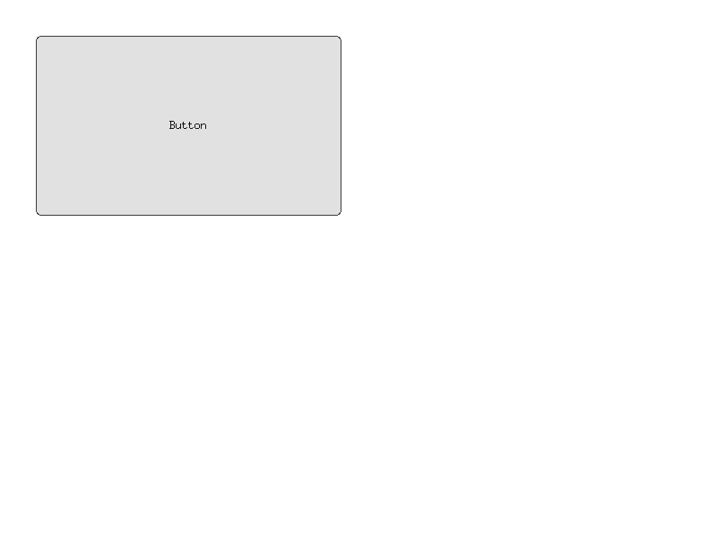

A rounded, polished push button with a centred caption. It draws sunken (fill and outline swapped) while held down and shows a focus rectangle once focused.

**Constructor:** `GtkButton(Display* display, int screen, Window window, GC gc, SStyle_Manager* styles, int x, int y, int width, int height)`

**API** (widget-specific methods/properties/signals ONLY — skip the common ones):

- `set_text(std::string t)` / `get_text()` — the caption (default `"Button"`)

- signal `on_click` (`std::function<void()>`) — fires on release inside the button, or on Return/Space while focused

**Example:**

```cpp
#include "GtkButton.h"

#include <cstdio>

int main()
{
    Display* display = XOpenDisplay(nullptr);
    if (!display) { return 1; }
    int screen = DefaultScreen(display);
    Window window = XCreateSimpleWindow(display, RootWindow(display, screen), 100, 100, 800, 600, 1, BlackPixel(display, screen), WhitePixel(display, screen));
    XStoreName(display, window, "GtkButton - XFrame demo");
    XSelectInput(display, window, ExposureMask | KeyPressMask | StructureNotifyMask | ButtonPressMask | ButtonReleaseMask | PointerMotionMask);
    Atom deleteWindowMessage = XInternAtom(display, "WM_DELETE_WINDOW", False);
    XSetWMProtocols(display, window, &deleteWindowMessage, 1);
    XMapWindow(display, window);
    GC gc = DefaultGC(display, screen);
    SStyle_Manager styles(display, window, screen, gc);
    styles.add_style_ex("default", Srgb{225, 225, 225}, Srgb{120, 120, 120}, Srgb{60, 60, 60}, Srgb{20, 20, 20}, 6, 1, "-misc-fixed-medium-r-normal--13-*");
    styles.set_active_style_byName("default");
    GtkButton widget(display, screen, window, gc, &styles, 40, 40, 280, 36);
    widget.set_text("Click me");
    widget.on_click = [] { std::printf("clicked\n"); };
    widget.draw();
    bool running = true;
    while (running)
    {
        XEvent event;
        XNextEvent(display, &event);
        bool handled = false;
        switch (event.type)
        {
        case Expose:
            handled = true;
            break;
        case ButtonPress:
            handled = widget.on_button_press(event.xbutton.x, event.xbutton.y, event.xbutton.button);
            break;
        case ButtonRelease:
            handled = widget.on_button_release(event.xbutton.x, event.xbutton.y, event.xbutton.button);
            break;
        case MotionNotify:
            handled = widget.on_motion(event.xmotion.x, event.xmotion.y);
            break;
        case KeyPress:
        {
            char buffer[32];
            KeySym key = 0;
            int n = XLookupString(&event.xkey, buffer, (int)sizeof(buffer) - 1, &key, nullptr);
            buffer[n] = 0;
            handled = widget.on_key(key, buffer);
            break;
        }
        case ClientMessage:
            if ((Atom)event.xclient.data.l[0] == deleteWindowMessage)
            {
                running = false;
            }
            break;
        }
        if (handled)
        {
            XClearWindow(display, window);
            widget.draw();
            XFlush(display);
        }
    }
    XCloseDisplay(display);
    return 0;
}
```

## GtkCheckButton


A check box: a 15x15 indicator box at the left and a caption beside it. The box shows a checkmark when active and a dash through the middle when inconsistent.

**Constructor:** `GtkCheckButton(Display* display, int screen, Window window, GC gc, SStyle_Manager* styles, int x, int y, int width, int height)`

**API** (widget-specific methods/properties/signals ONLY — skip the common ones):

- `set_text(std::string t)` / `get_text()` — the caption (default `"Check me"`)

- `set_active(bool a)` / `get_active()` — ticked state (default `true`, so a bare demo shows the mark); setting it fires `on_toggled`

- `set_inconsistent(bool i)` / `get_inconsistent()` — the mixed/dash state

- signal `on_click` (`std::function<void()>`) — fires on click

- signal `on_toggled` (`std::function<void(bool)>`) — fires with the new state whenever the state changes

**Example:**

```cpp
#include "GtkCheckButton.h"

#include <cstdio>

int main()
{
    Display* display = XOpenDisplay(nullptr);
    if (!display) { return 1; }
    int screen = DefaultScreen(display);
    Window window = XCreateSimpleWindow(display, RootWindow(display, screen), 100, 100, 800, 600, 1, BlackPixel(display, screen), WhitePixel(display, screen));
    XStoreName(display, window, "GtkCheckButton - XFrame demo");
    XSelectInput(display, window, ExposureMask | KeyPressMask | StructureNotifyMask | ButtonPressMask | ButtonReleaseMask | PointerMotionMask);
    Atom deleteWindowMessage = XInternAtom(display, "WM_DELETE_WINDOW", False);
    XSetWMProtocols(display, window, &deleteWindowMessage, 1);
    XMapWindow(display, window);
    GC gc = DefaultGC(display, screen);
    SStyle_Manager styles(display, window, screen, gc);
    styles.add_style_ex("default", Srgb{225, 225, 225}, Srgb{120, 120, 120}, Srgb{60, 60, 60}, Srgb{20, 20, 20}, 6, 1, "-misc-fixed-medium-r-normal--13-*");
    styles.set_active_style_byName("default");
    GtkCheckButton widget(display, screen, window, gc, &styles, 40, 40, 280, 36);
    widget.set_active(true);
    widget.on_toggled = [](bool active) { std::printf("toggled: %d\n", (int)active); };
    widget.draw();
    bool running = true;
    while (running)
    {
        XEvent event;
        XNextEvent(display, &event);
        bool handled = false;
        switch (event.type)
        {
        case Expose:
            handled = true;
            break;
        case ButtonPress:
            handled = widget.on_button_press(event.xbutton.x, event.xbutton.y, event.xbutton.button);
            break;
        case ButtonRelease:
            handled = widget.on_button_release(event.xbutton.x, event.xbutton.y, event.xbutton.button);
            break;
        case MotionNotify:
            handled = widget.on_motion(event.xmotion.x, event.xmotion.y);
            break;
        case KeyPress:
        {
            char buffer[32];
            KeySym key = 0;
            int n = XLookupString(&event.xkey, buffer, (int)sizeof(buffer) - 1, &key, nullptr);
            buffer[n] = 0;
            handled = widget.on_key(key, buffer);
            break;
        }
        case ClientMessage:
            if ((Atom)event.xclient.data.l[0] == deleteWindowMessage)
            {
                running = false;
            }
            break;
        }
        if (handled)
        {
            XClearWindow(display, window);
            widget.draw();
            XFlush(display);
        }
    }
    XCloseDisplay(display);
    return 0;
}
```

**Notes:** Clicking toggles the state. `on_motion` is a no-op (no hover state).

## GtkColorButton

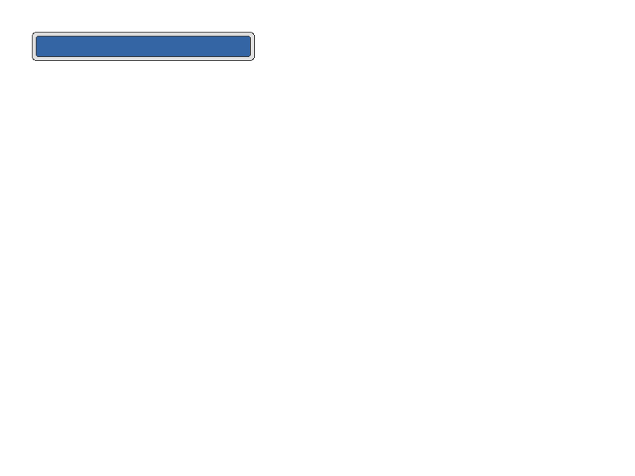

A polished button carrying a colour swatch: an inset rounded rectangle filled with the current colour. With a caption set, the swatch shrinks to a chip at the left and the caption sits beside it.

**Constructor:** `GtkColorButton(Display* display, int screen, Window window, GC gc, SStyle_Manager* styles, int x, int y, int width, int height)`

**API** (widget-specific methods/properties/signals ONLY — skip the common ones):

- `set_text(std::string t)` / `get_text()` — the caption (default `""`)

- `set_color(Srgb color)` / `get_color()` (`Srgb`) — the swatch colour (default `{52, 101, 164}`, a GTK-ish blue)

- `set_color_rgb(int r, int g, int b)` — same, from components

- signal `on_click` (`std::function<void()>`) — fires on click

- signal `on_color_set` (`std::function<void(Srgb)>`) — fires on click (and on Return/Space) with the current colour

**Example:**

```cpp
#include "GtkColorButton.h"

#include <cstdio>

int main()
{
    Display* display = XOpenDisplay(nullptr);
    if (!display) { return 1; }
    int screen = DefaultScreen(display);
    Window window = XCreateSimpleWindow(display, RootWindow(display, screen), 100, 100, 800, 600, 1, BlackPixel(display, screen), WhitePixel(display, screen));
    XStoreName(display, window, "GtkColorButton - XFrame demo");
    XSelectInput(display, window, ExposureMask | KeyPressMask | StructureNotifyMask | ButtonPressMask | ButtonReleaseMask | PointerMotionMask);
    Atom deleteWindowMessage = XInternAtom(display, "WM_DELETE_WINDOW", False);
    XSetWMProtocols(display, window, &deleteWindowMessage, 1);
    XMapWindow(display, window);
    GC gc = DefaultGC(display, screen);
    SStyle_Manager styles(display, window, screen, gc);
    styles.add_style_ex("default", Srgb{225, 225, 225}, Srgb{120, 120, 120}, Srgb{60, 60, 60}, Srgb{20, 20, 20}, 6, 1, "-misc-fixed-medium-r-normal--13-*");
    styles.set_active_style_byName("default");
    GtkColorButton widget(display, screen, window, gc, &styles, 40, 40, 280, 36);
    widget.set_color_rgb(200, 60, 40);
    widget.on_color_set = [](Srgb c) { std::printf("colour: %d %d %d\n", c.r, c.g, c.b); };
    widget.draw();
    bool running = true;
    while (running)
    {
        XEvent event;
        XNextEvent(display, &event);
        bool handled = false;
        switch (event.type)
        {
        case Expose:
            handled = true;
            break;
        case ButtonPress:
            handled = widget.on_button_press(event.xbutton.x, event.xbutton.y, event.xbutton.button);
            break;
        case ButtonRelease:
            handled = widget.on_button_release(event.xbutton.x, event.xbutton.y, event.xbutton.button);
            break;
        case MotionNotify:
            handled = widget.on_motion(event.xmotion.x, event.xmotion.y);
            break;
        case KeyPress:
        {
            char buffer[32];
            KeySym key = 0;
            int n = XLookupString(&event.xkey, buffer, (int)sizeof(buffer) - 1, &key, nullptr);
            buffer[n] = 0;
            handled = widget.on_key(key, buffer);
            break;
        }
        case ClientMessage:
            if ((Atom)event.xclient.data.l[0] == deleteWindowMessage)
            {
                running = false;
            }
            break;
        }
        if (handled)
        {
            XClearWindow(display, window);
            widget.draw();
            XFlush(display);
        }
    }
    XCloseDisplay(display);
    return 0;
}
```

**Notes:** Clicking does not open a colour chooser dialog — there is none in this framework; the callback simply reports the colour that is already set.

## GtkColorDialogButton

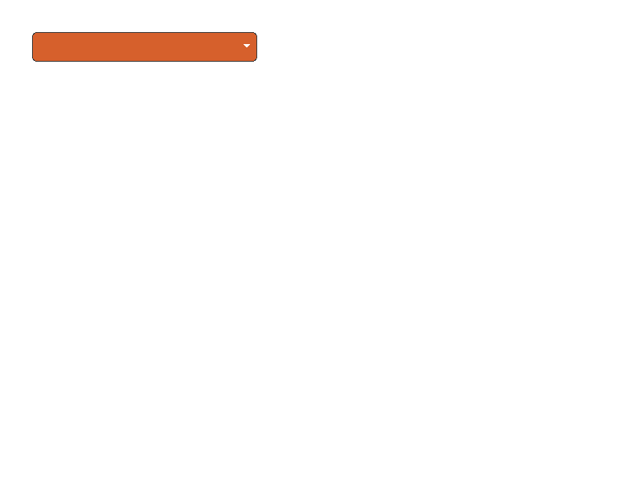

A colour button whose whole face is filled with the current colour, with a small dropdown triangle at the right — dark on a light colour, white on a dark one (by rough luminance).

**Constructor:** `GtkColorDialogButton(Display* display, int screen, Window window, GC gc, SStyle_Manager* styles, int x, int y, int width, int height)`

**API** (widget-specific methods/properties/signals ONLY — skip the common ones):

- `set_text(std::string t)` / `get_text()` — the caption (default `""`, not drawn; the face is all swatch)

- `set_color(Srgb color)` / `get_color()` (`Srgb`) — the face colour (default `{214, 96, 44}`, a warm orange)

- `set_color_rgb(int r, int g, int b)` — same, from components

- signal `on_click` (`std::function<void()>`) — fires on click

- signal `on_color_set` (`std::function<void(Srgb)>`) — fires on click with the current colour

**Example:**

```cpp
#include "GtkColorDialogButton.h"

#include <cstdio>

int main()
{
    Display* display = XOpenDisplay(nullptr);
    if (!display) { return 1; }
    int screen = DefaultScreen(display);
    Window window = XCreateSimpleWindow(display, RootWindow(display, screen), 100, 100, 800, 600, 1, BlackPixel(display, screen), WhitePixel(display, screen));
    XStoreName(display, window, "GtkColorDialogButton - XFrame demo");
    XSelectInput(display, window, ExposureMask | KeyPressMask | StructureNotifyMask | ButtonPressMask | ButtonReleaseMask | PointerMotionMask);
    Atom deleteWindowMessage = XInternAtom(display, "WM_DELETE_WINDOW", False);
    XSetWMProtocols(display, window, &deleteWindowMessage, 1);
    XMapWindow(display, window);
    GC gc = DefaultGC(display, screen);
    SStyle_Manager styles(display, window, screen, gc);
    styles.add_style_ex("default", Srgb{225, 225, 225}, Srgb{120, 120, 120}, Srgb{60, 60, 60}, Srgb{20, 20, 20}, 6, 1, "-misc-fixed-medium-r-normal--13-*");
    styles.set_active_style_byName("default");
    GtkColorDialogButton widget(display, screen, window, gc, &styles, 40, 40, 280, 36);
    widget.set_color_rgb(214, 96, 44);
    widget.on_color_set = [](Srgb c) { std::printf("colour: %d %d %d\n", c.r, c.g, c.b); };
    widget.draw();
    bool running = true;
    while (running)
    {
        XEvent event;
        XNextEvent(display, &event);
        bool handled = false;
        switch (event.type)
        {
        case Expose:
            handled = true;
            break;
        case ButtonPress:
            handled = widget.on_button_press(event.xbutton.x, event.xbutton.y, event.xbutton.button);
            break;
        case ButtonRelease:
            handled = widget.on_button_release(event.xbutton.x, event.xbutton.y, event.xbutton.button);
            break;
        case MotionNotify:
            handled = widget.on_motion(event.xmotion.x, event.xmotion.y);
            break;
        case KeyPress:
        {
            char buffer[32];
            KeySym key = 0;
            int n = XLookupString(&event.xkey, buffer, (int)sizeof(buffer) - 1, &key, nullptr);
            buffer[n] = 0;
            handled = widget.on_key(key, buffer);
            break;
        }
        case ClientMessage:
            if ((Atom)event.xclient.data.l[0] == deleteWindowMessage)
            {
                running = false;
            }
            break;
        }
        if (handled)
        {
            XClearWindow(display, window);
            widget.draw();
            XFlush(display);
        }
    }
    XCloseDisplay(display);
    return 0;
}
```

**Notes:** Clicking does not open a colour dialog — there is none in this framework; the callback simply reports the colour that is already set.

## GtkFileChooserButton

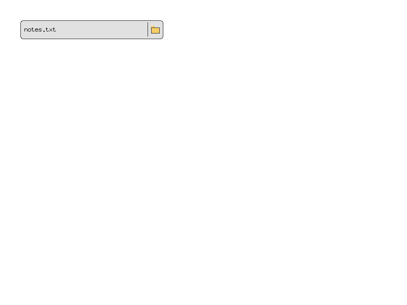

A polished button showing the file name at the left and a folder glyph in a separated 30px zone at the right.

**Constructor:** `GtkFileChooserButton(Display* display, int screen, Window window, GC gc, SStyle_Manager* styles, int x, int y, int width, int height)`

**API** (widget-specific methods/properties/signals ONLY — skip the common ones):

- `set_text(std::string t)` / `get_text()` — the displayed name; mirrors the file name (default `"notes.txt"`)

- `set_filename(std::string filename)` / `get_filename()` — the chosen file (default `"notes.txt"`)

- `set_title(std::string title)` / `get_title()` — the dialog title (default `"Select a File"`, stored only)

- signal `on_click` (`std::function<void()>`) — fires on click

- signal `on_file_set` (`std::function<void(std::string)>`) — fires on click with the current file name

**Example:**

```cpp
#include "GtkFileChooserButton.h"

#include <cstdio>

int main()
{
    Display* display = XOpenDisplay(nullptr);
    if (!display) { return 1; }
    int screen = DefaultScreen(display);
    Window window = XCreateSimpleWindow(display, RootWindow(display, screen), 100, 100, 800, 600, 1, BlackPixel(display, screen), WhitePixel(display, screen));
    XStoreName(display, window, "GtkFileChooserButton - XFrame demo");
    XSelectInput(display, window, ExposureMask | KeyPressMask | StructureNotifyMask | ButtonPressMask | ButtonReleaseMask | PointerMotionMask);
    Atom deleteWindowMessage = XInternAtom(display, "WM_DELETE_WINDOW", False);
    XSetWMProtocols(display, window, &deleteWindowMessage, 1);
    XMapWindow(display, window);
    GC gc = DefaultGC(display, screen);
    SStyle_Manager styles(display, window, screen, gc);
    styles.add_style_ex("default", Srgb{225, 225, 225}, Srgb{120, 120, 120}, Srgb{60, 60, 60}, Srgb{20, 20, 20}, 6, 1, "-misc-fixed-medium-r-normal--13-*");
    styles.set_active_style_byName("default");
    GtkFileChooserButton widget(display, screen, window, gc, &styles, 40, 40, 280, 36);
    widget.set_filename("notes.txt");
    widget.on_file_set = [](std::string f) { std::printf("file: %s\n", f.c_str()); };
    widget.draw();
    bool running = true;
    while (running)
    {
        XEvent event;
        XNextEvent(display, &event);
        bool handled = false;
        switch (event.type)
        {
        case Expose:
            handled = true;
            break;
        case ButtonPress:
            handled = widget.on_button_press(event.xbutton.x, event.xbutton.y, event.xbutton.button);
            break;
        case ButtonRelease:
            handled = widget.on_button_release(event.xbutton.x, event.xbutton.y, event.xbutton.button);
            break;
        case MotionNotify:
            handled = widget.on_motion(event.xmotion.x, event.xmotion.y);
            break;
        case KeyPress:
        {
            char buffer[32];
            KeySym key = 0;
            int n = XLookupString(&event.xkey, buffer, (int)sizeof(buffer) - 1, &key, nullptr);
            buffer[n] = 0;
            handled = widget.on_key(key, buffer);
            break;
        }
        case ClientMessage:
            if ((Atom)event.xclient.data.l[0] == deleteWindowMessage)
            {
                running = false;
            }
            break;
        }
        if (handled)
        {
            XClearWindow(display, window);
            widget.draw();
            XFlush(display);
        }
    }
    XCloseDisplay(display);
    return 0;
}
```

**Notes:** Clicking does not open a file chooser dialog — there is none in this framework; the callback simply reports the file name that is already set.

## GtkFontButton


A polished button whose face shows the font description, e.g. `"Sans 12"` — the real button previews the font itself, and the description is the fallback.

**Constructor:** `GtkFontButton(Display* display, int screen, Window window, GC gc, SStyle_Manager* styles, int x, int y, int width, int height)`

**API** (widget-specific methods/properties/signals ONLY — skip the common ones):

- `set_text(std::string t)` / `get_text()` — the face text (default the font description, `"Sans 12"`)

- `set_font_name(std::string name)` / `get_font_name()` — the family (default `"Sans"`)

- `set_font_size(int size)` / `get_font_size()` — the size in points (default `12`)

- `get_font_desc()` — `"<family> <size>"`; `set_font_desc(std::string desc)` — parses a description back into family and size (the last word counts as the size when it is all digits)

- signal `on_click` (`std::function<void()>`) — fires on click

- signal `on_font_set` (`std::function<void(std::string)>`) — fires on click (and on Return/Space) with the font description

**Example:**

```cpp
#include "GtkFontButton.h"

#include <cstdio>

int main()
{
    Display* display = XOpenDisplay(nullptr);
    if (!display) { return 1; }
    int screen = DefaultScreen(display);
    Window window = XCreateSimpleWindow(display, RootWindow(display, screen), 100, 100, 800, 600, 1, BlackPixel(display, screen), WhitePixel(display, screen));
    XStoreName(display, window, "GtkFontButton - XFrame demo");
    XSelectInput(display, window, ExposureMask | KeyPressMask | StructureNotifyMask | ButtonPressMask | ButtonReleaseMask | PointerMotionMask);
    Atom deleteWindowMessage = XInternAtom(display, "WM_DELETE_WINDOW", False);
    XSetWMProtocols(display, window, &deleteWindowMessage, 1);
    XMapWindow(display, window);
    GC gc = DefaultGC(display, screen);
    SStyle_Manager styles(display, window, screen, gc);
    styles.add_style_ex("default", Srgb{225, 225, 225}, Srgb{120, 120, 120}, Srgb{60, 60, 60}, Srgb{20, 20, 20}, 6, 1, "-misc-fixed-medium-r-normal--13-*");
    styles.set_active_style_byName("default");
    GtkFontButton widget(display, screen, window, gc, &styles, 40, 40, 280, 36);
    widget.set_font_name("Sans");
    widget.set_font_size(12);
    widget.on_font_set = [](std::string desc) { std::printf("font: %s\n", desc.c_str()); };
    widget.draw();
    bool running = true;
    while (running)
    {
        XEvent event;
        XNextEvent(display, &event);
        bool handled = false;
        switch (event.type)
        {
        case Expose:
            handled = true;
            break;
        case ButtonPress:
            handled = widget.on_button_press(event.xbutton.x, event.xbutton.y, event.xbutton.button);
            break;
        case ButtonRelease:
            handled = widget.on_button_release(event.xbutton.x, event.xbutton.y, event.xbutton.button);
            break;
        case MotionNotify:
            handled = widget.on_motion(event.xmotion.x, event.xmotion.y);
            break;
        case KeyPress:
        {
            char buffer[32];
            KeySym key = 0;
            int n = XLookupString(&event.xkey, buffer, (int)sizeof(buffer) - 1, &key, nullptr);
            buffer[n] = 0;
            handled = widget.on_key(key, buffer);
            break;
        }
        case ClientMessage:
            if ((Atom)event.xclient.data.l[0] == deleteWindowMessage)
            {
                running = false;
            }
            break;
        }
        if (handled)
        {
            XClearWindow(display, window);
            widget.draw();
            XFlush(display);
        }
    }
    XCloseDisplay(display);
    return 0;
}
```

**Notes:** Clicking does not open a font chooser dialog — there is none in this framework; the callback simply reports the description that is already set.

## GtkLinkButton

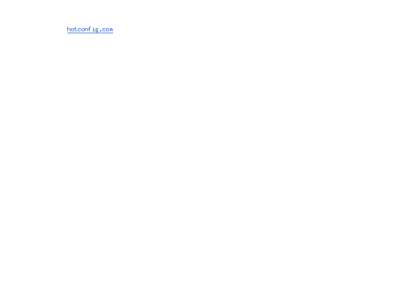

A borderless underlined link, centred. Blue normally, purple once visited, brighter blue on hover, grey when disabled. Clicking marks it visited.

**Constructor:** `GtkLinkButton(Display* display, int screen, Window window, GC gc, SStyle_Manager* styles, int x, int y, int width, int height)`

**API** (widget-specific methods/properties/signals ONLY — skip the common ones):

- `set_text(std::string t)` / `get_text()` — the link text (default `"hotconfig.com"`)

- `set_uri(std::string uri)` / `get_uri()` — the target (default `"https://www.hotconfig.com"`)

- `set_visited(bool v)` / `get_visited()` — the visited state

- signal `on_click` (`std::function<void()>`) — fires on click

**Example:**

```cpp
#include "GtkLinkButton.h"

#include <cstdio>

int main()
{
    Display* display = XOpenDisplay(nullptr);
    if (!display) { return 1; }
    int screen = DefaultScreen(display);
    Window window = XCreateSimpleWindow(display, RootWindow(display, screen), 100, 100, 800, 600, 1, BlackPixel(display, screen), WhitePixel(display, screen));
    XStoreName(display, window, "GtkLinkButton - XFrame demo");
    XSelectInput(display, window, ExposureMask | KeyPressMask | StructureNotifyMask | ButtonPressMask | ButtonReleaseMask | PointerMotionMask);
    Atom deleteWindowMessage = XInternAtom(display, "WM_DELETE_WINDOW", False);
    XSetWMProtocols(display, window, &deleteWindowMessage, 1);
    XMapWindow(display, window);
    GC gc = DefaultGC(display, screen);
    SStyle_Manager styles(display, window, screen, gc);
    styles.add_style_ex("default", Srgb{225, 225, 225}, Srgb{120, 120, 120}, Srgb{60, 60, 60}, Srgb{20, 20, 20}, 6, 1, "-misc-fixed-medium-r-normal--13-*");
    styles.set_active_style_byName("default");
    GtkLinkButton widget(display, screen, window, gc, &styles, 40, 40, 280, 36);
    widget.set_uri("https://www.hotconfig.com");
    widget.on_click = [] { std::printf("link clicked\n"); };
    widget.draw();
    bool running = true;
    while (running)
    {
        XEvent event;
        XNextEvent(display, &event);
        bool handled = false;
        switch (event.type)
        {
        case Expose:
            handled = true;
            break;
        case ButtonPress:
            handled = widget.on_button_press(event.xbutton.x, event.xbutton.y, event.xbutton.button);
            break;
        case ButtonRelease:
            handled = widget.on_button_release(event.xbutton.x, event.xbutton.y, event.xbutton.button);
            break;
        case MotionNotify:
            handled = widget.on_motion(event.xmotion.x, event.xmotion.y);
            break;
        case KeyPress:
        {
            char buffer[32];
            KeySym key = 0;
            int n = XLookupString(&event.xkey, buffer, (int)sizeof(buffer) - 1, &key, nullptr);
            buffer[n] = 0;
            handled = widget.on_key(key, buffer);
            break;
        }
        case ClientMessage:
            if ((Atom)event.xclient.data.l[0] == deleteWindowMessage)
            {
                running = false;
            }
            break;
        }
        if (handled)
        {
            XClearWindow(display, window);
            widget.draw();
            XFlush(display);
        }
    }
    XCloseDisplay(display);
    return 0;
}
```

**Notes:** One of the few widgets with real hover state: `on_motion` tracks whether the pointer is inside and the colour brightens. Clicking does not open a browser — the host must act on `on_click`/`get_uri()`.

## GtkLockButton

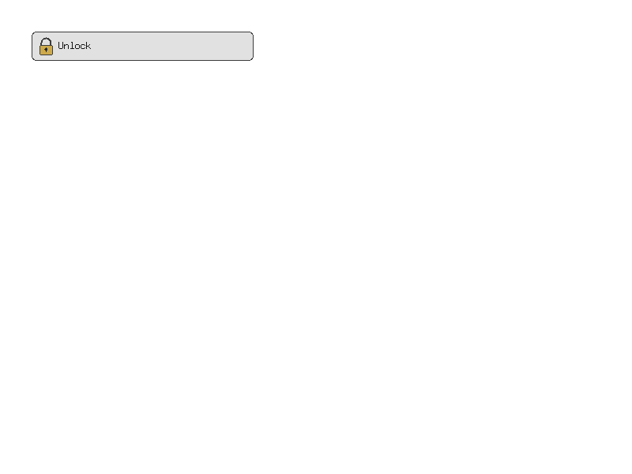

A polished button with a gold padlock glyph at the left. Locked, the shackle sits down on both sides; unlocked, it is raised with the right leg swung free. The caption follows the state.

**Constructor:** `GtkLockButton(Display* display, int screen, Window window, GC gc, SStyle_Manager* styles, int x, int y, int width, int height)`

**API** (widget-specific methods/properties/signals ONLY — skip the common ones):

- `set_text(std::string t)` / `get_text()` — the caption (default `"Unlock"`)

- `set_locked(bool locked)` / `get_locked()` — the lock state (default `true`); setting it also sets the caption to `"Unlock"` (locked) or `"Lock"` (unlocked)

- signal `on_click` (`std::function<void()>`) — fires on click

**Example:**

```cpp
#include "GtkLockButton.h"

#include <cstdio>

int main()
{
    Display* display = XOpenDisplay(nullptr);
    if (!display) { return 1; }
    int screen = DefaultScreen(display);
    Window window = XCreateSimpleWindow(display, RootWindow(display, screen), 100, 100, 800, 600, 1, BlackPixel(display, screen), WhitePixel(display, screen));
    XStoreName(display, window, "GtkLockButton - XFrame demo");
    XSelectInput(display, window, ExposureMask | KeyPressMask | StructureNotifyMask | ButtonPressMask | ButtonReleaseMask | PointerMotionMask);
    Atom deleteWindowMessage = XInternAtom(display, "WM_DELETE_WINDOW", False);
    XSetWMProtocols(display, window, &deleteWindowMessage, 1);
    XMapWindow(display, window);
    GC gc = DefaultGC(display, screen);
    SStyle_Manager styles(display, window, screen, gc);
    styles.add_style_ex("default", Srgb{225, 225, 225}, Srgb{120, 120, 120}, Srgb{60, 60, 60}, Srgb{20, 20, 20}, 6, 1, "-misc-fixed-medium-r-normal--13-*");
    styles.set_active_style_byName("default");
    GtkLockButton widget(display, screen, window, gc, &styles, 40, 40, 280, 36);
    widget.set_locked(true);
    widget.on_click = [] { std::printf("lock clicked\n"); };
    widget.draw();
    bool running = true;
    while (running)
    {
        XEvent event;
        XNextEvent(display, &event);
        bool handled = false;
        switch (event.type)
        {
        case Expose:
            handled = true;
            break;
        case ButtonPress:
            handled = widget.on_button_press(event.xbutton.x, event.xbutton.y, event.xbutton.button);
            break;
        case ButtonRelease:
            handled = widget.on_button_release(event.xbutton.x, event.xbutton.y, event.xbutton.button);
            break;
        case MotionNotify:
            handled = widget.on_motion(event.xmotion.x, event.xmotion.y);
            break;
        case KeyPress:
        {
            char buffer[32];
            KeySym key = 0;
            int n = XLookupString(&event.xkey, buffer, (int)sizeof(buffer) - 1, &key, nullptr);
            buffer[n] = 0;
            handled = widget.on_key(key, buffer);
            break;
        }
        case ClientMessage:
            if ((Atom)event.xclient.data.l[0] == deleteWindowMessage)
            {
                running = false;
            }
            break;
        }
        if (handled)
        {
            XClearWindow(display, window);
            widget.draw();
            XFlush(display);
        }
    }
    XCloseDisplay(display);
    return 0;
}
```

**Notes:** Clicking toggles the lock (`set_locked(!locked_)`) and then fires `on_click`. There is no permission/authentication backend — the state is purely visual.

## GtkModelButton


A flat menu row: it paints a background only while the pointer is over it, it is pressed, or it is focused. The indicator slot at the left shows a checkmark (role 1), a radio dot (role 2), or nothing; an optional framed picture icon shifts the text right.

**Constructor:** `GtkModelButton(Display* display, int screen, Window window, GC gc, SStyle_Manager* styles, int x, int y, int width, int height)`

**API** (widget-specific methods/properties/signals ONLY — skip the common ones):

- `set_text(std::string t)` / `get_text()` — the row label (default `"Menu Item"`)

- `set_role(int role)` / `get_role()` — 0 = plain item, 1 = check item, 2 = radio item (default `1`)

- `set_active(bool a)` / `get_active()` — the checked/selected state (default `true`)

- `set_icon_visible(bool v)` / `get_icon_visible()` — whether the picture icon is drawn (default `true`)

- signal `on_click` (`std::function<void()>`) — fires on click

**Example:**

```cpp
#include "GtkModelButton.h"

#include <cstdio>

int main()
{
    Display* display = XOpenDisplay(nullptr);
    if (!display) { return 1; }
    int screen = DefaultScreen(display);
    Window window = XCreateSimpleWindow(display, RootWindow(display, screen), 100, 100, 800, 600, 1, BlackPixel(display, screen), WhitePixel(display, screen));
    XStoreName(display, window, "GtkModelButton - XFrame demo");
    XSelectInput(display, window, ExposureMask | KeyPressMask | StructureNotifyMask | ButtonPressMask | ButtonReleaseMask | PointerMotionMask);
    Atom deleteWindowMessage = XInternAtom(display, "WM_DELETE_WINDOW", False);
    XSetWMProtocols(display, window, &deleteWindowMessage, 1);
    XMapWindow(display, window);
    GC gc = DefaultGC(display, screen);
    SStyle_Manager styles(display, window, screen, gc);
    styles.add_style_ex("default", Srgb{225, 225, 225}, Srgb{120, 120, 120}, Srgb{60, 60, 60}, Srgb{20, 20, 20}, 6, 1, "-misc-fixed-medium-r-normal--13-*");
    styles.set_active_style_byName("default");
    GtkModelButton widget(display, screen, window, gc, &styles, 40, 40, 280, 36);
    widget.set_role(1);
    widget.set_active(true);
    widget.on_click = [] { std::printf("menu item clicked\n"); };
    widget.draw();
    bool running = true;
    while (running)
    {
        XEvent event;
        XNextEvent(display, &event);
        bool handled = false;
        switch (event.type)
        {
        case Expose:
            handled = true;
            break;
        case ButtonPress:
            handled = widget.on_button_press(event.xbutton.x, event.xbutton.y, event.xbutton.button);
            break;
        case ButtonRelease:
            handled = widget.on_button_release(event.xbutton.x, event.xbutton.y, event.xbutton.button);
            break;
        case MotionNotify:
            handled = widget.on_motion(event.xmotion.x, event.xmotion.y);
            break;
        case KeyPress:
        {
            char buffer[32];
            KeySym key = 0;
            int n = XLookupString(&event.xkey, buffer, (int)sizeof(buffer) - 1, &key, nullptr);
            buffer[n] = 0;
            handled = widget.on_key(key, buffer);
            break;
        }
        case ClientMessage:
            if ((Atom)event.xclient.data.l[0] == deleteWindowMessage)
            {
                running = false;
            }
            break;
        }
        if (handled)
        {
            XClearWindow(display, window);
            widget.draw();
            XFlush(display);
        }
    }
    XCloseDisplay(display);
    return 0;
}
```

**Notes:** Real hover state: `on_motion` tracks the pointer and the row highlight follows it. The role meanings (0/1/2) are read from `draw()`; the header does not name them.

## GtkRadioButton


A radio button: a circle indicator (radius 8) at the left, filled with a dot when active, and a caption. A radio never turns itself off by clicking.

**Constructor:** `GtkRadioButton(Display* display, int screen, Window window, GC gc, SStyle_Manager* styles, int x, int y, int width, int height)`

**API** (widget-specific methods/properties/signals ONLY — skip the common ones):

- `set_text(std::string t)` / `get_text()` — the caption (default `"Option"`)

- `set_group(std::vector<GtkRadioButton*>* group)` / `get_group()` — the group; selecting one member deselects the others (group members are tracked by pointer)

- `set_active(bool a)` / `get_active()` — the selected state (default `false`); setting it fires `on_toggled`

- signal `on_click` (`std::function<void()>`) — fires when an inactive button is clicked and selected

- signal `on_toggled` (`std::function<void(bool)>`) — fires with the new state

**Example:**

```cpp
#include "GtkRadioButton.h"

#include <cstdio>

int main()
{
    Display* display = XOpenDisplay(nullptr);
    if (!display) { return 1; }
    int screen = DefaultScreen(display);
    Window window = XCreateSimpleWindow(display, RootWindow(display, screen), 100, 100, 800, 600, 1, BlackPixel(display, screen), WhitePixel(display, screen));
    XStoreName(display, window, "GtkRadioButton - XFrame demo");
    XSelectInput(display, window, ExposureMask | KeyPressMask | StructureNotifyMask | ButtonPressMask | ButtonReleaseMask | PointerMotionMask);
    Atom deleteWindowMessage = XInternAtom(display, "WM_DELETE_WINDOW", False);
    XSetWMProtocols(display, window, &deleteWindowMessage, 1);
    XMapWindow(display, window);
    GC gc = DefaultGC(display, screen);
    SStyle_Manager styles(display, window, screen, gc);
    styles.add_style_ex("default", Srgb{225, 225, 225}, Srgb{120, 120, 120}, Srgb{60, 60, 60}, Srgb{20, 20, 20}, 6, 1, "-misc-fixed-medium-r-normal--13-*");
    styles.set_active_style_byName("default");
    GtkRadioButton widget(display, screen, window, gc, &styles, 40, 40, 280, 36);
    widget.set_active(true);
    widget.on_toggled = [](bool active) { std::printf("toggled: %d\n", (int)active); };
    widget.draw();
    bool running = true;
    while (running)
    {
        XEvent event;
        XNextEvent(display, &event);
        bool handled = false;
        switch (event.type)
        {
        case Expose:
            handled = true;
            break;
        case ButtonPress:
            handled = widget.on_button_press(event.xbutton.x, event.xbutton.y, event.xbutton.button);
            break;
        case ButtonRelease:
            handled = widget.on_button_release(event.xbutton.x, event.xbutton.y, event.xbutton.button);
            break;
        case MotionNotify:
            handled = widget.on_motion(event.xmotion.x, event.xmotion.y);
            break;
        case KeyPress:
        {
            char buffer[32];
            KeySym key = 0;
            int n = XLookupString(&event.xkey, buffer, (int)sizeof(buffer) - 1, &key, nullptr);
            buffer[n] = 0;
            handled = widget.on_key(key, buffer);
            break;
        }
        case ClientMessage:
            if ((Atom)event.xclient.data.l[0] == deleteWindowMessage)
            {
                running = false;
            }
            break;
        }
        if (handled)
        {
            XClearWindow(display, window);
            widget.draw();
            XFlush(display);
        }
    }
    XCloseDisplay(display);
    return 0;
}
```

**Notes:** The group is a plain pointer to a vector the caller owns; the widget does not create or manage it.

## GtkSwitch


A pill-shaped switch: a sliding white knob on a track that is blue when on and grey when off, with I/O glyphs at the ends of the track. The knob follows the pointer while it is being dragged.

**Constructor:** `GtkSwitch(Display* display, int screen, Window window, GC gc, SStyle_Manager* styles, int x, int y, int width, int height)`

**API** (widget-specific methods/properties/signals ONLY — skip the common ones):

- `set_text(std::string t)` / `get_text()` — stored but not drawn (default `""`)

- `set_active(bool a)` / `get_active()` — the on/off state (default `false`)

- signal `on_click` (`std::function<void()>`) — fires on click

- signal `on_state_set` (`std::function<void(bool)>`) — fires when the user changes the state (click, drag past the midpoint, or key)

**Example:**

```cpp
#include "GtkSwitch.h"

#include <cstdio>

int main()
{
    Display* display = XOpenDisplay(nullptr);
    if (!display) { return 1; }
    int screen = DefaultScreen(display);
    Window window = XCreateSimpleWindow(display, RootWindow(display, screen), 100, 100, 800, 600, 1, BlackPixel(display, screen), WhitePixel(display, screen));
    XStoreName(display, window, "GtkSwitch - XFrame demo");
    XSelectInput(display, window, ExposureMask | KeyPressMask | StructureNotifyMask | ButtonPressMask | ButtonReleaseMask | PointerMotionMask);
    Atom deleteWindowMessage = XInternAtom(display, "WM_DELETE_WINDOW", False);
    XSetWMProtocols(display, window, &deleteWindowMessage, 1);
    XMapWindow(display, window);
    GC gc = DefaultGC(display, screen);
    SStyle_Manager styles(display, window, screen, gc);
    styles.add_style_ex("default", Srgb{225, 225, 225}, Srgb{120, 120, 120}, Srgb{60, 60, 60}, Srgb{20, 20, 20}, 6, 1, "-misc-fixed-medium-r-normal--13-*");
    styles.set_active_style_byName("default");
    GtkSwitch widget(display, screen, window, gc, &styles, 40, 40, 280, 36);
    widget.set_active(true);
    widget.on_state_set = [](bool active) { std::printf("switch: %d\n", (int)active); };
    widget.draw();
    bool running = true;
    while (running)
    {
        XEvent event;
        XNextEvent(display, &event);
        bool handled = false;
        switch (event.type)
        {
        case Expose:
            handled = true;
            break;
        case ButtonPress:
            handled = widget.on_button_press(event.xbutton.x, event.xbutton.y, event.xbutton.button);
            break;
        case ButtonRelease:
            handled = widget.on_button_release(event.xbutton.x, event.xbutton.y, event.xbutton.button);
            break;
        case MotionNotify:
            handled = widget.on_motion(event.xmotion.x, event.xmotion.y);
            break;
        case KeyPress:
        {
            char buffer[32];
            KeySym key = 0;
            int n = XLookupString(&event.xkey, buffer, (int)sizeof(buffer) - 1, &key, nullptr);
            buffer[n] = 0;
            handled = widget.on_key(key, buffer);
            break;
        }
        case ClientMessage:
            if ((Atom)event.xclient.data.l[0] == deleteWindowMessage)
            {
                running = false;
            }
            break;
        }
        if (handled)
        {
            XClearWindow(display, window);
            widget.draw();
            XFlush(display);
        }
    }
    XCloseDisplay(display);
    return 0;
}
```

**Notes:** `set_active()` is programmatic and fires no signal (per the header comment, like `gtk_switch_set_active`). `on_motion` only tracks dragging — there is no hover state.

## GtkToggleButton


A polished button that stays sunken while it is active, so the on/off state is visible at a glance.

**Constructor:** `GtkToggleButton(Display* display, int screen, Window window, GC gc, SStyle_Manager* styles, int x, int y, int width, int height)`

**API** (widget-specific methods/properties/signals ONLY — skip the common ones):

- `set_text(std::string t)` / `get_text()` — the caption (default `"Toggle"`)

- `set_active(bool a)` / `get_active()` — the latched state (default `false`); setting it fires `on_toggled`

- `toggle()` — flips the state (fires `on_toggled`)

- signal `on_click` (`std::function<void()>`) — fires on click

- signal `on_toggled` (`std::function<void(bool)>`) — fires with the new state

**Example:**

```cpp
#include "GtkToggleButton.h"

#include <cstdio>

int main()
{
    Display* display = XOpenDisplay(nullptr);
    if (!display) { return 1; }
    int screen = DefaultScreen(display);
    Window window = XCreateSimpleWindow(display, RootWindow(display, screen), 100, 100, 800, 600, 1, BlackPixel(display, screen), WhitePixel(display, screen));
    XStoreName(display, window, "GtkToggleButton - XFrame demo");
    XSelectInput(display, window, ExposureMask | KeyPressMask | StructureNotifyMask | ButtonPressMask | ButtonReleaseMask | PointerMotionMask);
    Atom deleteWindowMessage = XInternAtom(display, "WM_DELETE_WINDOW", False);
    XSetWMProtocols(display, window, &deleteWindowMessage, 1);
    XMapWindow(display, window);
    GC gc = DefaultGC(display, screen);
    SStyle_Manager styles(display, window, screen, gc);
    styles.add_style_ex("default", Srgb{225, 225, 225}, Srgb{120, 120, 120}, Srgb{60, 60, 60}, Srgb{20, 20, 20}, 6, 1, "-misc-fixed-medium-r-normal--13-*");
    styles.set_active_style_byName("default");
    GtkToggleButton widget(display, screen, window, gc, &styles, 40, 40, 280, 36);
    widget.set_active(true);
    widget.on_toggled = [](bool active) { std::printf("toggled: %d\n", (int)active); };
    widget.draw();
    bool running = true;
    while (running)
    {
        XEvent event;
        XNextEvent(display, &event);
        bool handled = false;
        switch (event.type)
        {
        case Expose:
            handled = true;
            break;
        case ButtonPress:
            handled = widget.on_button_press(event.xbutton.x, event.xbutton.y, event.xbutton.button);
            break;
        case ButtonRelease:
            handled = widget.on_button_release(event.xbutton.x, event.xbutton.y, event.xbutton.button);
            break;
        case MotionNotify:
            handled = widget.on_motion(event.xmotion.x, event.xmotion.y);
            break;
        case KeyPress:
        {
            char buffer[32];
            KeySym key = 0;
            int n = XLookupString(&event.xkey, buffer, (int)sizeof(buffer) - 1, &key, nullptr);
            buffer[n] = 0;
            handled = widget.on_key(key, buffer);
            break;
        }
        case ClientMessage:
            if ((Atom)event.xclient.data.l[0] == deleteWindowMessage)
            {
                running = false;
            }
            break;
        }
        if (handled)
        {
            XClearWindow(display, window);
            widget.draw();
            XFlush(display);
        }
    }
    XCloseDisplay(display);
    return 0;
}
```

**Notes:** Clicking, or Return/Space while focused, toggles the state.

## GtkToggleToolButton

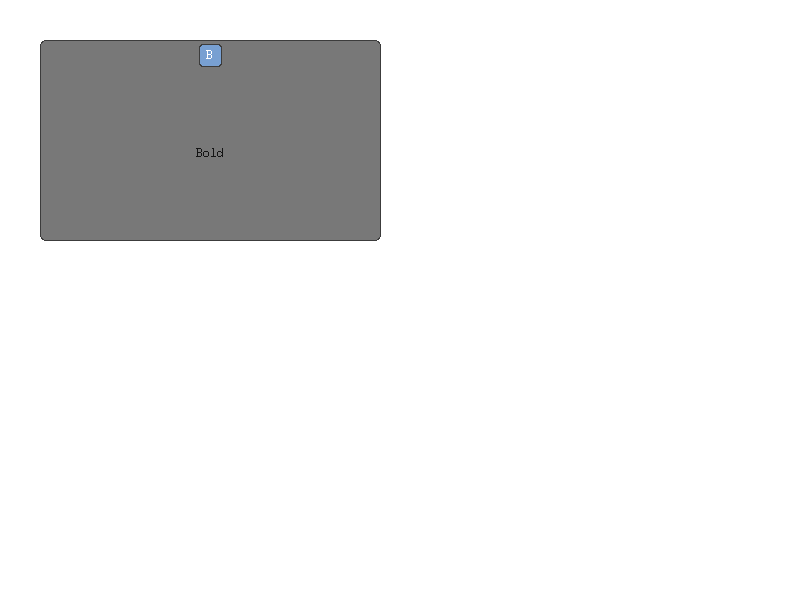

A toolbar toggle: flat (no body, no border) at rest, polished chrome on hover, sunken while active. A 22x22 blue icon box holds a glyph letter, with the caption below it when the button is at least 44px tall.

**Constructor:** `GtkToggleToolButton(Display* display, int screen, Window window, GC gc, SStyle_Manager* styles, int x, int y, int width, int height)`

**API** (widget-specific methods/properties/signals ONLY — skip the common ones):

- `set_text(std::string t)` / `get_text()` — the caption (default `"Bold"`)

- `set_active(bool active)` / `get_active()` — the latched state (default `false`)

- `toggle()` — flips the state (fires `on_toggled`)

- `set_icon_label(std::string glyph)` / `get_icon_label()` — the letter in the icon box (default `"B"`)

- `set_label(std::string label)` / `get_label()` — sets the caption text

- signal `on_toggled` (`std::function<void()>`) — fires when the state flips; note it carries no bool, and there is no `on_click` on this widget

**Example:**

```cpp
#include "GtkToggleToolButton.h"

#include <cstdio>

int main()
{
    Display* display = XOpenDisplay(nullptr);
    if (!display) { return 1; }
    int screen = DefaultScreen(display);
    Window window = XCreateSimpleWindow(display, RootWindow(display, screen), 100, 100, 800, 600, 1, BlackPixel(display, screen), WhitePixel(display, screen));
    XStoreName(display, window, "GtkToggleToolButton - XFrame demo");
    XSelectInput(display, window, ExposureMask | KeyPressMask | StructureNotifyMask | ButtonPressMask | ButtonReleaseMask | PointerMotionMask);
    Atom deleteWindowMessage = XInternAtom(display, "WM_DELETE_WINDOW", False);
    XSetWMProtocols(display, window, &deleteWindowMessage, 1);
    XMapWindow(display, window);
    GC gc = DefaultGC(display, screen);
    SStyle_Manager styles(display, window, screen, gc);
    styles.add_style_ex("default", Srgb{225, 225, 225}, Srgb{120, 120, 120}, Srgb{60, 60, 60}, Srgb{20, 20, 20}, 6, 1, "-misc-fixed-medium-r-normal--13-*");
    styles.set_active_style_byName("default");
    GtkToggleToolButton widget(display, screen, window, gc, &styles, 40, 40, 340, 200);
    widget.set_icon_label("B");
    widget.set_active(false);
    widget.on_toggled = [] { std::printf("toggled\n"); };
    widget.draw();
    bool running = true;
    while (running)
    {
        XEvent event;
        XNextEvent(display, &event);
        bool handled = false;
        switch (event.type)
        {
        case Expose:
            handled = true;
            break;
        case ButtonPress:
            handled = widget.on_button_press(event.xbutton.x, event.xbutton.y, event.xbutton.button);
            break;
        case ButtonRelease:
            handled = widget.on_button_release(event.xbutton.x, event.xbutton.y, event.xbutton.button);
            break;
        case MotionNotify:
            handled = widget.on_motion(event.xmotion.x, event.xmotion.y);
            break;
        case KeyPress:
        {
            char buffer[32];
            KeySym key = 0;
            int n = XLookupString(&event.xkey, buffer, (int)sizeof(buffer) - 1, &key, nullptr);
            buffer[n] = 0;
            handled = widget.on_key(key, buffer);
            break;
        }
        case ClientMessage:
            if ((Atom)event.xclient.data.l[0] == deleteWindowMessage)
            {
                running = false;
            }
            break;
        }
        if (handled)
        {
            XClearWindow(display, window);
            widget.draw();
            XFlush(display);
        }
    }
    XCloseDisplay(display);
    return 0;
}
```

**Notes:** Real hover state: `on_motion` tracks the pointer and the chrome appears on hover.

## GtkToolButton

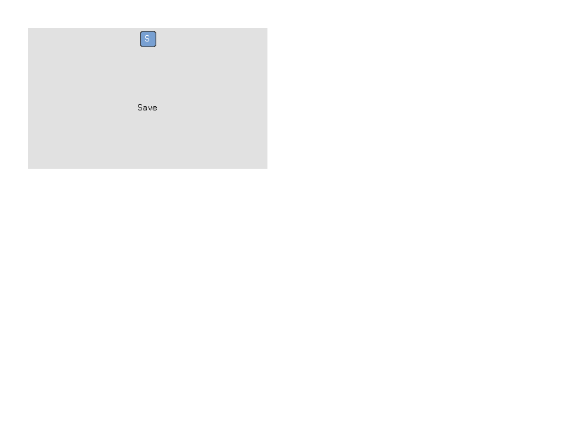

A momentary toolbar button: flat (no body, no border) at rest, polished chrome on hover or while pressed. A 22x22 blue icon box holds a glyph letter, with the caption below it when the button is at least 44px tall.

**Constructor:** `GtkToolButton(Display* display, int screen, Window window, GC gc, SStyle_Manager* styles, int x, int y, int width, int height)`

**API** (widget-specific methods/properties/signals ONLY — skip the common ones):

- `set_text(std::string t)` / `get_text()` — the caption (default `"Save"`)

- `set_icon_label(std::string glyph)` / `get_icon_label()` — the letter in the icon box (default `"S"`)

- `set_label(std::string label)` / `get_label()` — sets the caption text

- signal `on_click` (`std::function<void()>`) — fires on click

**Example:**

```cpp
#include "GtkToolButton.h"

#include <cstdio>

int main()
{
    Display* display = XOpenDisplay(nullptr);
    if (!display) { return 1; }
    int screen = DefaultScreen(display);
    Window window = XCreateSimpleWindow(display, RootWindow(display, screen), 100, 100, 800, 600, 1, BlackPixel(display, screen), WhitePixel(display, screen));
    XStoreName(display, window, "GtkToolButton - XFrame demo");
    XSelectInput(display, window, ExposureMask | KeyPressMask | StructureNotifyMask | ButtonPressMask | ButtonReleaseMask | PointerMotionMask);
    Atom deleteWindowMessage = XInternAtom(display, "WM_DELETE_WINDOW", False);
    XSetWMProtocols(display, window, &deleteWindowMessage, 1);
    XMapWindow(display, window);
    GC gc = DefaultGC(display, screen);
    SStyle_Manager styles(display, window, screen, gc);
    styles.add_style_ex("default", Srgb{225, 225, 225}, Srgb{120, 120, 120}, Srgb{60, 60, 60}, Srgb{20, 20, 20}, 6, 1, "-misc-fixed-medium-r-normal--13-*");
    styles.set_active_style_byName("default");
    GtkToolButton widget(display, screen, window, gc, &styles, 40, 40, 340, 200);
    widget.set_icon_label("S");
    widget.on_click = [] { std::printf("tool clicked\n"); };
    widget.draw();
    bool running = true;
    while (running)
    {
        XEvent event;
        XNextEvent(display, &event);
        bool handled = false;
        switch (event.type)
        {
        case Expose:
            handled = true;
            break;
        case ButtonPress:
            handled = widget.on_button_press(event.xbutton.x, event.xbutton.y, event.xbutton.button);
            break;
        case ButtonRelease:
            handled = widget.on_button_release(event.xbutton.x, event.xbutton.y, event.xbutton.button);
            break;
        case MotionNotify:
            handled = widget.on_motion(event.xmotion.x, event.xmotion.y);
            break;
        case KeyPress:
        {
            char buffer[32];
            KeySym key = 0;
            int n = XLookupString(&event.xkey, buffer, (int)sizeof(buffer) - 1, &key, nullptr);
            buffer[n] = 0;
            handled = widget.on_key(key, buffer);
            break;
        }
        case ClientMessage:
            if ((Atom)event.xclient.data.l[0] == deleteWindowMessage)
            {
                running = false;
            }
            break;
        }
        if (handled)
        {
            XClearWindow(display, window);
            widget.draw();
            XFlush(display);
        }
    }
    XCloseDisplay(display);
    return 0;
}
```

**Notes:** Real hover state: `on_motion` tracks the pointer and the chrome appears on hover.

## GtkVolumeButton


A volume control in a polished button: minus and plus zones at the ends, a speaker glyph, and sound waves whose count grows with the volume — or a red cross when muted or at zero. The caption is the percentage.

**Constructor:** `GtkVolumeButton(Display* display, int screen, Window window, GC gc, SStyle_Manager* styles, int x, int y, int width, int height)`

**API** (widget-specific methods/properties/signals ONLY — skip the common ones):

- `set_text(std::string t)` / `get_text()` — the caption, kept as `"<n>%"` (default `"70%"`)

- `set_value(double v)` / `get_value()` — the volume, 0..1, clamped (default `0.7`)

- `set_muted(bool m)` / `get_muted()` — mute; the previous value is remembered and restored on unmute

- signal `on_click` (`std::function<void()>`) — fires on click

- signal `on_value_changed` (`std::function<void(double)>`) — fires with the new value whenever it changes

**Example:**

```cpp
#include "GtkVolumeButton.h"

#include <cstdio>

int main()
{
    Display* display = XOpenDisplay(nullptr);
    if (!display) { return 1; }
    int screen = DefaultScreen(display);
    Window window = XCreateSimpleWindow(display, RootWindow(display, screen), 100, 100, 800, 600, 1, BlackPixel(display, screen), WhitePixel(display, screen));
    XStoreName(display, window, "GtkVolumeButton - XFrame demo");
    XSelectInput(display, window, ExposureMask | KeyPressMask | StructureNotifyMask | ButtonPressMask | ButtonReleaseMask | PointerMotionMask);
    Atom deleteWindowMessage = XInternAtom(display, "WM_DELETE_WINDOW", False);
    XSetWMProtocols(display, window, &deleteWindowMessage, 1);
    XMapWindow(display, window);
    GC gc = DefaultGC(display, screen);
    SStyle_Manager styles(display, window, screen, gc);
    styles.add_style_ex("default", Srgb{225, 225, 225}, Srgb{120, 120, 120}, Srgb{60, 60, 60}, Srgb{20, 20, 20}, 6, 1, "-misc-fixed-medium-r-normal--13-*");
    styles.set_active_style_byName("default");
    GtkVolumeButton widget(display, screen, window, gc, &styles, 40, 40, 280, 36);
    widget.set_value(0.5);
    widget.on_value_changed = [](double v) { std::printf("volume: %f\n", v); };
    widget.draw();
    bool running = true;
    while (running)
    {
        XEvent event;
        XNextEvent(display, &event);
        bool handled = false;
        switch (event.type)
        {
        case Expose:
            handled = true;
            break;
        case ButtonPress:
            handled = widget.on_button_press(event.xbutton.x, event.xbutton.y, event.xbutton.button);
            break;
        case ButtonRelease:
            handled = widget.on_button_release(event.xbutton.x, event.xbutton.y, event.xbutton.button);
            break;
        case MotionNotify:
            handled = widget.on_motion(event.xmotion.x, event.xmotion.y);
            break;
        case KeyPress:
        {
            char buffer[32];
            KeySym key = 0;
            int n = XLookupString(&event.xkey, buffer, (int)sizeof(buffer) - 1, &key, nullptr);
            buffer[n] = 0;
            handled = widget.on_key(key, buffer);
            break;
        }
        case ClientMessage:
            if ((Atom)event.xclient.data.l[0] == deleteWindowMessage)
            {
                running = false;
            }
            break;
        }
        if (handled)
        {
            XClearWindow(display, window);
            widget.draw();
            XFlush(display);
        }
    }
    XCloseDisplay(display);
    return 0;
}
```

**Notes:** Clicking the minus/plus zones steps the volume; clicking the middle toggles mute. The widget controls no audio device — it is a value control only.

## TBitBtn

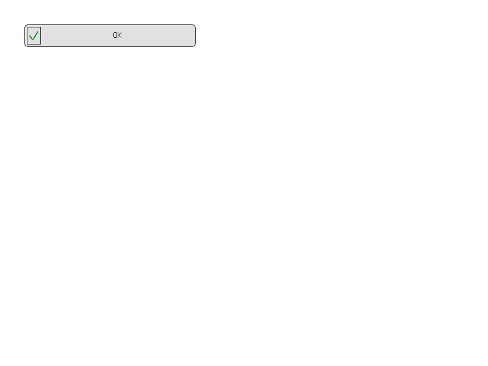

A button with a glyph box at the left and a caption at the right. The kind picks a standard glyph, caption, and modal result; clicking stores the modal result and fires `on_click`.

**Constructor:** `TBitBtn(Display* display, int screen, Window window, GC gc, SStyle_Manager* styles, int x, int y, int width, int height)`

**API** (widget-specific methods/properties/signals ONLY — skip the common ones):

- `set_text(std::string t)` / `get_text()` — the caption (default `"OK"` for `bkOK`)

- `set_kind(TBitBtnKind k)` / `get_kind()` — the kind; `TBitBtnKind` is `bkCustom, bkOK, bkCancel, bkHelp, bkYes, bkNo, bkClose, bkAbort, bkRetry, bkIgnore, bkAll, bkNoToAll, bkYesToAll` (default `bkOK`)

- `set_modal_result(int r)` / `get_modal_result()` — the result stored on click (default `1`)

- `get_kind_modal_result()` — the standard modal result for the current kind

- `set_glyph_width(int w)` / `get_glyph_width()` — the glyph box width in pixels (default `22`)

- signal `on_click` (`std::function<void()>`) — fires on click

**Example:**

```cpp
#include "TBitBtn.h"

#include <cstdio>

int main()
{
    Display* display = XOpenDisplay(nullptr);
    if (!display) { return 1; }
    int screen = DefaultScreen(display);
    Window window = XCreateSimpleWindow(display, RootWindow(display, screen), 100, 100, 800, 600, 1, BlackPixel(display, screen), WhitePixel(display, screen));
    XStoreName(display, window, "TBitBtn - XFrame demo");
    XSelectInput(display, window, ExposureMask | KeyPressMask | StructureNotifyMask | ButtonPressMask | ButtonReleaseMask | PointerMotionMask);
    Atom deleteWindowMessage = XInternAtom(display, "WM_DELETE_WINDOW", False);
    XSetWMProtocols(display, window, &deleteWindowMessage, 1);
    XMapWindow(display, window);
    GC gc = DefaultGC(display, screen);
    SStyle_Manager styles(display, window, screen, gc);
    styles.add_style_ex("default", Srgb{225, 225, 225}, Srgb{120, 120, 120}, Srgb{60, 60, 60}, Srgb{20, 20, 20}, 6, 1, "-misc-fixed-medium-r-normal--13-*");
    styles.set_active_style_byName("default");
    TBitBtn widget(display, screen, window, gc, &styles, 40, 40, 280, 36);
    widget.set_kind(bkOK);
    widget.on_click = [] { std::printf("bit button clicked\n"); };
    widget.draw();
    bool running = true;
    while (running)
    {
        XEvent event;
        XNextEvent(display, &event);
        bool handled = false;
        switch (event.type)
        {
        case Expose:
            handled = true;
            break;
        case ButtonPress:
            handled = widget.on_button_press(event.xbutton.x, event.xbutton.y, event.xbutton.button);
            break;
        case ButtonRelease:
            handled = widget.on_button_release(event.xbutton.x, event.xbutton.y, event.xbutton.button);
            break;
        case MotionNotify:
            handled = widget.on_motion(event.xmotion.x, event.xmotion.y);
            break;
        case KeyPress:
        {
            char buffer[32];
            KeySym key = 0;
            int n = XLookupString(&event.xkey, buffer, (int)sizeof(buffer) - 1, &key, nullptr);
            buffer[n] = 0;
            handled = widget.on_key(key, buffer);
            break;
        }
        case ClientMessage:
            if ((Atom)event.xclient.data.l[0] == deleteWindowMessage)
            {
                running = false;
            }
            break;
        }
        if (handled)
        {
            XClearWindow(display, window);
            widget.draw();
            XFlush(display);
        }
    }
    XCloseDisplay(display);
    return 0;
}
```

**Notes:** `set_kind()` also sets the caption from the kind (except `bkCustom`, which keeps the current text). The stored result has no getter — the host reads it via `get_modal_result()`.

## TButton


The standard push button: a polished button whose caption shifts 1px down-right while pressed, with a thicker outline when it is the default button.

**Constructor:** `TButton(Display* display, int screen, Window window, GC gc, SStyle_Manager* styles, int x, int y, int width, int height)`

**API** (widget-specific methods/properties/signals ONLY — skip the common ones):

- `set_text(std::string t)` / `get_text()` — the caption (default `"OK"`)

- `set_default(bool d)` / `get_default()` — the default-button outline (default `false`)

- `set_modal_result(int r)` / `get_modal_result()` — the modal result value (default `0`)

- `get_pressed()` — whether the button is currently held down

- `click()` — fires `on_click` programmatically (only if enabled)

- signal `on_click` (`std::function<void()>`) — fires on click, or on Return/Space while focused, or via `click()`

**Example:**

```cpp
#include "TButton.h"

#include <cstdio>

int main()
{
    Display* display = XOpenDisplay(nullptr);
    if (!display) { return 1; }
    int screen = DefaultScreen(display);
    Window window = XCreateSimpleWindow(display, RootWindow(display, screen), 100, 100, 800, 600, 1, BlackPixel(display, screen), WhitePixel(display, screen));
    XStoreName(display, window, "TButton - XFrame demo");
    XSelectInput(display, window, ExposureMask | KeyPressMask | StructureNotifyMask | ButtonPressMask | ButtonReleaseMask | PointerMotionMask);
    Atom deleteWindowMessage = XInternAtom(display, "WM_DELETE_WINDOW", False);
    XSetWMProtocols(display, window, &deleteWindowMessage, 1);
    XMapWindow(display, window);
    GC gc = DefaultGC(display, screen);
    SStyle_Manager styles(display, window, screen, gc);
    styles.add_style_ex("default", Srgb{225, 225, 225}, Srgb{120, 120, 120}, Srgb{60, 60, 60}, Srgb{20, 20, 20}, 6, 1, "-misc-fixed-medium-r-normal--13-*");
    styles.set_active_style_byName("default");
    TButton widget(display, screen, window, gc, &styles, 40, 40, 280, 36);
    widget.set_default(true);
    widget.set_modal_result(1);
    widget.on_click = [] { std::printf("button clicked\n"); };
    widget.draw();
    bool running = true;
    while (running)
    {
        XEvent event;
        XNextEvent(display, &event);
        bool handled = false;
        switch (event.type)
        {
        case Expose:
            handled = true;
            break;
        case ButtonPress:
            handled = widget.on_button_press(event.xbutton.x, event.xbutton.y, event.xbutton.button);
            break;
        case ButtonRelease:
            handled = widget.on_button_release(event.xbutton.x, event.xbutton.y, event.xbutton.button);
            break;
        case MotionNotify:
            handled = widget.on_motion(event.xmotion.x, event.xmotion.y);
            break;
        case KeyPress:
        {
            char buffer[32];
            KeySym key = 0;
            int n = XLookupString(&event.xkey, buffer, (int)sizeof(buffer) - 1, &key, nullptr);
            buffer[n] = 0;
            handled = widget.on_key(key, buffer);
            break;
        }
        case ClientMessage:
            if ((Atom)event.xclient.data.l[0] == deleteWindowMessage)
            {
                running = false;
            }
            break;
        }
        if (handled)
        {
            XClearWindow(display, window);
            widget.draw();
            XFlush(display);
        }
    }
    XCloseDisplay(display);
    return 0;
}
```

## TButtonPanel

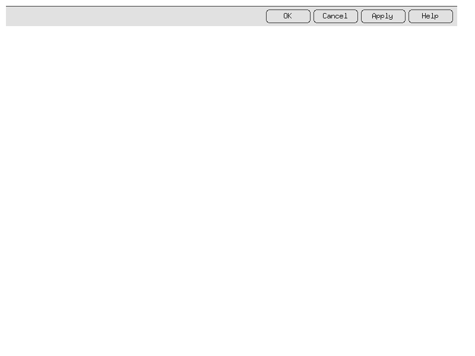

A panel with a separator line along the top edge and a right-aligned row of standard buttons (OK, Cancel, Apply, Close, Help). Which buttons appear is a bitmask over the `PB_*` kinds.

**Constructor:** `TButtonPanel(Display* display, int screen, Window window, GC gc, SStyle_Manager* styles, int x, int y, int width, int height)`

**API** (widget-specific methods/properties/signals ONLY — skip the common ones):

- `set_text(std::string t)` / `get_text()` — stored but not drawn (default `"TButtonPanel"`)

- `set_show_buttons(int mask)` / `get_show_buttons()` — bitmask of visible buttons; bits are `(1 << PB_OK)` etc. (default OK + Cancel)

- `set_button_visible(int kind, bool show)` / `get_button_visible(int kind)` — one button at a time

- public constants `PB_OK = 0`, `PB_CANCEL = 1`, `PB_CLOSE = 2`, `PB_HELP = 3`, `PB_APPLY = 4`

- signal `on_click` (`std::function<void()>`) — fires when any button is clicked

- signal `on_button` (`std::function<void(int)>`) — fires with the kind of the button clicked

**Example:**

```cpp
#include "TButtonPanel.h"

#include <cstdio>

int main()
{
    Display* display = XOpenDisplay(nullptr);
    if (!display) { return 1; }
    int screen = DefaultScreen(display);
    Window window = XCreateSimpleWindow(display, RootWindow(display, screen), 100, 100, 800, 600, 1, BlackPixel(display, screen), WhitePixel(display, screen));
    XStoreName(display, window, "TButtonPanel - XFrame demo");
    XSelectInput(display, window, ExposureMask | KeyPressMask | StructureNotifyMask | ButtonPressMask | ButtonReleaseMask | PointerMotionMask);
    Atom deleteWindowMessage = XInternAtom(display, "WM_DELETE_WINDOW", False);
    XSetWMProtocols(display, window, &deleteWindowMessage, 1);
    XMapWindow(display, window);
    GC gc = DefaultGC(display, screen);
    SStyle_Manager styles(display, window, screen, gc);
    styles.add_style_ex("default", Srgb{225, 225, 225}, Srgb{120, 120, 120}, Srgb{60, 60, 60}, Srgb{20, 20, 20}, 6, 1, "-misc-fixed-medium-r-normal--13-*");
    styles.set_active_style_byName("default");
    TButtonPanel widget(display, screen, window, gc, &styles, 10, 10, 760, 34);
    widget.set_show_buttons((1 << TButtonPanel::PB_OK) | (1 << TButtonPanel::PB_CANCEL));
    widget.on_button = [](int kind) { std::printf("panel button %d\n", kind); };
    widget.draw();
    bool running = true;
    while (running)
    {
        XEvent event;
        XNextEvent(display, &event);
        bool handled = false;
        switch (event.type)
        {
        case Expose:
            handled = true;
            break;
        case ButtonPress:
            handled = widget.on_button_press(event.xbutton.x, event.xbutton.y, event.xbutton.button);
            break;
        case ButtonRelease:
            handled = widget.on_button_release(event.xbutton.x, event.xbutton.y, event.xbutton.button);
            break;
        case MotionNotify:
            handled = widget.on_motion(event.xmotion.x, event.xmotion.y);
            break;
        case KeyPress:
        {
            char buffer[32];
            KeySym key = 0;
            int n = XLookupString(&event.xkey, buffer, (int)sizeof(buffer) - 1, &key, nullptr);
            buffer[n] = 0;
            handled = widget.on_key(key, buffer);
            break;
        }
        case ClientMessage:
            if ((Atom)event.xclient.data.l[0] == deleteWindowMessage)
            {
                running = false;
            }
            break;
        }
        if (handled)
        {
            XClearWindow(display, window);
            widget.draw();
            XFlush(display);
        }
    }
    XCloseDisplay(display);
    return 0;
}
```

**Notes:** Buttons are drawn right-aligned in the order OK, Cancel, Apply, Close, Help, each 74px wide with a 6px gap. Return triggers OK when it is shown. The panel has no dialog behaviour of its own — the host decides what each button does.

## TCheckBox


A check box: a 14px box at the left and a caption. Three states — 0 unchecked, 1 checked, 2 grayed (grey box, grey check, grey caption).

**Constructor:** `TCheckBox(Display* display, int screen, Window window, GC gc, SStyle_Manager* styles, int x, int y, int width, int height)`

**API** (widget-specific methods/properties/signals ONLY — skip the common ones):

- `set_text(std::string t)` / `get_text()` — the caption (default `"Check me"`)

- `get_state()` / `set_state(int state)` — 0 = unchecked, 1 = checked, 2 = grayed (default `1`, checked)

- `get_checked()` / `set_checked(bool checked)` — checked as a bool (checked = state 1)

- `set_allow_grayed(bool allow)` / `get_allow_grayed()` — whether the grayed state is reachable by clicking (default `false`)

- `cycle()` — advances to the next state

- signal `on_change` (`std::function<void()>`) — fires when the state changes

- signal `on_click` (`std::function<void()>`) — fires on click

**Example:**

```cpp
#include "TCheckBox.h"

#include <cstdio>

int main()
{
    Display* display = XOpenDisplay(nullptr);
    if (!display) { return 1; }
    int screen = DefaultScreen(display);
    Window window = XCreateSimpleWindow(display, RootWindow(display, screen), 100, 100, 800, 600, 1, BlackPixel(display, screen), WhitePixel(display, screen));
    XStoreName(display, window, "TCheckBox - XFrame demo");
    XSelectInput(display, window, ExposureMask | KeyPressMask | StructureNotifyMask | ButtonPressMask | ButtonReleaseMask | PointerMotionMask);
    Atom deleteWindowMessage = XInternAtom(display, "WM_DELETE_WINDOW", False);
    XSetWMProtocols(display, window, &deleteWindowMessage, 1);
    XMapWindow(display, window);
    GC gc = DefaultGC(display, screen);
    SStyle_Manager styles(display, window, screen, gc);
    styles.add_style_ex("default", Srgb{225, 225, 225}, Srgb{120, 120, 120}, Srgb{60, 60, 60}, Srgb{20, 20, 20}, 6, 1, "-misc-fixed-medium-r-normal--13-*");
    styles.set_active_style_byName("default");
    TCheckBox widget(display, screen, window, gc, &styles, 40, 40, 280, 36);
    widget.set_checked(true);
    widget.on_change = [] { std::printf("checkbox changed\n"); };
    widget.draw();
    bool running = true;
    while (running)
    {
        XEvent event;
        XNextEvent(display, &event);
        bool handled = false;
        switch (event.type)
        {
        case Expose:
            handled = true;
            break;
        case ButtonPress:
            handled = widget.on_button_press(event.xbutton.x, event.xbutton.y, event.xbutton.button);
            break;
        case ButtonRelease:
            handled = widget.on_button_release(event.xbutton.x, event.xbutton.y, event.xbutton.button);
            break;
        case MotionNotify:
            handled = widget.on_motion(event.xmotion.x, event.xmotion.y);
            break;
        case KeyPress:
        {
            char buffer[32];
            KeySym key = 0;
            int n = XLookupString(&event.xkey, buffer, (int)sizeof(buffer) - 1, &key, nullptr);
            buffer[n] = 0;
            handled = widget.on_key(key, buffer);
            break;
        }
        case ClientMessage:
            if ((Atom)event.xclient.data.l[0] == deleteWindowMessage)
            {
                running = false;
            }
            break;
        }
        if (handled)
        {
            XClearWindow(display, window);
            widget.draw();
            XFlush(display);
        }
    }
    XCloseDisplay(display);
    return 0;
}
```

**Notes:** Clicking (or Space) cycles: checked/unchecked when `allow_grayed` is off, and through the grayed state when it is on.

## TCheckComboBox

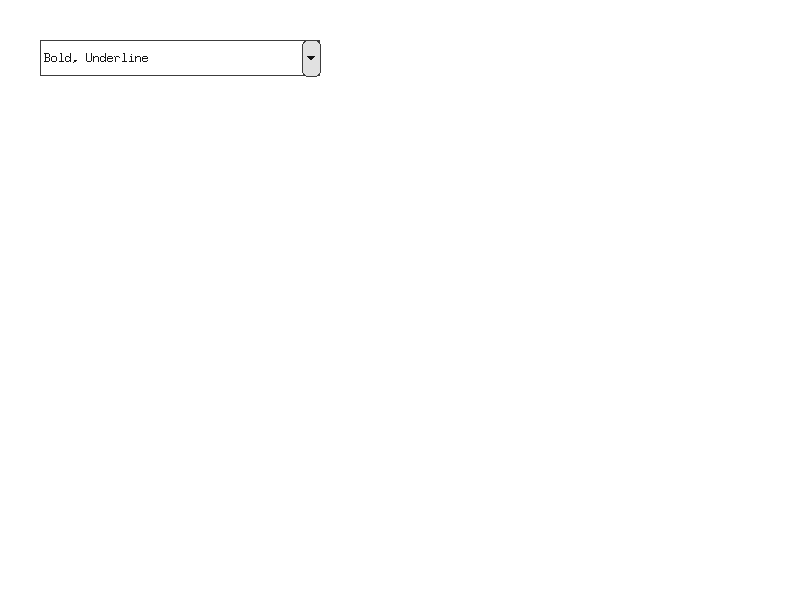

A combo box whose dropdown lists items with check boxes. The field shows the checked captions joined together; clicking a row in the open list toggles its check.

**Constructor:** `TCheckComboBox(Display* display, int screen, Window window, GC gc, SStyle_Manager* styles, int x, int y, int width, int height)`

**API** (widget-specific methods/properties/signals ONLY — skip the common ones):

- `set_text(std::string t)` / `get_text()` — the field text (derived from the checked items)

- `get_count()` — number of items; `get_checked_count()` — number checked

- `is_checked(int i)` / `set_checked(int i, bool c)` — one item's check state

- `toggle_checked(int i)` — flips one item

- `add_item(std::string caption, bool checked)` — appends an item

- `get_checked_text()` — the checked captions joined for the field

- signal `on_click` (`std::function<void()>`) — fires on click

- signal `on_change` (`std::function<void()>`) — fires when a check changes

**Example:**

```cpp
#include "TCheckComboBox.h"

#include <cstdio>

int main()
{
    Display* display = XOpenDisplay(nullptr);
    if (!display) { return 1; }
    int screen = DefaultScreen(display);
    Window window = XCreateSimpleWindow(display, RootWindow(display, screen), 100, 100, 800, 600, 1, BlackPixel(display, screen), WhitePixel(display, screen));
    XStoreName(display, window, "TCheckComboBox - XFrame demo");
    XSelectInput(display, window, ExposureMask | KeyPressMask | StructureNotifyMask | ButtonPressMask | ButtonReleaseMask | PointerMotionMask);
    Atom deleteWindowMessage = XInternAtom(display, "WM_DELETE_WINDOW", False);
    XSetWMProtocols(display, window, &deleteWindowMessage, 1);
    XMapWindow(display, window);
    GC gc = DefaultGC(display, screen);
    SStyle_Manager styles(display, window, screen, gc);
    styles.add_style_ex("default", Srgb{225, 225, 225}, Srgb{120, 120, 120}, Srgb{60, 60, 60}, Srgb{20, 20, 20}, 6, 1, "-misc-fixed-medium-r-normal--13-*");
    styles.set_active_style_byName("default");
    TCheckComboBox widget(display, screen, window, gc, &styles, 40, 40, 280, 36);
    widget.add_item("Alpha", true);
    widget.add_item("Beta", false);
    widget.on_change = [] { std::printf("checked list changed\n"); };
    widget.draw();
    bool running = true;
    while (running)
    {
        XEvent event;
        XNextEvent(display, &event);
        bool handled = false;
        switch (event.type)
        {
        case Expose:
            handled = true;
            break;
        case ButtonPress:
            handled = widget.on_button_press(event.xbutton.x, event.xbutton.y, event.xbutton.button);
            break;
        case ButtonRelease:
            handled = widget.on_button_release(event.xbutton.x, event.xbutton.y, event.xbutton.button);
            break;
        case MotionNotify:
            handled = widget.on_motion(event.xmotion.x, event.xmotion.y);
            break;
        case KeyPress:
        {
            char buffer[32];
            KeySym key = 0;
            int n = XLookupString(&event.xkey, buffer, (int)sizeof(buffer) - 1, &key, nullptr);
            buffer[n] = 0;
            handled = widget.on_key(key, buffer);
            break;
        }
        case ClientMessage:
            if ((Atom)event.xclient.data.l[0] == deleteWindowMessage)
            {
                running = false;
            }
            break;
        }
        if (handled)
        {
            XClearWindow(display, window);
            widget.draw();
            XFlush(display);
        }
    }
    XCloseDisplay(display);
    return 0;
}
```

**Notes:** The list starts empty — items only exist if the host adds them with `add_item()`. The dropdown is drawn below the field, overflowing the widget bounds.

## TRadioButton


A radio button: a white disc at the left, filled with a dot when checked, and a caption. `check()` selects this button and deselects the rest of its group.

**Constructor:** `TRadioButton(Display* display, int screen, Window window, GC gc, SStyle_Manager* styles, int x, int y, int width, int height)`

**API** (widget-specific methods/properties/signals ONLY — skip the common ones):

- `set_text(std::string t)` / `get_text()` — the caption (default `"Option"`)

- `get_checked()` / `set_checked(bool checked)` — the checked state (default `false`)

- `set_group(std::vector<TRadioButton*>* group)` / `get_group()` — the group; selecting one member deselects the others

- `check()` — selects this button (fires `on_change`)

- signal `on_change` (`std::function<void()>`) — fires when the checked state changes

- signal `on_click` (`std::function<void()>`) — fires on click

**Example:**

```cpp
#include "TRadioButton.h"

#include <cstdio>

int main()
{
    Display* display = XOpenDisplay(nullptr);
    if (!display) { return 1; }
    int screen = DefaultScreen(display);
    Window window = XCreateSimpleWindow(display, RootWindow(display, screen), 100, 100, 800, 600, 1, BlackPixel(display, screen), WhitePixel(display, screen));
    XStoreName(display, window, "TRadioButton - XFrame demo");
    XSelectInput(display, window, ExposureMask | KeyPressMask | StructureNotifyMask | ButtonPressMask | ButtonReleaseMask | PointerMotionMask);
    Atom deleteWindowMessage = XInternAtom(display, "WM_DELETE_WINDOW", False);
    XSetWMProtocols(display, window, &deleteWindowMessage, 1);
    XMapWindow(display, window);
    GC gc = DefaultGC(display, screen);
    SStyle_Manager styles(display, window, screen, gc);
    styles.add_style_ex("default", Srgb{225, 225, 225}, Srgb{120, 120, 120}, Srgb{60, 60, 60}, Srgb{20, 20, 20}, 6, 1, "-misc-fixed-medium-r-normal--13-*");
    styles.set_active_style_byName("default");
    TRadioButton widget(display, screen, window, gc, &styles, 40, 40, 280, 36);
    widget.set_checked(true);
    widget.on_change = [] { std::printf("radio changed\n"); };
    widget.draw();
    bool running = true;
    while (running)
    {
        XEvent event;
        XNextEvent(display, &event);
        bool handled = false;
        switch (event.type)
        {
        case Expose:
            handled = true;
            break;
        case ButtonPress:
            handled = widget.on_button_press(event.xbutton.x, event.xbutton.y, event.xbutton.button);
            break;
        case ButtonRelease:
            handled = widget.on_button_release(event.xbutton.x, event.xbutton.y, event.xbutton.button);
            break;
        case MotionNotify:
            handled = widget.on_motion(event.xmotion.x, event.xmotion.y);
            break;
        case KeyPress:
        {
            char buffer[32];
            KeySym key = 0;
            int n = XLookupString(&event.xkey, buffer, (int)sizeof(buffer) - 1, &key, nullptr);
            buffer[n] = 0;
            handled = widget.on_key(key, buffer);
            break;
        }
        case ClientMessage:
            if ((Atom)event.xclient.data.l[0] == deleteWindowMessage)
            {
                running = false;
            }
            break;
        }
        if (handled)
        {
            XClearWindow(display, window);
            widget.draw();
            XFlush(display);
        }
    }
    XCloseDisplay(display);
    return 0;
}
```

**Notes:** The group is a plain pointer to a vector the caller owns; the widget does not create or manage it. Clicking an already-checked button does nothing.

## TSpeedButton

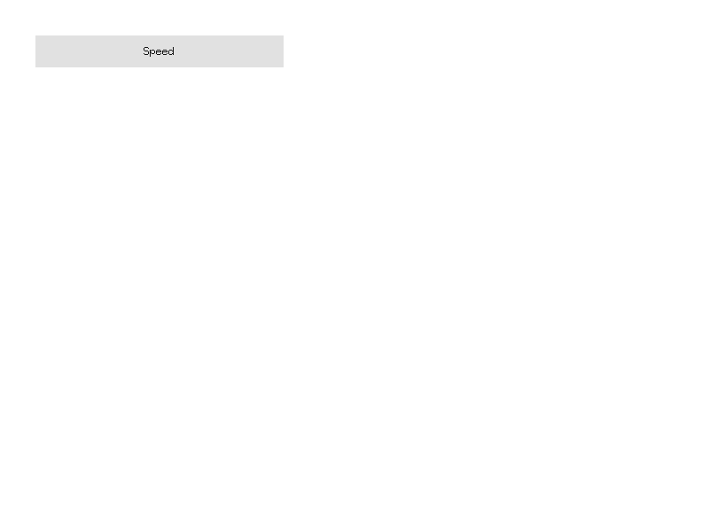

A flat toolbar button: at idle it has no body or border — just the caption on the parent surface. The polished body appears on hover, while down, while pressed, or while focused; the down state also gets an underline, and the caption shifts 1px when down or pressed.

**Constructor:** `TSpeedButton(Display* display, int screen, Window window, GC gc, SStyle_Manager* styles, int x, int y, int width, int height)`

**API** (widget-specific methods/properties/signals ONLY — skip the common ones):

- `set_text(std::string t)` / `get_text()` — the caption (default `"Speed"`)

- `set_group_index(int g)` / `get_group_index()` — the radio group (default `0`)

- `set_allow_all_up(bool a)` / `get_allow_all_up()` — whether a group may have nothing down (default `false`)

- `get_down()` / `set_down(bool d)` — the latched down state

- `get_hover()` — whether the pointer is currently over the button

- signal `on_click` (`std::function<void()>`) — fires on click

**Example:**

```cpp
#include "TSpeedButton.h"

#include <cstdio>

int main()
{
    Display* display = XOpenDisplay(nullptr);
    if (!display) { return 1; }
    int screen = DefaultScreen(display);
    Window window = XCreateSimpleWindow(display, RootWindow(display, screen), 100, 100, 800, 600, 1, BlackPixel(display, screen), WhitePixel(display, screen));
    XStoreName(display, window, "TSpeedButton - XFrame demo");
    XSelectInput(display, window, ExposureMask | KeyPressMask | StructureNotifyMask | ButtonPressMask | ButtonReleaseMask | PointerMotionMask);
    Atom deleteWindowMessage = XInternAtom(display, "WM_DELETE_WINDOW", False);
    XSetWMProtocols(display, window, &deleteWindowMessage, 1);
    XMapWindow(display, window);
    GC gc = DefaultGC(display, screen);
    SStyle_Manager styles(display, window, screen, gc);
    styles.add_style_ex("default", Srgb{225, 225, 225}, Srgb{120, 120, 120}, Srgb{60, 60, 60}, Srgb{20, 20, 20}, 6, 1, "-misc-fixed-medium-r-normal--13-*");
    styles.set_active_style_byName("default");
    TSpeedButton widget(display, screen, window, gc, &styles, 40, 40, 280, 36);
    widget.set_down(true);
    widget.set_group_index(1);
    widget.on_click = [] { std::printf("speed button clicked\n"); };
    widget.draw();
    bool running = true;
    while (running)
    {
        XEvent event;
        XNextEvent(display, &event);
        bool handled = false;
        switch (event.type)
        {
        case Expose:
            handled = true;
            break;
        case ButtonPress:
            handled = widget.on_button_press(event.xbutton.x, event.xbutton.y, event.xbutton.button);
            break;
        case ButtonRelease:
            handled = widget.on_button_release(event.xbutton.x, event.xbutton.y, event.xbutton.button);
            break;
        case MotionNotify:
            handled = widget.on_motion(event.xmotion.x, event.xmotion.y);
            break;
        case KeyPress:
        {
            char buffer[32];
            KeySym key = 0;
            int n = XLookupString(&event.xkey, buffer, (int)sizeof(buffer) - 1, &key, nullptr);
            buffer[n] = 0;
            handled = widget.on_key(key, buffer);
            break;
        }
        case ClientMessage:
            if ((Atom)event.xclient.data.l[0] == deleteWindowMessage)
            {
                running = false;
            }
            break;
        }
        if (handled)
        {
            XClearWindow(display, window);
            widget.draw();
            XFlush(display);
        }
    }
    XCloseDisplay(display);
    return 0;
}
```

**Notes:** Real hover state: `on_motion` tracks the pointer and the body appears on hover. Group behaviour (same `group_index` acting as a radio set) is driven by `set_down()`/clicking; the header does not document an automatic group manager, so group exclusivity is unclear from the header.

## TToggleBox


A full-face toggle: the whole button face is the control. It draws sunken while on, with a checkmark at the left of the caption; the grayed state is also sunken, with a grey checkmark and grey caption.

**Constructor:** `TToggleBox(Display* display, int screen, Window window, GC gc, SStyle_Manager* styles, int x, int y, int width, int height)`

**API** (widget-specific methods/properties/signals ONLY — skip the common ones):

- `set_text(std::string t)` / `get_text()` — the caption (default `"Toggle"`)

- `get_checked()` / `set_checked(bool checked)` — checked as a bool (checked = state 1)

- `get_state()` / `set_state(int state)` — 0 = unchecked, 1 = checked, 2 = grayed (default `0`)

- `set_allow_grayed(bool allow)` / `get_allow_grayed()` — whether the grayed state is reachable by clicking (default `false`)

- `toggle()` — advances to the next state

- signal `on_change` (`std::function<void()>`) — fires when the state changes

- signal `on_click` (`std::function<void()>`) — fires on click

**Example:**

```cpp
#include "TToggleBox.h"

#include <cstdio>

int main()
{
    Display* display = XOpenDisplay(nullptr);
    if (!display) { return 1; }
    int screen = DefaultScreen(display);
    Window window = XCreateSimpleWindow(display, RootWindow(display, screen), 100, 100, 800, 600, 1, BlackPixel(display, screen), WhitePixel(display, screen));
    XStoreName(display, window, "TToggleBox - XFrame demo");
    XSelectInput(display, window, ExposureMask | KeyPressMask | StructureNotifyMask | ButtonPressMask | ButtonReleaseMask | PointerMotionMask);
    Atom deleteWindowMessage = XInternAtom(display, "WM_DELETE_WINDOW", False);
    XSetWMProtocols(display, window, &deleteWindowMessage, 1);
    XMapWindow(display, window);
    GC gc = DefaultGC(display, screen);
    SStyle_Manager styles(display, window, screen, gc);
    styles.add_style_ex("default", Srgb{225, 225, 225}, Srgb{120, 120, 120}, Srgb{60, 60, 60}, Srgb{20, 20, 20}, 6, 1, "-misc-fixed-medium-r-normal--13-*");
    styles.set_active_style_byName("default");
    TToggleBox widget(display, screen, window, gc, &styles, 40, 40, 280, 36);
    widget.set_checked(true);
    widget.on_change = [] { std::printf("toggle box changed\n"); };
    widget.draw();
    bool running = true;
    while (running)
    {
        XEvent event;
        XNextEvent(display, &event);
        bool handled = false;
        switch (event.type)
        {
        case Expose:
            handled = true;
            break;
        case ButtonPress:
            handled = widget.on_button_press(event.xbutton.x, event.xbutton.y, event.xbutton.button);
            break;
        case ButtonRelease:
            handled = widget.on_button_release(event.xbutton.x, event.xbutton.y, event.xbutton.button);
            break;
        case MotionNotify:
            handled = widget.on_motion(event.xmotion.x, event.xmotion.y);
            break;
        case KeyPress:
        {
            char buffer[32];
            KeySym key = 0;
            int n = XLookupString(&event.xkey, buffer, (int)sizeof(buffer) - 1, &key, nullptr);
            buffer[n] = 0;
            handled = widget.on_key(key, buffer);
            break;
        }
        case ClientMessage:
            if ((Atom)event.xclient.data.l[0] == deleteWindowMessage)
            {
                running = false;
            }
            break;
        }
        if (handled)
        {
            XClearWindow(display, window);
            widget.draw();
            XFlush(display);
        }
    }
    XCloseDisplay(display);
    return 0;
}
```

**Notes:** Clicking (or Space) toggles; with `allow_grayed` on, `toggle()` cycles through the grayed state.

## TUpDown

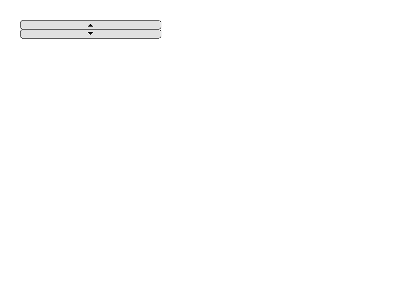

A spin control: two half-buttons, each with a triangle — up/down when vertical, left/right when horizontal. Each press moves the position by the increment, clamped to [min, max].

**Constructor:** `TUpDown(Display* display, int screen, Window window, GC gc, SStyle_Manager* styles, int x, int y, int width, int height)`

**API** (widget-specific methods/properties/signals ONLY — skip the common ones):

- `set_text(std::string t)` / `get_text()` — stored but not drawn (default `"TUpDown"`)

- `set_orientation(int o)` / `get_orientation()` — 0 = vertical (default), 1 = horizontal

- `set_min(int m)` — the lower bound (default `0`); `set_max(int m)` — the upper bound (default `100`)

- `set_increment(int i)` / `get_increment()` — the step per press (default `1`)

- `set_position(int p)` / `get_position()` — the current value (default `25`, clamped to [min, max])

- signal `on_change` (`std::function<void()>`) — fires when the position changes

- signal `on_click` (`std::function<void()>`) — fires on press

**Example:**

```cpp
#include "TUpDown.h"

#include <cstdio>

int main()
{
    Display* display = XOpenDisplay(nullptr);
    if (!display) { return 1; }
    int screen = DefaultScreen(display);
    Window window = XCreateSimpleWindow(display, RootWindow(display, screen), 100, 100, 800, 600, 1, BlackPixel(display, screen), WhitePixel(display, screen));
    XStoreName(display, window, "TUpDown - XFrame demo");
    XSelectInput(display, window, ExposureMask | KeyPressMask | StructureNotifyMask | ButtonPressMask | ButtonReleaseMask | PointerMotionMask);
    Atom deleteWindowMessage = XInternAtom(display, "WM_DELETE_WINDOW", False);
    XSetWMProtocols(display, window, &deleteWindowMessage, 1);
    XMapWindow(display, window);
    GC gc = DefaultGC(display, screen);
    SStyle_Manager styles(display, window, screen, gc);
    styles.add_style_ex("default", Srgb{225, 225, 225}, Srgb{120, 120, 120}, Srgb{60, 60, 60}, Srgb{20, 20, 20}, 6, 1, "-misc-fixed-medium-r-normal--13-*");
    styles.set_active_style_byName("default");
    TUpDown widget(display, screen, window, gc, &styles, 40, 40, 280, 36);
    widget.set_min(0);
    widget.set_max(100);
    widget.set_position(25);
    widget.set_increment(5);
    widget.on_change = [] { std::printf("updown changed\n"); };
    widget.draw();
    bool running = true;
    while (running)
    {
        XEvent event;
        XNextEvent(display, &event);
        bool handled = false;
        switch (event.type)
        {
        case Expose:
            handled = true;
            break;
        case ButtonPress:
            handled = widget.on_button_press(event.xbutton.x, event.xbutton.y, event.xbutton.button);
            break;
        case ButtonRelease:
            handled = widget.on_button_release(event.xbutton.x, event.xbutton.y, event.xbutton.button);
            break;
        case MotionNotify:
            handled = widget.on_motion(event.xmotion.x, event.xmotion.y);
            break;
        case KeyPress:
        {
            char buffer[32];
            KeySym key = 0;
            int n = XLookupString(&event.xkey, buffer, (int)sizeof(buffer) - 1, &key, nullptr);
            buffer[n] = 0;
            handled = widget.on_key(key, buffer);
            break;
        }
        case ClientMessage:
            if ((Atom)event.xclient.data.l[0] == deleteWindowMessage)
            {
                running = false;
            }
            break;
        }
        if (handled)
        {
            XClearWindow(display, window);
            widget.draw();
            XFlush(display);
        }
    }
    XCloseDisplay(display);
    return 0;
}
```

**Notes:** There is no `get_min()` or `get_max()` — the bounds are write-only. Pressing the first half steps up (vertical) or left (horizontal); the second half steps the other way.
