# Display

Display widgets show things rather than collect input: labels, calendars, progress bars, pictures, media controls, and a few non-visual helpers (notably `GtkInvisible` and `TTimer`, which draw nothing interactive). Several of them are stand-ins — `GtkGLArea` and `GtkVideo` paint fake scenes in plain X11 rather than doing any real GL or video work.

> Every widget here shares the common XFrame widget API — same constructor, set_bounds/draw/event handlers, visible/enabled state. The shared contract is documented in docs/index.md (written by the coordinator). Each subsection below lists only what is specific to that widget.

## GtkAccelLabel

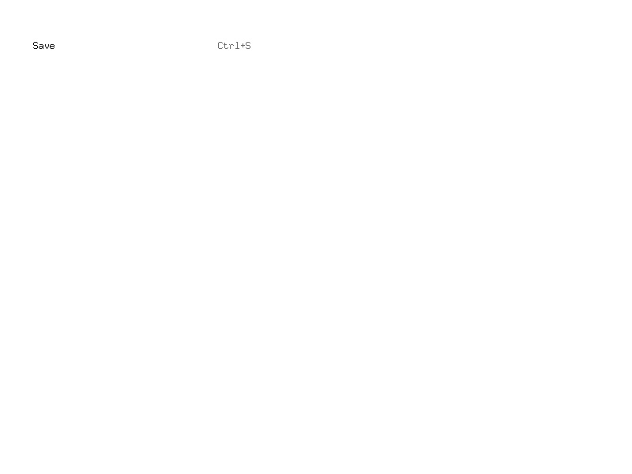

A label with its keyboard accelerator shown right-aligned in dim grey (e.g. `"Ctrl+S"`). The label occupies the remaining space on the left and is truncated to fit.

**Constructor:** `GtkAccelLabel(Display* display, int screen, Window window, GC gc, SStyle_Manager* styles, int x, int y, int width, int height)`

**API** (widget-specific methods/properties/signals ONLY — skip the common ones):

- `set_text(std::string t)` / `get_text()` — the label (default `"Save"`)

- `set_accel_text(std::string t)` / `get_accel_text()` — the accelerator string, right-aligned (default `"Ctrl+S"`)

- `set_accel_widget(std::string widget_name)` / `get_accel_widget()` — the name of the widget the accelerator belongs to (stored only; no lookup is performed)

- `set_xalign(double a)` / `get_xalign()` — horizontal alignment of the label within its space, 0 = left to 1 = right (default `0.0`)

**Example:**

```cpp
#include "GtkAccelLabel.h"

#include <cstdio>

int main()
{
    Display* display = XOpenDisplay(nullptr);
    if (!display) { return 1; }
    int screen = DefaultScreen(display);
    Window window = XCreateSimpleWindow(display, RootWindow(display, screen), 100, 100, 800, 600, 1, BlackPixel(display, screen), WhitePixel(display, screen));
    XStoreName(display, window, "GtkAccelLabel - XFrame demo");
    XSelectInput(display, window, ExposureMask | KeyPressMask | StructureNotifyMask | ButtonPressMask | ButtonReleaseMask | PointerMotionMask);
    Atom deleteWindowMessage = XInternAtom(display, "WM_DELETE_WINDOW", False);
    XSetWMProtocols(display, window, &deleteWindowMessage, 1);
    XMapWindow(display, window);
    GC gc = DefaultGC(display, screen);
    SStyle_Manager styles(display, window, screen, gc);
    styles.add_style_ex("default", Srgb{225, 225, 225}, Srgb{120, 120, 120}, Srgb{60, 60, 60}, Srgb{20, 20, 20}, 6, 1, "-misc-fixed-medium-r-normal--13-*");
    styles.set_active_style_byName("default");
    GtkAccelLabel widget(display, screen, window, gc, &styles, 40, 40, 280, 36);
    widget.set_accel_text("Ctrl+S");
    widget.draw();
    bool running = true;
    while (running)
    {
        XEvent event;
        XNextEvent(display, &event);
        bool handled = false;
        switch (event.type)
        {
        case Expose:
            handled = true;
            break;
        case ButtonPress:
            handled = widget.on_button_press(event.xbutton.x, event.xbutton.y, event.xbutton.button);
            break;
        case ButtonRelease:
            handled = widget.on_button_release(event.xbutton.x, event.xbutton.y, event.xbutton.button);
            break;
        case MotionNotify:
            handled = widget.on_motion(event.xmotion.x, event.xmotion.y);
            break;
        case KeyPress:
        {
            char buffer[32];
            KeySym key = 0;
            int n = XLookupString(&event.xkey, buffer, (int)sizeof(buffer) - 1, &key, nullptr);
            buffer[n] = 0;
            handled = widget.on_key(key, buffer);
            break;
        }
        case ClientMessage:
            if ((Atom)event.xclient.data.l[0] == deleteWindowMessage)
            {
                running = false;
            }
            break;
        }
        if (handled)
        {
            XClearWindow(display, window);
            widget.draw();
            XFlush(display);
        }
    }
    XCloseDisplay(display);
    return 0;
}
```

**Notes:** Display-only: clicking only takes focus, and there are no signals.

## GtkCalendar

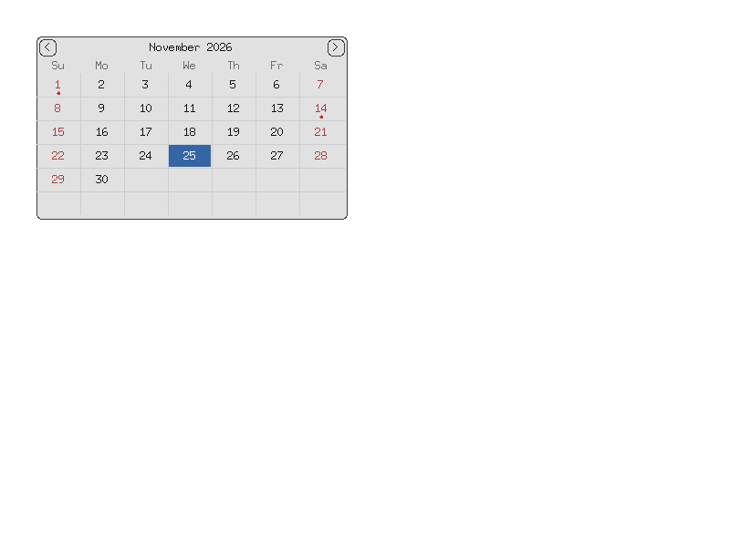

A month calendar: a heading with `<` / `>` month buttons and the month title, a Su–Sa day-name row, and a 6x7 grid of day cells with faint grid lines. Today and the selected day are highlighted in the grid.

**Constructor:** `GtkCalendar(Display* display, int screen, Window window, GC gc, SStyle_Manager* styles, int x, int y, int width, int height)`

**API** (widget-specific methods/properties/signals ONLY — skip the common ones):

- `set_text(std::string t)` / `get_text()` — stored but not drawn (default `"GtkCalendar"`)

- `set_date(int y, int m, int d)` / `get_date(int& y, int& m, int& d)` — the selected date (default 2026-11-25); `get_year()`, `get_month()`, `get_day()` read the parts

- `set_today(int y, int m, int d)` — the date highlighted as today (default 2026-11-25)

- `select_day(int d)` — selects a day of the displayed month

- `prev_month()` / `next_month()` — step the displayed month (fires `on_month_changed`)

- `mark_day(int d)` / `unmark_day(int d)` / `clear_marks()` / `get_marked(int d)` — marked days

- `set_show_heading(bool s)` / `set_show_day_names(bool s)` — heading and day-name row (both default on)

- `date_string()` — the selected date as `"YYYY-MM-DD"`; `is_leap(int y)`, `days_in_month(int y, int m)`, `weekday_of(int y, int m, int d)`, `month_name(int m)` are public calendar helpers

- signal `on_day_selected` (`std::function<void()>`) — fires when a day is clicked

- signal `on_month_changed` (`std::function<void()>`) — fires when the displayed month changes

**Example:**

```cpp
#include "GtkCalendar.h"

#include <cstdio>

int main()
{
    Display* display = XOpenDisplay(nullptr);
    if (!display) { return 1; }
    int screen = DefaultScreen(display);
    Window window = XCreateSimpleWindow(display, RootWindow(display, screen), 100, 100, 800, 600, 1, BlackPixel(display, screen), WhitePixel(display, screen));
    XStoreName(display, window, "GtkCalendar - XFrame demo");
    XSelectInput(display, window, ExposureMask | KeyPressMask | StructureNotifyMask | ButtonPressMask | ButtonReleaseMask | PointerMotionMask);
    Atom deleteWindowMessage = XInternAtom(display, "WM_DELETE_WINDOW", False);
    XSetWMProtocols(display, window, &deleteWindowMessage, 1);
    XMapWindow(display, window);
    GC gc = DefaultGC(display, screen);
    SStyle_Manager styles(display, window, screen, gc);
    styles.add_style_ex("default", Srgb{225, 225, 225}, Srgb{120, 120, 120}, Srgb{60, 60, 60}, Srgb{20, 20, 20}, 6, 1, "-misc-fixed-medium-r-normal--13-*");
    styles.set_active_style_byName("default");
    GtkCalendar widget(display, screen, window, gc, &styles, 40, 40, 340, 200);
    widget.set_date(2026, 11, 25);
    widget.mark_day(15);
    widget.on_day_selected = [] { std::printf("day selected\n"); };
    widget.draw();
    bool running = true;
    while (running)
    {
        XEvent event;
        XNextEvent(display, &event);
        bool handled = false;
        switch (event.type)
        {
        case Expose:
            handled = true;
            break;
        case ButtonPress:
            handled = widget.on_button_press(event.xbutton.x, event.xbutton.y, event.xbutton.button);
            break;
        case ButtonRelease:
            handled = widget.on_button_release(event.xbutton.x, event.xbutton.y, event.xbutton.button);
            break;
        case MotionNotify:
            handled = widget.on_motion(event.xmotion.x, event.xmotion.y);
            break;
        case KeyPress:
        {
            char buffer[32];
            KeySym key = 0;
            int n = XLookupString(&event.xkey, buffer, (int)sizeof(buffer) - 1, &key, nullptr);
            buffer[n] = 0;
            handled = widget.on_key(key, buffer);
            break;
        }
        case ClientMessage:
            if ((Atom)event.xclient.data.l[0] == deleteWindowMessage)
            {
                running = false;
            }
            break;
        }
        if (handled)
        {
            XClearWindow(display, window);
            widget.draw();
            XFlush(display);
        }
    }
    XCloseDisplay(display);
    return 0;
}
```

**Notes:** Months are 1..12. Clicking a day cell selects it; clicking the `<` / `>` zones steps the month.

## GtkCellView

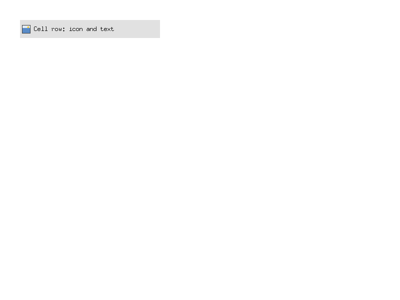

A single row of a list/tree: an optional 16x16 picture cell (a tiny landscape — sky band and sun dot) followed by the text cell, on a settable background.

**Constructor:** `GtkCellView(Display* display, int screen, Window window, GC gc, SStyle_Manager* styles, int x, int y, int width, int height)`

**API** (widget-specific methods/properties/signals ONLY — skip the common ones):

- `set_text(std::string t)` / `get_text()` — the text cell (default `"Cell row: icon and text"`)

- `set_pixmap_visible(bool v)` / `get_pixmap_visible()` — whether the picture cell is drawn (default `true`)

- `set_pixmap_color(int r, int g, int b)` — the picture cell colour (default `{90, 140, 200}`)

- `set_draw_sensitive(bool sensitive)` / `get_draw_sensitive()` — `false` draws the row greyed/insensitive (default `true`)

- `set_background_color(int r, int g, int b)` / `clear_background_color()` / `get_background_set()` — an explicit background colour (default unset, style fill is used)

- `set_spacing(int px)` / `get_spacing()` — the gap between the picture and text cells (default `6`)

- signal `on_click` (`std::function<void()>`) — fires on click

**Example:**

```cpp
#include "GtkCellView.h"

#include <cstdio>

int main()
{
    Display* display = XOpenDisplay(nullptr);
    if (!display) { return 1; }
    int screen = DefaultScreen(display);
    Window window = XCreateSimpleWindow(display, RootWindow(display, screen), 100, 100, 800, 600, 1, BlackPixel(display, screen), WhitePixel(display, screen));
    XStoreName(display, window, "GtkCellView - XFrame demo");
    XSelectInput(display, window, ExposureMask | KeyPressMask | StructureNotifyMask | ButtonPressMask | ButtonReleaseMask | PointerMotionMask);
    Atom deleteWindowMessage = XInternAtom(display, "WM_DELETE_WINDOW", False);
    XSetWMProtocols(display, window, &deleteWindowMessage, 1);
    XMapWindow(display, window);
    GC gc = DefaultGC(display, screen);
    SStyle_Manager styles(display, window, screen, gc);
    styles.add_style_ex("default", Srgb{225, 225, 225}, Srgb{120, 120, 120}, Srgb{60, 60, 60}, Srgb{20, 20, 20}, 6, 1, "-misc-fixed-medium-r-normal--13-*");
    styles.set_active_style_byName("default");
    GtkCellView widget(display, screen, window, gc, &styles, 40, 40, 280, 36);
    widget.set_pixmap_color(90, 140, 200);
    widget.set_spacing(6);
    widget.on_click = [] { std::printf("cell clicked\n"); };
    widget.draw();
    bool running = true;
    while (running)
    {
        XEvent event;
        XNextEvent(display, &event);
        bool handled = false;
        switch (event.type)
        {
        case Expose:
            handled = true;
            break;
        case ButtonPress:
            handled = widget.on_button_press(event.xbutton.x, event.xbutton.y, event.xbutton.button);
            break;
        case ButtonRelease:
            handled = widget.on_button_release(event.xbutton.x, event.xbutton.y, event.xbutton.button);
            break;
        case MotionNotify:
            handled = widget.on_motion(event.xmotion.x, event.xmotion.y);
            break;
        case KeyPress:
        {
            char buffer[32];
            KeySym key = 0;
            int n = XLookupString(&event.xkey, buffer, (int)sizeof(buffer) - 1, &key, nullptr);
            buffer[n] = 0;
            handled = widget.on_key(key, buffer);
            break;
        }
        case ClientMessage:
            if ((Atom)event.xclient.data.l[0] == deleteWindowMessage)
            {
                running = false;
            }
            break;
        }
        if (handled)
        {
            XClearWindow(display, window);
            widget.draw();
            XFlush(display);
        }
    }
    XCloseDisplay(display);
    return 0;
}
```

## GtkDrawingArea

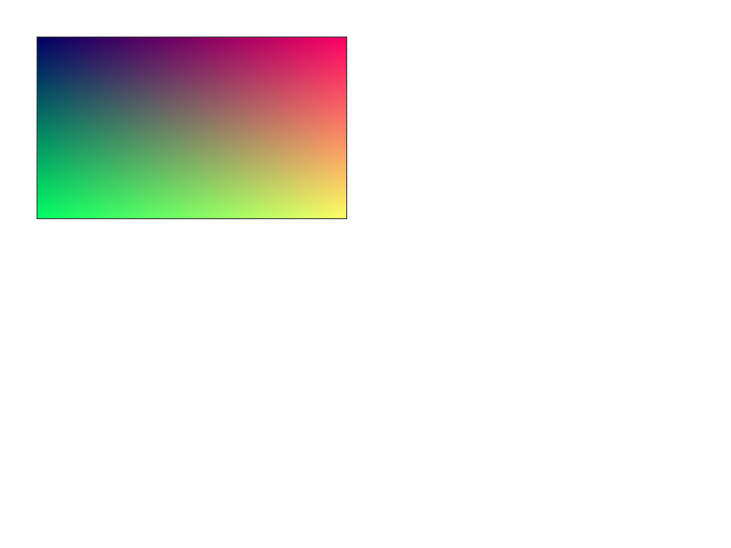

A blank canvas widget that owns a `Canvas` sized to its bounds and blits it into its rectangle, with a thin frame. It starts with a gradient demo scene already painted.

**Constructor:** `GtkDrawingArea(Display* display, int screen, Window window, GC gc, SStyle_Manager* styles, int x, int y, int width, int height)`

**API** (widget-specific methods/properties/signals ONLY — skip the common ones):

- `set_text(std::string t)` / `get_text()` — stored but not drawn (default `"GtkDrawingArea"`)

- `canvas()` (`Canvas&`) / `canvas_ptr()` (`Canvas*`) — the owned canvas; draw on it with the `Canvas` API (`clear`, `fillRect`, `drawGradient`, `setPixel`, …)

- `get_draw_count()` — the draw count

- `clear(uint32_t rgb)` — clears the canvas to a colour

- `queue_draw()` — requests a redraw

- signal `on_draw_point` (`std::function<void(int, int)>`) — fires with widget-local coordinates on click

**Example:**

```cpp
#include "GtkDrawingArea.h"

#include <cstdio>

int main()
{
    Display* display = XOpenDisplay(nullptr);
    if (!display) { return 1; }
    int screen = DefaultScreen(display);
    Window window = XCreateSimpleWindow(display, RootWindow(display, screen), 100, 100, 800, 600, 1, BlackPixel(display, screen), WhitePixel(display, screen));
    XStoreName(display, window, "GtkDrawingArea - XFrame demo");
    XSelectInput(display, window, ExposureMask | KeyPressMask | StructureNotifyMask | ButtonPressMask | ButtonReleaseMask | PointerMotionMask);
    Atom deleteWindowMessage = XInternAtom(display, "WM_DELETE_WINDOW", False);
    XSetWMProtocols(display, window, &deleteWindowMessage, 1);
    XMapWindow(display, window);
    GC gc = DefaultGC(display, screen);
    SStyle_Manager styles(display, window, screen, gc);
    styles.add_style_ex("default", Srgb{225, 225, 225}, Srgb{120, 120, 120}, Srgb{60, 60, 60}, Srgb{20, 20, 20}, 6, 1, "-misc-fixed-medium-r-normal--13-*");
    styles.set_active_style_byName("default");
    GtkDrawingArea widget(display, screen, window, gc, &styles, 40, 40, 340, 200);
    widget.clear(0x303030);
    widget.on_draw_point = [](int x, int y) { std::printf("point %d %d\n", x, y); };
    widget.draw();
    bool running = true;
    while (running)
    {
        XEvent event;
        XNextEvent(display, &event);
        bool handled = false;
        switch (event.type)
        {
        case Expose:
            handled = true;
            break;
        case ButtonPress:
            handled = widget.on_button_press(event.xbutton.x, event.xbutton.y, event.xbutton.button);
            break;
        case ButtonRelease:
            handled = widget.on_button_release(event.xbutton.x, event.xbutton.y, event.xbutton.button);
            break;
        case MotionNotify:
            handled = widget.on_motion(event.xmotion.x, event.xmotion.y);
            break;
        case KeyPress:
        {
            char buffer[32];
            KeySym key = 0;
            int n = XLookupString(&event.xkey, buffer, (int)sizeof(buffer) - 1, &key, nullptr);
            buffer[n] = 0;
            handled = widget.on_key(key, buffer);
            break;
        }
        case ClientMessage:
            if ((Atom)event.xclient.data.l[0] == deleteWindowMessage)
            {
                running = false;
            }
            break;
        }
        if (handled)
        {
            XClearWindow(display, window);
            widget.draw();
            XFlush(display);
        }
    }
    XCloseDisplay(display);
    return 0;
}
```

**Notes:** Clicking stamps a 5x5 white dot on the canvas. Pressing `c` clears the canvas (dark grey) and `g` repaints the gradient. Resizing the widget (`set_bounds`) resizes the canvas and repaints the gradient.

## GtkGLArea

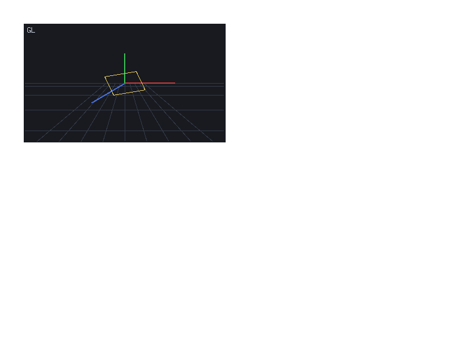

An OpenGL area in name only: there is no GL context here. `draw()` paints a fake 3D scene in plain X11 — a dark viewport, a perspective floor grid, red/green/blue axes, and a wireframe square rotated by `rotation_` (default 30 degrees).

**Constructor:** `GtkGLArea(Display* display, int screen, Window window, GC gc, SStyle_Manager* styles, int x, int y, int width, int height)`

**API** (widget-specific methods/properties/signals ONLY — skip the common ones):

- `set_text(std::string t)` / `get_text()` — drawn as a small caption at the top left (default `"GL"`)

- `set_render_callback(std::function<bool()> cb)` — sets `on_render`; it runs at the end of `draw()` and returning `false` stops rendering

- `queue_render()` — counts a render request; `get_render_requests()` reads the count

- `make_current()` / `get_is_current()` — `make_current()` only sets a flag (it does not bind any GL context)

- `set_auto_render(bool a)` / `get_auto_render()` — auto-render flag (default `true`)

- `set_has_depth_buffer(bool d)` / `get_has_depth_buffer()`, `set_has_stencil_buffer(bool s)` / `get_has_stencil_buffer()`, `set_use_es(bool e)` / `get_use_es()` — stored flags only (all default `false`)

- `set_rotation(double deg)` / `get_rotation()` — the demo scene angle in degrees (default `30.0`)

- signal `on_render` (`std::function<bool()>`) — the render callback

**Example:**

```cpp
#include "GtkGLArea.h"

#include <cstdio>

int main()
{
    Display* display = XOpenDisplay(nullptr);
    if (!display) { return 1; }
    int screen = DefaultScreen(display);
    Window window = XCreateSimpleWindow(display, RootWindow(display, screen), 100, 100, 800, 600, 1, BlackPixel(display, screen), WhitePixel(display, screen));
    XStoreName(display, window, "GtkGLArea - XFrame demo");
    XSelectInput(display, window, ExposureMask | KeyPressMask | StructureNotifyMask | ButtonPressMask | ButtonReleaseMask | PointerMotionMask);
    Atom deleteWindowMessage = XInternAtom(display, "WM_DELETE_WINDOW", False);
    XSetWMProtocols(display, window, &deleteWindowMessage, 1);
    XMapWindow(display, window);
    GC gc = DefaultGC(display, screen);
    SStyle_Manager styles(display, window, screen, gc);
    styles.add_style_ex("default", Srgb{225, 225, 225}, Srgb{120, 120, 120}, Srgb{60, 60, 60}, Srgb{20, 20, 20}, 6, 1, "-misc-fixed-medium-r-normal--13-*");
    styles.set_active_style_byName("default");
    GtkGLArea widget(display, screen, window, gc, &styles, 40, 40, 340, 200);
    widget.set_rotation(45.0);
    widget.set_render_callback([] { return true; });
    widget.draw();
    bool running = true;
    while (running)
    {
        XEvent event;
        XNextEvent(display, &event);
        bool handled = false;
        switch (event.type)
        {
        case Expose:
            handled = true;
            break;
        case ButtonPress:
            handled = widget.on_button_press(event.xbutton.x, event.xbutton.y, event.xbutton.button);
            break;
        case ButtonRelease:
            handled = widget.on_button_release(event.xbutton.x, event.xbutton.y, event.xbutton.button);
            break;
        case MotionNotify:
            handled = widget.on_motion(event.xmotion.x, event.xmotion.y);
            break;
        case KeyPress:
        {
            char buffer[32];
            KeySym key = 0;
            int n = XLookupString(&event.xkey, buffer, (int)sizeof(buffer) - 1, &key, nullptr);
            buffer[n] = 0;
            handled = widget.on_key(key, buffer);
            break;
        }
        case ClientMessage:
            if ((Atom)event.xclient.data.l[0] == deleteWindowMessage)
            {
                running = false;
            }
            break;
        }
        if (handled)
        {
            XClearWindow(display, window);
            widget.draw();
            XFlush(display);
        }
    }
    XCloseDisplay(display);
    return 0;
}
```

**Notes:** Dragging across the viewport while focused spins the scene (the rotation follows the pointer x position). The depth/stencil/ES flags change nothing about what is drawn.

## GtkImage

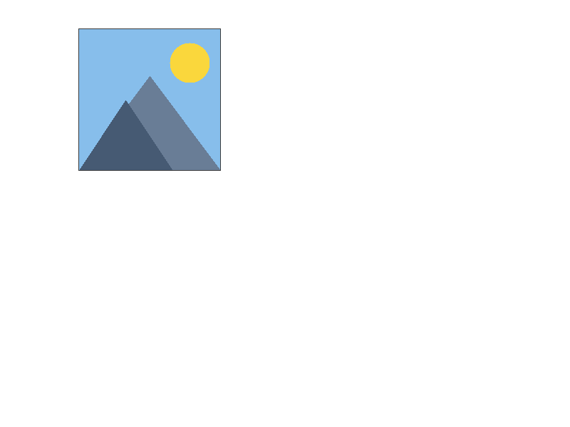

A framed picture area. With no file it draws a placeholder landscape (sky, sun, mountains); with a file set it draws a checkerboard stand-in and captions it with the file's basename. No image file is ever loaded or decoded.

**Constructor:** `GtkImage(Display* display, int screen, Window window, GC gc, SStyle_Manager* styles, int x, int y, int width, int height)`

**API** (widget-specific methods/properties/signals ONLY — skip the common ones):

- `set_text(std::string t)` / `get_text()` — stored but not drawn (default `"GtkImage"`)

- `set_filename(std::string f)` / `get_filename()` — the file name (default `""`)

- `clear()` — clears the file name back to the placeholder

- `set_icon_name(std::string n)` / `get_icon_name()` — the icon name (default `"image-x-generic"`, stored only)

- `set_icon_size(int s)` / `get_icon_size()` — 0 = small, 1 = normal (default), 2 = large

- `set_pixel_size(int px)` / `get_pixel_size()` — the drawn size in pixels; `-1` (default) uses the widget bounds

**Example:**

```cpp
#include "GtkImage.h"

#include <cstdio>

int main()
{
    Display* display = XOpenDisplay(nullptr);
    if (!display) { return 1; }
    int screen = DefaultScreen(display);
    Window window = XCreateSimpleWindow(display, RootWindow(display, screen), 100, 100, 800, 600, 1, BlackPixel(display, screen), WhitePixel(display, screen));
    XStoreName(display, window, "GtkImage - XFrame demo");
    XSelectInput(display, window, ExposureMask | KeyPressMask | StructureNotifyMask | ButtonPressMask | ButtonReleaseMask | PointerMotionMask);
    Atom deleteWindowMessage = XInternAtom(display, "WM_DELETE_WINDOW", False);
    XSetWMProtocols(display, window, &deleteWindowMessage, 1);
    XMapWindow(display, window);
    GC gc = DefaultGC(display, screen);
    SStyle_Manager styles(display, window, screen, gc);
    styles.add_style_ex("default", Srgb{225, 225, 225}, Srgb{120, 120, 120}, Srgb{60, 60, 60}, Srgb{20, 20, 20}, 6, 1, "-misc-fixed-medium-r-normal--13-*");
    styles.set_active_style_byName("default");
    GtkImage widget(display, screen, window, gc, &styles, 40, 40, 340, 200);
    widget.set_filename("photo.jpg");
    widget.set_pixel_size(64);
    widget.draw();
    bool running = true;
    while (running)
    {
        XEvent event;
        XNextEvent(display, &event);
        bool handled = false;
        switch (event.type)
        {
        case Expose:
            handled = true;
            break;
        case ButtonPress:
            handled = widget.on_button_press(event.xbutton.x, event.xbutton.y, event.xbutton.button);
            break;
        case ButtonRelease:
            handled = widget.on_button_release(event.xbutton.x, event.xbutton.y, event.xbutton.button);
            break;
        case MotionNotify:
            handled = widget.on_motion(event.xmotion.x, event.xmotion.y);
            break;
        case KeyPress:
        {
            char buffer[32];
            KeySym key = 0;
            int n = XLookupString(&event.xkey, buffer, (int)sizeof(buffer) - 1, &key, nullptr);
            buffer[n] = 0;
            handled = widget.on_key(key, buffer);
            break;
        }
        case ClientMessage:
            if ((Atom)event.xclient.data.l[0] == deleteWindowMessage)
            {
                running = false;
            }
            break;
        }
        if (handled)
        {
            XClearWindow(display, window);
            widget.draw();
            XFlush(display);
        }
    }
    XCloseDisplay(display);
    return 0;
}
```

**Notes:** Disabled images get horizontal grey lines drawn over them. Clicking only takes focus; there are no signals.

## GtkInfoBar

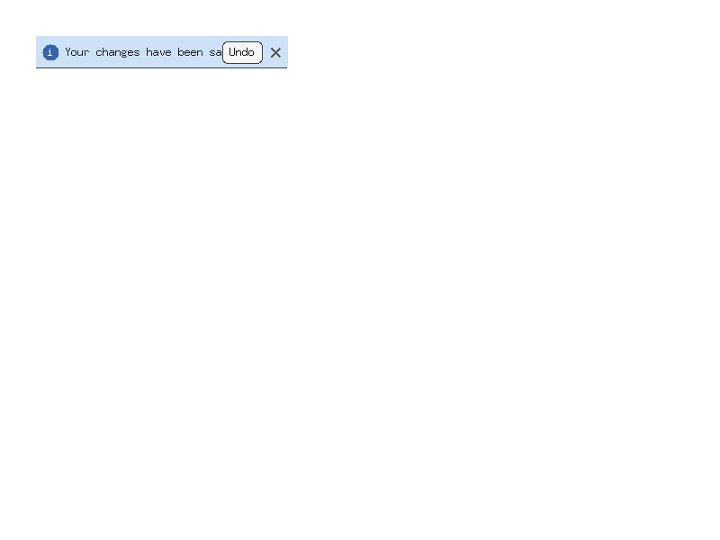

A message bar: a coloured band with a glyph disc (letter `i`, `!`, or `?` depending on the type), the message text, action buttons, and an optional close box.

**Constructor:** `GtkInfoBar(Display* display, int screen, Window window, GC gc, SStyle_Manager* styles, int x, int y, int width, int height)`

**API** (widget-specific methods/properties/signals ONLY — skip the common ones):

- `set_text(std::string t)` / `get_text()` — the message (default `"Your changes have been saved."`)

- `set_message_type(int t)` / `get_message_type()` — 0 = info, 1 = warning, 2 = error, 3 = question (default `0`)

- `set_show_close_button(bool s)` / `get_show_close_button()` — the close box (default `true`)

- `add_button(std::string label, int response_id)` / `clear_buttons()` / `button_count()` — the action buttons

- signal `on_response` (`std::function<void(int)>`) — fires with the button's response id, or `-1` when the close box is used

**Example:**

```cpp
#include "GtkInfoBar.h"

#include <cstdio>

int main()
{
    Display* display = XOpenDisplay(nullptr);
    if (!display) { return 1; }
    int screen = DefaultScreen(display);
    Window window = XCreateSimpleWindow(display, RootWindow(display, screen), 100, 100, 800, 600, 1, BlackPixel(display, screen), WhitePixel(display, screen));
    XStoreName(display, window, "GtkInfoBar - XFrame demo");
    XSelectInput(display, window, ExposureMask | KeyPressMask | StructureNotifyMask | ButtonPressMask | ButtonReleaseMask | PointerMotionMask);
    Atom deleteWindowMessage = XInternAtom(display, "WM_DELETE_WINDOW", False);
    XSetWMProtocols(display, window, &deleteWindowMessage, 1);
    XMapWindow(display, window);
    GC gc = DefaultGC(display, screen);
    SStyle_Manager styles(display, window, screen, gc);
    styles.add_style_ex("default", Srgb{225, 225, 225}, Srgb{120, 120, 120}, Srgb{60, 60, 60}, Srgb{20, 20, 20}, 6, 1, "-misc-fixed-medium-r-normal--13-*");
    styles.set_active_style_byName("default");
    GtkInfoBar widget(display, screen, window, gc, &styles, 40, 40, 280, 36);
    widget.set_message_type(1);
    widget.add_button("OK", 1);
    widget.on_response = [](int id) { std::printf("response %d\n", id); };
    widget.draw();
    bool running = true;
    while (running)
    {
        XEvent event;
        XNextEvent(display, &event);
        bool handled = false;
        switch (event.type)
        {
        case Expose:
            handled = true;
            break;
        case ButtonPress:
            handled = widget.on_button_press(event.xbutton.x, event.xbutton.y, event.xbutton.button);
            break;
        case ButtonRelease:
            handled = widget.on_button_release(event.xbutton.x, event.xbutton.y, event.xbutton.button);
            break;
        case MotionNotify:
            handled = widget.on_motion(event.xmotion.x, event.xmotion.y);
            break;
        case KeyPress:
        {
            char buffer[32];
            KeySym key = 0;
            int n = XLookupString(&event.xkey, buffer, (int)sizeof(buffer) - 1, &key, nullptr);
            buffer[n] = 0;
            handled = widget.on_key(key, buffer);
            break;
        }
        case ClientMessage:
            if ((Atom)event.xclient.data.l[0] == deleteWindowMessage)
            {
                running = false;
            }
            break;
        }
        if (handled)
        {
            XClearWindow(display, window);
            widget.draw();
            XFlush(display);
        }
    }
    XCloseDisplay(display);
    return 0;
}
```

**Notes:** The bar colour follows the type (info/warning/error/question each get their own band colour). Buttons are laid out right-aligned inside the bar.

## GtkInscription

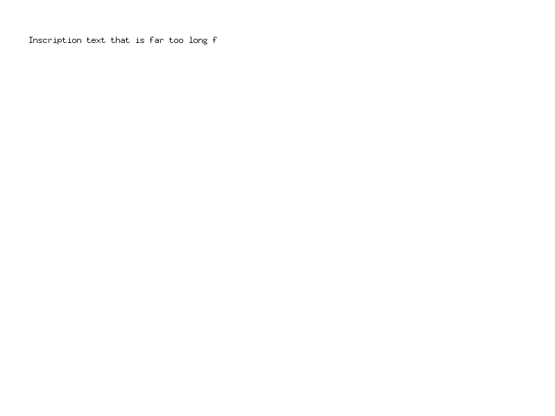

A single line of text that is clipped to the longest prefix that fits its box — the final glyph may overrun by a pixel or two, exactly like the real widget clipping mid-glyph.

**Constructor:** `GtkInscription(Display* display, int screen, Window window, GC gc, SStyle_Manager* styles, int x, int y, int width, int height)`

**API** (widget-specific methods/properties/signals ONLY — skip the common ones):

- `set_text(std::string t)` / `get_text()` — the text (default `"Inscription text that is far too long for its box"`)

- `set_min_chars(int n)` / `get_min_chars()` — the minimum-width hint in characters (default `0`)

- `set_nat_chars(int n)` / `get_nat_chars()` — the natural-width hint in characters (default `0`)

- `set_xalign(double a)` / `get_xalign()` — horizontal alignment, 0 = left to 1 = right (default `0.0`)

- `min_width_px()` / `nat_width_px()` — the char hints converted to pixels using the current font

**Example:**

```cpp
#include "GtkInscription.h"

#include <cstdio>

int main()
{
    Display* display = XOpenDisplay(nullptr);
    if (!display) { return 1; }
    int screen = DefaultScreen(display);
    Window window = XCreateSimpleWindow(display, RootWindow(display, screen), 100, 100, 800, 600, 1, BlackPixel(display, screen), WhitePixel(display, screen));
    XStoreName(display, window, "GtkInscription - XFrame demo");
    XSelectInput(display, window, ExposureMask | KeyPressMask | StructureNotifyMask | ButtonPressMask | ButtonReleaseMask | PointerMotionMask);
    Atom deleteWindowMessage = XInternAtom(display, "WM_DELETE_WINDOW", False);
    XSetWMProtocols(display, window, &deleteWindowMessage, 1);
    XMapWindow(display, window);
    GC gc = DefaultGC(display, screen);
    SStyle_Manager styles(display, window, screen, gc);
    styles.add_style_ex("default", Srgb{225, 225, 225}, Srgb{120, 120, 120}, Srgb{60, 60, 60}, Srgb{20, 20, 20}, 6, 1, "-misc-fixed-medium-r-normal--13-*");
    styles.set_active_style_byName("default");
    GtkInscription widget(display, screen, window, gc, &styles, 40, 40, 280, 36);
    widget.set_min_chars(10);
    widget.set_nat_chars(20);
    widget.draw();
    bool running = true;
    while (running)
    {
        XEvent event;
        XNextEvent(display, &event);
        bool handled = false;
        switch (event.type)
        {
        case Expose:
            handled = true;
            break;
        case ButtonPress:
            handled = widget.on_button_press(event.xbutton.x, event.xbutton.y, event.xbutton.button);
            break;
        case ButtonRelease:
            handled = widget.on_button_release(event.xbutton.x, event.xbutton.y, event.xbutton.button);
            break;
        case MotionNotify:
            handled = widget.on_motion(event.xmotion.x, event.xmotion.y);
            break;
        case KeyPress:
        {
            char buffer[32];
            KeySym key = 0;
            int n = XLookupString(&event.xkey, buffer, (int)sizeof(buffer) - 1, &key, nullptr);
            buffer[n] = 0;
            handled = widget.on_key(key, buffer);
            break;
        }
        case ClientMessage:
            if ((Atom)event.xclient.data.l[0] == deleteWindowMessage)
            {
                running = false;
            }
            break;
        }
        if (handled)
        {
            XClearWindow(display, window);
            widget.draw();
            XFlush(display);
        }
    }
    XCloseDisplay(display);
    return 0;
}
```

**Notes:** The char counts are size hints only — they do not change what is drawn. Display-only: clicking only takes focus, and there are no signals.

## GtkInvisible


NON-VISUAL by design: `draw()` intentionally does nothing — not even a design-time glyph — and every event handler returns `false`. It exists to hold data and to own a grab, as the GTK original does for drag-and-drop and selections.

**Constructor:** `GtkInvisible(Display* display, int screen, Window window, GC gc, SStyle_Manager* styles, int x, int y, int width, int height)`

**API** (widget-specific methods/properties/signals ONLY — skip the common ones):

- `set_text(std::string t)` / `get_text()` — stored but never drawn (default `""`)

- `set_data(std::string d)` / `get_data()` — an opaque data string

- `set_selection_name(std::string s)` / `get_selection_name()` — the selection name

- `grab()` / `ungrab()` / `has_grab()` — the grab flag

- signal `on_grab` (`std::function<void()>`) — fires on `grab()`

- signal `on_ungrab` (`std::function<void()>`) — fires on `ungrab()`

**Example:**

```cpp
#include "GtkInvisible.h"

#include <cstdio>

int main()
{
    Display* display = XOpenDisplay(nullptr);
    if (!display) { return 1; }
    int screen = DefaultScreen(display);
    Window window = XCreateSimpleWindow(display, RootWindow(display, screen), 100, 100, 800, 600, 1, BlackPixel(display, screen), WhitePixel(display, screen));
    XStoreName(display, window, "GtkInvisible - XFrame demo");
    XSelectInput(display, window, ExposureMask | KeyPressMask | StructureNotifyMask | ButtonPressMask | ButtonReleaseMask | PointerMotionMask);
    Atom deleteWindowMessage = XInternAtom(display, "WM_DELETE_WINDOW", False);
    XSetWMProtocols(display, window, &deleteWindowMessage, 1);
    XMapWindow(display, window);
    GC gc = DefaultGC(display, screen);
    SStyle_Manager styles(display, window, screen, gc);
    styles.add_style_ex("default", Srgb{225, 225, 225}, Srgb{120, 120, 120}, Srgb{60, 60, 60}, Srgb{20, 20, 20}, 6, 1, "-misc-fixed-medium-r-normal--13-*");
    styles.set_active_style_byName("default");
    GtkInvisible widget(display, screen, window, gc, &styles, 40, 40, 340, 200);
    widget.set_data("drag-data");
    widget.set_selection_name("PRIMARY");
    widget.on_grab = [] { std::printf("grabbed\n"); };
    widget.draw();
    bool running = true;
    while (running)
    {
        XEvent event;
        XNextEvent(display, &event);
        bool handled = false;
        switch (event.type)
        {
        case Expose:
            handled = true;
            break;
        case ButtonPress:
            handled = widget.on_button_press(event.xbutton.x, event.xbutton.y, event.xbutton.button);
            break;
        case ButtonRelease:
            handled = widget.on_button_release(event.xbutton.x, event.xbutton.y, event.xbutton.button);
            break;
        case MotionNotify:
            handled = widget.on_motion(event.xmotion.x, event.xmotion.y);
            break;
        case KeyPress:
        {
            char buffer[32];
            KeySym key = 0;
            int n = XLookupString(&event.xkey, buffer, (int)sizeof(buffer) - 1, &key, nullptr);
            buffer[n] = 0;
            handled = widget.on_key(key, buffer);
            break;
        }
        case ClientMessage:
            if ((Atom)event.xclient.data.l[0] == deleteWindowMessage)
            {
                running = false;
            }
            break;
        }
        if (handled)
        {
            XClearWindow(display, window);
            widget.draw();
            XFlush(display);
        }
    }
    XCloseDisplay(display);
    return 0;
}
```

**Notes:** The example below constructs it and sets data on it; there is nothing to see on screen, which is the point.

## GtkLabel


Plain text with word wrap and horizontal/vertical alignment. Selectable labels support click-drag selection, highlighted behind the selected characters.

**Constructor:** `GtkLabel(Display* display, int screen, Window window, GC gc, SStyle_Manager* styles, int x, int y, int width, int height)`

**API** (widget-specific methods/properties/signals ONLY — skip the common ones):

- `set_text(std::string t)` / `get_text()` — the text (default `"Label"`)

- `set_xalign(double a)` / `get_xalign()` — 0 = left, 0.5 = centre, 1 = right (default `0.0`)

- `set_yalign(double a)` / `get_yalign()` — 0 = top, 0.5 = middle, 1 = bottom (default `0.5`)

- `set_wrap(bool w)` / `get_wrap()` — word wrap (default `false`)

- `set_selectable(bool s)` / `get_selectable()` — whether the user can select text (default `false`)

- `get_selected_text()` — the currently selected substring (empty when nothing is selected)

**Example:**

```cpp
#include "GtkLabel.h"

#include <cstdio>

int main()
{
    Display* display = XOpenDisplay(nullptr);
    if (!display) { return 1; }
    int screen = DefaultScreen(display);
    Window window = XCreateSimpleWindow(display, RootWindow(display, screen), 100, 100, 800, 600, 1, BlackPixel(display, screen), WhitePixel(display, screen));
    XStoreName(display, window, "GtkLabel - XFrame demo");
    XSelectInput(display, window, ExposureMask | KeyPressMask | StructureNotifyMask | ButtonPressMask | ButtonReleaseMask | PointerMotionMask);
    Atom deleteWindowMessage = XInternAtom(display, "WM_DELETE_WINDOW", False);
    XSetWMProtocols(display, window, &deleteWindowMessage, 1);
    XMapWindow(display, window);
    GC gc = DefaultGC(display, screen);
    SStyle_Manager styles(display, window, screen, gc);
    styles.add_style_ex("default", Srgb{225, 225, 225}, Srgb{120, 120, 120}, Srgb{60, 60, 60}, Srgb{20, 20, 20}, 6, 1, "-misc-fixed-medium-r-normal--13-*");
    styles.set_active_style_byName("default");
    GtkLabel widget(display, screen, window, gc, &styles, 40, 40, 280, 36);
    widget.set_wrap(true);
    widget.set_selectable(true);
    widget.draw();
    bool running = true;
    while (running)
    {
        XEvent event;
        XNextEvent(display, &event);
        bool handled = false;
        switch (event.type)
        {
        case Expose:
            handled = true;
            break;
        case ButtonPress:
            handled = widget.on_button_press(event.xbutton.x, event.xbutton.y, event.xbutton.button);
            break;
        case ButtonRelease:
            handled = widget.on_button_release(event.xbutton.x, event.xbutton.y, event.xbutton.button);
            break;
        case MotionNotify:
            handled = widget.on_motion(event.xmotion.x, event.xmotion.y);
            break;
        case KeyPress:
        {
            char buffer[32];
            KeySym key = 0;
            int n = XLookupString(&event.xkey, buffer, (int)sizeof(buffer) - 1, &key, nullptr);
            buffer[n] = 0;
            handled = widget.on_key(key, buffer);
            break;
        }
        case ClientMessage:
            if ((Atom)event.xclient.data.l[0] == deleteWindowMessage)
            {
                running = false;
            }
            break;
        }
        if (handled)
        {
            XClearWindow(display, window);
            widget.draw();
            XFlush(display);
        }
    }
    XCloseDisplay(display);
    return 0;
}
```

**Notes:** Selection works on single-line labels: click to start at a character, drag to extend. There are no signals.

## GtkLevelBar

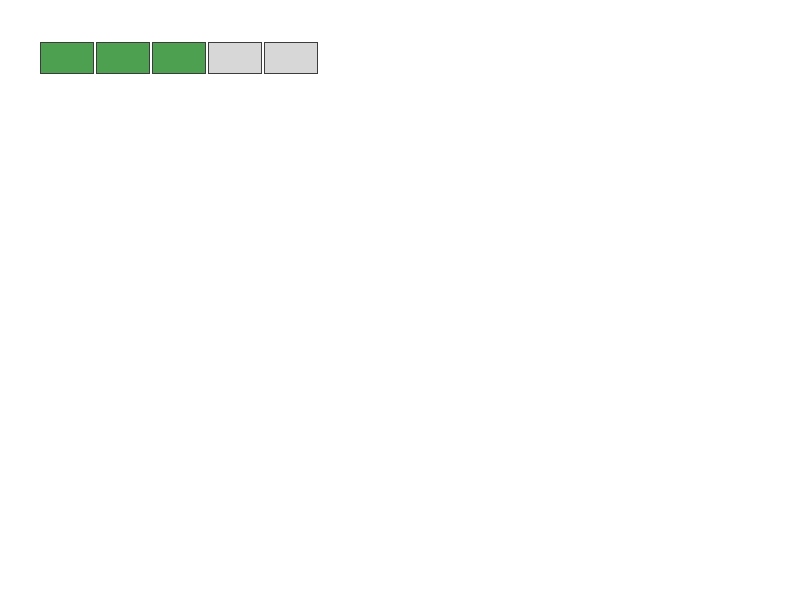

A level indicator: a trough filled to the current value. In discrete mode (the default) it draws one block per unit of range — with the default 0..5 range that is five blocks.

**Constructor:** `GtkLevelBar(Display* display, int screen, Window window, GC gc, SStyle_Manager* styles, int x, int y, int width, int height)`

**API** (widget-specific methods/properties/signals ONLY — skip the common ones):

- `set_text(std::string t)` / `get_text()` — stored but not drawn (default `"GtkLevelBar"`)

- `set_min_value(double v)` / `get_min_value()` — the range low end (default `0.0`)

- `set_max_value(double v)` / `get_max_value()` — the range high end (default `5.0`)

- `set_value(double v)` / `get_value()` — the level, clamped to [min, max] (default `3.0`)

- `set_discrete(bool d)` / `get_discrete()` — block mode vs a continuous fill (default `true`)

- `add_offset_value(std::string name, double value)` / `get_offset_value(std::string name, double& out)` / `remove_offset_value(std::string name)` — named offsets on the range

- signal: none

**Example:**

```cpp
#include "GtkLevelBar.h"

#include <cstdio>

int main()
{
    Display* display = XOpenDisplay(nullptr);
    if (!display) { return 1; }
    int screen = DefaultScreen(display);
    Window window = XCreateSimpleWindow(display, RootWindow(display, screen), 100, 100, 800, 600, 1, BlackPixel(display, screen), WhitePixel(display, screen));
    XStoreName(display, window, "GtkLevelBar - XFrame demo");
    XSelectInput(display, window, ExposureMask | KeyPressMask | StructureNotifyMask | ButtonPressMask | ButtonReleaseMask | PointerMotionMask);
    Atom deleteWindowMessage = XInternAtom(display, "WM_DELETE_WINDOW", False);
    XSetWMProtocols(display, window, &deleteWindowMessage, 1);
    XMapWindow(display, window);
    GC gc = DefaultGC(display, screen);
    SStyle_Manager styles(display, window, screen, gc);
    styles.add_style_ex("default", Srgb{225, 225, 225}, Srgb{120, 120, 120}, Srgb{60, 60, 60}, Srgb{20, 20, 20}, 6, 1, "-misc-fixed-medium-r-normal--13-*");
    styles.set_active_style_byName("default");
    GtkLevelBar widget(display, screen, window, gc, &styles, 40, 40, 280, 36);
    widget.set_value(3.0);
    widget.add_offset_value("low", 1.0);
    widget.draw();
    bool running = true;
    while (running)
    {
        XEvent event;
        XNextEvent(display, &event);
        bool handled = false;
        switch (event.type)
        {
        case Expose:
            handled = true;
            break;
        case ButtonPress:
            handled = widget.on_button_press(event.xbutton.x, event.xbutton.y, event.xbutton.button);
            break;
        case ButtonRelease:
            handled = widget.on_button_release(event.xbutton.x, event.xbutton.y, event.xbutton.button);
            break;
        case MotionNotify:
            handled = widget.on_motion(event.xmotion.x, event.xmotion.y);
            break;
        case KeyPress:
        {
            char buffer[32];
            KeySym key = 0;
            int n = XLookupString(&event.xkey, buffer, (int)sizeof(buffer) - 1, &key, nullptr);
            buffer[n] = 0;
            handled = widget.on_key(key, buffer);
            break;
        }
        case ClientMessage:
            if ((Atom)event.xclient.data.l[0] == deleteWindowMessage)
            {
                running = false;
            }
            break;
        }
        if (handled)
        {
            XClearWindow(display, window);
            widget.draw();
            XFlush(display);
        }
    }
    XCloseDisplay(display);
    return 0;
}
```

**Notes:** The fill colour comes from the offsets: orange while the value is at or below the `"low"` offset, green otherwise (grey when disabled). Only the `"low"` offset affects the colour; other offset names are stored but not used by `draw()`. Clicking sets the value from the click position.

## GtkMediaControls

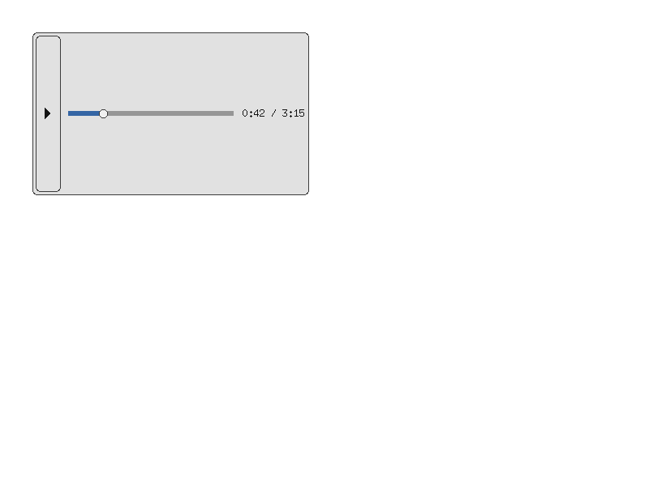

Media playback controls: a play/pause button, a seek bar with a knob, and `m:ss / m:ss` time labels. The default media is `"song.mp3"`, 42 seconds into 195.

**Constructor:** `GtkMediaControls(Display* display, int screen, Window window, GC gc, SStyle_Manager* styles, int x, int y, int width, int height)`

**API** (widget-specific methods/properties/signals ONLY — skip the common ones):

- `set_text(std::string t)` / `get_text()` — stored but not drawn (default `"GtkMediaControls"`)

- `play()` / `pause()` / `get_playing()` — transport (default paused)

- `set_position(double sec)` / `get_position()` — playback position in seconds (default `42.0`)

- `set_duration(double sec)` / `get_duration()` — the track length in seconds (default `195.0`)

- `set_media_label(std::string s)` / `get_media_label()` — the track name (default `"song.mp3"`)

- `step(double dt_sec)` — advances playback by `dt_sec`; returns `false` when the end is reached (and stops)

- `format_time(double sec)` — formats seconds as `m:ss`

- signal `on_seek` (`std::function<void(double)>`) — fires with the new position when the user drags the seek bar

- signal `on_play` (`std::function<void()>`) / `on_pause` (`std::function<void()>`) — fire on the play/pause button

**Example:**

```cpp
#include "GtkMediaControls.h"

#include <cstdio>
#include <chrono>
#include <unistd.h>

int main()
{
    Display* display = XOpenDisplay(nullptr);
    if (!display) { return 1; }
    int screen = DefaultScreen(display);
    Window window = XCreateSimpleWindow(display, RootWindow(display, screen), 100, 100, 800, 600, 1, BlackPixel(display, screen), WhitePixel(display, screen));
    XStoreName(display, window, "GtkMediaControls - XFrame demo");
    XSelectInput(display, window, ExposureMask | KeyPressMask | StructureNotifyMask | ButtonPressMask | ButtonReleaseMask | PointerMotionMask);
    Atom deleteWindowMessage = XInternAtom(display, "WM_DELETE_WINDOW", False);
    XSetWMProtocols(display, window, &deleteWindowMessage, 1);
    XMapWindow(display, window);
    GC gc = DefaultGC(display, screen);
    SStyle_Manager styles(display, window, screen, gc);
    styles.add_style_ex("default", Srgb{225, 225, 225}, Srgb{120, 120, 120}, Srgb{60, 60, 60}, Srgb{20, 20, 20}, 6, 1, "-misc-fixed-medium-r-normal--13-*");
    styles.set_active_style_byName("default");
    GtkMediaControls widget(display, screen, window, gc, &styles, 40, 40, 340, 200);
    widget.set_duration(195.0);
    widget.set_position(42.0);
    widget.play();
    widget.on_play = [] { std::printf("play\n"); };
    widget.on_seek = [](double sec) { std::printf("seek %f\n", sec); };
    widget.draw();
    auto last = std::chrono::steady_clock::now();
    bool running = true;
    while (running)
    {
        if (XPending(display))
        {
            XEvent event;
            XNextEvent(display, &event);
            bool handled = false;
            switch (event.type)
            {
            case Expose:
                handled = true;
                break;
            case ButtonPress:
                handled = widget.on_button_press(event.xbutton.x, event.xbutton.y, event.xbutton.button);
                break;
            case ButtonRelease:
                handled = widget.on_button_release(event.xbutton.x, event.xbutton.y, event.xbutton.button);
                break;
            case MotionNotify:
                handled = widget.on_motion(event.xmotion.x, event.xmotion.y);
                break;
            case KeyPress:
            {
                char buffer[32];
                KeySym key = 0;
                int n = XLookupString(&event.xkey, buffer, (int)sizeof(buffer) - 1, &key, nullptr);
                buffer[n] = 0;
                handled = widget.on_key(key, buffer);
                break;
            }
            case ClientMessage:
                if ((Atom)event.xclient.data.l[0] == deleteWindowMessage)
                {
                    running = false;
                }
                break;
            }
            if (handled)
            {
                XClearWindow(display, window);
                widget.draw();
                XFlush(display);
            }
        }
        else
        {
            auto now = std::chrono::steady_clock::now();
            if (std::chrono::duration_cast<std::chrono::milliseconds>(now - last).count() >= 100)
            {
                last = now;
                widget.step(0.1);

                XClearWindow(display, window);
                widget.draw();
                XFlush(display);
            }
            else
            {
                usleep(10000);
            }
        }
    }
    XCloseDisplay(display);
    return 0;
}
```

**Notes:** No audio is played — this is a control that tracks a position. The host must call `step()` from a timer (as in the example) for the position to advance; clicking the play button only flips `playing_`.

## GtkPicture

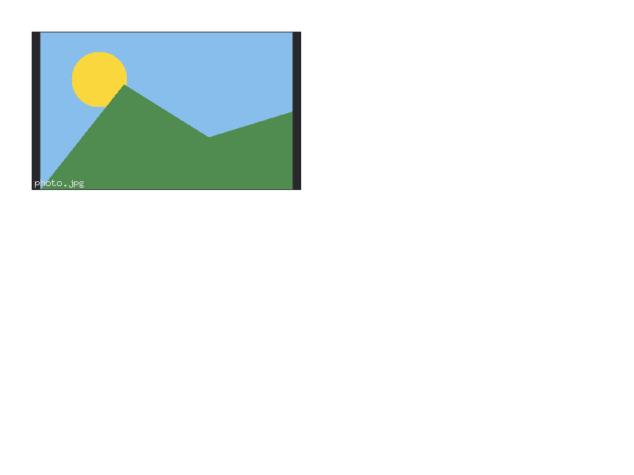

A picture widget: a dark letterbox area holding a landscape scene (sky, sun, hills) scaled to the content size. The file name only changes the caption — no image is ever loaded.

**Constructor:** `GtkPicture(Display* display, int screen, Window window, GC gc, SStyle_Manager* styles, int x, int y, int width, int height)`

**API** (widget-specific methods/properties/signals ONLY — skip the common ones):

- `set_text(std::string t)` / `get_text()` — stored but not drawn (default `"GtkPicture"`)

- `set_filename(std::string f)` / `get_filename()` — the file name (default `"photo.jpg"`)

- `set_keep_aspect_ratio(bool k)` / `get_keep_aspect_ratio()` — scale by the smaller factor so the picture is not stretched (default `true`)

- `set_can_shrink(bool s)` / `get_can_shrink()` — whether the picture may shrink below its content size (default `true`)

- `set_content_size(int w, int h)` / `get_content_width()` / `get_content_height()` — the intrinsic picture size (default 640x400)

**Example:**

```cpp
#include "GtkPicture.h"

#include <cstdio>

int main()
{
    Display* display = XOpenDisplay(nullptr);
    if (!display) { return 1; }
    int screen = DefaultScreen(display);
    Window window = XCreateSimpleWindow(display, RootWindow(display, screen), 100, 100, 800, 600, 1, BlackPixel(display, screen), WhitePixel(display, screen));
    XStoreName(display, window, "GtkPicture - XFrame demo");
    XSelectInput(display, window, ExposureMask | KeyPressMask | StructureNotifyMask | ButtonPressMask | ButtonReleaseMask | PointerMotionMask);
    Atom deleteWindowMessage = XInternAtom(display, "WM_DELETE_WINDOW", False);
    XSetWMProtocols(display, window, &deleteWindowMessage, 1);
    XMapWindow(display, window);
    GC gc = DefaultGC(display, screen);
    SStyle_Manager styles(display, window, screen, gc);
    styles.add_style_ex("default", Srgb{225, 225, 225}, Srgb{120, 120, 120}, Srgb{60, 60, 60}, Srgb{20, 20, 20}, 6, 1, "-misc-fixed-medium-r-normal--13-*");
    styles.set_active_style_byName("default");
    GtkPicture widget(display, screen, window, gc, &styles, 40, 40, 340, 200);
    widget.set_filename("photo.jpg");
    widget.set_keep_aspect_ratio(true);
    widget.draw();
    bool running = true;
    while (running)
    {
        XEvent event;
        XNextEvent(display, &event);
        bool handled = false;
        switch (event.type)
        {
        case Expose:
            handled = true;
            break;
        case ButtonPress:
            handled = widget.on_button_press(event.xbutton.x, event.xbutton.y, event.xbutton.button);
            break;
        case ButtonRelease:
            handled = widget.on_button_release(event.xbutton.x, event.xbutton.y, event.xbutton.button);
            break;
        case MotionNotify:
            handled = widget.on_motion(event.xmotion.x, event.xmotion.y);
            break;
        case KeyPress:
        {
            char buffer[32];
            KeySym key = 0;
            int n = XLookupString(&event.xkey, buffer, (int)sizeof(buffer) - 1, &key, nullptr);
            buffer[n] = 0;
            handled = widget.on_key(key, buffer);
            break;
        }
        case ClientMessage:
            if ((Atom)event.xclient.data.l[0] == deleteWindowMessage)
            {
                running = false;
            }
            break;
        }
        if (handled)
        {
            XClearWindow(display, window);
            widget.draw();
            XFlush(display);
        }
    }
    XCloseDisplay(display);
    return 0;
}
```

**Notes:** Display-only: clicking only takes focus, and there are no signals.

## GtkProgressBar

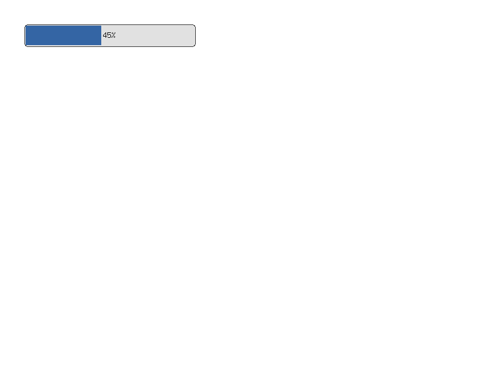

A progress bar: a sunken trough with a blue fill. The default fraction is 0.45 with the percentage text shown; clicking the bar sets the fraction from the click position.

**Constructor:** `GtkProgressBar(Display* display, int screen, Window window, GC gc, SStyle_Manager* styles, int x, int y, int width, int height)`

**API** (widget-specific methods/properties/signals ONLY — skip the common ones):

- `set_text(std::string t)` / `get_text()` — custom text, shown instead of the percentage when set

- `set_fraction(double f)` / `get_fraction()` — the fill, 0..1, clamped (default `0.45`)

- `set_show_text(bool s)` / `get_show_text()` — whether text is drawn over the bar (default `true`)

- `set_pulsing(bool p)` / `get_pulsing()` — activity mode: a block slides back and forth instead of a fill (default `false`)

- `set_inverted(bool i)` / `get_inverted()` — fill from the right instead of the left (default `false`)

- `pulse()` — advances the sliding block one step (only meaningful while pulsing)

- `display_text()` — the text that would be drawn (`"45%"` by default, or the custom text)

**Example:**

```cpp
#include "GtkProgressBar.h"

#include <cstdio>

int main()
{
    Display* display = XOpenDisplay(nullptr);
    if (!display) { return 1; }
    int screen = DefaultScreen(display);
    Window window = XCreateSimpleWindow(display, RootWindow(display, screen), 100, 100, 800, 600, 1, BlackPixel(display, screen), WhitePixel(display, screen));
    XStoreName(display, window, "GtkProgressBar - XFrame demo");
    XSelectInput(display, window, ExposureMask | KeyPressMask | StructureNotifyMask | ButtonPressMask | ButtonReleaseMask | PointerMotionMask);
    Atom deleteWindowMessage = XInternAtom(display, "WM_DELETE_WINDOW", False);
    XSetWMProtocols(display, window, &deleteWindowMessage, 1);
    XMapWindow(display, window);
    GC gc = DefaultGC(display, screen);
    SStyle_Manager styles(display, window, screen, gc);
    styles.add_style_ex("default", Srgb{225, 225, 225}, Srgb{120, 120, 120}, Srgb{60, 60, 60}, Srgb{20, 20, 20}, 6, 1, "-misc-fixed-medium-r-normal--13-*");
    styles.set_active_style_byName("default");
    GtkProgressBar widget(display, screen, window, gc, &styles, 40, 40, 280, 36);
    widget.set_fraction(0.6);
    widget.set_show_text(true);
    widget.draw();
    bool running = true;
    while (running)
    {
        XEvent event;
        XNextEvent(display, &event);
        bool handled = false;
        switch (event.type)
        {
        case Expose:
            handled = true;
            break;
        case ButtonPress:
            handled = widget.on_button_press(event.xbutton.x, event.xbutton.y, event.xbutton.button);
            break;
        case ButtonRelease:
            handled = widget.on_button_release(event.xbutton.x, event.xbutton.y, event.xbutton.button);
            break;
        case MotionNotify:
            handled = widget.on_motion(event.xmotion.x, event.xmotion.y);
            break;
        case KeyPress:
        {
            char buffer[32];
            KeySym key = 0;
            int n = XLookupString(&event.xkey, buffer, (int)sizeof(buffer) - 1, &key, nullptr);
            buffer[n] = 0;
            handled = widget.on_key(key, buffer);
            break;
        }
        case ClientMessage:
            if ((Atom)event.xclient.data.l[0] == deleteWindowMessage)
            {
                running = false;
            }
            break;
        }
        if (handled)
        {
            XClearWindow(display, window);
            widget.draw();
            XFlush(display);
        }
    }
    XCloseDisplay(display);
    return 0;
}
```

**Notes:** No signals. In pulsing mode the host must call `pulse()` repeatedly (e.g. from a timer) to animate the block; `pulse()` on its own does not start a timer.

## GtkSpinner

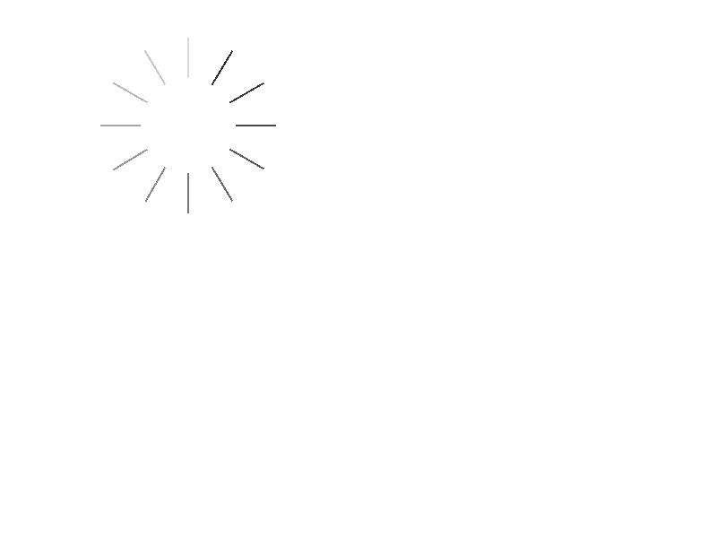

A 12-spoke activity spinner. The lit spoke advances with the frame and the trailing spokes fade; when inactive all spokes are drawn dim grey. Clicking toggles the animation.

**Constructor:** `GtkSpinner(Display* display, int screen, Window window, GC gc, SStyle_Manager* styles, int x, int y, int width, int height)`

**API** (widget-specific methods/properties/signals ONLY — skip the common ones):

- `set_text(std::string t)` / `get_text()` — stored but not drawn (default `"GtkSpinner"`)

- `start()` / `stop()` — start/stop the animation (default active)

- `set_active(bool a)` / `get_active()` — the animation state

- `get_frame()` — the current frame, 0..11

- `step()` — advances one frame

**Example:**

```cpp
#include "GtkSpinner.h"

#include <cstdio>
#include <chrono>
#include <unistd.h>

int main()
{
    Display* display = XOpenDisplay(nullptr);
    if (!display) { return 1; }
    int screen = DefaultScreen(display);
    Window window = XCreateSimpleWindow(display, RootWindow(display, screen), 100, 100, 800, 600, 1, BlackPixel(display, screen), WhitePixel(display, screen));
    XStoreName(display, window, "GtkSpinner - XFrame demo");
    XSelectInput(display, window, ExposureMask | KeyPressMask | StructureNotifyMask | ButtonPressMask | ButtonReleaseMask | PointerMotionMask);
    Atom deleteWindowMessage = XInternAtom(display, "WM_DELETE_WINDOW", False);
    XSetWMProtocols(display, window, &deleteWindowMessage, 1);
    XMapWindow(display, window);
    GC gc = DefaultGC(display, screen);
    SStyle_Manager styles(display, window, screen, gc);
    styles.add_style_ex("default", Srgb{225, 225, 225}, Srgb{120, 120, 120}, Srgb{60, 60, 60}, Srgb{20, 20, 20}, 6, 1, "-misc-fixed-medium-r-normal--13-*");
    styles.set_active_style_byName("default");
    GtkSpinner widget(display, screen, window, gc, &styles, 40, 40, 340, 200);
    widget.start();
    widget.draw();
    auto last = std::chrono::steady_clock::now();
    bool running = true;
    while (running)
    {
        if (XPending(display))
        {
            XEvent event;
            XNextEvent(display, &event);
            bool handled = false;
            switch (event.type)
            {
            case Expose:
                handled = true;
                break;
            case ButtonPress:
                handled = widget.on_button_press(event.xbutton.x, event.xbutton.y, event.xbutton.button);
                break;
            case ButtonRelease:
                handled = widget.on_button_release(event.xbutton.x, event.xbutton.y, event.xbutton.button);
                break;
            case MotionNotify:
                handled = widget.on_motion(event.xmotion.x, event.xmotion.y);
                break;
            case KeyPress:
            {
                char buffer[32];
                KeySym key = 0;
                int n = XLookupString(&event.xkey, buffer, (int)sizeof(buffer) - 1, &key, nullptr);
                buffer[n] = 0;
                handled = widget.on_key(key, buffer);
                break;
            }
            case ClientMessage:
                if ((Atom)event.xclient.data.l[0] == deleteWindowMessage)
                {
                    running = false;
                }
                break;
            }
            if (handled)
            {
                XClearWindow(display, window);
                widget.draw();
                XFlush(display);
            }
        }
        else
        {
            auto now = std::chrono::steady_clock::now();
            if (std::chrono::duration_cast<std::chrono::milliseconds>(now - last).count() >= 100)
            {
                last = now;
                widget.step();

                XClearWindow(display, window);
                widget.draw();
                XFlush(display);
            }
            else
            {
                usleep(10000);
            }
        }
    }
    XCloseDisplay(display);
    return 0;
}
```

**Notes:** No signals. The host must call `step()` repeatedly (e.g. from a timer, as in the example) to animate — `start()` alone does not advance the frame.

## GtkStatusbar

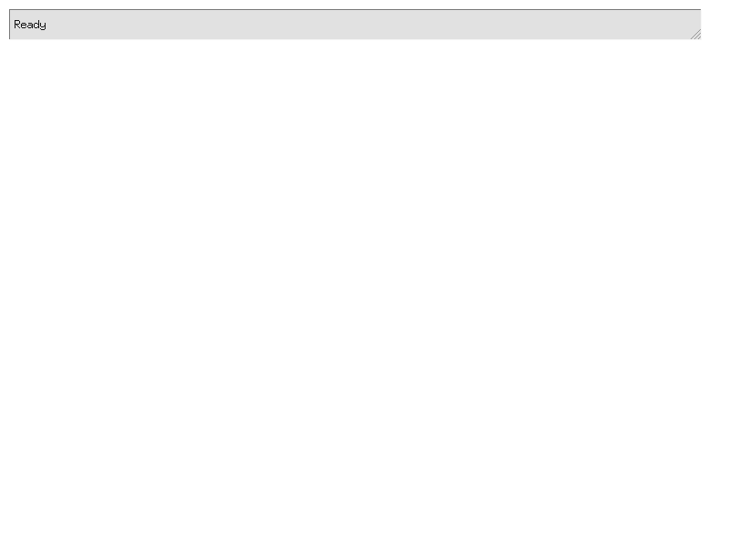

A status bar: a sunken bar showing the top message of a stack, with a resize grip (three diagonal lines) at the bottom right.

**Constructor:** `GtkStatusbar(Display* display, int screen, Window window, GC gc, SStyle_Manager* styles, int x, int y, int width, int height)`

**API** (widget-specific methods/properties/signals ONLY — skip the common ones):

- `set_text(std::string t)` / `get_text()` — the initial message (default `"Ready"`)

- `push(std::string message)` — pushes a message, returns its id (an `int`)

- `pop()` — removes the top message

- `remove_all()` — clears the stack

- `message_count()` — the number of stacked messages

- `current_message()` — the message currently shown (empty when the stack is empty)

**Example:**

```cpp
#include "GtkStatusbar.h"

#include <cstdio>

int main()
{
    Display* display = XOpenDisplay(nullptr);
    if (!display) { return 1; }
    int screen = DefaultScreen(display);
    Window window = XCreateSimpleWindow(display, RootWindow(display, screen), 100, 100, 800, 600, 1, BlackPixel(display, screen), WhitePixel(display, screen));
    XStoreName(display, window, "GtkStatusbar - XFrame demo");
    XSelectInput(display, window, ExposureMask | KeyPressMask | StructureNotifyMask | ButtonPressMask | ButtonReleaseMask | PointerMotionMask);
    Atom deleteWindowMessage = XInternAtom(display, "WM_DELETE_WINDOW", False);
    XSetWMProtocols(display, window, &deleteWindowMessage, 1);
    XMapWindow(display, window);
    GC gc = DefaultGC(display, screen);
    SStyle_Manager styles(display, window, screen, gc);
    styles.add_style_ex("default", Srgb{225, 225, 225}, Srgb{120, 120, 120}, Srgb{60, 60, 60}, Srgb{20, 20, 20}, 6, 1, "-misc-fixed-medium-r-normal--13-*");
    styles.set_active_style_byName("default");
    GtkStatusbar widget(display, screen, window, gc, &styles, 10, 10, 760, 34);
    widget.push("Ready");
    widget.draw();
    bool running = true;
    while (running)
    {
        XEvent event;
        XNextEvent(display, &event);
        bool handled = false;
        switch (event.type)
        {
        case Expose:
            handled = true;
            break;
        case ButtonPress:
            handled = widget.on_button_press(event.xbutton.x, event.xbutton.y, event.xbutton.button);
            break;
        case ButtonRelease:
            handled = widget.on_button_release(event.xbutton.x, event.xbutton.y, event.xbutton.button);
            break;
        case MotionNotify:
            handled = widget.on_motion(event.xmotion.x, event.xmotion.y);
            break;
        case KeyPress:
        {
            char buffer[32];
            KeySym key = 0;
            int n = XLookupString(&event.xkey, buffer, (int)sizeof(buffer) - 1, &key, nullptr);
            buffer[n] = 0;
            handled = widget.on_key(key, buffer);
            break;
        }
        case ClientMessage:
            if ((Atom)event.xclient.data.l[0] == deleteWindowMessage)
            {
                running = false;
            }
            break;
        }
        if (handled)
        {
            XClearWindow(display, window);
            widget.draw();
            XFlush(display);
        }
    }
    XCloseDisplay(display);
    return 0;
}
```

**Notes:** Display-only: clicking only takes focus, and there are no signals. The grip is drawn, not functional — resizing is the host window's job.

## GtkVideo

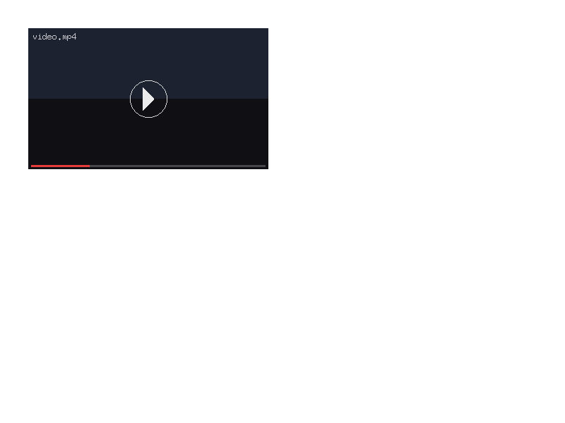

A video player in name only: a near-black picture area with a faint scene gradient, the title at the top left, a big play triangle (or pause bars while playing), and a red progress line along the bottom. No video is decoded.

**Constructor:** `GtkVideo(Display* display, int screen, Window window, GC gc, SStyle_Manager* styles, int x, int y, int width, int height)`

**API** (widget-specific methods/properties/signals ONLY — skip the common ones):

- `set_text(std::string t)` / `get_text()` — the title (default `"video.mp4"`)

- `set_filename(std::string f)` / `get_filename()` — the file (default `"video.mp4"`)

- `play()` / `pause()` / `get_playing()` — transport (default paused)

- `set_autoplay(bool a)` / `get_autoplay()` — autoplay flag (default `false`, stored only)

- `set_position(double p)` / `get_position()` — the position as a fraction, 0..1 (default `0.25`)

- `set_duration(double sec)` / `get_duration()` — the stream length in seconds (default `195.0`)

- `get_time_sec()` — the position in seconds (`position_ * duration`)

- `step(double dt_sec)` — advances playback; returns `false` at the end (and stops)

- signal `on_play` (`std::function<void()>`) / `on_pause` (`std::function<void()>`) — fire on the play/pause toggle

**Example:**

```cpp
#include "GtkVideo.h"

#include <cstdio>
#include <chrono>
#include <unistd.h>

int main()
{
    Display* display = XOpenDisplay(nullptr);
    if (!display) { return 1; }
    int screen = DefaultScreen(display);
    Window window = XCreateSimpleWindow(display, RootWindow(display, screen), 100, 100, 800, 600, 1, BlackPixel(display, screen), WhitePixel(display, screen));
    XStoreName(display, window, "GtkVideo - XFrame demo");
    XSelectInput(display, window, ExposureMask | KeyPressMask | StructureNotifyMask | ButtonPressMask | ButtonReleaseMask | PointerMotionMask);
    Atom deleteWindowMessage = XInternAtom(display, "WM_DELETE_WINDOW", False);
    XSetWMProtocols(display, window, &deleteWindowMessage, 1);
    XMapWindow(display, window);
    GC gc = DefaultGC(display, screen);
    SStyle_Manager styles(display, window, screen, gc);
    styles.add_style_ex("default", Srgb{225, 225, 225}, Srgb{120, 120, 120}, Srgb{60, 60, 60}, Srgb{20, 20, 20}, 6, 1, "-misc-fixed-medium-r-normal--13-*");
    styles.set_active_style_byName("default");
    GtkVideo widget(display, screen, window, gc, &styles, 40, 40, 340, 200);
    widget.set_filename("video.mp4");
    widget.play();
    widget.on_play = [] { std::printf("play\n"); };
    widget.draw();
    auto last = std::chrono::steady_clock::now();
    bool running = true;
    while (running)
    {
        if (XPending(display))
        {
            XEvent event;
            XNextEvent(display, &event);
            bool handled = false;
            switch (event.type)
            {
            case Expose:
                handled = true;
                break;
            case ButtonPress:
                handled = widget.on_button_press(event.xbutton.x, event.xbutton.y, event.xbutton.button);
                break;
            case ButtonRelease:
                handled = widget.on_button_release(event.xbutton.x, event.xbutton.y, event.xbutton.button);
                break;
            case MotionNotify:
                handled = widget.on_motion(event.xmotion.x, event.xmotion.y);
                break;
            case KeyPress:
            {
                char buffer[32];
                KeySym key = 0;
                int n = XLookupString(&event.xkey, buffer, (int)sizeof(buffer) - 1, &key, nullptr);
                buffer[n] = 0;
                handled = widget.on_key(key, buffer);
                break;
            }
            case ClientMessage:
                if ((Atom)event.xclient.data.l[0] == deleteWindowMessage)
                {
                    running = false;
                }
                break;
            }
            if (handled)
            {
                XClearWindow(display, window);
                widget.draw();
                XFlush(display);
            }
        }
        else
        {
            auto now = std::chrono::steady_clock::now();
            if (std::chrono::duration_cast<std::chrono::milliseconds>(now - last).count() >= 100)
            {
                last = now;
                widget.step(0.1);

                XClearWindow(display, window);
                widget.draw();
                XFlush(display);
            }
            else
            {
                usleep(10000);
            }
        }
    }
    XCloseDisplay(display);
    return 0;
}
```

**Notes:** Clicking toggles play/pause. The host must call `step()` from a timer (as in the example) for playback to advance.

## TArrow

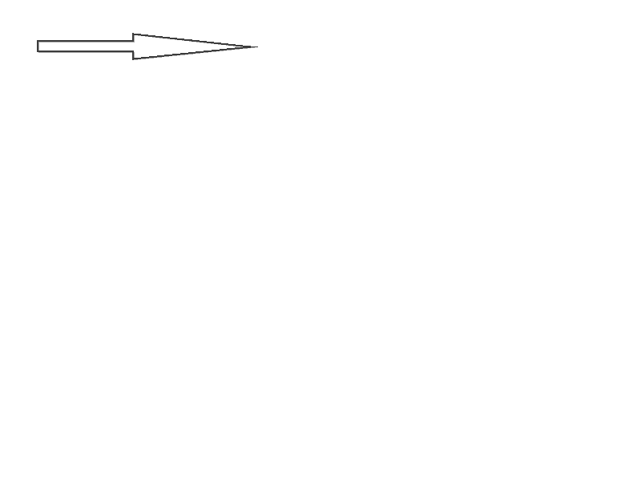

A stroked arrow, drawn with the style line colour, with an optional drop shadow offset down-right. Arrow keys change the direction while it is focused.

**Constructor:** `TArrow(Display* display, int screen, Window window, GC gc, SStyle_Manager* styles, int x, int y, int width, int height)`

**API** (widget-specific methods/properties/signals ONLY — skip the common ones):

- `set_text(std::string t)` / `get_text()` — stored but not drawn (default `"TArrow"`)

- `set_arrow_type(int t)` / `get_arrow_type()` — 0 = up, 1 = down, 2 = left, 3 = right (default `3`, right)

- `set_shadow_type(int t)` / `get_shadow_type()` — 0 = no shadow, 1 = one offset pass, 2 = two offset passes (default `1`)

- signal `on_click` (`std::function<void()>`) — fires on click

**Example:**

```cpp
#include "TArrow.h"

#include <cstdio>

int main()
{
    Display* display = XOpenDisplay(nullptr);
    if (!display) { return 1; }
    int screen = DefaultScreen(display);
    Window window = XCreateSimpleWindow(display, RootWindow(display, screen), 100, 100, 800, 600, 1, BlackPixel(display, screen), WhitePixel(display, screen));
    XStoreName(display, window, "TArrow - XFrame demo");
    XSelectInput(display, window, ExposureMask | KeyPressMask | StructureNotifyMask | ButtonPressMask | ButtonReleaseMask | PointerMotionMask);
    Atom deleteWindowMessage = XInternAtom(display, "WM_DELETE_WINDOW", False);
    XSetWMProtocols(display, window, &deleteWindowMessage, 1);
    XMapWindow(display, window);
    GC gc = DefaultGC(display, screen);
    SStyle_Manager styles(display, window, screen, gc);
    styles.add_style_ex("default", Srgb{225, 225, 225}, Srgb{120, 120, 120}, Srgb{60, 60, 60}, Srgb{20, 20, 20}, 6, 1, "-misc-fixed-medium-r-normal--13-*");
    styles.set_active_style_byName("default");
    TArrow widget(display, screen, window, gc, &styles, 40, 40, 280, 36);
    widget.set_arrow_type(0);
    widget.set_shadow_type(1);
    widget.on_click = [] { std::printf("arrow clicked\n"); };
    widget.draw();
    bool running = true;
    while (running)
    {
        XEvent event;
        XNextEvent(display, &event);
        bool handled = false;
        switch (event.type)
        {
        case Expose:
            handled = true;
            break;
        case ButtonPress:
            handled = widget.on_button_press(event.xbutton.x, event.xbutton.y, event.xbutton.button);
            break;
        case ButtonRelease:
            handled = widget.on_button_release(event.xbutton.x, event.xbutton.y, event.xbutton.button);
            break;
        case MotionNotify:
            handled = widget.on_motion(event.xmotion.x, event.xmotion.y);
            break;
        case KeyPress:
        {
            char buffer[32];
            KeySym key = 0;
            int n = XLookupString(&event.xkey, buffer, (int)sizeof(buffer) - 1, &key, nullptr);
            buffer[n] = 0;
            handled = widget.on_key(key, buffer);
            break;
        }
        case ClientMessage:
            if ((Atom)event.xclient.data.l[0] == deleteWindowMessage)
            {
                running = false;
            }
            break;
        }
        if (handled)
        {
            XClearWindow(display, window);
            widget.draw();
            XFlush(display);
        }
    }
    XCloseDisplay(display);
    return 0;
}
```

**Notes:** The direction numbers (0/1/2/3) are read from `on_key()`; the header comments name only the defaults. The shadow values are read from `draw()`.

## TBevel


A bevelled edge: a box, a frame band, a single line, or nothing at all (a spacer that occupies its bounds but draws nothing). Raised and lowered styles swap the highlight/shadow edges.

**Constructor:** `TBevel(Display* display, int screen, Window window, GC gc, SStyle_Manager* styles, int x, int y, int width, int height)`

**API** (widget-specific methods/properties/signals ONLY — skip the common ones):

- `set_text(std::string t)` / `get_text()` — stored but not drawn (default `"TBevel"`)

- `set_bevel_style(TBevelStyle s)` / `get_bevel_style()` — `bsLowered` or `bsRaised`

- `set_bevel_shape(TBevelShape s)` / `get_bevel_shape()` — `bsBox` (default), `bsFrame`, `bsTopLine`, `bsBottomLine`, `bsLeftLine`, `bsRightLine`, `bsSpacer`

**Example:**

```cpp
#include "TBevel.h"

#include <cstdio>

int main()
{
    Display* display = XOpenDisplay(nullptr);
    if (!display) { return 1; }
    int screen = DefaultScreen(display);
    Window window = XCreateSimpleWindow(display, RootWindow(display, screen), 100, 100, 800, 600, 1, BlackPixel(display, screen), WhitePixel(display, screen));
    XStoreName(display, window, "TBevel - XFrame demo");
    XSelectInput(display, window, ExposureMask | KeyPressMask | StructureNotifyMask | ButtonPressMask | ButtonReleaseMask | PointerMotionMask);
    Atom deleteWindowMessage = XInternAtom(display, "WM_DELETE_WINDOW", False);
    XSetWMProtocols(display, window, &deleteWindowMessage, 1);
    XMapWindow(display, window);
    GC gc = DefaultGC(display, screen);
    SStyle_Manager styles(display, window, screen, gc);
    styles.add_style_ex("default", Srgb{225, 225, 225}, Srgb{120, 120, 120}, Srgb{60, 60, 60}, Srgb{20, 20, 20}, 6, 1, "-misc-fixed-medium-r-normal--13-*");
    styles.set_active_style_byName("default");
    TBevel widget(display, screen, window, gc, &styles, 40, 40, 340, 200);
    widget.set_bevel_shape(bsFrame);
    widget.set_bevel_style(bsRaised);
    widget.draw();
    bool running = true;
    while (running)
    {
        XEvent event;
        XNextEvent(display, &event);
        bool handled = false;
        switch (event.type)
        {
        case Expose:
            handled = true;
            break;
        case ButtonPress:
            handled = widget.on_button_press(event.xbutton.x, event.xbutton.y, event.xbutton.button);
            break;
        case ButtonRelease:
            handled = widget.on_button_release(event.xbutton.x, event.xbutton.y, event.xbutton.button);
            break;
        case MotionNotify:
            handled = widget.on_motion(event.xmotion.x, event.xmotion.y);
            break;
        case KeyPress:
        {
            char buffer[32];
            KeySym key = 0;
            int n = XLookupString(&event.xkey, buffer, (int)sizeof(buffer) - 1, &key, nullptr);
            buffer[n] = 0;
            handled = widget.on_key(key, buffer);
            break;
        }
        case ClientMessage:
            if ((Atom)event.xclient.data.l[0] == deleteWindowMessage)
            {
                running = false;
            }
            break;
        }
        if (handled)
        {
            XClearWindow(display, window);
            widget.draw();
            XFlush(display);
        }
    }
    XCloseDisplay(display);
    return 0;
}
```

**Notes:** Display-only and non-interactive: all event handlers return `false`, and there are no signals.

## TCalendar

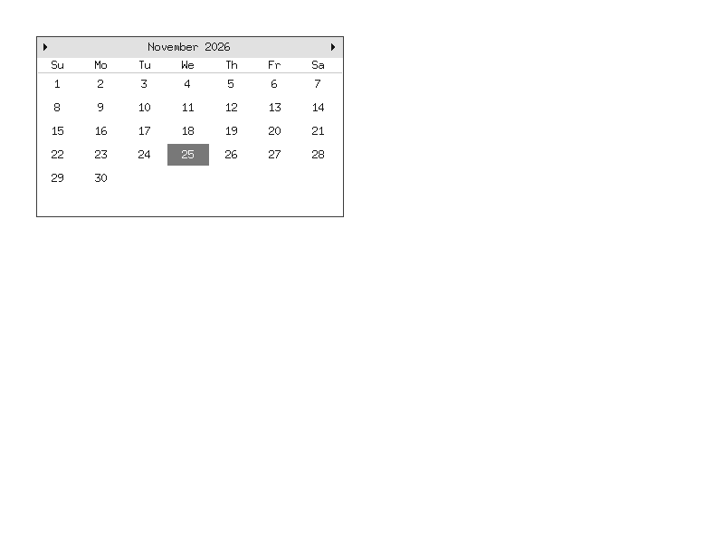

A month calendar panel: a white body, a header band with the month title and prev/next triangles, a weekday row, and a 6-week day grid. The selected day is highlighted and today is marked.

**Constructor:** `TCalendar(Display* display, int screen, Window window, GC gc, SStyle_Manager* styles, int x, int y, int width, int height)`

**API** (widget-specific methods/properties/signals ONLY — skip the common ones):

- `set_text(std::string t)` / `get_text()` — the text is overwritten with the selected date as `"YYYY-MM-DD"` whenever the selection changes

- `get_date()` — the selected date as a `"YYYY-MM-DD"` string

- `get_year()` / `get_month()` / `get_day()` — the selected date parts (default 2026-11-26)

- `set_date(int y, int m, int d)` — sets the displayed month and the selection

- `go_today()` — jumps the display and selection to today

- signal `on_change` (`std::function<void()>`) — fires when the selection changes

- signal `on_click` (`std::function<void()>`) — fires on click

**Example:**

```cpp
#include "TCalendar.h"

#include <cstdio>

int main()
{
    Display* display = XOpenDisplay(nullptr);
    if (!display) { return 1; }
    int screen = DefaultScreen(display);
    Window window = XCreateSimpleWindow(display, RootWindow(display, screen), 100, 100, 800, 600, 1, BlackPixel(display, screen), WhitePixel(display, screen));
    XStoreName(display, window, "TCalendar - XFrame demo");
    XSelectInput(display, window, ExposureMask | KeyPressMask | StructureNotifyMask | ButtonPressMask | ButtonReleaseMask | PointerMotionMask);
    Atom deleteWindowMessage = XInternAtom(display, "WM_DELETE_WINDOW", False);
    XSetWMProtocols(display, window, &deleteWindowMessage, 1);
    XMapWindow(display, window);
    GC gc = DefaultGC(display, screen);
    SStyle_Manager styles(display, window, screen, gc);
    styles.add_style_ex("default", Srgb{225, 225, 225}, Srgb{120, 120, 120}, Srgb{60, 60, 60}, Srgb{20, 20, 20}, 6, 1, "-misc-fixed-medium-r-normal--13-*");
    styles.set_active_style_byName("default");
    TCalendar widget(display, screen, window, gc, &styles, 40, 40, 340, 200);
    widget.set_date(2026, 11, 26);
    widget.on_change = [] { std::printf("calendar changed\n"); };
    widget.draw();
    bool running = true;
    while (running)
    {
        XEvent event;
        XNextEvent(display, &event);
        bool handled = false;
        switch (event.type)
        {
        case Expose:
            handled = true;
            break;
        case ButtonPress:
            handled = widget.on_button_press(event.xbutton.x, event.xbutton.y, event.xbutton.button);
            break;
        case ButtonRelease:
            handled = widget.on_button_release(event.xbutton.x, event.xbutton.y, event.xbutton.button);
            break;
        case MotionNotify:
            handled = widget.on_motion(event.xmotion.x, event.xmotion.y);
            break;
        case KeyPress:
        {
            char buffer[32];
            KeySym key = 0;
            int n = XLookupString(&event.xkey, buffer, (int)sizeof(buffer) - 1, &key, nullptr);
            buffer[n] = 0;
            handled = widget.on_key(key, buffer);
            break;
        }
        case ClientMessage:
            if ((Atom)event.xclient.data.l[0] == deleteWindowMessage)
            {
                running = false;
            }
            break;
        }
        if (handled)
        {
            XClearWindow(display, window);
            widget.draw();
            XFlush(display);
        }
    }
    XCloseDisplay(display);
    return 0;
}
```

**Notes:** Clicking a day selects it; clicking the header triangles steps the month. `set_text()` is overwritten by the widget itself, so do not rely on a custom caption.

## TDateTimePicker

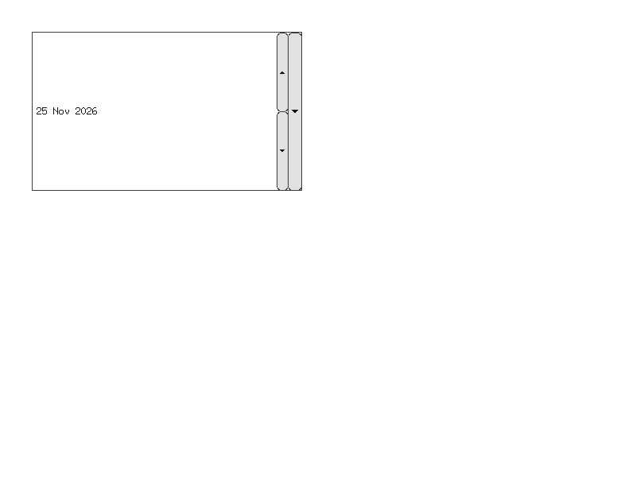

A date/time edit field with a spin up/down zone and a dropdown button that opens a month-calendar popup. The field is split into segments (day/month/year, or hour/minute/second in time mode); clicking selects a segment and the spin buttons step it.

**Constructor:** `TDateTimePicker(Display* display, int screen, Window window, GC gc, SStyle_Manager* styles, int x, int y, int width, int height)`

**API** (widget-specific methods/properties/signals ONLY — skip the common ones):

- `set_text(std::string t)` / `get_text()` — the displayed value; the widget rewrites it from the date/time whenever they change

- `set_date(int y, int m, int d)` / `get_date(int& y, int& m, int& d)` — the date (default 2026-11-25)

- `set_time(int h, int m, int s)` / `get_time(int& h, int& m, int& s)` — the time (default 13:30:00)

- `set_time_mode(bool t)` / `get_time_mode()` — `false` = date picker (default), `true` = time picker

- `is_calendar_open()` — whether the popup calendar is currently open

- signal `on_change` (`std::function<void()>`) — fires when the date/time changes

**Example:**

```cpp
#include "TDateTimePicker.h"

#include <cstdio>

int main()
{
    Display* display = XOpenDisplay(nullptr);
    if (!display) { return 1; }
    int screen = DefaultScreen(display);
    Window window = XCreateSimpleWindow(display, RootWindow(display, screen), 100, 100, 800, 600, 1, BlackPixel(display, screen), WhitePixel(display, screen));
    XStoreName(display, window, "TDateTimePicker - XFrame demo");
    XSelectInput(display, window, ExposureMask | KeyPressMask | StructureNotifyMask | ButtonPressMask | ButtonReleaseMask | PointerMotionMask);
    Atom deleteWindowMessage = XInternAtom(display, "WM_DELETE_WINDOW", False);
    XSetWMProtocols(display, window, &deleteWindowMessage, 1);
    XMapWindow(display, window);
    GC gc = DefaultGC(display, screen);
    SStyle_Manager styles(display, window, screen, gc);
    styles.add_style_ex("default", Srgb{225, 225, 225}, Srgb{120, 120, 120}, Srgb{60, 60, 60}, Srgb{20, 20, 20}, 6, 1, "-misc-fixed-medium-r-normal--13-*");
    styles.set_active_style_byName("default");
    TDateTimePicker widget(display, screen, window, gc, &styles, 40, 40, 340, 200);
    widget.set_date(2026, 11, 25);
    widget.set_time(13, 30, 0);
    widget.on_change = [] { std::printf("date/time changed\n"); };
    widget.draw();
    bool running = true;
    while (running)
    {
        XEvent event;
        XNextEvent(display, &event);
        bool handled = false;
        switch (event.type)
        {
        case Expose:
            handled = true;
            break;
        case ButtonPress:
            handled = widget.on_button_press(event.xbutton.x, event.xbutton.y, event.xbutton.button);
            break;
        case ButtonRelease:
            handled = widget.on_button_release(event.xbutton.x, event.xbutton.y, event.xbutton.button);
            break;
        case MotionNotify:
            handled = widget.on_motion(event.xmotion.x, event.xmotion.y);
            break;
        case KeyPress:
        {
            char buffer[32];
            KeySym key = 0;
            int n = XLookupString(&event.xkey, buffer, (int)sizeof(buffer) - 1, &key, nullptr);
            buffer[n] = 0;
            handled = widget.on_key(key, buffer);
            break;
        }
        case ClientMessage:
            if ((Atom)event.xclient.data.l[0] == deleteWindowMessage)
            {
                running = false;
            }
            break;
        }
        if (handled)
        {
            XClearWindow(display, window);
            widget.draw();
            XFlush(display);
        }
    }
    XCloseDisplay(display);
    return 0;
}
```

**Notes:** In the popup, clicking a day picks it and closes the popup; the `<` / `>` zones step the month. Typing digits edits the selected segment.

## TImage

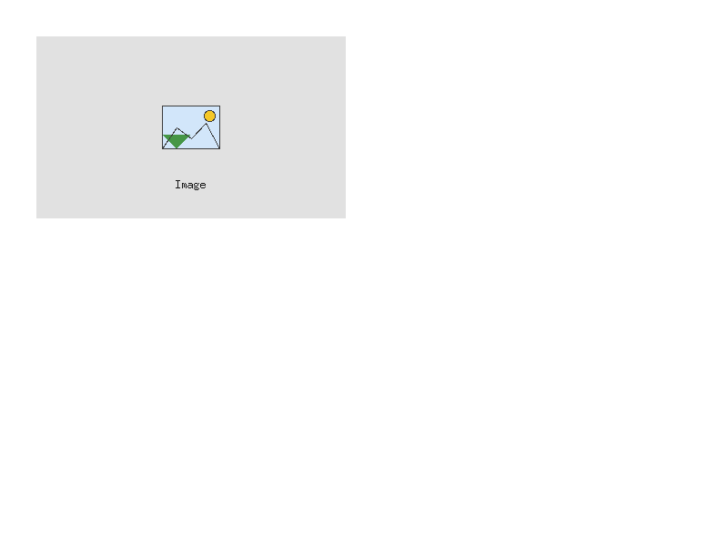

A picture box that draws a built-in landscape (sky, sun, two mountain peaks) inside a frame. No file is ever loaded — `set_picture_size()` only changes the virtual picture size used for the stretch/proportional layout.

**Constructor:** `TImage(Display* display, int screen, Window window, GC gc, SStyle_Manager* styles, int x, int y, int width, int height)`

**API** (widget-specific methods/properties/signals ONLY — skip the common ones):

- `set_text(std::string t)` / `get_text()` — stored but not drawn (default `"Image"`)

- `set_stretch(bool s)` / `get_stretch()` — stretch the picture to fill the box (default `false`)

- `set_proportional(bool p)` / `get_proportional()` — keep the aspect ratio when scaling (default `false`)

- `set_center(bool c)` / `get_center()` — centre the picture when it is smaller than the box (default `true`)

- `set_transparent(bool t)` / `get_transparent()` — skip painting the background fill (default `false`)

- `set_picture_size(int w, int h)` / `get_picture_width()` / `get_picture_height()` — the virtual picture size (default 64x48)

- signal `on_click` (`std::function<void()>`) — fires on click

**Example:**

```cpp
#include "TImage.h"

#include <cstdio>

int main()
{
    Display* display = XOpenDisplay(nullptr);
    if (!display) { return 1; }
    int screen = DefaultScreen(display);
    Window window = XCreateSimpleWindow(display, RootWindow(display, screen), 100, 100, 800, 600, 1, BlackPixel(display, screen), WhitePixel(display, screen));
    XStoreName(display, window, "TImage - XFrame demo");
    XSelectInput(display, window, ExposureMask | KeyPressMask | StructureNotifyMask | ButtonPressMask | ButtonReleaseMask | PointerMotionMask);
    Atom deleteWindowMessage = XInternAtom(display, "WM_DELETE_WINDOW", False);
    XSetWMProtocols(display, window, &deleteWindowMessage, 1);
    XMapWindow(display, window);
    GC gc = DefaultGC(display, screen);
    SStyle_Manager styles(display, window, screen, gc);
    styles.add_style_ex("default", Srgb{225, 225, 225}, Srgb{120, 120, 120}, Srgb{60, 60, 60}, Srgb{20, 20, 20}, 6, 1, "-misc-fixed-medium-r-normal--13-*");
    styles.set_active_style_byName("default");
    TImage widget(display, screen, window, gc, &styles, 40, 40, 340, 200);
    widget.set_picture_size(64, 48);
    widget.set_stretch(true);
    widget.on_click = [] { std::printf("image clicked\n"); };
    widget.draw();
    bool running = true;
    while (running)
    {
        XEvent event;
        XNextEvent(display, &event);
        bool handled = false;
        switch (event.type)
        {
        case Expose:
            handled = true;
            break;
        case ButtonPress:
            handled = widget.on_button_press(event.xbutton.x, event.xbutton.y, event.xbutton.button);
            break;
        case ButtonRelease:
            handled = widget.on_button_release(event.xbutton.x, event.xbutton.y, event.xbutton.button);
            break;
        case MotionNotify:
            handled = widget.on_motion(event.xmotion.x, event.xmotion.y);
            break;
        case KeyPress:
        {
            char buffer[32];
            KeySym key = 0;
            int n = XLookupString(&event.xkey, buffer, (int)sizeof(buffer) - 1, &key, nullptr);
            buffer[n] = 0;
            handled = widget.on_key(key, buffer);
            break;
        }
        case ClientMessage:
            if ((Atom)event.xclient.data.l[0] == deleteWindowMessage)
            {
                running = false;
            }
            break;
        }
        if (handled)
        {
            XClearWindow(display, window);
            widget.draw();
            XFlush(display);
        }
    }
    XCloseDisplay(display);
    return 0;
}
```

## TImageList

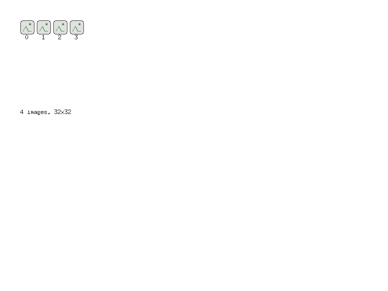

A list of images by name. At run time it holds names only (no pixel data); `draw()` paints a design-time strip — one outlined box per image slot with its index and a tiny glyph, plus a `"N images, WxH"` summary line.

**Constructor:** `TImageList(Display* display, int screen, Window window, GC gc, SStyle_Manager* styles, int x, int y, int width, int height)`

**API** (widget-specific methods/properties/signals ONLY — skip the common ones):

- `set_text(std::string t)` / `get_text()` — stored but not drawn (default `"TImageList"`)

- `add(std::string image_name)` — appends a name, returns its index (`int`)

- `remove(int index)` / `clear()` — remove one / all

- `count()` — number of images

- `get_name(int index)` — the name at an index

- `index_of(std::string image_name)` — the index of a name, or -1 (unclear from the header — the return for a missing name is not documented; verify before relying on it)

- `set_image_size(int w, int h)` / `get_image_width()` / `get_image_height()` — the nominal image size (default 32x32)

**Example:**

```cpp
#include "TImageList.h"

#include <cstdio>

int main()
{
    Display* display = XOpenDisplay(nullptr);
    if (!display) { return 1; }
    int screen = DefaultScreen(display);
    Window window = XCreateSimpleWindow(display, RootWindow(display, screen), 100, 100, 800, 600, 1, BlackPixel(display, screen), WhitePixel(display, screen));
    XStoreName(display, window, "TImageList - XFrame demo");
    XSelectInput(display, window, ExposureMask | KeyPressMask | StructureNotifyMask | ButtonPressMask | ButtonReleaseMask | PointerMotionMask);
    Atom deleteWindowMessage = XInternAtom(display, "WM_DELETE_WINDOW", False);
    XSetWMProtocols(display, window, &deleteWindowMessage, 1);
    XMapWindow(display, window);
    GC gc = DefaultGC(display, screen);
    SStyle_Manager styles(display, window, screen, gc);
    styles.add_style_ex("default", Srgb{225, 225, 225}, Srgb{120, 120, 120}, Srgb{60, 60, 60}, Srgb{20, 20, 20}, 6, 1, "-misc-fixed-medium-r-normal--13-*");
    styles.set_active_style_byName("default");
    TImageList widget(display, screen, window, gc, &styles, 40, 40, 340, 200);
    widget.add("icon1");
    widget.add("icon2");
    widget.draw();
    bool running = true;
    while (running)
    {
        XEvent event;
        XNextEvent(display, &event);
        bool handled = false;
        switch (event.type)
        {
        case Expose:
            handled = true;
            break;
        case ButtonPress:
            handled = widget.on_button_press(event.xbutton.x, event.xbutton.y, event.xbutton.button);
            break;
        case ButtonRelease:
            handled = widget.on_button_release(event.xbutton.x, event.xbutton.y, event.xbutton.button);
            break;
        case MotionNotify:
            handled = widget.on_motion(event.xmotion.x, event.xmotion.y);
            break;
        case KeyPress:
        {
            char buffer[32];
            KeySym key = 0;
            int n = XLookupString(&event.xkey, buffer, (int)sizeof(buffer) - 1, &key, nullptr);
            buffer[n] = 0;
            handled = widget.on_key(key, buffer);
            break;
        }
        case ClientMessage:
            if ((Atom)event.xclient.data.l[0] == deleteWindowMessage)
            {
                running = false;
            }
            break;
        }
        if (handled)
        {
            XClearWindow(display, window);
            widget.draw();
            XFlush(display);
        }
    }
    XCloseDisplay(display);
    return 0;
}
```

**Notes:** No signals. The strip only shows as many boxes as fit in the widget width; the rest are clipped.

## TLabel

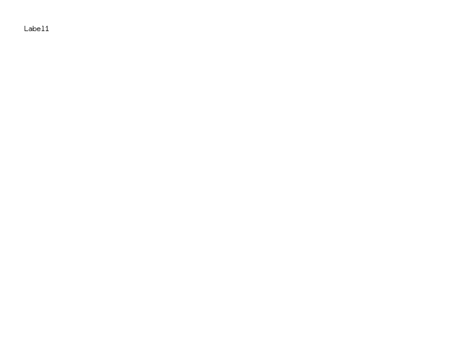

A caption with alignment, word wrap, autosize, and an optional polished box behind it. Clicking (or Return/Space while focused) fires `on_click`.

**Constructor:** `TLabel(Display* display, int screen, Window window, GC gc, SStyle_Manager* styles, int x, int y, int width, int height)`

**API** (widget-specific methods/properties/signals ONLY — skip the common ones):

- `set_text(std::string t)` / `get_text()` — the caption (default `"Label1"`)

- `set_alignment(int a)` / `get_alignment()` — 0 = left (default), 1 = centre, 2 = right

- `set_wordwrap(bool w)` / `get_wordwrap()` — wrap at word boundaries (default `false`)

- `set_autosize(bool a)` / `get_autosize()` — resize the bounds to fit the text (default `true`)

- `set_show_box(bool s)` / `get_show_box()` — draw the polished box behind the text (default `false`)

- `autosize_to_text()` — resizes the bounds to the text now; `text_pixel_width()` / `text_pixel_height()` report the text size

- signal `on_click` (`std::function<void()>`) — fires on click

**Example:**

```cpp
#include "TLabel.h"

#include <cstdio>

int main()
{
    Display* display = XOpenDisplay(nullptr);
    if (!display) { return 1; }
    int screen = DefaultScreen(display);
    Window window = XCreateSimpleWindow(display, RootWindow(display, screen), 100, 100, 800, 600, 1, BlackPixel(display, screen), WhitePixel(display, screen));
    XStoreName(display, window, "TLabel - XFrame demo");
    XSelectInput(display, window, ExposureMask | KeyPressMask | StructureNotifyMask | ButtonPressMask | ButtonReleaseMask | PointerMotionMask);
    Atom deleteWindowMessage = XInternAtom(display, "WM_DELETE_WINDOW", False);
    XSetWMProtocols(display, window, &deleteWindowMessage, 1);
    XMapWindow(display, window);
    GC gc = DefaultGC(display, screen);
    SStyle_Manager styles(display, window, screen, gc);
    styles.add_style_ex("default", Srgb{225, 225, 225}, Srgb{120, 120, 120}, Srgb{60, 60, 60}, Srgb{20, 20, 20}, 6, 1, "-misc-fixed-medium-r-normal--13-*");
    styles.set_active_style_byName("default");
    TLabel widget(display, screen, window, gc, &styles, 40, 40, 280, 36);
    widget.set_alignment(1);
    widget.set_wordwrap(true);
    widget.on_click = [] { std::printf("label clicked\n"); };
    widget.draw();
    bool running = true;
    while (running)
    {
        XEvent event;
        XNextEvent(display, &event);
        bool handled = false;
        switch (event.type)
        {
        case Expose:
            handled = true;
            break;
        case ButtonPress:
            handled = widget.on_button_press(event.xbutton.x, event.xbutton.y, event.xbutton.button);
            break;
        case ButtonRelease:
            handled = widget.on_button_release(event.xbutton.x, event.xbutton.y, event.xbutton.button);
            break;
        case MotionNotify:
            handled = widget.on_motion(event.xmotion.x, event.xmotion.y);
            break;
        case KeyPress:
        {
            char buffer[32];
            KeySym key = 0;
            int n = XLookupString(&event.xkey, buffer, (int)sizeof(buffer) - 1, &key, nullptr);
            buffer[n] = 0;
            handled = widget.on_key(key, buffer);
            break;
        }
        case ClientMessage:
            if ((Atom)event.xclient.data.l[0] == deleteWindowMessage)
            {
                running = false;
            }
            break;
        }
        if (handled)
        {
            XClearWindow(display, window);
            widget.draw();
            XFlush(display);
        }
    }
    XCloseDisplay(display);
    return 0;
}
```

## TPaintBox

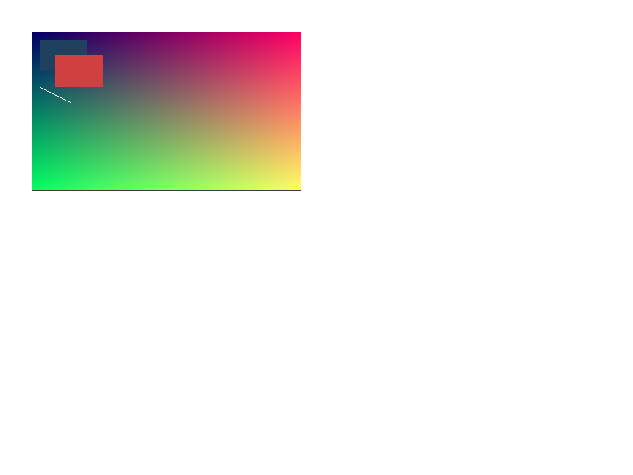

A paint surface that owns a `Canvas`. `draw()` calls `on_paint(this)` when one is assigned, otherwise it paints a built-in demo scene (gradient, two rectangles, a diagonal line), then blits the canvas and frames it.

**Constructor:** `TPaintBox(Display* display, int screen, Window window, GC gc, SStyle_Manager* styles, int x, int y, int width, int height)`

**API** (widget-specific methods/properties/signals ONLY — skip the common ones):

- `set_text(std::string t)` / `get_text()` — stored but not drawn (default `"TPaintBox"`)

- `canvas()` (`Canvas*`) — the owned canvas; draw on it with the `Canvas` API (`clear`, `fillRect`, `drawGradient`, `setPixel`, …)

- signal `on_paint` (`std::function<void(TPaintBox*)>`) — fires on every `draw()`; the handler receives the paint box so it can reach `canvas()`

**Example:**

```cpp
#include "TPaintBox.h"

#include <cstdio>

int main()
{
    Display* display = XOpenDisplay(nullptr);
    if (!display) { return 1; }
    int screen = DefaultScreen(display);
    Window window = XCreateSimpleWindow(display, RootWindow(display, screen), 100, 100, 800, 600, 1, BlackPixel(display, screen), WhitePixel(display, screen));
    XStoreName(display, window, "TPaintBox - XFrame demo");
    XSelectInput(display, window, ExposureMask | KeyPressMask | StructureNotifyMask | ButtonPressMask | ButtonReleaseMask | PointerMotionMask);
    Atom deleteWindowMessage = XInternAtom(display, "WM_DELETE_WINDOW", False);
    XSetWMProtocols(display, window, &deleteWindowMessage, 1);
    XMapWindow(display, window);
    GC gc = DefaultGC(display, screen);
    SStyle_Manager styles(display, window, screen, gc);
    styles.add_style_ex("default", Srgb{225, 225, 225}, Srgb{120, 120, 120}, Srgb{60, 60, 60}, Srgb{20, 20, 20}, 6, 1, "-misc-fixed-medium-r-normal--13-*");
    styles.set_active_style_byName("default");
    TPaintBox widget(display, screen, window, gc, &styles, 40, 40, 340, 200);
    widget.on_paint = [](TPaintBox* pb) { pb->canvas()->fillRect(10, 10, 60, 40, 0x204060); };
    widget.draw();
    bool running = true;
    while (running)
    {
        XEvent event;
        XNextEvent(display, &event);
        bool handled = false;
        switch (event.type)
        {
        case Expose:
            handled = true;
            break;
        case ButtonPress:
            handled = widget.on_button_press(event.xbutton.x, event.xbutton.y, event.xbutton.button);
            break;
        case ButtonRelease:
            handled = widget.on_button_release(event.xbutton.x, event.xbutton.y, event.xbutton.button);
            break;
        case MotionNotify:
            handled = widget.on_motion(event.xmotion.x, event.xmotion.y);
            break;
        case KeyPress:
        {
            char buffer[32];
            KeySym key = 0;
            int n = XLookupString(&event.xkey, buffer, (int)sizeof(buffer) - 1, &key, nullptr);
            buffer[n] = 0;
            handled = widget.on_key(key, buffer);
            break;
        }
        case ClientMessage:
            if ((Atom)event.xclient.data.l[0] == deleteWindowMessage)
            {
                running = false;
            }
            break;
        }
        if (handled)
        {
            XClearWindow(display, window);
            widget.draw();
            XFlush(display);
        }
    }
    XCloseDisplay(display);
    return 0;
}
```

**Notes:** The canvas is created at construction sized to the widget bounds and resized by `set_bounds()`. There is no separate invalidation — painting happens when the host calls `draw()`.

## TProgressBar

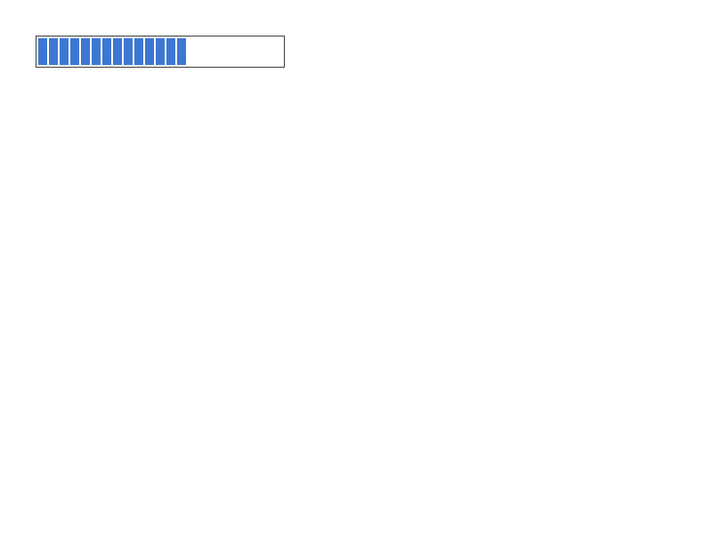

A progress bar: a white well with a blue fill, smooth or segmented (10px blocks with 2px gaps), horizontal or vertical, with an optional percentage text.

**Constructor:** `TProgressBar(Display* display, int screen, Window window, GC gc, SStyle_Manager* styles, int x, int y, int width, int height)`

**API** (widget-specific methods/properties/signals ONLY — skip the common ones):

- `set_text(std::string t)` / `get_text()` — the caption (default `"TProgressBar"`)

- `set_min(int m)` / `get_min()` — the range low end (default `0`)

- `set_max(int m)` / `get_max()` — the range high end (default `100`)

- `set_position(int p)` / `get_position()` — the current value (default `65`)

- `set_step(int s)` / `get_step()` — the step size (default `10`)

- `step_it()` — advances by the step; `step_by(int delta)` — advances by `delta`

- `set_smooth(bool s)` / `get_smooth()` — smooth fill vs segmented blocks (default `false`, segmented)

- `set_orientation(int o)` — 0 = horizontal (default), 1 = vertical (no getter)

- `set_show_text(bool s)` — draw the percentage over the bar (default `false`)

- `get_percent()` — the position as a 0..100 percentage

**Example:**

```cpp
#include "TProgressBar.h"

#include <cstdio>

int main()
{
    Display* display = XOpenDisplay(nullptr);
    if (!display) { return 1; }
    int screen = DefaultScreen(display);
    Window window = XCreateSimpleWindow(display, RootWindow(display, screen), 100, 100, 800, 600, 1, BlackPixel(display, screen), WhitePixel(display, screen));
    XStoreName(display, window, "TProgressBar - XFrame demo");
    XSelectInput(display, window, ExposureMask | KeyPressMask | StructureNotifyMask | ButtonPressMask | ButtonReleaseMask | PointerMotionMask);
    Atom deleteWindowMessage = XInternAtom(display, "WM_DELETE_WINDOW", False);
    XSetWMProtocols(display, window, &deleteWindowMessage, 1);
    XMapWindow(display, window);
    GC gc = DefaultGC(display, screen);
    SStyle_Manager styles(display, window, screen, gc);
    styles.add_style_ex("default", Srgb{225, 225, 225}, Srgb{120, 120, 120}, Srgb{60, 60, 60}, Srgb{20, 20, 20}, 6, 1, "-misc-fixed-medium-r-normal--13-*");
    styles.set_active_style_byName("default");
    TProgressBar widget(display, screen, window, gc, &styles, 40, 40, 280, 36);
    widget.set_position(65);
    widget.set_step(10);
    widget.step_it();
    widget.draw();
    bool running = true;
    while (running)
    {
        XEvent event;
        XNextEvent(display, &event);
        bool handled = false;
        switch (event.type)
        {
        case Expose:
            handled = true;
            break;
        case ButtonPress:
            handled = widget.on_button_press(event.xbutton.x, event.xbutton.y, event.xbutton.button);
            break;
        case ButtonRelease:
            handled = widget.on_button_release(event.xbutton.x, event.xbutton.y, event.xbutton.button);
            break;
        case MotionNotify:
            handled = widget.on_motion(event.xmotion.x, event.xmotion.y);
            break;
        case KeyPress:
        {
            char buffer[32];
            KeySym key = 0;
            int n = XLookupString(&event.xkey, buffer, (int)sizeof(buffer) - 1, &key, nullptr);
            buffer[n] = 0;
            handled = widget.on_key(key, buffer);
            break;
        }
        case ClientMessage:
            if ((Atom)event.xclient.data.l[0] == deleteWindowMessage)
            {
                running = false;
            }
            break;
        }
        if (handled)
        {
            XClearWindow(display, window);
            widget.draw();
            XFlush(display);
        }
    }
    XCloseDisplay(display);
    return 0;
}
```

**Notes:** No signals. Clicking the bar does nothing — the value only moves via the setters and step functions.

## TShape

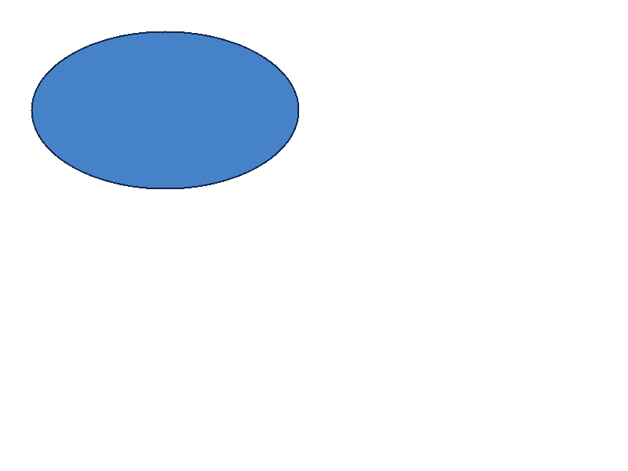

A filled geometric shape with a brush fill and a pen outline: rectangle, square, round rect, round square, ellipse, circle, triangle, diamond, pentagon, or hexagon. Square and circle variants force a square box from the smaller side.

**Constructor:** `TShape(Display* display, int screen, Window window, GC gc, SStyle_Manager* styles, int x, int y, int width, int height)`

**API** (widget-specific methods/properties/signals ONLY — skip the common ones):

- `set_text(std::string t)` / `get_text()` — stored but not drawn (default `"TShape"`)

- `set_shape(TShapeType s)` / `get_shape()` — `stRectangle, stSquare, stRoundRect, stRoundSquare, stEllipse, stCircle, stTriangle, stDiamond, stPentagon, stHexagon` (default `stEllipse`)

- `set_brush_color(Srgb c)` / `get_brush_color()` — the fill (default `{70, 130, 200}`)

- `set_pen_color(Srgb c)` / `get_pen_color()` — the outline (default `{20, 40, 80}`)

- `set_pen_width(int w)` / `get_pen_width()` — the outline width (default `2`)

**Example:**

```cpp
#include "TShape.h"

#include <cstdio>

int main()
{
    Display* display = XOpenDisplay(nullptr);
    if (!display) { return 1; }
    int screen = DefaultScreen(display);
    Window window = XCreateSimpleWindow(display, RootWindow(display, screen), 100, 100, 800, 600, 1, BlackPixel(display, screen), WhitePixel(display, screen));
    XStoreName(display, window, "TShape - XFrame demo");
    XSelectInput(display, window, ExposureMask | KeyPressMask | StructureNotifyMask | ButtonPressMask | ButtonReleaseMask | PointerMotionMask);
    Atom deleteWindowMessage = XInternAtom(display, "WM_DELETE_WINDOW", False);
    XSetWMProtocols(display, window, &deleteWindowMessage, 1);
    XMapWindow(display, window);
    GC gc = DefaultGC(display, screen);
    SStyle_Manager styles(display, window, screen, gc);
    styles.add_style_ex("default", Srgb{225, 225, 225}, Srgb{120, 120, 120}, Srgb{60, 60, 60}, Srgb{20, 20, 20}, 6, 1, "-misc-fixed-medium-r-normal--13-*");
    styles.set_active_style_byName("default");
    TShape widget(display, screen, window, gc, &styles, 40, 40, 340, 200);
    widget.set_shape(stEllipse);
    widget.set_brush_color(Srgb{70, 130, 200});
    widget.draw();
    bool running = true;
    while (running)
    {
        XEvent event;
        XNextEvent(display, &event);
        bool handled = false;
        switch (event.type)
        {
        case Expose:
            handled = true;
            break;
        case ButtonPress:
            handled = widget.on_button_press(event.xbutton.x, event.xbutton.y, event.xbutton.button);
            break;
        case ButtonRelease:
            handled = widget.on_button_release(event.xbutton.x, event.xbutton.y, event.xbutton.button);
            break;
        case MotionNotify:
            handled = widget.on_motion(event.xmotion.x, event.xmotion.y);
            break;
        case KeyPress:
        {
            char buffer[32];
            KeySym key = 0;
            int n = XLookupString(&event.xkey, buffer, (int)sizeof(buffer) - 1, &key, nullptr);
            buffer[n] = 0;
            handled = widget.on_key(key, buffer);
            break;
        }
        case ClientMessage:
            if ((Atom)event.xclient.data.l[0] == deleteWindowMessage)
            {
                running = false;
            }
            break;
        }
        if (handled)
        {
            XClearWindow(display, window);
            widget.draw();
            XFlush(display);
        }
    }
    XCloseDisplay(display);
    return 0;
}
```

**Notes:** Display-only and non-interactive: all event handlers return `false`, and there are no signals.

## TStaticText

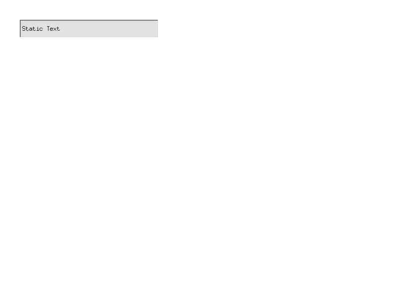

A static label with an optional border, alignment, and an accelerator character (`&`) that can be shown or hidden. The focus control is a name only.

**Constructor:** `TStaticText(Display* display, int screen, Window window, GC gc, SStyle_Manager* styles, int x, int y, int width, int height)`

**API** (widget-specific methods/properties/signals ONLY — skip the common ones):

- `set_text(std::string t)` / `get_text()` — the text (default `"Static Text"`)

- `set_border_style(TStaticBorderStyle b)` / `get_border_style()` — `sbsNone` (default), `sbsSingle`, `sbsSunken`

- `set_alignment(int a)` / `get_alignment()` — 0 = left (default), 1 = centre, 2 = right (unclear from the header — the alignment values are not named; 0/1/2 follow the TLabel convention)

- `set_focus_control(std::string name)` / `get_focus_control()` — the name of the control this label is for (stored only)

- `set_show_accel_char(bool s)` / `get_show_accel_char()` — whether the `&` accelerator marker is shown (default `true`)

- signal `on_click` (`std::function<void()>`) — fires on click

**Example:**

```cpp
#include "TStaticText.h"

#include <cstdio>

int main()
{
    Display* display = XOpenDisplay(nullptr);
    if (!display) { return 1; }
    int screen = DefaultScreen(display);
    Window window = XCreateSimpleWindow(display, RootWindow(display, screen), 100, 100, 800, 600, 1, BlackPixel(display, screen), WhitePixel(display, screen));
    XStoreName(display, window, "TStaticText - XFrame demo");
    XSelectInput(display, window, ExposureMask | KeyPressMask | StructureNotifyMask | ButtonPressMask | ButtonReleaseMask | PointerMotionMask);
    Atom deleteWindowMessage = XInternAtom(display, "WM_DELETE_WINDOW", False);
    XSetWMProtocols(display, window, &deleteWindowMessage, 1);
    XMapWindow(display, window);
    GC gc = DefaultGC(display, screen);
    SStyle_Manager styles(display, window, screen, gc);
    styles.add_style_ex("default", Srgb{225, 225, 225}, Srgb{120, 120, 120}, Srgb{60, 60, 60}, Srgb{20, 20, 20}, 6, 1, "-misc-fixed-medium-r-normal--13-*");
    styles.set_active_style_byName("default");
    TStaticText widget(display, screen, window, gc, &styles, 40, 40, 280, 36);
    widget.set_border_style(sbsSunken);
    widget.on_click = [] { std::printf("static text clicked\n"); };
    widget.draw();
    bool running = true;
    while (running)
    {
        XEvent event;
        XNextEvent(display, &event);
        bool handled = false;
        switch (event.type)
        {
        case Expose:
            handled = true;
            break;
        case ButtonPress:
            handled = widget.on_button_press(event.xbutton.x, event.xbutton.y, event.xbutton.button);
            break;
        case ButtonRelease:
            handled = widget.on_button_release(event.xbutton.x, event.xbutton.y, event.xbutton.button);
            break;
        case MotionNotify:
            handled = widget.on_motion(event.xmotion.x, event.xmotion.y);
            break;
        case KeyPress:
        {
            char buffer[32];
            KeySym key = 0;
            int n = XLookupString(&event.xkey, buffer, (int)sizeof(buffer) - 1, &key, nullptr);
            buffer[n] = 0;
            handled = widget.on_key(key, buffer);
            break;
        }
        case ClientMessage:
            if ((Atom)event.xclient.data.l[0] == deleteWindowMessage)
            {
                running = false;
            }
            break;
        }
        if (handled)
        {
            XClearWindow(display, window);
            widget.draw();
            XFlush(display);
        }
    }
    XCloseDisplay(display);
    return 0;
}
```

**Notes:** The sunken border is drawn as two nested bevel lines (dark outside top/left, light outside bottom/right, reversed on the inner line).

## TStatusBar

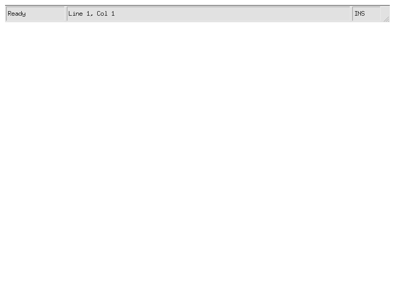

A status bar: a bar body in the style fill with a raised top edge, sunken panels, and an optional size grip (three diagonal ridges in the corner). Panels have explicit widths; the last panel takes the remaining width.

**Constructor:** `TStatusBar(Display* display, int screen, Window window, GC gc, SStyle_Manager* styles, int x, int y, int width, int height)`

**API** (widget-specific methods/properties/signals ONLY — skip the common ones):

- `set_text(std::string t)` / `get_text()` — stored but not drawn (default `"TStatusBar"`)

- `add_panel(int w, std::string t)` — appends a panel of width `w` with text `t`

- `panel_count()` — the number of panels

- `set_panel_text(int index, std::string t)` / `get_panel_text(int index)` — one panel's text

- `set_size_grip(bool g)` — the size grip (default `true`; no getter)

- signal `on_panel_click` (`std::function<void(int)>`) — fires with the panel index when a panel is clicked

**Example:**

```cpp
#include "TStatusBar.h"

#include <cstdio>

int main()
{
    Display* display = XOpenDisplay(nullptr);
    if (!display) { return 1; }
    int screen = DefaultScreen(display);
    Window window = XCreateSimpleWindow(display, RootWindow(display, screen), 100, 100, 800, 600, 1, BlackPixel(display, screen), WhitePixel(display, screen));
    XStoreName(display, window, "TStatusBar - XFrame demo");
    XSelectInput(display, window, ExposureMask | KeyPressMask | StructureNotifyMask | ButtonPressMask | ButtonReleaseMask | PointerMotionMask);
    Atom deleteWindowMessage = XInternAtom(display, "WM_DELETE_WINDOW", False);
    XSetWMProtocols(display, window, &deleteWindowMessage, 1);
    XMapWindow(display, window);
    GC gc = DefaultGC(display, screen);
    SStyle_Manager styles(display, window, screen, gc);
    styles.add_style_ex("default", Srgb{225, 225, 225}, Srgb{120, 120, 120}, Srgb{60, 60, 60}, Srgb{20, 20, 20}, 6, 1, "-misc-fixed-medium-r-normal--13-*");
    styles.set_active_style_byName("default");
    TStatusBar widget(display, screen, window, gc, &styles, 10, 10, 760, 34);
    widget.add_panel(200, "Ready");
    widget.set_panel_text(0, "Ready");
    widget.on_panel_click = [](int index) { std::printf("panel %d clicked\n", index); };
    widget.draw();
    bool running = true;
    while (running)
    {
        XEvent event;
        XNextEvent(display, &event);
        bool handled = false;
        switch (event.type)
        {
        case Expose:
            handled = true;
            break;
        case ButtonPress:
            handled = widget.on_button_press(event.xbutton.x, event.xbutton.y, event.xbutton.button);
            break;
        case ButtonRelease:
            handled = widget.on_button_release(event.xbutton.x, event.xbutton.y, event.xbutton.button);
            break;
        case MotionNotify:
            handled = widget.on_motion(event.xmotion.x, event.xmotion.y);
            break;
        case KeyPress:
        {
            char buffer[32];
            KeySym key = 0;
            int n = XLookupString(&event.xkey, buffer, (int)sizeof(buffer) - 1, &key, nullptr);
            buffer[n] = 0;
            handled = widget.on_key(key, buffer);
            break;
        }
        case ClientMessage:
            if ((Atom)event.xclient.data.l[0] == deleteWindowMessage)
            {
                running = false;
            }
            break;
        }
        if (handled)
        {
            XClearWindow(display, window);
            widget.draw();
            XFlush(display);
        }
    }
    XCloseDisplay(display);
    return 0;
}
```

**Notes:** The bar starts with no panels — add them with `add_panel()` or nothing is drawn except the bar body and grip.

## TTimeEdit

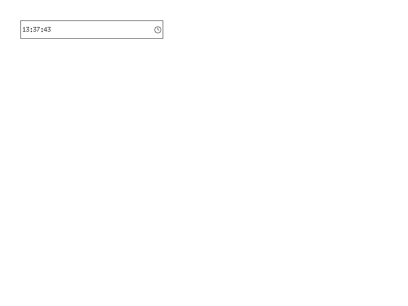

A time edit field: a white well showing HH:MM:SS with a small clock glyph at the right edge. Clicking selects a segment (hours/minutes/seconds); typing digits edits it and Up/Down steps it, and the focused segment is highlighted.

**Constructor:** `TTimeEdit(Display* display, int screen, Window window, GC gc, SStyle_Manager* styles, int x, int y, int width, int height)`

**API** (widget-specific methods/properties/signals ONLY — skip the common ones):

- `set_text(std::string t)` / `get_text()` — the time text; `set_text()` parses `"h:m:s"`

- `get_hours()` / `get_minutes()` / `get_seconds()` — the parts (default 13:45:30)

- `set_time(int h, int m, int s)` — sets all three parts

- `get_time()` — the time as a `"HH:MM:SS"` string

- `set_show_seconds(bool s)` / `get_show_seconds()` — whether the seconds segment is shown (default `true`)

- signal `on_click` (`std::function<void()>`) — fires on click

- signal `on_change` (`std::function<void()>`) — fires when the time changes

**Example:**

```cpp
#include "TTimeEdit.h"

#include <cstdio>

int main()
{
    Display* display = XOpenDisplay(nullptr);
    if (!display) { return 1; }
    int screen = DefaultScreen(display);
    Window window = XCreateSimpleWindow(display, RootWindow(display, screen), 100, 100, 800, 600, 1, BlackPixel(display, screen), WhitePixel(display, screen));
    XStoreName(display, window, "TTimeEdit - XFrame demo");
    XSelectInput(display, window, ExposureMask | KeyPressMask | StructureNotifyMask | ButtonPressMask | ButtonReleaseMask | PointerMotionMask);
    Atom deleteWindowMessage = XInternAtom(display, "WM_DELETE_WINDOW", False);
    XSetWMProtocols(display, window, &deleteWindowMessage, 1);
    XMapWindow(display, window);
    GC gc = DefaultGC(display, screen);
    SStyle_Manager styles(display, window, screen, gc);
    styles.add_style_ex("default", Srgb{225, 225, 225}, Srgb{120, 120, 120}, Srgb{60, 60, 60}, Srgb{20, 20, 20}, 6, 1, "-misc-fixed-medium-r-normal--13-*");
    styles.set_active_style_byName("default");
    TTimeEdit widget(display, screen, window, gc, &styles, 40, 40, 280, 36);
    widget.set_time(13, 45, 30);
    widget.on_change = [] { std::printf("time changed\n"); };
    widget.draw();
    bool running = true;
    while (running)
    {
        XEvent event;
        XNextEvent(display, &event);
        bool handled = false;
        switch (event.type)
        {
        case Expose:
            handled = true;
            break;
        case ButtonPress:
            handled = widget.on_button_press(event.xbutton.x, event.xbutton.y, event.xbutton.button);
            break;
        case ButtonRelease:
            handled = widget.on_button_release(event.xbutton.x, event.xbutton.y, event.xbutton.button);
            break;
        case MotionNotify:
            handled = widget.on_motion(event.xmotion.x, event.xmotion.y);
            break;
        case KeyPress:
        {
            char buffer[32];
            KeySym key = 0;
            int n = XLookupString(&event.xkey, buffer, (int)sizeof(buffer) - 1, &key, nullptr);
            buffer[n] = 0;
            handled = widget.on_key(key, buffer);
            break;
        }
        case ClientMessage:
            if ((Atom)event.xclient.data.l[0] == deleteWindowMessage)
            {
                running = false;
            }
            break;
        }
        if (handled)
        {
            XClearWindow(display, window);
            widget.draw();
            XFlush(display);
        }
    }
    XCloseDisplay(display);
    return 0;
}
```

## TTimer


A timer, not a control: at run time it is not drawn as an interactive widget at all — `draw()` only paints a design-time clock icon plus `"TTimer: <interval> ms"` (with `" (off)"` when disabled). The host's event loop must drive it by calling `tick()` with a millisecond clock.

**Constructor:** `TTimer(Display* display, int screen, Window window, GC gc, SStyle_Manager* styles, int x, int y, int width, int height)`

**API** (widget-specific methods/properties/signals ONLY — skip the common ones):

- `set_text(std::string t)` / `get_text()` — stored but not drawn (default `"TTimer"`)

- `set_interval(int ms)` / `get_interval()` — the interval in milliseconds (default `1000`; clamped to at least `1`)

- `get_fire_count()` — how many times `on_timer` has fired (`long`)

- `tick(long now_ms)` — call from the host loop with the current time in milliseconds; the first call just starts the clock, then `on_timer` fires each time a full interval has elapsed

- `reset()` — restarts the clock so the next `tick()` starts it again

- signal `on_timer` (`std::function<void()>`) — fires once per elapsed interval

**Example:**

```cpp
#include "TTimer.h"

#include <cstdio>
#include <chrono>
#include <unistd.h>

int main()
{
    Display* display = XOpenDisplay(nullptr);
    if (!display) { return 1; }
    int screen = DefaultScreen(display);
    Window window = XCreateSimpleWindow(display, RootWindow(display, screen), 100, 100, 800, 600, 1, BlackPixel(display, screen), WhitePixel(display, screen));
    XStoreName(display, window, "TTimer - XFrame demo");
    XSelectInput(display, window, ExposureMask | KeyPressMask | StructureNotifyMask | ButtonPressMask | ButtonReleaseMask | PointerMotionMask);
    Atom deleteWindowMessage = XInternAtom(display, "WM_DELETE_WINDOW", False);
    XSetWMProtocols(display, window, &deleteWindowMessage, 1);
    XMapWindow(display, window);
    GC gc = DefaultGC(display, screen);
    SStyle_Manager styles(display, window, screen, gc);
    styles.add_style_ex("default", Srgb{225, 225, 225}, Srgb{120, 120, 120}, Srgb{60, 60, 60}, Srgb{20, 20, 20}, 6, 1, "-misc-fixed-medium-r-normal--13-*");
    styles.set_active_style_byName("default");
    TTimer widget(display, screen, window, gc, &styles, 40, 40, 340, 200);
    widget.set_interval(500);
    widget.on_timer = [] { std::printf("timer fired\n"); };
    widget.draw();
    auto last = std::chrono::steady_clock::now();
    bool running = true;
    while (running)
    {
        if (XPending(display))
        {
            XEvent event;
            XNextEvent(display, &event);
            bool handled = false;
            switch (event.type)
            {
            case Expose:
                handled = true;
                break;
            case ButtonPress:
                handled = widget.on_button_press(event.xbutton.x, event.xbutton.y, event.xbutton.button);
                break;
            case ButtonRelease:
                handled = widget.on_button_release(event.xbutton.x, event.xbutton.y, event.xbutton.button);
                break;
            case MotionNotify:
                handled = widget.on_motion(event.xmotion.x, event.xmotion.y);
                break;
            case KeyPress:
            {
                char buffer[32];
                KeySym key = 0;
                int n = XLookupString(&event.xkey, buffer, (int)sizeof(buffer) - 1, &key, nullptr);
                buffer[n] = 0;
                handled = widget.on_key(key, buffer);
                break;
            }
            case ClientMessage:
                if ((Atom)event.xclient.data.l[0] == deleteWindowMessage)
                {
                    running = false;
                }
                break;
            }
            if (handled)
            {
                XClearWindow(display, window);
                widget.draw();
                XFlush(display);
            }
        }
        else
        {
            auto now = std::chrono::steady_clock::now();
            if (std::chrono::duration_cast<std::chrono::milliseconds>(now - last).count() >= 100)
            {
                last = now;
                long now_ms = (long)std::chrono::duration_cast<std::chrono::milliseconds>(now.time_since_epoch()).count();
                widget.tick(now_ms);

                XClearWindow(display, window);
                widget.draw();
                XFlush(display);
            }
            else
            {
                usleep(10000);
            }
        }
    }
    XCloseDisplay(display);
    return 0;
}
```

**Notes:** `set_enabled(false)` pauses the timer (`tick()` returns immediately). There is no thread and no X timer behind it — without host `tick()` calls nothing ever fires. The example uses a polling loop with `XPending()` so `tick()` is called even when no events arrive.

## TTrayIcon

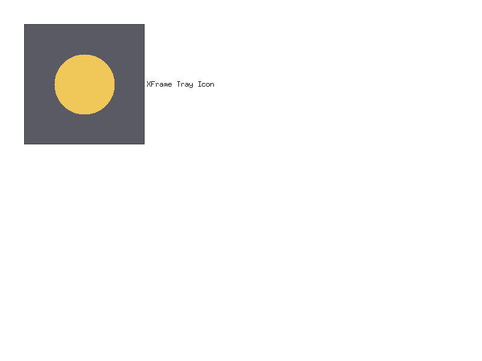

A tray icon in name only: there is no system-tray registration here. `draw()` paints a design-time tray slot with a gold dot plus the hint text beside it.

**Constructor:** `TTrayIcon(Display* display, int screen, Window window, GC gc, SStyle_Manager* styles, int x, int y, int width, int height)`

**API** (widget-specific methods/properties/signals ONLY — skip the common ones):

- `set_text(std::string t)` / `get_text()` — stored but not drawn (default `"TTrayIcon"`)

- `set_hint(std::string h)` / `get_hint()` — the tooltip text (default `"XFrame Tray Icon"`)

- `set_icon_name(std::string n)` / `get_icon_name()` — the icon name (default `"app_icon"`, stored only)

- `set_pop_up_menu(std::string menu_name)` / `get_pop_up_menu()` — the name of the bound `TPopupMenu` (default `""`, stored only)

- `show_icon()` / `hide_icon()` / `icon_visible()` — flip and read the tray-visible flag (default hidden)

- signal `on_click` (`std::function<void()>`) — fires on the first click

- signal `on_dbl_click` (`std::function<void()>`) — fires on the second click while armed

- signal `on_mouse_down` (`std::function<void()>`) — fires on any button press; a right-click with a pop-up menu set also fires it

**Example:**

```cpp
#include "TTrayIcon.h"

#include <cstdio>

int main()
{
    Display* display = XOpenDisplay(nullptr);
    if (!display) { return 1; }
    int screen = DefaultScreen(display);
    Window window = XCreateSimpleWindow(display, RootWindow(display, screen), 100, 100, 800, 600, 1, BlackPixel(display, screen), WhitePixel(display, screen));
    XStoreName(display, window, "TTrayIcon - XFrame demo");
    XSelectInput(display, window, ExposureMask | KeyPressMask | StructureNotifyMask | ButtonPressMask | ButtonReleaseMask | PointerMotionMask);
    Atom deleteWindowMessage = XInternAtom(display, "WM_DELETE_WINDOW", False);
    XSetWMProtocols(display, window, &deleteWindowMessage, 1);
    XMapWindow(display, window);
    GC gc = DefaultGC(display, screen);
    SStyle_Manager styles(display, window, screen, gc);
    styles.add_style_ex("default", Srgb{225, 225, 225}, Srgb{120, 120, 120}, Srgb{60, 60, 60}, Srgb{20, 20, 20}, 6, 1, "-misc-fixed-medium-r-normal--13-*");
    styles.set_active_style_byName("default");
    TTrayIcon widget(display, screen, window, gc, &styles, 40, 40, 340, 200);
    widget.set_hint("My app");
    widget.show_icon();
    widget.on_click = [] { std::printf("tray clicked\n"); };
    widget.on_dbl_click = [] { std::printf("tray double-clicked\n"); };
    widget.draw();
    bool running = true;
    while (running)
    {
        XEvent event;
        XNextEvent(display, &event);
        bool handled = false;
        switch (event.type)
        {
        case Expose:
            handled = true;
            break;
        case ButtonPress:
            handled = widget.on_button_press(event.xbutton.x, event.xbutton.y, event.xbutton.button);
            break;
        case ButtonRelease:
            handled = widget.on_button_release(event.xbutton.x, event.xbutton.y, event.xbutton.button);
            break;
        case MotionNotify:
            handled = widget.on_motion(event.xmotion.x, event.xmotion.y);
            break;
        case KeyPress:
        {
            char buffer[32];
            KeySym key = 0;
            int n = XLookupString(&event.xkey, buffer, (int)sizeof(buffer) - 1, &key, nullptr);
            buffer[n] = 0;
            handled = widget.on_key(key, buffer);
            break;
        }
        case ClientMessage:
            if ((Atom)event.xclient.data.l[0] == deleteWindowMessage)
            {
                running = false;
            }
            break;
        }
        if (handled)
        {
            XClearWindow(display, window);
            widget.draw();
            XFlush(display);
        }
    }
    XCloseDisplay(display);
    return 0;
}
```

**Notes:** Double-click arming: the first press arms it, the second fires `on_dbl_click`; moving the pointer away disarms it. `show_icon()` only sets a flag — nothing appears in a real system tray.

## TTrackBar

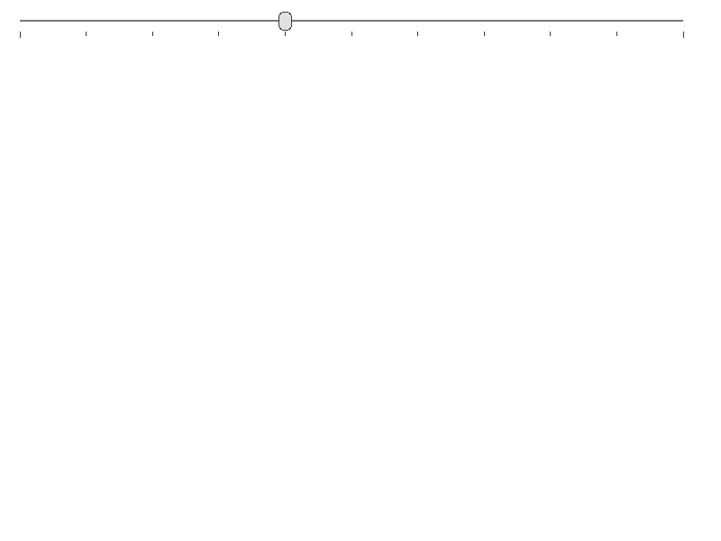

A slider: a groove with tick marks every `frequency_` units and a polished thumb. Drag the thumb, click the groove to page, or use the keyboard.

**Constructor:** `TTrackBar(Display* display, int screen, Window window, GC gc, SStyle_Manager* styles, int x, int y, int width, int height)`

**API** (widget-specific methods/properties/signals ONLY — skip the common ones):

- `set_text(std::string t)` / `get_text()` — stored but not drawn (default `"TTrackBar"`)

- `set_orientation(int o)` / `get_orientation()` — 0 = horizontal (default), 1 = vertical

- `set_min(int m)` / `get_min()` — the low end (default `0`); `set_max(int m)` / `get_max()` — the high end (default `100`)

- `set_position(int p)` / `get_position()` — the thumb position (default `40`)

- `set_frequency(int f)` / `get_frequency()` — tick marks every `f` units (default `10`; `0` hides them)

- `set_line_size(int s)` — the arrow-key step (default `1`; no getter); `set_page_size(int s)` — the page step (default `10`; no getter)

- signal `on_change` (`std::function<void()>`) — fires when the position changes

**Example:**

```cpp
#include "TTrackBar.h"

#include <cstdio>

int main()
{
    Display* display = XOpenDisplay(nullptr);
    if (!display) { return 1; }
    int screen = DefaultScreen(display);
    Window window = XCreateSimpleWindow(display, RootWindow(display, screen), 100, 100, 800, 600, 1, BlackPixel(display, screen), WhitePixel(display, screen));
    XStoreName(display, window, "TTrackBar - XFrame demo");
    XSelectInput(display, window, ExposureMask | KeyPressMask | StructureNotifyMask | ButtonPressMask | ButtonReleaseMask | PointerMotionMask);
    Atom deleteWindowMessage = XInternAtom(display, "WM_DELETE_WINDOW", False);
    XSetWMProtocols(display, window, &deleteWindowMessage, 1);
    XMapWindow(display, window);
    GC gc = DefaultGC(display, screen);
    SStyle_Manager styles(display, window, screen, gc);
    styles.add_style_ex("default", Srgb{225, 225, 225}, Srgb{120, 120, 120}, Srgb{60, 60, 60}, Srgb{20, 20, 20}, 6, 1, "-misc-fixed-medium-r-normal--13-*");
    styles.set_active_style_byName("default");
    TTrackBar widget(display, screen, window, gc, &styles, 10, 10, 760, 34);
    widget.set_position(40);
    widget.set_frequency(10);
    widget.on_change = [] { std::printf("trackbar changed\n"); };
    widget.draw();
    bool running = true;
    while (running)
    {
        XEvent event;
        XNextEvent(display, &event);
        bool handled = false;
        switch (event.type)
        {
        case Expose:
            handled = true;
            break;
        case ButtonPress:
            handled = widget.on_button_press(event.xbutton.x, event.xbutton.y, event.xbutton.button);
            break;
        case ButtonRelease:
            handled = widget.on_button_release(event.xbutton.x, event.xbutton.y, event.xbutton.button);
            break;
        case MotionNotify:
            handled = widget.on_motion(event.xmotion.x, event.xmotion.y);
            break;
        case KeyPress:
        {
            char buffer[32];
            KeySym key = 0;
            int n = XLookupString(&event.xkey, buffer, (int)sizeof(buffer) - 1, &key, nullptr);
            buffer[n] = 0;
            handled = widget.on_key(key, buffer);
            break;
        }
        case ClientMessage:
            if ((Atom)event.xclient.data.l[0] == deleteWindowMessage)
            {
                running = false;
            }
            break;
        }
        if (handled)
        {
            XClearWindow(display, window);
            widget.draw();
            XFlush(display);
        }
    }
    XCloseDisplay(display);
    return 0;
}
```

**Notes:** Clicking the groove pages by `page_size_` towards the click; arrow keys step by `line_size_`, PageUp/PageDown by `page_size_`, Home/End jump to the ends. `on_motion` only tracks thumb dragging — there is no hover state.
