# Instrumentation — XFrame Instrumentation section

The 11th XFrame palette section (amber accent): 66 widgets — tank levels,
switches, illuminators and status LEDs, gauges, panel furniture, LED digit
displays, analog needles, and higher-segment alphanumeric displays — taking
the library from 481 to 547 widgets in 11 sections and the combined IDE
palette from 517 to 583 entries (36 FDesigner + 547 XFrame). Every widget
is a header-only X11 class in `widgets/components/<Name>/`, following the
`XGraph` pattern (`Display*`/screen/window/GC, `draw()`, `on_button_press`,
`on_button_release`, `on_motion`, `on_key`), in the standard XFrame
hand-drawn widget style — no photorealism, no photo textures.
Attribution: XFrame.

All 66 instrumentation widgets render their text in 18 px bold
(13 px x 1.33 = 17.3 px target; 18 px is the nearest available core X
font to that target, since the server fixed-font set has no 17 px bold).
The 7/14/16-segment digit glyphs already fill their cells, so their
geometry is unchanged — the one exception is InstDigitalReadout, whose
fixed glyphs scaled 34x64 to 45x85.

## Groups

| Group | Widgets | Document |
| --- | --- | --- |
| A — Tank Level | 8 | [instrumentation-tanks.md](instrumentation-tanks.md) |
| B — Switches | 12 | [instrumentation-switches.md](instrumentation-switches.md) |
| C — Illuminators & Status LEDs | 12 | [instrumentation-lamps.md](instrumentation-lamps.md) |
| D+E — Gauges & Panel Furniture | 12 | [instrumentation-gauges.md](instrumentation-gauges.md) |
| F — LED Digit Displays & Analog Needles | 10 | [instrumentation-digits.md](instrumentation-digits.md) |
| G — Higher-Segment Alphanumeric LED Displays | 12 | [instrumentation-segments.md](instrumentation-segments.md) |
| **Total** | **66** | |

## Shared data model (InstData.h)

All 66 widgets render from one shared header,
`widgets/components/InstData.h` (included as `#include "../InstData.h"`).
No hardware I/O, no network: demos and tests run on deterministic values
defined here, so results are reproducible.

- `xframe::inst_clamp_level(double)` — clamps a level to [0, 100].
- `xframe::InstAlarmBands` — hi-hi 95, hi 80, lo 20, lo-lo 5 (percent);
  `set_alarm_bands()` changes them on tank widgets.
- `xframe::InstSwitchState` — `Off`, `On`, `Tripped`. Centre-off rockers
  use `Off` as the middle position; breakers use `Tripped` for the fault
  position.
- `xframe::InstLamp {on, brightness}` — one illuminator: on/off plus
  brightness 0–100 (100 = full).
- `xframe::InstRgb {red, green, blue}` — one RGB status LED: three
  independent channels, each an independent illuminator. Any of the 8
  colour combinations plus off.
- `xframe::inst_demo_level(seed)` — deterministic demo level in [5, 95];
  same seed gives the same level on every run and every platform.
- `xframe::inst_demo_value(min, max, seed)` — deterministic demo value in
  [min, max] for gauges, derived from `inst_demo_level(seed)`.

## How the widgets behave

- **Tank levels (Group A):** every widget shows fill 0–100%, a 0–100
  scale, and hi/lo alarm markers. Level is settable with `set_level()`
  (clamped via `inst_clamp_level`) and readable with `get_level()`.
  Clicking sets the level from the click position; Up/Down (or
  Left/Right) keys nudge it by 5, Home sets 0, End sets 100, R resets to
  the deterministic demo level.
- **Switches (Group B):** every switch really toggles — a click flips the
  state and the widget redraws in the new position. State is observable
  via `is_on()` and `get_state()` (returning `InstSwitchState`), and every
  widget exposes an `on_click` callback fired on each state change. The
  emergency stop latches on press and resets on right-click or R; the
  circuit breaker adds a mid-position `Tripped` fault state.
- **Lamps and LEDs (Group C):** every lamp and LED is an independent
  illuminator — its own on/off plus brightness 0–100, observable via
  `is_on()` and `get_brightness()`. Click (or Space when focused) toggles
  a lamp; the RGB LED takes `r`/`g`/`b` keys for its three independent
  channels; the stack light takes `1`/`2`/`3`; the beacon takes `f`; the
  lamp-test button is momentary (on only while held).
- **Gauges, meters and digits (Groups D, F):** every value widget has
  `set_value(double)` (clamped to its range) and `get_value()`, plus
  `set_range(lo, hi)`, `min_value()`/`max_value()` and `fraction()` where
  it applies. Arrow keys adjust the value, Home resets to mid-range (or
  the minimum for digits/needles). The LED digit displays are old
  7-segment style in 1–6 digit variants, zero-padded, with a decimal
  point after a settable digit.
- **Higher-segment displays (Group G):** 14- and 16-segment alphanumeric
  LED displays in 1–6 digit variants. `set_value(string)` takes the
  displayed string, normalised to uppercase and truncated to the digit
  count; characters with no approximation are dropped, `.`/`:` become a
  decimal-point dot after the previous digit. Each type documents its
  repertoire honestly: which characters render clean, which only
  approximately, and which cannot show at all (blank). Up/Right steps
  the last displayed character, Down/Left steps it down, Home restores
  the default demo string.
- **Panel furniture (Group E):** mounting plates, nameplates, bezels and
  a control-panel grid container other widgets sit on — title strip,
  screws, labelled cells, click a cell to select it.

Each widget directory holds exactly `<Name>.h`, `main_<Name>.cpp`,
`CMakeLists.txt`, and `core/xframe_core.h` (byte-identical to
`widgets/core/xframe_core.h`). Build one widget (from the repo root, on
the server):

```
cmake -S widgets/components/InstVerticalTankLevel -B /tmp/b-tank -DCMAKE_CXX_FLAGS="-Wall -Wextra"
cmake --build /tmp/b-tank   # 0 warnings
```

## Test summary

Integration test battery, run on the server after Group G landed
(registry 547 widgets, 11 sections, Instrumentation 66). All counts
derived from the registry at run time, never hard-coded.

| Check | Result |
| --- | --- |
| Section assignment (`tools/sections.py`) | 547 widgets, exactly one section each; Instrumentation 66 |
| Icons (`tools/verify_icons.py`) | 547/547 parse as 16x16 BMP ICOs, all non-blank, 547 distinct hashes, most-shared 1 |
| Combined palette (`widgets/tests/test_combined_palette.py`) | ALL PASS — presence 36 FDesigner + 547 XFrame, self-test 583/583, real-mouse select + place |
| Palette / layout (`widgets/tests/test_palette_layout.py`) | place 547/547, draw 547/547, PLACE_ALL 547/547, palette self-test 547/547, handle drags 12/12, interactive place/move/resize/delete PASS |
| Full build (`widgets/build`, all 547 demos + palette + layout) | 0 warnings, 0 errors |
| Doc examples (`tools/verify_doc_examples.py`, all docs) | 547/547 compile (66/66 Instrumentation) |
| Per-widget pictures (`tools/render_widget_pics.py`) | 547/547 PASS, 0 FAIL; 66/66 picture links in this doc (`tools/link_widget_pics.py --check`) |
| Composite (`widgets/build_composite.py`, `verify_composite.py`) | 24x23 grid, 5868x4842, 547 tiles, 0 blank, 0 mismatched, 0 bad labels |
| Seam (`widgets/tests/test_layout_to_fdesigner.py`) | ALL PASS — 547 entries, 136 mapped (same 136 as before; 0 of the 66 Instrumentation widgets map to a GTK counterpart, never forced), 411 unmapped, 34 approximate, generated project builds |
| Group drivers (each widget build + draw + click/key + clean exit) | Tanks 8/8, switches 12/12, lamps 12/12, gauges + panel 38/38 checks, digits + needles ALL PASS, segments ALL PASS — every driver exit 0 |

One integration fix was needed: `widgets/palette/main_palette.cpp` had a
hard-coded 10-entry section-accent table, so the 11th section fell back
to blue. The 11th entry (amber 245, 158, 11) was added and the header
colour pixel-verified in `screenshots/instrumentation_palette_section.png`.

## Group A — Tank Level (8 widgets)

Group A of the XFrame Instrumentation section (11th palette section, amber
accent). Eight tank-level widgets, all in the standard XFrame hand-drawn
widget style — no photorealism, no photo textures.

Every widget shows fill 0–100%, a 0–100 scale, and hi/lo alarm markers.
Level is settable with `set_level()` (clamped to 0–100 via
`xframe::inst_clamp_level`) and readable with `get_level()`. Alarm bands
default to hi-hi 95, hi 80, lo 20, lo-lo 5 (`xframe::InstAlarmBands`) and
can be changed with `set_alarm_bands()`. Clicking a widget sets the level
from the click position; Up/Down (or Left/Right) keys nudge it by 5,
Home sets 0, End sets 100, R resets to the deterministic demo level.
Demos use deterministic values from `widgets/components/InstData.h`
(`xframe::inst_demo_level(seed)` in [5, 95]).

Shared header: `widgets/components/InstData.h` — `inst_clamp_level()`,
`InstAlarmBands`, `inst_demo_level()`, `inst_demo_value()`.

## InstVerticalTankLevel

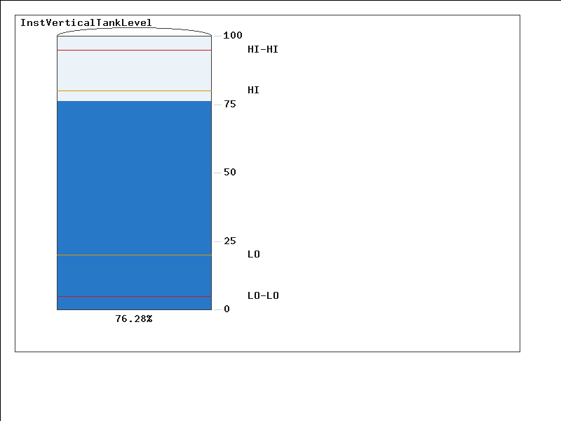

Upright cylindrical tank, fill rises from the bottom, percent readout,
hi-hi / hi / lo / lo-lo alarm markers on the right of the tank.

API: `set_level(double)` / `get_level()`, `set_alarm_bands(InstAlarmBands)` /
`alarm_bands()`, `set_text()`, `set_on_click()`, `set_bounds()`, `contains()`,
`set_visible()` / `get_visible()`, `set_enabled()` / `get_enabled()`,
`draw()`, `on_button_press()` / `on_button_release()` / `on_motion()` /
`on_key()`.

```cpp
InstVerticalTankLevel tank(display, screen, window, gc, &styles, 20, 20, 360, 240, 62.5);
tank.set_level(75.0);
tank.set_alarm_bands(xframe::InstAlarmBands{95.0, 80.0, 20.0, 5.0});
tank.draw();
```

## InstHorizontalTankLevel

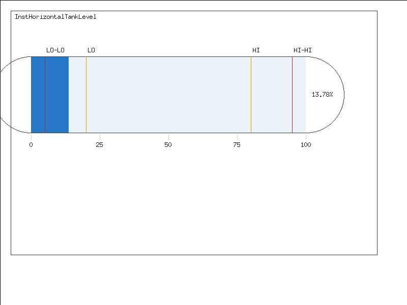

Horizontal bullet tank, fill by cross-section width, percent readout,
hi-hi / hi / lo / lo-lo alarm markers as vertical lines across the tank.

API: `set_level(double)` / `get_level()`, `set_alarm_bands(InstAlarmBands)` /
`alarm_bands()`, `set_text()`, `set_on_click()`, `set_bounds()`, `contains()`,
`set_visible()` / `get_visible()`, `set_enabled()` / `get_enabled()`,
`draw()`, `on_button_press()` / `on_button_release()` / `on_motion()` /
`on_key()`.

```cpp
InstHorizontalTankLevel tank(display, screen, window, gc, &styles, 20, 20, 360, 240, 40.0);
tank.set_level(55.0);
tank.draw();
```

## InstSphericalTankLevel

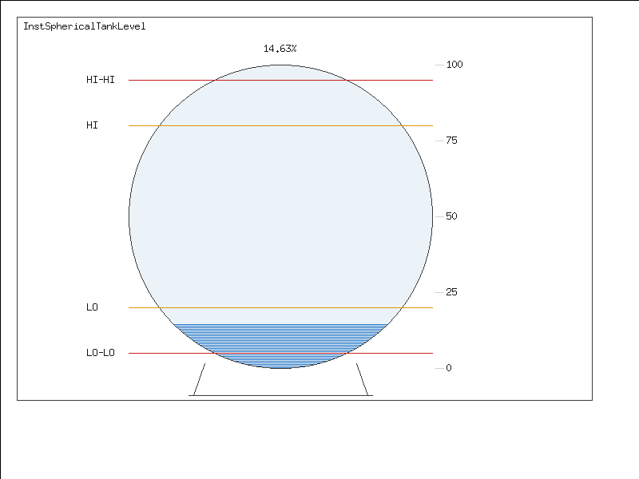

Sphere tank on legs, fill by volume height, percent readout, hi-hi / hi /
lo / lo-lo alarm markers.

API: `set_level(double)` / `get_level()`, `set_alarm_bands(InstAlarmBands)` /
`alarm_bands()`, `set_text()`, `set_on_click()`, `set_bounds()`, `contains()`,
`set_visible()` / `get_visible()`, `set_enabled()` / `get_enabled()`,
`draw()`, `on_button_press()` / `on_button_release()` / `on_motion()` /
`on_key()`.

```cpp
InstSphericalTankLevel tank(display, screen, window, gc, &styles, 20, 20, 360, 240, 68.0);
tank.set_level(68.0);
tank.draw();
```

## InstSightGlassLevel

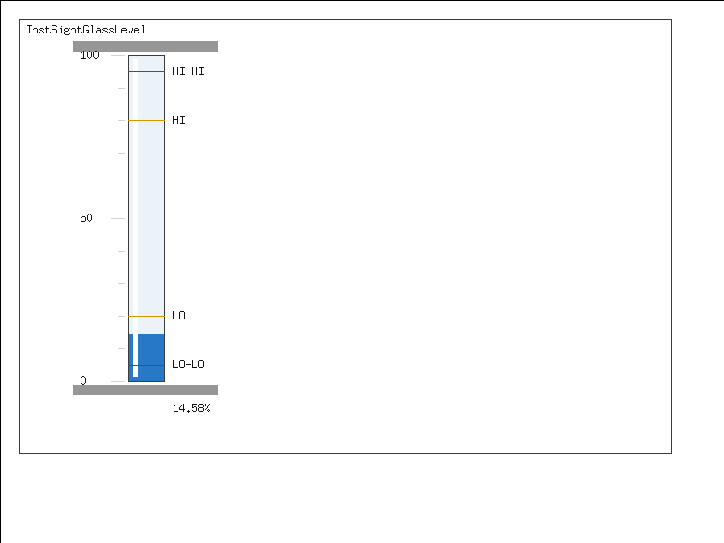

Glass tube with liquid column, scale marks every 10% (labelled every 25%),
top/bottom pipe connections, percent readout, hi-hi / hi / lo / lo-lo
alarm markers.

API: `set_level(double)` / `get_level()`, `set_alarm_bands(InstAlarmBands)` /
`alarm_bands()`, `set_text()`, `set_on_click()`, `set_bounds()`, `contains()`,
`set_visible()` / `get_visible()`, `set_enabled()` / `get_enabled()`,
`draw()`, `on_button_press()` / `on_button_release()` / `on_motion()` /
`on_key()`.

```cpp
InstSightGlassLevel gauge(display, screen, window, gc, &styles, 20, 20, 360, 240, 33.0);
gauge.set_level(33.0);
gauge.draw();
```

## InstLevelColumnGauge

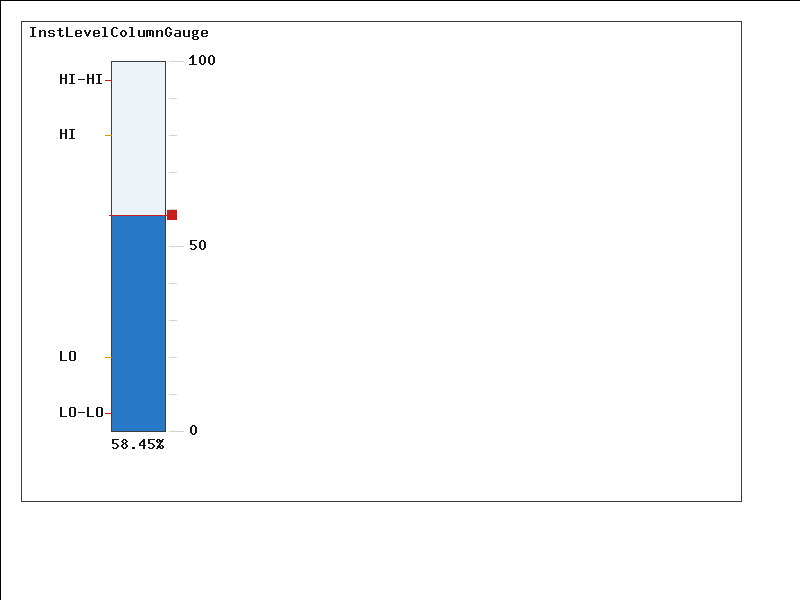

Vertical column gauge with scale and a float marker (red bar) at the
level, percent readout, hi-hi / hi / lo / lo-lo alarm markers.

API: `set_level(double)` / `get_level()`, `set_alarm_bands(InstAlarmBands)` /
`alarm_bands()`, `set_text()`, `set_on_click()`, `set_bounds()`, `contains()`,
`set_visible()` / `get_visible()`, `set_enabled()` / `get_enabled()`,
`draw()`, `on_button_press()` / `on_button_release()` / `on_motion()` /
`on_key()`.

```cpp
InstLevelColumnGauge gauge(display, screen, window, gc, &styles, 20, 20, 360, 240, 47.0);
gauge.set_level(47.0);
gauge.draw();
```

## InstTankLevelAlarms

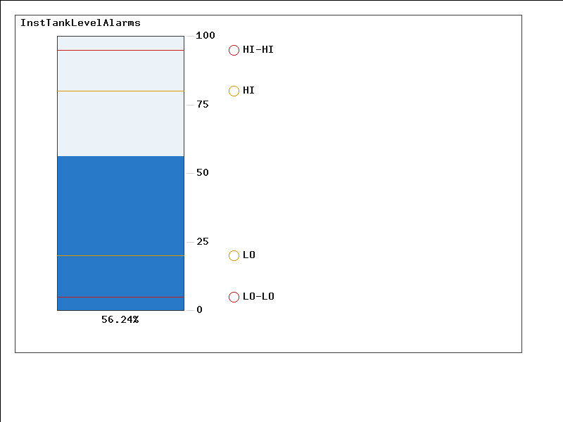

Tank with hi-hi / hi / lo / lo-lo alarm bands and lamps: the red HI-HI
lamp lights when the level reaches hi-hi, amber HI at hi, amber LO at or
below lo, red LO-LO at or below lo-lo.

API: `set_level(double)` / `get_level()`, `set_alarm_bands(InstAlarmBands)` /
`alarm_bands()`, `set_text()`, `set_on_click()`, `set_bounds()`, `contains()`,
`set_visible()` / `get_visible()`, `set_enabled()` / `get_enabled()`,
`draw()`, `on_button_press()` / `on_button_release()` / `on_motion()` /
`on_key()`.

```cpp
InstTankLevelAlarms tank(display, screen, window, gc, &styles, 20, 20, 360, 240, 97.0);
tank.set_level(97.0);
tank.draw();
```

## InstOpenChannelLevel

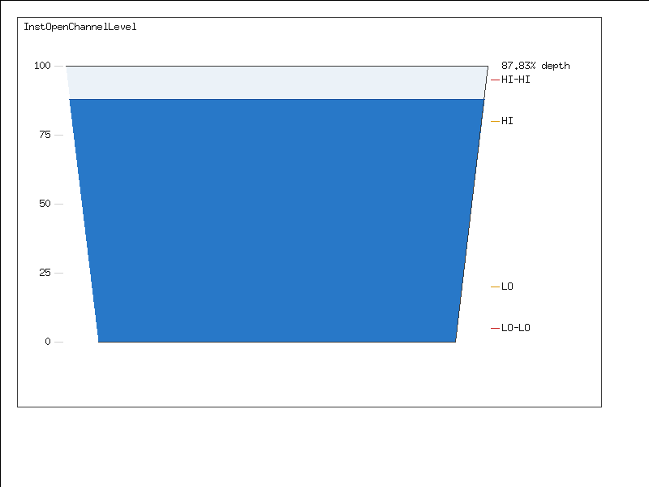

Open reservoir / channel with waterline and depth scale, percent depth
readout, hi-hi / hi / lo / lo-lo alarm markers.

API: `set_level(double)` / `get_level()`, `set_alarm_bands(InstAlarmBands)` /
`alarm_bands()`, `set_text()`, `set_on_click()`, `set_bounds()`, `contains()`,
`set_visible()` / `get_visible()`, `set_enabled()` / `get_enabled()`,
`draw()`, `on_button_press()` / `on_button_release()` / `on_motion()` /
`on_key()`.

```cpp
InstOpenChannelLevel channel(display, screen, window, gc, &styles, 20, 20, 360, 240, 58.0);
channel.set_level(58.0);
channel.draw();
```

## InstLevelTransmitter

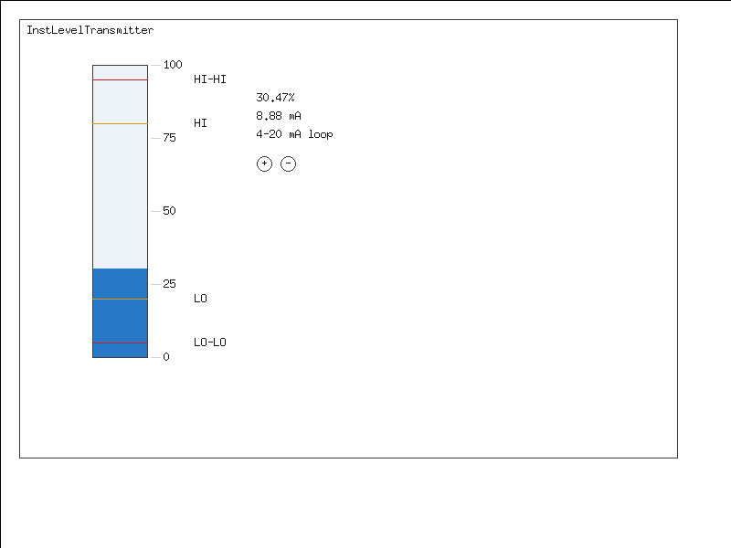

4–20 mA loop indicator: level bar, mA value (4 mA at 0%, 20 mA at 100%),
percent readout, loop terminals, hi-hi / hi / lo / lo-lo alarm markers.

API: `set_level(double)` / `get_level()`, `set_alarm_bands(InstAlarmBands)` /
`alarm_bands()`, `set_text()`, `set_on_click()`, `set_bounds()`, `contains()`,
`set_visible()` / `get_visible()`, `set_enabled()` / `get_enabled()`,
`draw()`, `on_button_press()` / `on_button_release()` / `on_motion()` /
`on_key()`.

```cpp
InstLevelTransmitter tx(display, screen, window, gc, &styles, 20, 20, 360, 240, 62.5);
tx.set_level(62.5);
double pct = tx.get_level();
double ma = 4.0 + 16.0 * pct / 100.0;
bool loop_ok = (ma >= 4.0 && ma <= 20.0);
tx.set_enabled(loop_ok);
tx.draw();
```

## Group B — Switches (12 widgets)

12 switch widgets for the XFrame Instrumentation section. Every switch really
toggles: a click flips the state and the widget redraws in the new position.
State is observable via `is_on()` and `get_state()` (returning
`xframe::InstSwitchState`: `Off`, `On`, `Tripped`), and every widget exposes an
`on_click` callback fired on each state change. Style: standard XFrame
hand-drawn widget style, no photorealism. Attribution: XFrame.

Shared types live in `widgets/components/InstData.h`.

## InstRockerSwitch

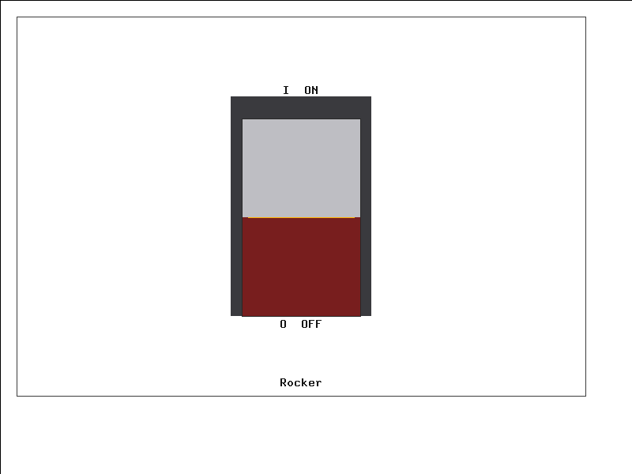

SPST rocker switch: up is on, down is off. Click flips it and it redraws tilted the other way.

API: is_on(), get_state() -> InstSwitchState, toggle(), set_on(bool), on_click callback.

```cpp
#include "InstRockerSwitch.h"

int main()
{
    Display* display = XOpenDisplay(nullptr);
    if (!display) return 1;
    int screen = DefaultScreen(display);
    Window window = XCreateSimpleWindow(display, RootWindow(display, screen), 100, 100, 800, 600, 1,
                                        BlackPixel(display, screen), WhitePixel(display, screen));
    XMapWindow(display, window);
    GC gc = DefaultGC(display, screen);
    SStyle_Manager styles(display, window, screen, gc);
    styles.add_style_ex("default", Srgb{225, 225, 225}, Srgb{120, 120, 120}, Srgb{60, 60, 60}, Srgb{20, 20, 20}, 6, 1, "-misc-fixed-medium-r-normal--13-*");
    styles.set_active_style_byName("default");
    InstRockerSwitch sw(display, screen, window, gc, &styles, 20, 20, 720, 480);
    sw.on_click = []() { std::printf("rocker toggled\n"); };
    sw.set_on(true);
    std::printf("on=%d state=%d\n", (int)sw.is_on(), (int)sw.get_state());
    sw.draw();
    XCloseDisplay(display);
    return 0;
}
```

## InstRockerSwitchIlluminated

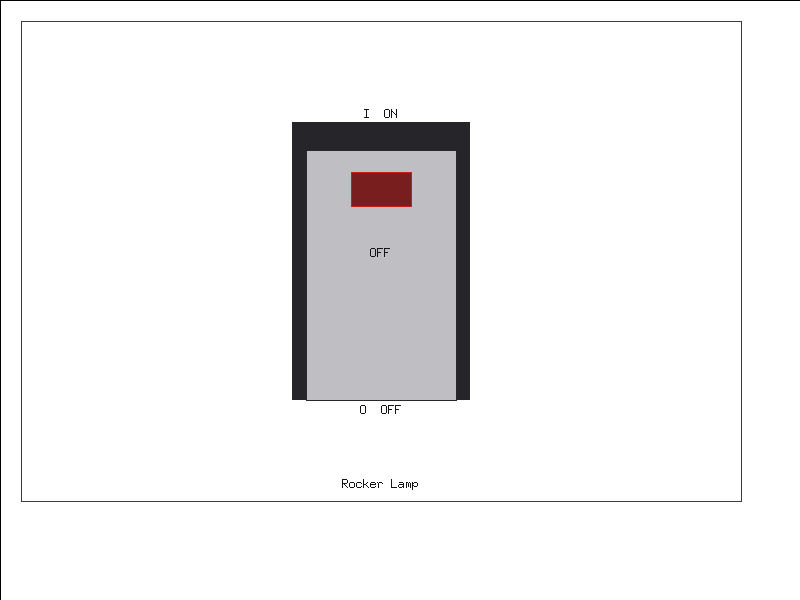

Rocker switch with a lens that lights green when on and dim red when off.

API: is_on(), get_state() -> InstSwitchState, toggle(), set_on(bool), on_click callback. Lens: green lit when on, dim red when off.

```cpp
#include "InstRockerSwitchIlluminated.h"

int main()
{
    Display* display = XOpenDisplay(nullptr);
    if (!display) return 1;
    int screen = DefaultScreen(display);
    Window window = XCreateSimpleWindow(display, RootWindow(display, screen), 100, 100, 800, 600, 1,
                                        BlackPixel(display, screen), WhitePixel(display, screen));
    XMapWindow(display, window);
    GC gc = DefaultGC(display, screen);
    SStyle_Manager styles(display, window, screen, gc);
    styles.add_style_ex("default", Srgb{225, 225, 225}, Srgb{120, 120, 120}, Srgb{60, 60, 60}, Srgb{20, 20, 20}, 6, 1, "-misc-fixed-medium-r-normal--13-*");
    styles.set_active_style_byName("default");
    InstRockerSwitchIlluminated sw(display, screen, window, gc, &styles, 20, 20, 720, 480);
    sw.on_click = []() { std::printf("illuminated rocker toggled\n"); };
    sw.set_on(true);
    std::printf("on=%d state=%d\n", (int)sw.is_on(), (int)sw.get_state());
    sw.draw();
    XCloseDisplay(display);
    return 0;
}
```

## InstRockerSwitchDouble

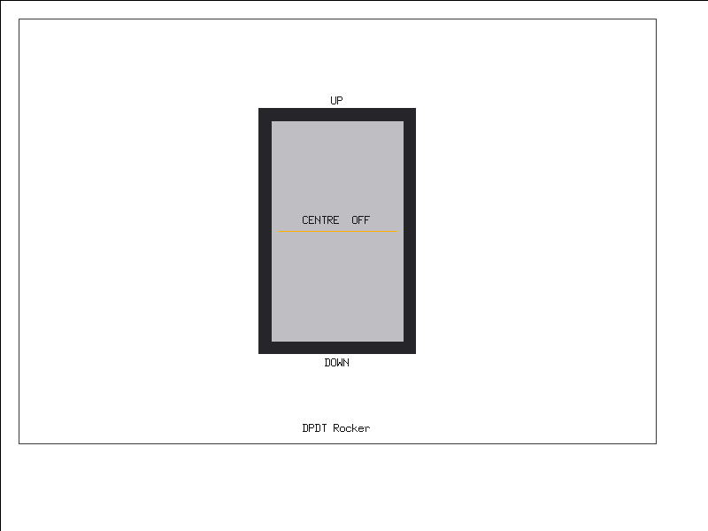

DPDT centre-off rocker: click the top half for up/on, the bottom half for down, the same half again (or the middle) for centre/off.

API: is_on(), get_state() -> InstSwitchState (On = up, Off = centre, Tripped = down), get_position() (-1/0/+1), set_position(int), on_click callback.

```cpp
#include "InstRockerSwitchDouble.h"

int main()
{
    Display* display = XOpenDisplay(nullptr);
    if (!display) return 1;
    int screen = DefaultScreen(display);
    Window window = XCreateSimpleWindow(display, RootWindow(display, screen), 100, 100, 800, 600, 1,
                                        BlackPixel(display, screen), WhitePixel(display, screen));
    XMapWindow(display, window);
    GC gc = DefaultGC(display, screen);
    SStyle_Manager styles(display, window, screen, gc);
    styles.add_style_ex("default", Srgb{225, 225, 225}, Srgb{120, 120, 120}, Srgb{60, 60, 60}, Srgb{20, 20, 20}, 6, 1, "-misc-fixed-medium-r-normal--13-*");
    styles.set_active_style_byName("default");
    InstRockerSwitchDouble sw(display, screen, window, gc, &styles, 20, 20, 720, 480);
    sw.set_position(1);
    std::printf("pos=%d on=%d state=%d\n", sw.get_position(), (int)sw.is_on(), (int)sw.get_state());
    sw.set_position(-1);
    std::printf("pos=%d on=%d state=%d\n", sw.get_position(), (int)sw.is_on(), (int)sw.get_state());
    sw.draw();
    XCloseDisplay(display);
    return 0;
}
```

## InstToggleSwitch

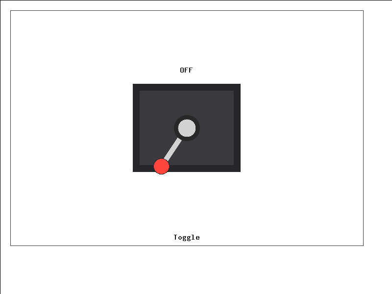

Bat-lever toggle switch: lever points up when on, down when off.

API: is_on(), get_state() -> InstSwitchState, toggle(), set_on(bool), on_click callback.

```cpp
#include "InstToggleSwitch.h"

int main()
{
    Display* display = XOpenDisplay(nullptr);
    if (!display) return 1;
    int screen = DefaultScreen(display);
    Window window = XCreateSimpleWindow(display, RootWindow(display, screen), 100, 100, 800, 600, 1,
                                        BlackPixel(display, screen), WhitePixel(display, screen));
    XMapWindow(display, window);
    GC gc = DefaultGC(display, screen);
    SStyle_Manager styles(display, window, screen, gc);
    styles.add_style_ex("default", Srgb{225, 225, 225}, Srgb{120, 120, 120}, Srgb{60, 60, 60}, Srgb{20, 20, 20}, 6, 1, "-misc-fixed-medium-r-normal--13-*");
    styles.set_active_style_byName("default");
    InstToggleSwitch sw(display, screen, window, gc, &styles, 20, 20, 720, 480);
    sw.toggle();
    std::printf("on=%d state=%d\n", (int)sw.is_on(), (int)sw.get_state());
    sw.draw();
    XCloseDisplay(display);
    return 0;
}
```

## InstToggleSwitchIlluminated

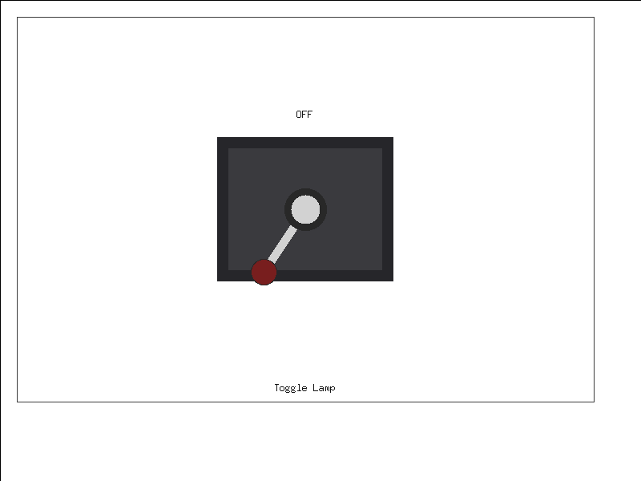

Bat-lever toggle with an illuminated tip: the tip glows green when on.

API: is_on(), get_state() -> InstSwitchState, toggle(), set_on(bool), on_click callback. Tip glows green when on.

```cpp
#include "InstToggleSwitchIlluminated.h"

int main()
{
    Display* display = XOpenDisplay(nullptr);
    if (!display) return 1;
    int screen = DefaultScreen(display);
    Window window = XCreateSimpleWindow(display, RootWindow(display, screen), 100, 100, 800, 600, 1,
                                        BlackPixel(display, screen), WhitePixel(display, screen));
    XMapWindow(display, window);
    GC gc = DefaultGC(display, screen);
    SStyle_Manager styles(display, window, screen, gc);
    styles.add_style_ex("default", Srgb{225, 225, 225}, Srgb{120, 120, 120}, Srgb{60, 60, 60}, Srgb{20, 20, 20}, 6, 1, "-misc-fixed-medium-r-normal--13-*");
    styles.set_active_style_byName("default");
    InstToggleSwitchIlluminated sw(display, screen, window, gc, &styles, 20, 20, 720, 480);
    sw.toggle();
    std::printf("on=%d state=%d\n", (int)sw.is_on(), (int)sw.get_state());
    sw.draw();
    XCloseDisplay(display);
    return 0;
}
```

## InstPushButton

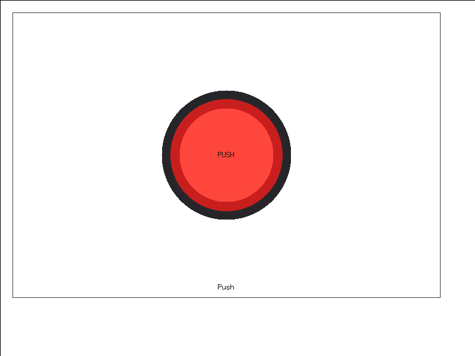

Momentary push button: on only while held down, off on release.

API: is_on(), get_state() -> InstSwitchState. On only while the button is held; release turns it off. on_click fires on press.

```cpp
#include "InstPushButton.h"

int main()
{
    Display* display = XOpenDisplay(nullptr);
    if (!display) return 1;
    int screen = DefaultScreen(display);
    Window window = XCreateSimpleWindow(display, RootWindow(display, screen), 100, 100, 800, 600, 1,
                                        BlackPixel(display, screen), WhitePixel(display, screen));
    XMapWindow(display, window);
    GC gc = DefaultGC(display, screen);
    SStyle_Manager styles(display, window, screen, gc);
    styles.add_style_ex("default", Srgb{225, 225, 225}, Srgb{120, 120, 120}, Srgb{60, 60, 60}, Srgb{20, 20, 20}, 6, 1, "-misc-fixed-medium-r-normal--13-*");
    styles.set_active_style_byName("default");
    InstPushButton sw(display, screen, window, gc, &styles, 20, 20, 720, 480);
    sw.on_button_press(380, 260, 1);
    std::printf("held on=%d\n", (int)sw.is_on());
    sw.on_button_release(380, 260, 1);
    std::printf("released on=%d\n", (int)sw.is_on());
    sw.draw();
    XCloseDisplay(display);
    return 0;
}
```

## InstPushButtonLatching

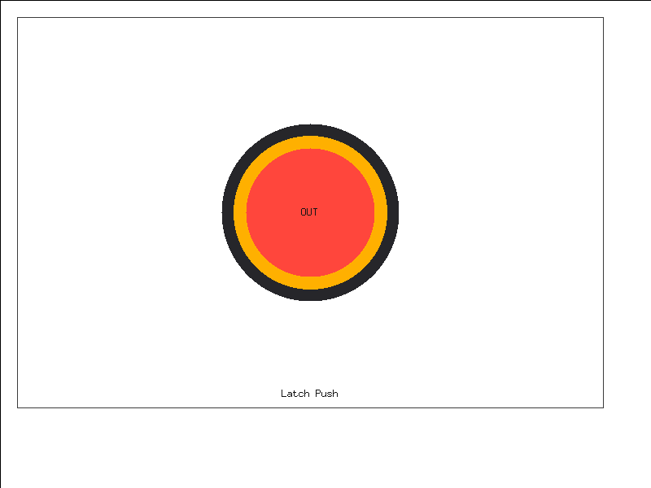

Latching push button: click once and it stays in (on), click again and it pops out (off).

API: is_on(), get_state() -> InstSwitchState, toggle(), set_on(bool), on_click callback. Drawn depressed with a green ring while latched in.

```cpp
#include "InstPushButtonLatching.h"

int main()
{
    Display* display = XOpenDisplay(nullptr);
    if (!display) return 1;
    int screen = DefaultScreen(display);
    Window window = XCreateSimpleWindow(display, RootWindow(display, screen), 100, 100, 800, 600, 1,
                                        BlackPixel(display, screen), WhitePixel(display, screen));
    XMapWindow(display, window);
    GC gc = DefaultGC(display, screen);
    SStyle_Manager styles(display, window, screen, gc);
    styles.add_style_ex("default", Srgb{225, 225, 225}, Srgb{120, 120, 120}, Srgb{60, 60, 60}, Srgb{20, 20, 20}, 6, 1, "-misc-fixed-medium-r-normal--13-*");
    styles.set_active_style_byName("default");
    InstPushButtonLatching sw(display, screen, window, gc, &styles, 20, 20, 720, 480);
    sw.toggle();
    std::printf("latched on=%d state=%d\n", (int)sw.is_on(), (int)sw.get_state());
    sw.toggle();
    std::printf("latched on=%d state=%d\n", (int)sw.is_on(), (int)sw.get_state());
    sw.draw();
    XCloseDisplay(display);
    return 0;
}
```

## InstEmergencyStop

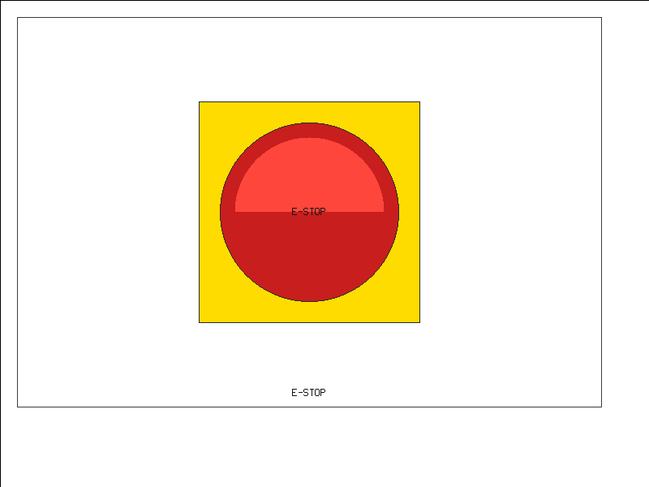

Mushroom emergency stop: press once and it latches in (stopped). A second press does nothing; twist (right-click) or the R key resets it.

API: is_on(), get_state() -> InstSwitchState (Tripped = latched/stopped), reset(), on_click callback. Press latches; right-click or R resets.

```cpp
#include "InstEmergencyStop.h"

int main()
{
    Display* display = XOpenDisplay(nullptr);
    if (!display) return 1;
    int screen = DefaultScreen(display);
    Window window = XCreateSimpleWindow(display, RootWindow(display, screen), 100, 100, 800, 600, 1,
                                        BlackPixel(display, screen), WhitePixel(display, screen));
    XMapWindow(display, window);
    GC gc = DefaultGC(display, screen);
    SStyle_Manager styles(display, window, screen, gc);
    styles.add_style_ex("default", Srgb{225, 225, 225}, Srgb{120, 120, 120}, Srgb{60, 60, 60}, Srgb{20, 20, 20}, 6, 1, "-misc-fixed-medium-r-normal--13-*");
    styles.set_active_style_byName("default");
    InstEmergencyStop sw(display, screen, window, gc, &styles, 20, 20, 720, 480);
    sw.on_button_press(380, 260, 1);
    std::printf("stopped=%d state=%d\n", (int)sw.is_on(), (int)sw.get_state());
    sw.reset();
    std::printf("after reset stopped=%d\n", (int)sw.is_on());
    sw.draw();
    XCloseDisplay(display);
    return 0;
}
```

## InstRotarySelector

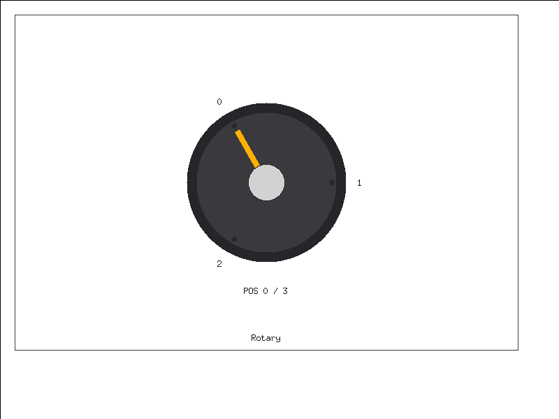

Rotary selector switch with 2, 3 or 4 positions and a pointer. Click (or Space) advances to the next position.

API: get_position(), get_positions(), set_positions(2..4), set_position(int), is_on() (position > 0), get_state(), on_click callback.

```cpp
#include "InstRotarySelector.h"

int main()
{
    Display* display = XOpenDisplay(nullptr);
    if (!display) return 1;
    int screen = DefaultScreen(display);
    Window window = XCreateSimpleWindow(display, RootWindow(display, screen), 100, 100, 800, 600, 1,
                                        BlackPixel(display, screen), WhitePixel(display, screen));
    XMapWindow(display, window);
    GC gc = DefaultGC(display, screen);
    SStyle_Manager styles(display, window, screen, gc);
    styles.add_style_ex("default", Srgb{225, 225, 225}, Srgb{120, 120, 120}, Srgb{60, 60, 60}, Srgb{20, 20, 20}, 6, 1, "-misc-fixed-medium-r-normal--13-*");
    styles.set_active_style_byName("default");
    InstRotarySelector sw(display, screen, window, gc, &styles, 20, 20, 720, 480);
    sw.set_positions(4);
    sw.set_position(2);
    std::printf("pos=%d of %d on=%d\n", sw.get_position(), sw.get_positions(), (int)sw.is_on());
    sw.draw();
    XCloseDisplay(display);
    return 0;
}
```

## InstKeySwitch

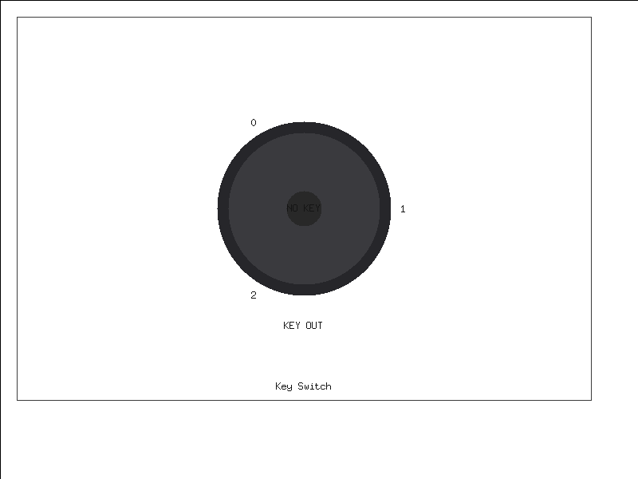

Key-operated selector: click inserts the key, further clicks move through the positions, K removes the key (position resets to 0).

API: get_key_in(), set_key_in(bool), get_position(), get_positions(), set_positions(2..4), is_on() (key in and position > 0), get_state(), on_click callback.

```cpp
#include "InstKeySwitch.h"

int main()
{
    Display* display = XOpenDisplay(nullptr);
    if (!display) return 1;
    int screen = DefaultScreen(display);
    Window window = XCreateSimpleWindow(display, RootWindow(display, screen), 100, 100, 800, 600, 1,
                                        BlackPixel(display, screen), WhitePixel(display, screen));
    XMapWindow(display, window);
    GC gc = DefaultGC(display, screen);
    SStyle_Manager styles(display, window, screen, gc);
    styles.add_style_ex("default", Srgb{225, 225, 225}, Srgb{120, 120, 120}, Srgb{60, 60, 60}, Srgb{20, 20, 20}, 6, 1, "-misc-fixed-medium-r-normal--13-*");
    styles.set_active_style_byName("default");
    InstKeySwitch sw(display, screen, window, gc, &styles, 20, 20, 720, 480);
    sw.set_key_in(true);
    sw.on_button_press(380, 260, 1);
    std::printf("key_in=%d pos=%d on=%d\n", (int)sw.get_key_in(), sw.get_position(), (int)sw.is_on());
    sw.draw();
    XCloseDisplay(display);
    return 0;
}
```

## InstSlideSwitch

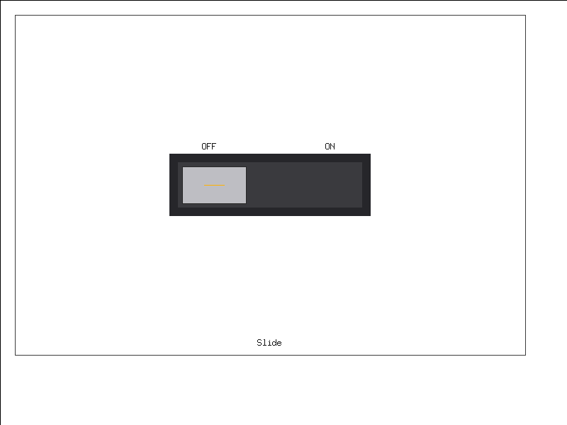

Slide switch: knob left is off, right is on. Click toggles; drag the knob across.

API: is_on(), get_state() -> InstSwitchState, toggle(), set_on(bool), on_click callback. Drag the knob or click to flip.

```cpp
#include "InstSlideSwitch.h"

int main()
{
    Display* display = XOpenDisplay(nullptr);
    if (!display) return 1;
    int screen = DefaultScreen(display);
    Window window = XCreateSimpleWindow(display, RootWindow(display, screen), 100, 100, 800, 600, 1,
                                        BlackPixel(display, screen), WhitePixel(display, screen));
    XMapWindow(display, window);
    GC gc = DefaultGC(display, screen);
    SStyle_Manager styles(display, window, screen, gc);
    styles.add_style_ex("default", Srgb{225, 225, 225}, Srgb{120, 120, 120}, Srgb{60, 60, 60}, Srgb{20, 20, 20}, 6, 1, "-misc-fixed-medium-r-normal--13-*");
    styles.set_active_style_byName("default");
    InstSlideSwitch sw(display, screen, window, gc, &styles, 20, 20, 720, 480);
    sw.toggle();
    std::printf("on=%d state=%d\n", (int)sw.is_on(), (int)sw.get_state());
    sw.draw();
    XCloseDisplay(display);
    return 0;
}
```

## InstCircuitBreaker

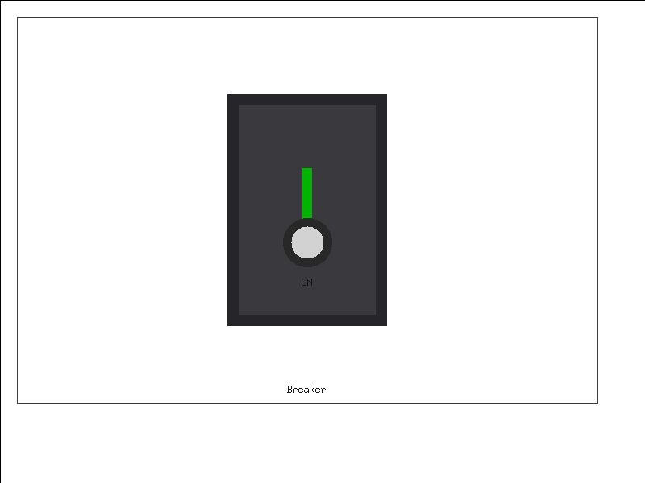

Circuit breaker: handle up is on, down is off, mid-position with a red TRIPPED flag is the fault state. Click toggles on/off; trip() simulates a fault.

API: is_on(), get_state() -> InstSwitchState (On/Off/Tripped), trip(), reset(), on_click callback. Click toggles On/Off and resets from Tripped.

```cpp
#include "InstCircuitBreaker.h"

int main()
{
    Display* display = XOpenDisplay(nullptr);
    if (!display) return 1;
    int screen = DefaultScreen(display);
    Window window = XCreateSimpleWindow(display, RootWindow(display, screen), 100, 100, 800, 600, 1,
                                        BlackPixel(display, screen), WhitePixel(display, screen));
    XMapWindow(display, window);
    GC gc = DefaultGC(display, screen);
    SStyle_Manager styles(display, window, screen, gc);
    styles.add_style_ex("default", Srgb{225, 225, 225}, Srgb{120, 120, 120}, Srgb{60, 60, 60}, Srgb{20, 20, 20}, 6, 1, "-misc-fixed-medium-r-normal--13-*");
    styles.set_active_style_byName("default");
    InstCircuitBreaker sw(display, screen, window, gc, &styles, 20, 20, 720, 480);
    sw.trip();
    std::printf("tripped state=%d on=%d\n", (int)sw.get_state(), (int)sw.is_on());
    sw.reset();
    std::printf("after reset state=%d\n", (int)sw.get_state());
    sw.draw();
    XCloseDisplay(display);
    return 0;
}
```

## Group C — Illuminators & Status LEDs (12 widgets)

Twelve widgets in `widgets/components/`, one per directory. Each directory
contains exactly `<Name>.h`, `main_<Name>.cpp`, `CMakeLists.txt`, and
`core/xframe_core.h` (byte-identical to `widgets/core/xframe_core.h`).
Attribution: XFrame.

Every lamp and LED is an independent illuminator: its own on/off plus
brightness 0–100, with the state observable (`is_on()`,
`get_brightness()`). They share the types in
`widgets/components/InstData.h` (included as `#include "../InstData.h"`):
`xframe::InstLamp {on, brightness}`, `xframe::InstRgb {red, green, blue}`,
and `inst_clamp_level()`. Style is the standard XFrame hand-drawn widget
style — no photorealism, no photo textures. Click (or Space when focused)
toggles a lamp; moving the mouse over a widget draws a hover outline.

### Common API (all twelve)

Constructor (all widgets):

```
Name(Display* display, int screen, Window window, GC gc,
     SStyle_Manager* styles, int x, int y, int width, int height);
```

Key methods, identical on every widget:

- `void draw()` — bezel/lens (or tiers/dome/button) plus label; hover or
  focus draws an outline.
- `bool on_button_press(int x, int y, unsigned int button)`,
  `bool on_button_release(int x, int y, unsigned int button)`,
  `bool on_motion(int x, int y)` — press toggles (or holds, for the
  lamp-test button); motion tracks hover.
- `bool on_key(KeySym key, const char* str)` — only when focused: Space
  toggles (momentary press/release for the lamp-test button); the RGB LED
  also takes `r`/`g`/`b`, the stack light `1`/`2`/`3`, the beacon `f`.
- `void set_bounds(...)`, `width()`, `height()`, `contains(x, y)`,
  `set_visible`/`get_visible`, `set_enabled`/`get_enabled`,
  `set_style_name`, `set_text`/`get_text`, `style()`.
- `std::function<void()> on_click` — called whenever the widget is
  toggled by click or Space.

Build one widget (from the repo root, on the server):

```
cmake -S widgets/components/InstPanelLampRed -B /tmp/b-lampred -DCMAKE_CXX_FLAGS="-Wall -Wextra"
cmake --build /tmp/b-lampred   # 0 warnings
```

Tests: `python3 widgets/tests/test_inst_lamps.py` builds all twelve with
`-Wall -Wextra`, runs each demo under Xvfb `:77` and checks build / draw
(non-blank screenshot) / hover / click / key (process survives) / clean
exit via `WM_DELETE_WINDOW`, runs the C++ state harness
(`widgets/tests/test_inst_lamps_state.cpp`, which hashes drawn pixels to
prove on/off and brightness change the picture, and that the RGB LED's 8
channel combinations are all distinct), and verifies every code example in
this document compiles. Result: see the driver run output (12/12 widgets fully PASS, 0 warnings, driver exit 0).

## InstPanelLampRed

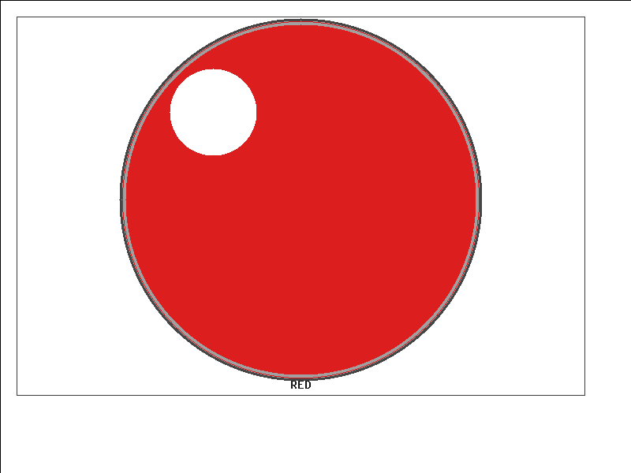

Round bezel panel lamp, red. The lens is a dim red tint when off and bright red when on, brighter with brightness; a highlight and glow ring appear at high brightness.

- `void set_on(bool on)` / `bool is_on() const` / `void toggle()` — the lamp state.
- `void set_brightness(int b)` / `int get_brightness() const` — 0–100, clamped; the lens brightens with brightness (off is a dim tint).
- `xframe::InstLamp lamp_state() const` / `void set_lamp(const xframe::InstLamp& s)` — the whole illuminator state at once.
- Click or Space toggles; `on_click` fires on every toggle.

```cpp
#include "InstPanelLampRed.h"
InstPanelLampRed w(display, screen, window, gc, &styles, 20, 20, 720, 480);
w.set_on(true);
w.set_brightness(75);
w.draw();
// Click or Space toggles the lamp; w.is_on() / w.get_brightness() read it back.
```

## InstPanelLampGreen

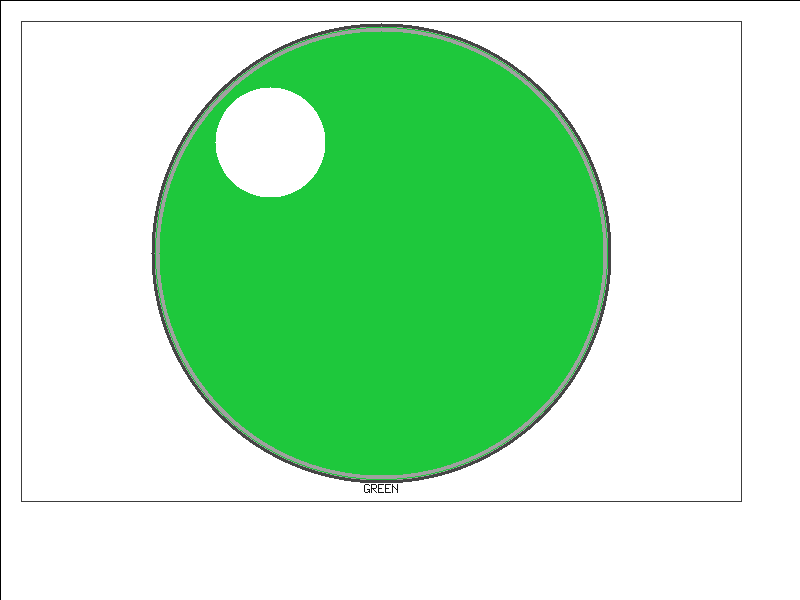

Round bezel panel lamp, green. Same behaviour as the red lamp, green lens.

- `void set_on(bool on)` / `bool is_on() const` / `void toggle()` — the lamp state.
- `void set_brightness(int b)` / `int get_brightness() const` — 0–100, clamped; the lens brightens with brightness (off is a dim tint).
- `xframe::InstLamp lamp_state() const` / `void set_lamp(const xframe::InstLamp& s)` — the whole illuminator state at once.
- Click or Space toggles; `on_click` fires on every toggle.

```cpp
#include "InstPanelLampGreen.h"
InstPanelLampGreen w(display, screen, window, gc, &styles, 20, 20, 720, 480);
w.set_on(true);
w.set_brightness(75);
w.draw();
// Click or Space toggles the lamp; w.is_on() / w.get_brightness() read it back.
```

## InstPanelLampAmber

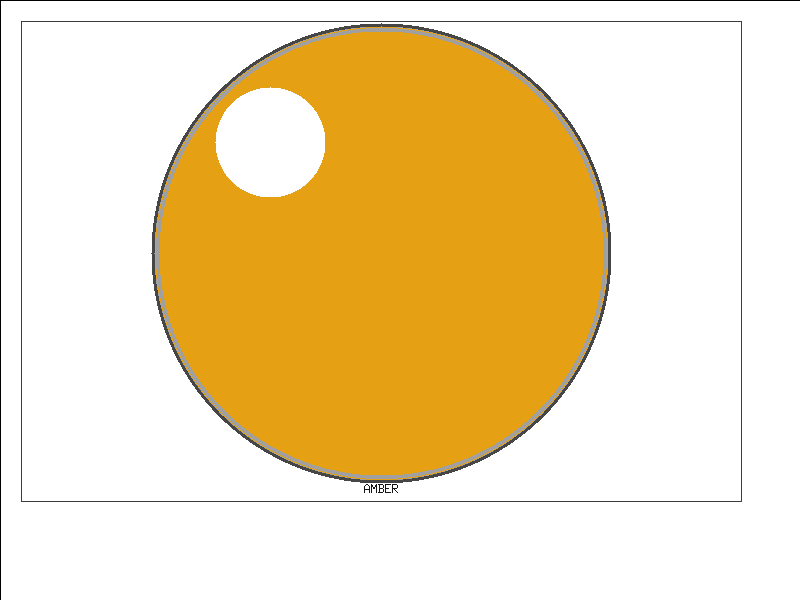

Round bezel panel lamp, amber. Same behaviour as the red lamp, amber lens.

- `void set_on(bool on)` / `bool is_on() const` / `void toggle()` — the lamp state.
- `void set_brightness(int b)` / `int get_brightness() const` — 0–100, clamped; the lens brightens with brightness (off is a dim tint).
- `xframe::InstLamp lamp_state() const` / `void set_lamp(const xframe::InstLamp& s)` — the whole illuminator state at once.
- Click or Space toggles; `on_click` fires on every toggle.

```cpp
#include "InstPanelLampAmber.h"
InstPanelLampAmber w(display, screen, window, gc, &styles, 20, 20, 720, 480);
w.set_on(true);
w.set_brightness(75);
w.draw();
// Click or Space toggles the lamp; w.is_on() / w.get_brightness() read it back.
```

## InstPanelLampBlue

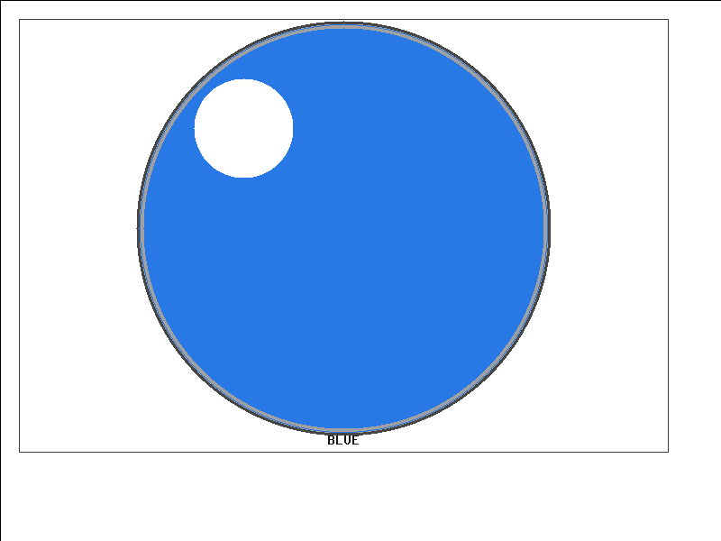

Round bezel panel lamp, blue. Same behaviour as the red lamp, blue lens.

- `void set_on(bool on)` / `bool is_on() const` / `void toggle()` — the lamp state.
- `void set_brightness(int b)` / `int get_brightness() const` — 0–100, clamped; the lens brightens with brightness (off is a dim tint).
- `xframe::InstLamp lamp_state() const` / `void set_lamp(const xframe::InstLamp& s)` — the whole illuminator state at once.
- Click or Space toggles; `on_click` fires on every toggle.

```cpp
#include "InstPanelLampBlue.h"
InstPanelLampBlue w(display, screen, window, gc, &styles, 20, 20, 720, 480);
w.set_on(true);
w.set_brightness(75);
w.draw();
// Click or Space toggles the lamp; w.is_on() / w.get_brightness() read it back.
```

## InstPanelLampWhite

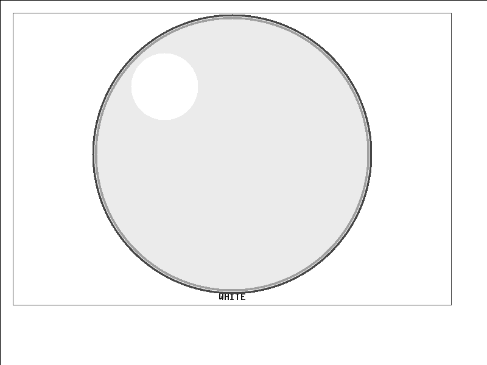

Round bezel panel lamp, white. Same behaviour as the red lamp, white lens.

- `void set_on(bool on)` / `bool is_on() const` / `void toggle()` — the lamp state.
- `void set_brightness(int b)` / `int get_brightness() const` — 0–100, clamped; the lens brightens with brightness (off is a dim tint).
- `xframe::InstLamp lamp_state() const` / `void set_lamp(const xframe::InstLamp& s)` — the whole illuminator state at once.
- Click or Space toggles; `on_click` fires on every toggle.

```cpp
#include "InstPanelLampWhite.h"
InstPanelLampWhite w(display, screen, window, gc, &styles, 20, 20, 720, 480);
w.set_on(true);
w.set_brightness(75);
w.draw();
// Click or Space toggles the lamp; w.is_on() / w.get_brightness() read it back.
```

## InstLedRed

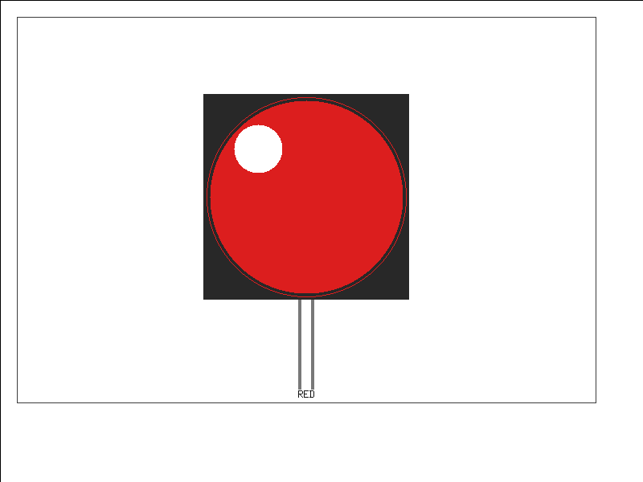

Single status LED, red: dark bezel block, domed lens, two leads. On/off + brightness like the panel lamps.

- `void set_on(bool on)` / `bool is_on() const` / `void toggle()` — the lamp state.
- `void set_brightness(int b)` / `int get_brightness() const` — 0–100, clamped; the lens brightens with brightness (off is a dim tint).
- `xframe::InstLamp lamp_state() const` / `void set_lamp(const xframe::InstLamp& s)` — the whole illuminator state at once.
- Click or Space toggles; `on_click` fires on every toggle.

```cpp
#include "InstLedRed.h"
InstLedRed w(display, screen, window, gc, &styles, 20, 20, 720, 480);
w.set_on(true);
w.set_brightness(75);
w.draw();
// Click or Space toggles the lamp; w.is_on() / w.get_brightness() read it back.
```

## InstLedGreen

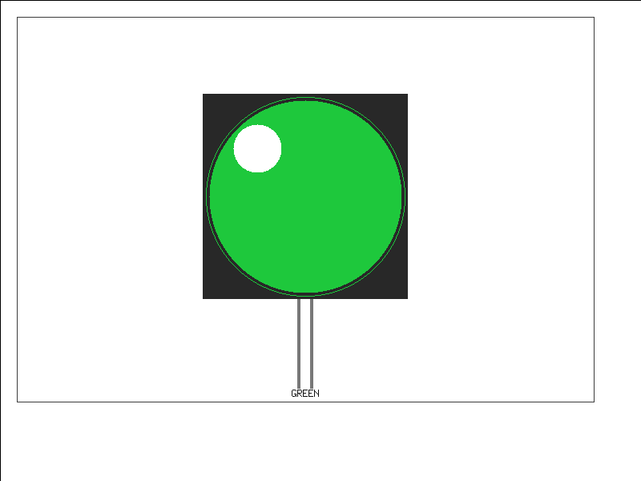

Single status LED, green: dark bezel block, domed lens, two leads. On/off + brightness like the panel lamps.

- `void set_on(bool on)` / `bool is_on() const` / `void toggle()` — the lamp state.
- `void set_brightness(int b)` / `int get_brightness() const` — 0–100, clamped; the lens brightens with brightness (off is a dim tint).
- `xframe::InstLamp lamp_state() const` / `void set_lamp(const xframe::InstLamp& s)` — the whole illuminator state at once.
- Click or Space toggles; `on_click` fires on every toggle.

```cpp
#include "InstLedGreen.h"
InstLedGreen w(display, screen, window, gc, &styles, 20, 20, 720, 480);
w.set_on(true);
w.set_brightness(75);
w.draw();
// Click or Space toggles the lamp; w.is_on() / w.get_brightness() read it back.
```

## InstLedBlue

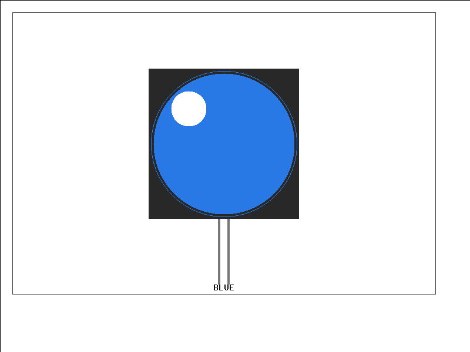

Single status LED, blue: dark bezel block, domed lens, two leads. On/off + brightness like the panel lamps.

- `void set_on(bool on)` / `bool is_on() const` / `void toggle()` — the lamp state.
- `void set_brightness(int b)` / `int get_brightness() const` — 0–100, clamped; the lens brightens with brightness (off is a dim tint).
- `xframe::InstLamp lamp_state() const` / `void set_lamp(const xframe::InstLamp& s)` — the whole illuminator state at once.
- Click or Space toggles; `on_click` fires on every toggle.

```cpp
#include "InstLedBlue.h"
InstLedBlue w(display, screen, window, gc, &styles, 20, 20, 720, 480);
w.set_on(true);
w.set_brightness(75);
w.draw();
// Click or Space toggles the lamp; w.is_on() / w.get_brightness() read it back.
```

## InstRgbStatusLed

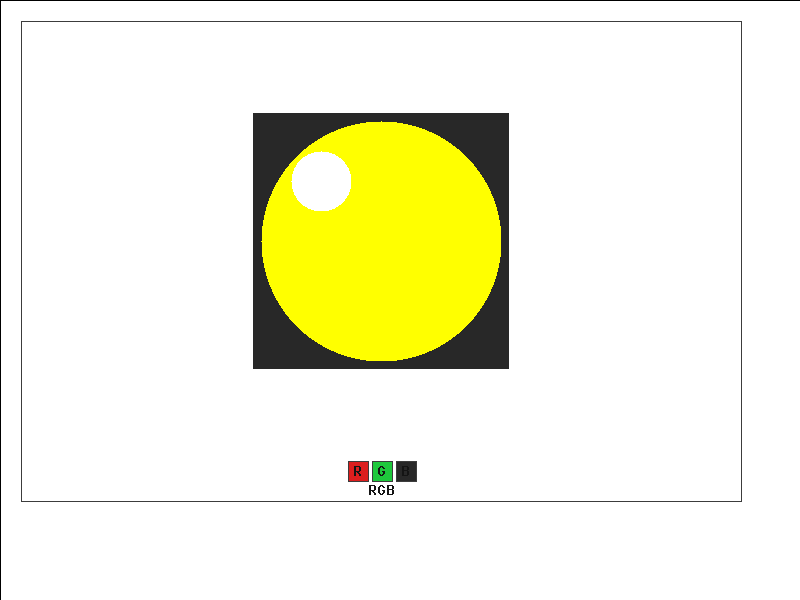

ONE status LED with INDEPENDENT red, green and blue channels — each channel is its own illuminator, so the LED shows any of the 8 colours plus off (red, green, blue, yellow, cyan, magenta, white, off).

- `void set_red(bool v)` / `set_green(bool v)` / `set_blue(bool v)` — each channel independently.
- `bool get_red() const` / `get_green() const` / `get_blue() const`, `xframe::InstRgb rgb_state() const` / `void set_rgb(const xframe::InstRgb& s)`.
- `void colour(int& r, int& g, int& b) const` — the combined 0–255 colour (any of the 8 combinations + off).
- `void set_brightness(int b)` / `int get_brightness() const` — 0–100, clamped; scales all channels together.
- `void set_all(bool v)` / `void toggle_all()` / `bool is_on() const` — all channels at once.
- Click or Space toggles all channels; keys `r`/`g`/`b` toggle one channel; the three squares under the dome show the channel states.

```cpp
#include "InstRgbStatusLed.h"
InstRgbStatusLed w(display, screen, window, gc, &styles, 20, 20, 720, 480);
w.set_red(true);
w.set_green(true);   // red + green = yellow; each channel independent
w.draw();
int r = 0, g = 0, b = 0;
w.colour(r, g, b);
// Keys r/g/b toggle one channel; w.get_red() / get_green() / get_blue().
```

## InstStackLight

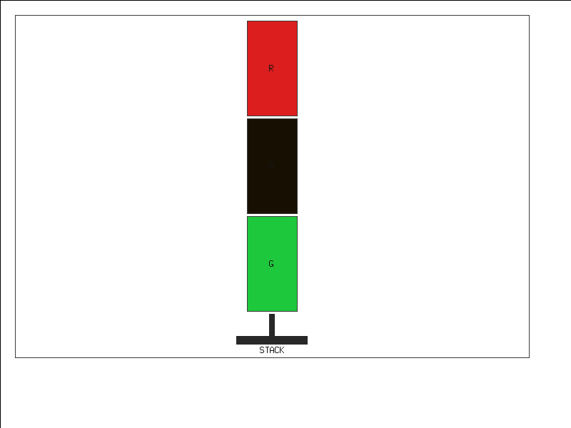

3-tier tower light on a pole and base: red (top), amber, green tiers, each an independent illuminator with its own on/off + brightness.

- `void set_red(bool v)` / `set_amber(bool v)` / `set_green(bool v)` — each tier independently (red top, amber middle, green bottom).
- `bool is_red_on() const` / `is_amber_on() const` / `is_green_on() const`.
- `void set_red_brightness(int b)` / `set_amber_brightness(int b)` / `set_green_brightness(int b)` (0–100, clamped) and matching getters.
- `xframe::InstLamp red_lamp() const` / `amber_lamp() const` / `green_lamp() const`, `void set_all(bool v)`, `bool is_on() const`.
- Click a tier to toggle just that tier; keys `1`/`2`/`3` toggle red/amber/green; Space toggles all.

```cpp
#include "InstStackLight.h"
InstStackLight w(display, screen, window, gc, &styles, 20, 20, 720, 480);
w.set_red(true);
w.set_green(true);
w.draw();
// Click a tier to toggle it; keys 1/2/3 toggle red/amber/green.
```

## InstBeacon

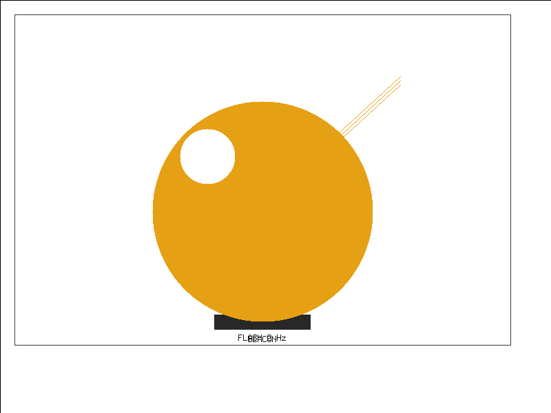

Rotating/flashing beacon on a base: amber dome with a beam when lit, on/off plus a flash rate of 0.5–10 Hz stepped with tick().

- `void set_on(bool on)` / `bool is_on() const` / `void toggle()`.
- `void set_brightness(int b)` / `int get_brightness() const` — 0–100, clamped.
- `void set_flash_rate(double hz)` / `double get_flash_rate() const` — 0.5–10 Hz, clamped.
- `void tick()` / `void set_phase(bool p)` / `bool get_phase() const` — advance one flash step; `bool is_lit() const` is on && in the bright phase.
- Click or Space toggles on/off; key `f` steps the flash.

```cpp
#include "InstBeacon.h"
InstBeacon w(display, screen, window, gc, &styles, 20, 20, 720, 480);
w.set_on(true);
w.set_flash_rate(2.0);
w.draw();
// w.tick() advances one flash step; key f steps it, Space toggles on/off.
```

## InstLampTestButton

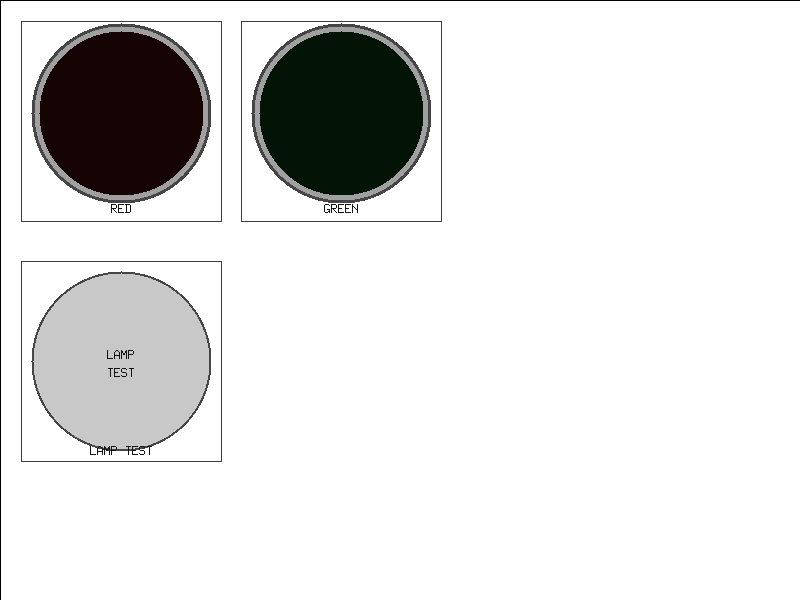

Lamp-test push button: while held it lights every lamp wired up with add_lamp(), then restores each lamp's previous state on release. A panel wires its lamps in and gets an on_test callback.

- `void add_lamp(std::function<void(bool)> setter, std::function<bool()> getter)` — wire a lamp in; the button drives it while held.
- `int lamp_count() const` — how many lamps are wired.
- `void set_on_test(std::function<void(bool)> cb)` — callback fired with true on press and false on release, for the panel to wire up.
- `void press()` / `void release()` / `bool is_testing() const` — while held every wired lamp is on; on release each lamp's previous state is restored.
- Click-and-hold (or Space) is the momentary action; `on_click` fires on press.

```cpp
#include "InstLampTestButton.h"
#include "../InstPanelLampRed/InstPanelLampRed.h"
#include "../InstPanelLampGreen/InstPanelLampGreen.h"
InstPanelLampRed lamp_r(display, screen, window, gc, &styles, 20, 20, 200, 200);
InstPanelLampGreen lamp_g(display, screen, window, gc, &styles, 240, 20, 200, 200);
InstLampTestButton w(display, screen, window, gc, &styles, 20, 260, 200, 200);
w.add_lamp([&](bool v) { lamp_r.set_on(v); }, [&]() { return lamp_r.is_on(); });
w.add_lamp([&](bool v) { lamp_g.set_on(v); }, [&]() { return lamp_g.is_on(); });
w.set_on_test([](bool testing) { (void)testing; });
w.draw();
```

## Group D+E — Gauges & Panel Furniture (12 widgets)

Group D (gauges and meters) and Group E (panel furniture) of the XFrame
Instrumentation section. Standard XFrame hand-drawn widget style, no
photorealism. Every widget is header-only, has a settable value where it
applies, and ships with a demo program. Attribution: XFrame.

## InstAnalogGauge

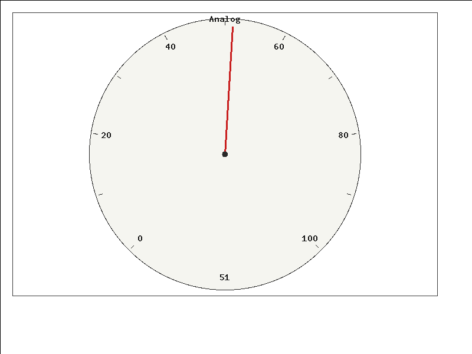

InstAnalogGauge - round dial gauge with a needle over a 0-100 scale.

Range: `0` to `100`. API: `set_value(double)` (clamped to range), `get_value()`, `set_range(lo, hi)`, `min_value()`, `max_value()`, `fraction()`. Arrow keys adjust the value, Home resets to mid-range. `on_click` fires on click.

```cpp
#include "InstAnalogGauge.h"
InstAnalogGauge gauge(display, screen, window, gc, &styles, 20, 20, 320, 240, xframe::inst_demo_value(0, 100, 7));
gauge.set_value(0);
gauge.draw();
```

## InstPressureGauge

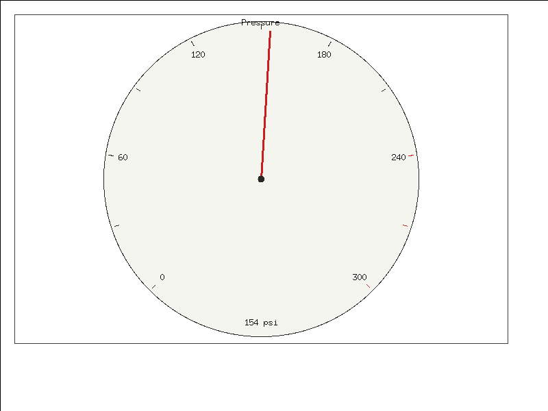

InstPressureGauge - pressure dial in psi with a red zone above 240 psi.

Range: `0` to `300`. API: `set_value(double)` (clamped to range), `get_value()`, `set_range(lo, hi)`, `min_value()`, `max_value()`, `fraction()`. Arrow keys adjust the value, Home resets to mid-range. `on_click` fires on click.

```cpp
#include "InstPressureGauge.h"
InstPressureGauge gauge(display, screen, window, gc, &styles, 20, 20, 320, 240, xframe::inst_demo_value(0, 300, 7));
gauge.set_value(0);
gauge.draw();
```

## InstTemperatureGauge

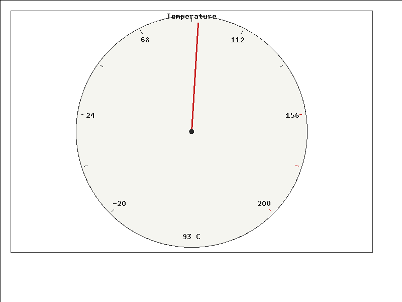

InstTemperatureGauge - temperature dial in degrees C with a red zone above 150 C.

Range: `-20` to `200`. API: `set_value(double)` (clamped to range), `get_value()`, `set_range(lo, hi)`, `min_value()`, `max_value()`, `fraction()`. Arrow keys adjust the value, Home resets to mid-range. `on_click` fires on click.

```cpp
#include "InstTemperatureGauge.h"
InstTemperatureGauge gauge(display, screen, window, gc, &styles, 20, 20, 320, 240, xframe::inst_demo_value(-20, 200, 7));
gauge.set_value(-20);
gauge.draw();
```

## InstVuMeter

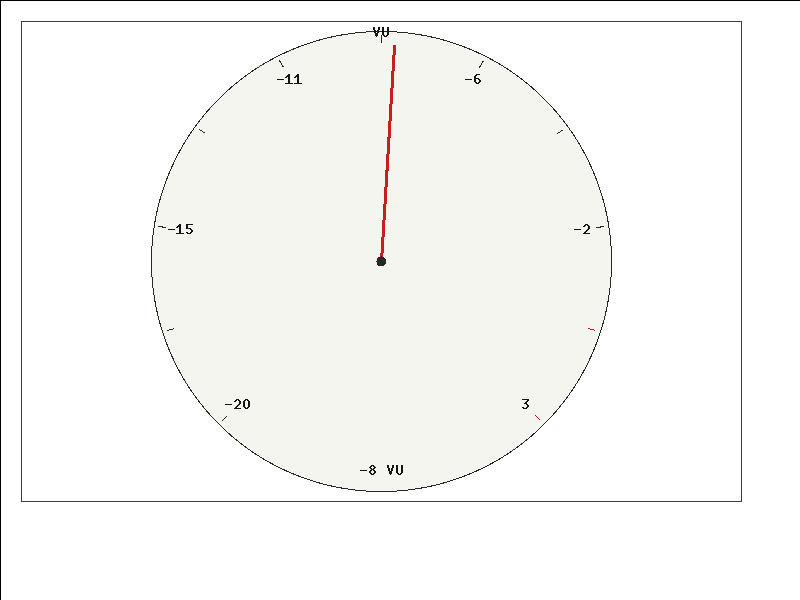

InstVuMeter - VU-style meter with a needle, red zone above 0 VU.

Range: `-20` to `3`. API: `set_value(double)` (clamped to range), `get_value()`, `set_range(lo, hi)`, `min_value()`, `max_value()`, `fraction()`. Arrow keys adjust the value, Home resets to mid-range. `on_click` fires on click.

```cpp
#include "InstVuMeter.h"
InstVuMeter gauge(display, screen, window, gc, &styles, 20, 20, 320, 240, xframe::inst_demo_value(-20, 3, 7));
gauge.set_value(-20);
gauge.draw();
```

## InstBarMeter

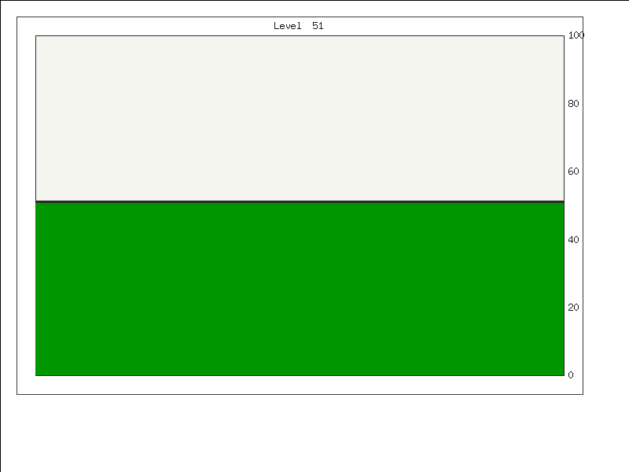

InstBarMeter - vertical or horizontal bar meter, green/amber/red by level. Click sets the value.

Range: `0` to `100`. API: `set_value(double)` (clamped to range), `get_value()`, `set_range(lo, hi)`, `min_value()`, `max_value()`, `fraction()`. Arrow keys adjust the value, Home resets to mid-range. `on_click` fires on click.
`set_horizontal(bool)` switches vertical / horizontal; clicking the bar sets the value.

```cpp
#include "InstBarMeter.h"
InstBarMeter gauge(display, screen, window, gc, &styles, 20, 20, 320, 240, xframe::inst_demo_value(0, 100, 7));
gauge.set_value(0);
gauge.draw();
```

## InstDigitalReadout

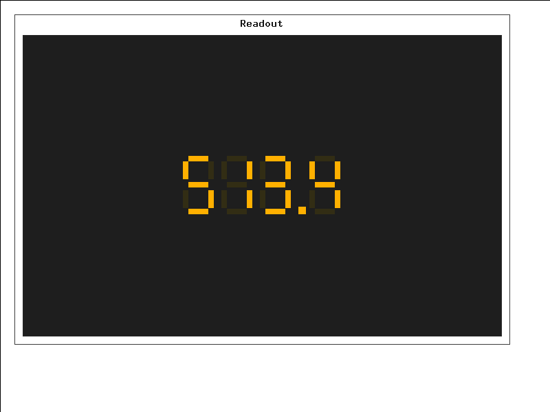

InstDigitalReadout - 7-segment style numeric display, 0 to 999.9.

Range: `0` to `999.9`. API: `set_value(double)` (clamped to range), `get_value()`, `set_range(lo, hi)`, `min_value()`, `max_value()`, `fraction()`. Arrow keys adjust the value, Home resets to mid-range. `on_click` fires on click.

```cpp
#include "InstDigitalReadout.h"
InstDigitalReadout gauge(display, screen, window, gc, &styles, 20, 20, 320, 240, xframe::inst_demo_value(0, 999.9, 7));
gauge.set_value(0);
gauge.draw();
```

## InstManometer

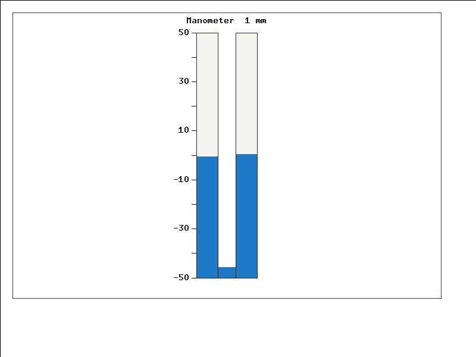

InstManometer - U-tube manometer, liquid levels move apart with differential pressure in mm.

Range: `-50` to `50`. API: `set_value(double)` (clamped to range), `get_value()`, `set_range(lo, hi)`, `min_value()`, `max_value()`, `fraction()`. Arrow keys adjust the value, Home resets to mid-range. `on_click` fires on click.

```cpp
#include "InstManometer.h"
InstManometer gauge(display, screen, window, gc, &styles, 20, 20, 320, 240, xframe::inst_demo_value(-50, 50, 7));
gauge.set_value(-50);
gauge.draw();
```

## InstFlowMeter

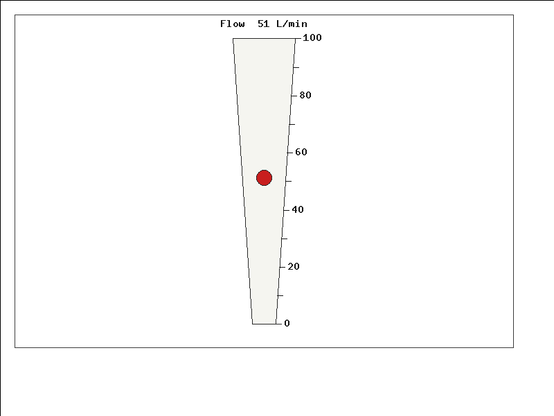

InstFlowMeter - rotameter: a float rides in a tapered tube, 0 to 100 L/min. Click sets the flow.

Range: `0` to `100`. API: `set_value(double)` (clamped to range), `get_value()`, `set_range(lo, hi)`, `min_value()`, `max_value()`, `fraction()`. Arrow keys adjust the value, Home resets to mid-range. `on_click` fires on click.

```cpp
#include "InstFlowMeter.h"
InstFlowMeter gauge(display, screen, window, gc, &styles, 20, 20, 320, 240, xframe::inst_demo_value(0, 100, 7));
gauge.set_value(0);
gauge.draw();
```

## InstPanelPlate

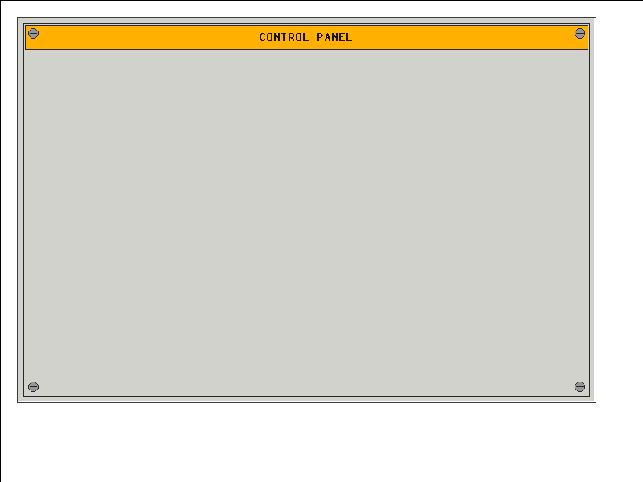

InstPanelPlate - mounting plate with corner screws and an amber title strip.

API: `set_text()` / `get_text()` for the title, `set_bounds()`, `contains()`, `set_visible()` / `get_visible()`, `set_enabled()` / `get_enabled()`, `on_click` fires on click.

```cpp
#include "InstPanelPlate.h"
InstPanelPlate widget(display, screen, window, gc, &styles, 20, 20, 320, 240);
widget.draw();
```

## InstNameplate

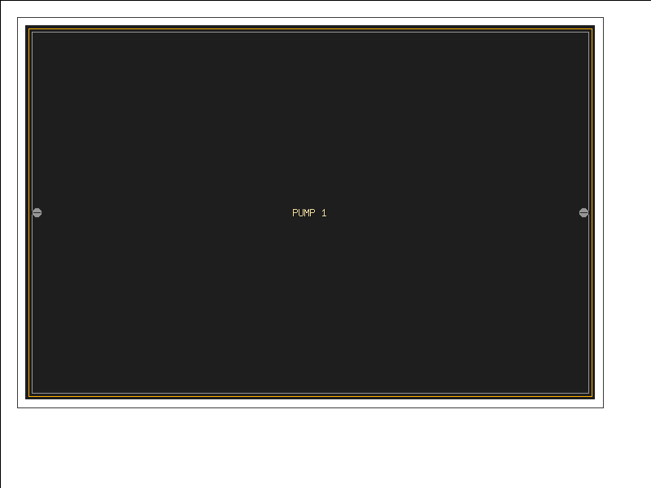

InstNameplate - engraved label plate with two screws.

API: `set_text()` / `get_text()` for the title, `set_bounds()`, `contains()`, `set_visible()` / `get_visible()`, `set_enabled()` / `get_enabled()`, `on_click` fires on click.

```cpp
#include "InstNameplate.h"
InstNameplate widget(display, screen, window, gc, &styles, 20, 20, 320, 240);
widget.draw();
```

## InstBezel

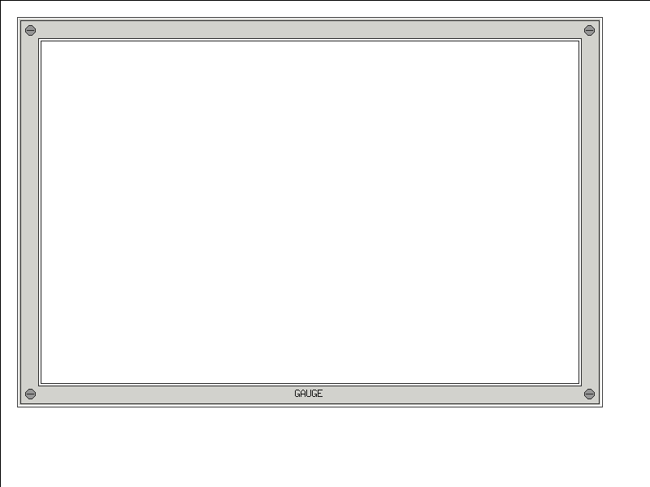

InstBezel - mounting bezel frame with an open window and corner screws.

API: `set_text()` / `get_text()` for the title, `set_bounds()`, `contains()`, `set_visible()` / `get_visible()`, `set_enabled()` / `get_enabled()`, `on_click` fires on click.

```cpp
#include "InstBezel.h"
InstBezel widget(display, screen, window, gc, &styles, 20, 20, 320, 240);
widget.draw();
```

## InstControlPanel

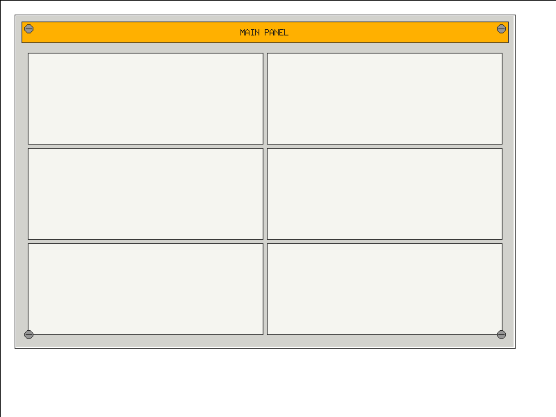

InstControlPanel - grid container: title strip, screws, and labelled cells other widgets sit on. Click a cell to select it.

API: `set_text()` / `get_text()` for the title, `set_bounds()`, `contains()`, `set_visible()` / `get_visible()`, `set_enabled()` / `get_enabled()`, `on_click` fires on click.
`set_grid(rows, cols)`, `place_cell(row, col, label)`, `cell_label(row, col)`, `selected_row()` / `selected_col()` / `selected_label()` — click a cell to select it.

```cpp
#include "InstControlPanel.h"
InstControlPanel panel(display, screen, window, gc, &styles, 20, 20, 320, 240);
panel.set_grid(2, 2);
panel.place_cell(0, 0, "PUMP");
panel.place_cell(0, 1, "VALVE");
panel.draw();
```

## Group F — LED Digit Displays & Analog Needles (10 widgets)

Ten widgets in `widgets/components/`, one per directory. Each directory
contains exactly `<Name>.h`, `main_<Name>.cpp`, `CMakeLists.txt`, and
`core/xframe_core.h` (byte-identical to `widgets/core/xframe_core.h`).
Attribution: XFrame.

Group F extends the Instrumentation section (see `docs/instrumentation.md`
for the full 66-widget section): the old 7-segment LED digit displays in 1–6 digit
variants, plus four analog needle meters. Standard XFrame hand-drawn style,
no photorealism. Demos use `xframe::inst_demo_value(min, max, seed)` from
`widgets/components/InstData.h` (included as `#include "../InstData.h"`).

### Common API (all ten)

Constructor (all widgets):

```cpp
Name(Display* display, int screen, Window window, GC gc,
     SStyle_Manager* styles, int x, int y, int width, int height);
```

Key methods, identical on every widget:

- `void set_value(double v)` / `double get_value() const` — settable and
  readable; values clamp to the displayable range.
- `void draw()` — redraws the widget.
- `bool on_button_press(int x, int y, unsigned int button)` — click focuses
  the widget and fires `on_click`; `bool on_button_release(...)`,
  `bool on_motion(int x, int y)` — hover tracking.
- `bool on_key(KeySym key, const char* str)` — only when focused: Up/Right
  steps the value up, Down/Left steps it down, Home resets to the minimum.
- `std::function<void()> on_click` — called on click (and Return/Space).
- `void set_bounds(...)`, `width()`, `height()`, `contains(x, y)`,
  `set_visible`/`get_visible`, `set_enabled`/`get_enabled`,
  `set_style_name`, `set_text`/`get_text`, `style()`.

LED digit displays also have:

- `double max_value() const` — largest displayable value.
- `std::string shown_digits() const` — the digits actually shown,
  zero-padded to the digit count (decimal point not included).
- `int digit_at(int i) const`, `static bool segment_on(int digit, char seg)`,
  `int decimal_point_after() const` — decimal point sits after that digit
  index (-1 when there is none).
- `void set_decimal_places(int dp)` / `int get_decimal_places() const`
  (default 1 for 2–6 digits, 0 for 1 digit).

Analog needles also have:

- `void set_range(double lo, double hi)` / `get_min()` / `get_max()`.
- `double needle_angle_deg() const` — needle angle in degrees from
  12 o'clock (round dials) or from vertical (edgewise / VU), clockwise positive.

Build one widget (from the repo root, on the server):

```
cmake -S widgets/components/InstLedDigits4 -B /tmp/b-digits4 -DCMAKE_CXX_FLAGS="-Wall -Wextra"
cmake --build /tmp/b-digits4   # 0 warnings
```

Tests: `python3 widgets/tests/test_inst_group_f.py` builds all ten with
`-Wall -Wextra`, runs the headless harness (clamping, segment map, needle
angles, pixel movement), runs each demo under Xvfb `:147` (draw / click /
key / clean exit), and compiles every code example in this document.
Result: 10/10 widgets fully PASS, 0 warnings, driver exit 0.

## InstLedDigits1

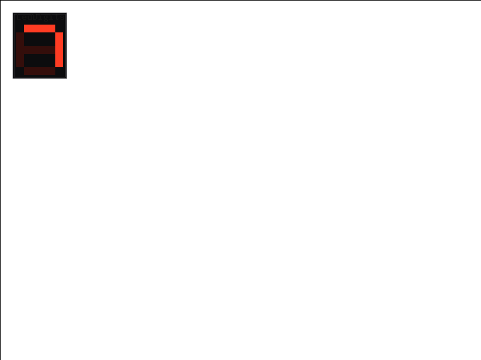

1-digit vintage red 7-segment LED display. Shows the value zero-padded to 1 digit(s), in the style of old LED counters and clocks: dark bezel, bright red lit segments, faint unlit segments.
Range 0..9, whole digits only.
Up/Down keys step by 1.

Working example:

```cpp
InstLedDigits1 w(display, screen, window, gc, &styles, 20, 20, 90, 110);
w.set_value(7);
w.draw();
```

## InstLedDigits2

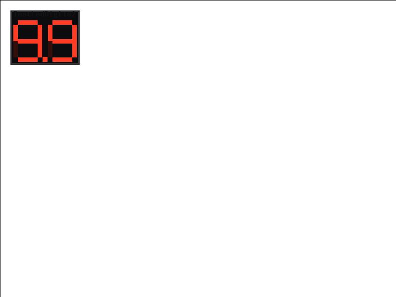

2-digit vintage red 7-segment LED display. Shows the value zero-padded to 2 digit(s) with one decimal place before the last digit, in the style of old LED counters and clocks: dark bezel, bright red lit segments, faint unlit segments.
Range 0..9.9, one decimal place (none for the 1-digit display).
Up/Down keys step by 0.1.

Working example:

```cpp
InstLedDigits2 w(display, screen, window, gc, &styles, 20, 20, 140, 110);
w.set_value(42.5);
w.draw();
```

## InstLedDigits3

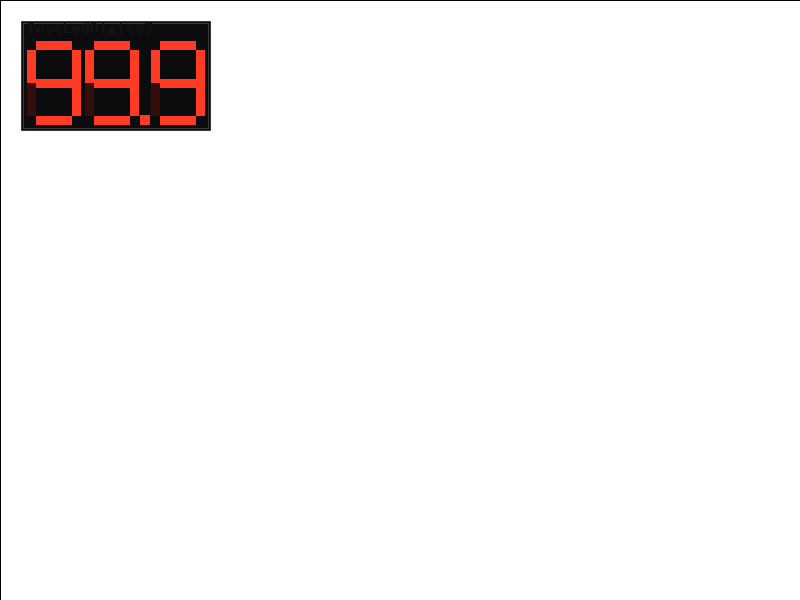

3-digit vintage red 7-segment LED display. Shows the value zero-padded to 3 digit(s) with one decimal place before the last digit, in the style of old LED counters and clocks: dark bezel, bright red lit segments, faint unlit segments.
Range 0..99.9, one decimal place (none for the 1-digit display).
Up/Down keys step by 0.1.

Working example:

```cpp
InstLedDigits3 w(display, screen, window, gc, &styles, 20, 20, 190, 110);
w.set_value(123.4);
w.draw();
```

## InstLedDigits4

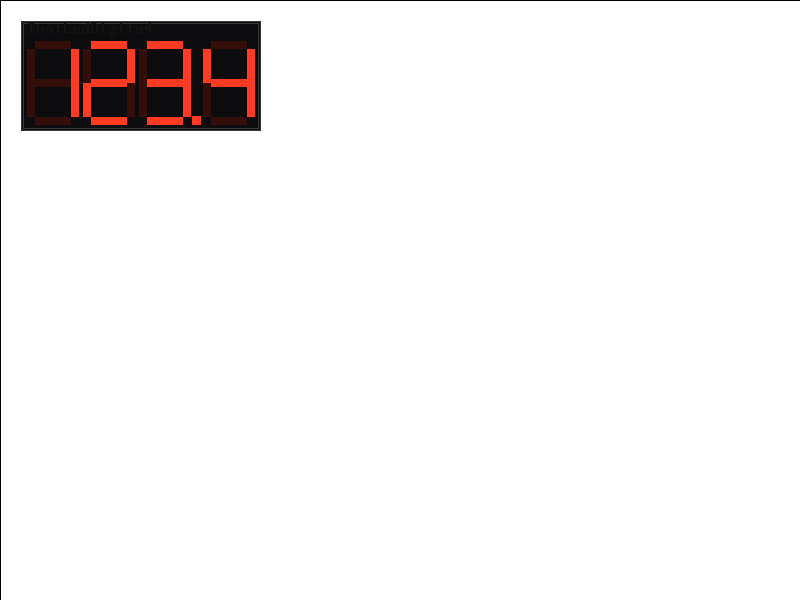

4-digit vintage red 7-segment LED display. Shows the value zero-padded to 4 digit(s) with one decimal place before the last digit, in the style of old LED counters and clocks: dark bezel, bright red lit segments, faint unlit segments.
Range 0..999.9, one decimal place (none for the 1-digit display).
Up/Down keys step by 0.1.

Working example:

```cpp
InstLedDigits4 w(display, screen, window, gc, &styles, 20, 20, 240, 110);
w.set_value(123.4);
w.draw();
```

## InstLedDigits5

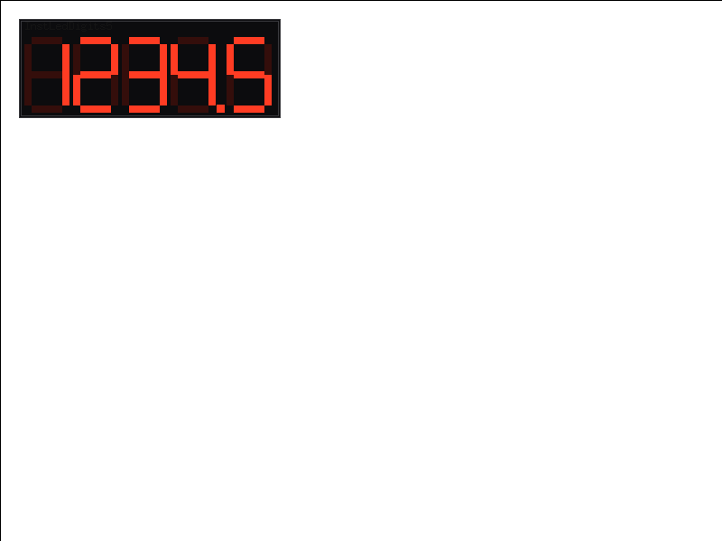

5-digit vintage red 7-segment LED display. Shows the value zero-padded to 5 digit(s) with one decimal place before the last digit, in the style of old LED counters and clocks: dark bezel, bright red lit segments, faint unlit segments.
Range 0..9999.9, one decimal place (none for the 1-digit display).
Up/Down keys step by 0.1.

Working example:

```cpp
InstLedDigits5 w(display, screen, window, gc, &styles, 20, 20, 290, 110);
w.set_value(1234.5);
w.draw();
```

## InstLedDigits6

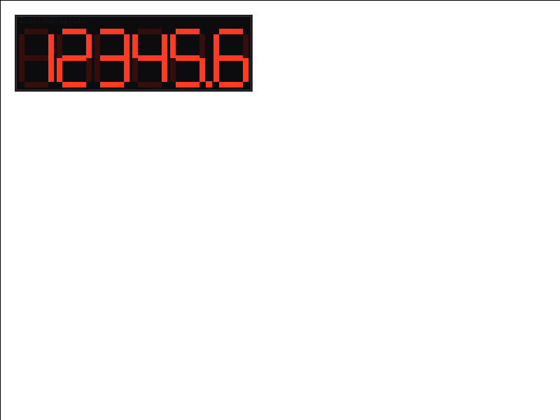

6-digit vintage red 7-segment LED display. Shows the value zero-padded to 6 digit(s) with one decimal place before the last digit, in the style of old LED counters and clocks: dark bezel, bright red lit segments, faint unlit segments.
Range 0..99999.9, one decimal place (none for the 1-digit display).
Up/Down keys step by 0.1.

Working example:

```cpp
InstLedDigits6 w(display, screen, window, gc, &styles, 20, 20, 340, 110);
w.set_value(12345.6);
w.draw();
```

## InstNeedleTapered


Standard tapered pointer on a round dial: the needle is wide at the hub and narrows to the tip, sweeping -135..+135 degrees over the range (default 0..100). Cream dial, major ticks every 20, red zone over the top 10%.
Range 0.0..100.0 by default; `set_range` changes it.

Working example:

```cpp
InstNeedleTapered w(display, screen, window, gc, &styles, 20, 20, 420, 380);
w.set_value(xframe::inst_demo_value(0.0, 100.0, 42));
w.draw();
```

## InstNeedleKnifeEdge


Knife-edge pointer on a round dial: a hair-thin pointer with a pointed tip and a short tail, sweeping -120..+120 degrees. White dial with a parallax mirror arc strip under the scale, ticks every 5, red zone over the top 10%.
Range 0.0..100.0 by default; `set_range` changes it.

Working example:

```cpp
InstNeedleKnifeEdge w(display, screen, window, gc, &styles, 20, 20, 420, 380);
w.set_value(xframe::inst_demo_value(0.0, 100.0, 42));
w.draw();
```

## InstNeedleEdgewise


Edgewise horizontal meter: a flat horizontal scale with the needle pivoting below it and sweeping left-right (-50..+50 degrees from vertical) across the scale. Ticks every 10, labels every 20, red zone over the rightmost 10%.
Range 0.0..100.0 by default; `set_range` changes it.

Working example:

```cpp
InstNeedleEdgewise w(display, screen, window, gc, &styles, 20, 20, 560, 280);
w.set_value(xframe::inst_demo_value(0.0, 100.0, 42));
w.draw();
```

## InstNeedleVu


VU-style needle on a VU meter scale: -20..+3 VU with the standard nonlinear VU spacing (-20, -10, -7, -5, -3, -1, 0, +1, +2, +3), red arc above 0 VU, cream face, thin black needle sweeping -45..+45 degrees.
Range -20.0..3.0 by default; `set_range` changes it.

Working example:

```cpp
InstNeedleVu w(display, screen, window, gc, &styles, 20, 20, 480, 380);
w.set_value(xframe::inst_demo_value(-20.0, 3.0, 42));
w.draw();
```

## Group G — Higher-Segment Alphanumeric LED Displays (12 widgets)

Twelve widgets in `widgets/components/`, one per directory. Each directory
contains exactly `<Name>.h`, `main_<Name>.cpp`, `CMakeLists.txt`, and
`core/xframe_core.h` (byte-identical to `widgets/core/xframe_core.h`).
Attribution: XFrame.

Group G extends the Instrumentation section (see `docs/instrumentation.md`
for the plan): the higher-segment displays that can roughly show
alphanumeric text — 14-segment in 1–6 digit variants, and 16-segment in
1–6 digit variants. The honest word is "roughly": a segment display is
not a dot matrix, and the tables below say exactly which characters each
type shows well, which it only approximates, and which it cannot show at
all. Standard XFrame hand-drawn style, no photorealism. Demos use
deterministic strings ("HELLO", "ABC123", "42.5").

### Common API (all twelve)

Constructor (all widgets):

```cpp
Name(Display* display, int screen, Window window, GC gc,
     SStyle_Manager* styles, int x, int y, int width, int height);
```

Key methods, identical on every widget:

- `void set_value(const std::string& v)` / `std::string get_value() const` — the displayed string; normalised to uppercase, truncated to the digit count, characters with no approximation dropped, `.`/`:` become a decimal-point dot after the previous digit.
- `std::string shown_text() const` — the string actually shown, padded with spaces to the digit count.
- `int cell_count() const`, `char char_at(int i) const`.
- `static bool segment_on(char ch, const std::string& seg)` — is that segment lit for that character?
- `static bool renders_clean(char ch)` / `renders_approx(char ch)` / `renders_blank(char ch)`; `static std::string clean_repertoire()` / `approx_repertoire()` / `cannot_repertoire()`.
- `static constexpr int kDigits`, `static constexpr int kSegments` (14 or 16), `static const char* default_value()`.
- `void draw()` — redraws the widget.
- `bool on_button_press(int x, int y, unsigned int button)` — click focuses the widget and fires `on_click`; `bool on_button_release(...)`, `bool on_motion(int x, int y)` — hover tracking.
- `bool on_key(KeySym key, const char* str)` — only when focused: Up/Right steps the last displayed character (digit wraps 9→0, letter wraps Z→A), Down/Left steps it down, Home restores the default demo string, Return/Space fires `on_click`.
- `std::function<void()> on_click`, `void set_bounds(...)`, `width()`, `height()`, `contains(x, y)`, `set_visible`/`get_visible`, `set_enabled`/`get_enabled`, `set_style_name`, `set_text`/`get_text`, `style()`.

Build one widget (from the repo root, on the server):

```
cmake -S widgets/components/InstSeg14Display4 -B /tmp/b-seg14-4 -DCMAKE_CXX_FLAGS="-Wall -Wextra"
cmake --build /tmp/b-seg14-4   # 0 warnings
```

Run the whole group (build + harness + demos + doc examples):

```
python3 widgets/tests/test_inst_group_g.py   # ALL PASS, 12/12 widgets
```

## InstSeg14Display1


14-segment alphanumeric LED display, 1 digit. The classic
14-segment font: the seven bars plus two half middle bars, two centre
verticals and four diagonals. Shows A–Z, 0–9 and common punctuation
roughly — M and W are poor (no centre peak), and K, Q, R, V, Y and Z
are approximations. Demo string: `A`.


Repertoire (14-segment):


| Class | Characters | Notes |
|---|---|---|
| Clean | 0–9, A B C D E F G H I J L O P S T U X, - _ = + / | Render distinctly; verified pixel-distinct in the harness, except the look-alikes below. |
| Approximate | K M N Q R V W Y Z ' " : | Renders something recognisable, but only roughly. |
| Cannot show | ; , ? ! @ # $ % & * ( ) [ ] { } < > \ | ^ ` ~ | Renders blank (no lit segments). |
| Look-alikes | 0/O, 5/S, 6/G, J/U | Each pair renders identically on segment displays. |

M and W have no centre peak on 14 segments, so they read as rough approximations; K, Q, R, V, Y and Z need diagonals the font only hints at.


Example:

```cpp
InstSeg14Display1 w(display, screen, window, gc, &styles, 20, 20, 90, 110);
w.set_value("A");
w.draw();
```

## InstSeg14Display2


14-segment alphanumeric LED display, 2 digits. The classic
14-segment font: the seven bars plus two half middle bars, two centre
verticals and four diagonals. Shows A–Z, 0–9 and common punctuation
roughly — M and W are poor (no centre peak), and K, Q, R, V, Y and Z
are approximations. Demo string: `42`.


Repertoire (14-segment):


| Class | Characters | Notes |
|---|---|---|
| Clean | 0–9, A B C D E F G H I J L O P S T U X, - _ = + / | Render distinctly; verified pixel-distinct in the harness, except the look-alikes below. |
| Approximate | K M N Q R V W Y Z ' " : | Renders something recognisable, but only roughly. |
| Cannot show | ; , ? ! @ # $ % & * ( ) [ ] { } < > \ | ^ ` ~ | Renders blank (no lit segments). |
| Look-alikes | 0/O, 5/S, 6/G, J/U | Each pair renders identically on segment displays. |

M and W have no centre peak on 14 segments, so they read as rough approximations; K, Q, R, V, Y and Z need diagonals the font only hints at.


Example:

```cpp
InstSeg14Display2 w(display, screen, window, gc, &styles, 20, 20, 140, 110);
w.set_value("42");
w.draw();
```

## InstSeg14Display3


14-segment alphanumeric LED display, 3 digits. The classic
14-segment font: the seven bars plus two half middle bars, two centre
verticals and four diagonals. Shows A–Z, 0–9 and common punctuation
roughly — M and W are poor (no centre peak), and K, Q, R, V, Y and Z
are approximations. Demo string: `ABC`.


Repertoire (14-segment):


| Class | Characters | Notes |
|---|---|---|
| Clean | 0–9, A B C D E F G H I J L O P S T U X, - _ = + / | Render distinctly; verified pixel-distinct in the harness, except the look-alikes below. |
| Approximate | K M N Q R V W Y Z ' " : | Renders something recognisable, but only roughly. |
| Cannot show | ; , ? ! @ # $ % & * ( ) [ ] { } < > \ | ^ ` ~ | Renders blank (no lit segments). |
| Look-alikes | 0/O, 5/S, 6/G, J/U | Each pair renders identically on segment displays. |

M and W have no centre peak on 14 segments, so they read as rough approximations; K, Q, R, V, Y and Z need diagonals the font only hints at.


Example:

```cpp
InstSeg14Display3 w(display, screen, window, gc, &styles, 20, 20, 190, 110);
w.set_value("ABC");
w.draw();
```

## InstSeg14Display4


14-segment alphanumeric LED display, 4 digits. The classic
14-segment font: the seven bars plus two half middle bars, two centre
verticals and four diagonals. Shows A–Z, 0–9 and common punctuation
roughly — M and W are poor (no centre peak), and K, Q, R, V, Y and Z
are approximations. Demo string: `HELL`.


Repertoire (14-segment):


| Class | Characters | Notes |
|---|---|---|
| Clean | 0–9, A B C D E F G H I J L O P S T U X, - _ = + / | Render distinctly; verified pixel-distinct in the harness, except the look-alikes below. |
| Approximate | K M N Q R V W Y Z ' " : | Renders something recognisable, but only roughly. |
| Cannot show | ; , ? ! @ # $ % & * ( ) [ ] { } < > \ | ^ ` ~ | Renders blank (no lit segments). |
| Look-alikes | 0/O, 5/S, 6/G, J/U | Each pair renders identically on segment displays. |

M and W have no centre peak on 14 segments, so they read as rough approximations; K, Q, R, V, Y and Z need diagonals the font only hints at.


Example:

```cpp
InstSeg14Display4 w(display, screen, window, gc, &styles, 20, 20, 240, 110);
w.set_value("HELL");
w.draw();
```

## InstSeg14Display5


14-segment alphanumeric LED display, 5 digits. The classic
14-segment font: the seven bars plus two half middle bars, two centre
verticals and four diagonals. Shows A–Z, 0–9 and common punctuation
roughly — M and W are poor (no centre peak), and K, Q, R, V, Y and Z
are approximations. Demo string: `HELLO`.


Repertoire (14-segment):


| Class | Characters | Notes |
|---|---|---|
| Clean | 0–9, A B C D E F G H I J L O P S T U X, - _ = + / | Render distinctly; verified pixel-distinct in the harness, except the look-alikes below. |
| Approximate | K M N Q R V W Y Z ' " : | Renders something recognisable, but only roughly. |
| Cannot show | ; , ? ! @ # $ % & * ( ) [ ] { } < > \ | ^ ` ~ | Renders blank (no lit segments). |
| Look-alikes | 0/O, 5/S, 6/G, J/U | Each pair renders identically on segment displays. |

M and W have no centre peak on 14 segments, so they read as rough approximations; K, Q, R, V, Y and Z need diagonals the font only hints at.


Example:

```cpp
InstSeg14Display5 w(display, screen, window, gc, &styles, 20, 20, 290, 110);
w.set_value("HELLO");
w.draw();
```

## InstSeg14Display6


14-segment alphanumeric LED display, 6 digits. The classic
14-segment font: the seven bars plus two half middle bars, two centre
verticals and four diagonals. Shows A–Z, 0–9 and common punctuation
roughly — M and W are poor (no centre peak), and K, Q, R, V, Y and Z
are approximations. Demo string: `ABC123`.


Repertoire (14-segment):


| Class | Characters | Notes |
|---|---|---|
| Clean | 0–9, A B C D E F G H I J L O P S T U X, - _ = + / | Render distinctly; verified pixel-distinct in the harness, except the look-alikes below. |
| Approximate | K M N Q R V W Y Z ' " : | Renders something recognisable, but only roughly. |
| Cannot show | ; , ? ! @ # $ % & * ( ) [ ] { } < > \ | ^ ` ~ | Renders blank (no lit segments). |
| Look-alikes | 0/O, 5/S, 6/G, J/U | Each pair renders identically on segment displays. |

M and W have no centre peak on 14 segments, so they read as rough approximations; K, Q, R, V, Y and Z need diagonals the font only hints at.


Example:

```cpp
InstSeg14Display6 w(display, screen, window, gc, &styles, 20, 20, 340, 110);
w.set_value("ABC123");
w.draw();
```

## InstSeg16Display1


16-segment alphanumeric LED display, 1 digit. The 14-segment
font with the top and bottom bars split in two, which — together with
the centre verticals — gives M and W a real middle peak and handles
more punctuation better. K, Q, R, V, Y and Z are still approximations.
Demo string: `M`.


Repertoire (16-segment):


| Class | Characters | Notes |
|---|---|---|
| Clean | 0–9, A B C D E F G H I J L M O P S T U W X, - _ = + / | Render distinctly; verified pixel-distinct in the harness, except the look-alikes below. |
| Approximate | K N Q R V Y Z ' " : | Renders something recognisable, but only roughly. |
| Cannot show | ; , ? ! @ # $ % & * ( ) [ ] { } < > \ | ^ ` ~ | Renders blank (no lit segments). |
| Look-alikes | 0/O, 5/S, 6/G, J/U | Each pair renders identically on segment displays. |

The split top/bottom bars plus the centre verticals give M and W a real middle peak, so they read cleanly here. K, Q, R, V, Y and Z are still only approximate.


Example:

```cpp
InstSeg16Display1 w(display, screen, window, gc, &styles, 20, 20, 90, 110);
w.set_value("M");
w.draw();
```

## InstSeg16Display2


16-segment alphanumeric LED display, 2 digits. The 14-segment
font with the top and bottom bars split in two, which — together with
the centre verticals — gives M and W a real middle peak and handles
more punctuation better. K, Q, R, V, Y and Z are still approximations.
Demo string: `MW`.


Repertoire (16-segment):


| Class | Characters | Notes |
|---|---|---|
| Clean | 0–9, A B C D E F G H I J L M O P S T U W X, - _ = + / | Render distinctly; verified pixel-distinct in the harness, except the look-alikes below. |
| Approximate | K N Q R V Y Z ' " : | Renders something recognisable, but only roughly. |
| Cannot show | ; , ? ! @ # $ % & * ( ) [ ] { } < > \ | ^ ` ~ | Renders blank (no lit segments). |
| Look-alikes | 0/O, 5/S, 6/G, J/U | Each pair renders identically on segment displays. |

The split top/bottom bars plus the centre verticals give M and W a real middle peak, so they read cleanly here. K, Q, R, V, Y and Z are still only approximate.


Example:

```cpp
InstSeg16Display2 w(display, screen, window, gc, &styles, 20, 20, 140, 110);
w.set_value("MW");
w.draw();
```

## InstSeg16Display3


16-segment alphanumeric LED display, 3 digits. The 14-segment
font with the top and bottom bars split in two, which — together with
the centre verticals — gives M and W a real middle peak and handles
more punctuation better. K, Q, R, V, Y and Z are still approximations.
Demo string: `MWM`.


Repertoire (16-segment):


| Class | Characters | Notes |
|---|---|---|
| Clean | 0–9, A B C D E F G H I J L M O P S T U W X, - _ = + / | Render distinctly; verified pixel-distinct in the harness, except the look-alikes below. |
| Approximate | K N Q R V Y Z ' " : | Renders something recognisable, but only roughly. |
| Cannot show | ; , ? ! @ # $ % & * ( ) [ ] { } < > \ | ^ ` ~ | Renders blank (no lit segments). |
| Look-alikes | 0/O, 5/S, 6/G, J/U | Each pair renders identically on segment displays. |

The split top/bottom bars plus the centre verticals give M and W a real middle peak, so they read cleanly here. K, Q, R, V, Y and Z are still only approximate.


Example:

```cpp
InstSeg16Display3 w(display, screen, window, gc, &styles, 20, 20, 190, 110);
w.set_value("MWM");
w.draw();
```

## InstSeg16Display4


16-segment alphanumeric LED display, 4 digits. The 14-segment
font with the top and bottom bars split in two, which — together with
the centre verticals — gives M and W a real middle peak and handles
more punctuation better. K, Q, R, V, Y and Z are still approximations.
Demo string: `MWMW`.


Repertoire (16-segment):


| Class | Characters | Notes |
|---|---|---|
| Clean | 0–9, A B C D E F G H I J L M O P S T U W X, - _ = + / | Render distinctly; verified pixel-distinct in the harness, except the look-alikes below. |
| Approximate | K N Q R V Y Z ' " : | Renders something recognisable, but only roughly. |
| Cannot show | ; , ? ! @ # $ % & * ( ) [ ] { } < > \ | ^ ` ~ | Renders blank (no lit segments). |
| Look-alikes | 0/O, 5/S, 6/G, J/U | Each pair renders identically on segment displays. |

The split top/bottom bars plus the centre verticals give M and W a real middle peak, so they read cleanly here. K, Q, R, V, Y and Z are still only approximate.


Example:

```cpp
InstSeg16Display4 w(display, screen, window, gc, &styles, 20, 20, 240, 110);
w.set_value("MWMW");
w.draw();
```

## InstSeg16Display5


16-segment alphanumeric LED display, 5 digits. The 14-segment
font with the top and bottom bars split in two, which — together with
the centre verticals — gives M and W a real middle peak and handles
more punctuation better. K, Q, R, V, Y and Z are still approximations.
Demo string: `MWMWM`.


Repertoire (16-segment):


| Class | Characters | Notes |
|---|---|---|
| Clean | 0–9, A B C D E F G H I J L M O P S T U W X, - _ = + / | Render distinctly; verified pixel-distinct in the harness, except the look-alikes below. |
| Approximate | K N Q R V Y Z ' " : | Renders something recognisable, but only roughly. |
| Cannot show | ; , ? ! @ # $ % & * ( ) [ ] { } < > \ | ^ ` ~ | Renders blank (no lit segments). |
| Look-alikes | 0/O, 5/S, 6/G, J/U | Each pair renders identically on segment displays. |

The split top/bottom bars plus the centre verticals give M and W a real middle peak, so they read cleanly here. K, Q, R, V, Y and Z are still only approximate.


Example:

```cpp
InstSeg16Display5 w(display, screen, window, gc, &styles, 20, 20, 290, 110);
w.set_value("MWMWM");
w.draw();
```

## InstSeg16Display6


16-segment alphanumeric LED display, 6 digits. The 14-segment
font with the top and bottom bars split in two, which — together with
the centre verticals — gives M and W a real middle peak and handles
more punctuation better. K, Q, R, V, Y and Z are still approximations.
Demo string: `MWMWMW`.


Repertoire (16-segment):


| Class | Characters | Notes |
|---|---|---|
| Clean | 0–9, A B C D E F G H I J L M O P S T U W X, - _ = + / | Render distinctly; verified pixel-distinct in the harness, except the look-alikes below. |
| Approximate | K N Q R V Y Z ' " : | Renders something recognisable, but only roughly. |
| Cannot show | ; , ? ! @ # $ % & * ( ) [ ] { } < > \ | ^ ` ~ | Renders blank (no lit segments). |
| Look-alikes | 0/O, 5/S, 6/G, J/U | Each pair renders identically on segment displays. |

The split top/bottom bars plus the centre verticals give M and W a real middle peak, so they read cleanly here. K, Q, R, V, Y and Z are still only approximate.


Example:

```cpp
InstSeg16Display6 w(display, screen, window, gc, &styles, 20, 20, 340, 110);
w.set_value("MWMWMW");
w.draw();
```
