# Stock Market — XFrame Stock Market section

The 10th XFrame palette section: 287 widgets (37 charts,
comparative, volume and drawing widgets + 250 indicators), taking the
library from 194 to 481 widgets in 10 sections and the combined IDE
palette from 230 to 517 entries (36 FDesigner + 481 XFrame).
Every widget is a header-only X11 class in
`widgets/components/<Name>/`, following the `XGraph` pattern
(`Display*`/screen/window/GC, `draw()`, `on_button_press`,
`on_button_release`, `on_motion`, `on_key`). Attribution: XFrame.

## Groups

| Group | Widgets | Document |
| --- | --- | --- |
| OHLC / price charts | 8 | [stock-market-ohlc.md](stock-market-ohlc.md) |
| Comparative plotting & volume | 15 | [stock-market-compare-volume.md](stock-market-compare-volume.md) |
| Drawing / annotation | 14 | [stock-market-drawing.md](stock-market-drawing.md) |
| Indicators — trend | 85 | [stock-market-indicators-trend.md](stock-market-indicators-trend.md) |
| Indicators — momentum | 85 | [stock-market-indicators-momentum.md](stock-market-indicators-momentum.md) |
| Indicators — volatility, volume and other | 80 | [stock-market-indicators-volatility.md](stock-market-indicators-volatility.md) |
| **Total** | **287** | |

The three indicator lists hold 85 + 85 + 80 = 250 lines, 0 overlaps,
250 unique names — each a real named indicator with a real formula
(TA-Lib / StockCharts / Investopedia or equivalent).

## Shared OHLCV data model

All 287 widgets render from one shared type,
`xframe::OHLCVSeries` (`widgets/components/StockData.h`), a vector of
`OHLCV` bars:

```cpp
struct OHLCV {
    double open = 0.0;
    double high = 0.0;
    double low = 0.0;
    double close = 0.0;
    double volume = 0.0;
    std::int64_t timestamp = 0;  // seconds since the epoch (daily bars)
};
using OHLCVSeries = std::vector<OHLCV>;
```

Helpers in the same header: `series_highs(series)`,
`series_lows(series)`, `series_closes(series)` (each returns one value
per bar), plus the seeded generator below. Chart widgets take the whole
series; indicator compute functions take either the series or a closes
vector and return one value per input bar.

## Deterministic seeded synthetic data

No network, no live market data, no API keys. Demos and tests run on
synthetic data from `xframe::make_seeded_series(n, seed)` — a random
walk starting at 100.0, daily bars from 2026-01-01 UTC, driven by a
xorshift64* generator. Same `(n, seed)` gives the identical series on
every run and every platform (default seed 42; the indicator smoke
tests use `make_seeded_series(250, 42)`). That makes every screenshot,
every smoke check and every demo reproducible.

```cpp
#include "StockData.h"
auto series = xframe::make_seeded_series(250, 42);  // 250 daily bars
auto closes = xframe::series_closes(series);
```

## How indicators are computed

Every indicator compute function returns a vector the same length as
its input; leading warm-up bars are NaN until enough bars exist, and
once values start they never go NaN again in the middle (the smoke
tests check exactly that, plus at least one finite value). Overlay
indicators draw over a light candlestick background; pane indicators
draw their own subplot with an axis. Each widget exposes `line(i)` /
`line_count()` for the plotted lines and `is_pane()` for the style.
Where a published definition leaves a choice open (smoothing variant,
warm-up handling), the fragment for that group says so in an
"Unclear from the header" note rather than pretending the header
settles it.

## Tests

Each group has its own driver under `widgets/tests/`, re-deriving its
counts from the fresh artifacts on every round: per-widget build with
`-Wall -Wextra` (0 warnings), demo run under Xvfb (draw + hover +
click + key + clean exit), and a per-indicator smoke program (finite
values on `make_seeded_series(250)` + hand-computed SMA/EMA checks
where applicable). Results land in `widgets/test-results/` as
per-item pass/fail tables. The palette self-test, layout PLACE_ALL,
composite contact sheet and combined-palette self-test all derive
their counts from the registry (`widgets/tools/widget_count.py`), so
they follow the 481-widget set with no hard-coded number.

## Group: OHLC / price charts (8)

## Stock Market widgets — OHLC / price charts

Eight widgets in `widgets/components/`, one per directory. Each directory
contains exactly `<Name>.h`, `main_<Name>.cpp`, `CMakeLists.txt`, and
`core/xframe_core.h` (byte-identical to `widgets/core/xframe_core.h`).
Attribution: XFrame.

All eight render from a shared `xframe::OHLCVSeries`
(`widgets/components/StockData.h`, included as `#include "../StockData.h"`).
Demos use `xframe::make_seeded_series(250)` — deterministic synthetic data,
no network, no live market data. Verified: same `(n, seed)` gives identical
bars, a different seed gives different bars, every bar satisfies
`high >= max(open, close)` and `low <= min(open, close)`.

## Common API (all eight)

Constructor (all widgets):

```cpp
Name(Display* display, int screen, Window window, GC gc,
     SStyle_Manager* styles, int x, int y, int width, int height,
     const xframe::OHLCVSeries& series = xframe::make_seeded_series(250));
```

Key methods, identical on every widget:

- `void set_series(const xframe::OHLCVSeries& s)` — replace the data; resets
  the view to show all items. Derived data (Heikin-Ashi candles, Renko
  bricks, BaselineChart's default baseline) is rebuilt here.
- `const xframe::OHLCVSeries& series() const` — the raw series.
- `int item_count()` — number of plotted items (bars for most widgets;
  Heikin-Ashi candles for StockHeikinAshi; bricks for StockRenko).
- `void draw()` — axes + 1/2/5 grid, series, index axis, title with last
  close, crosshair + readout when the mouse has moved over the plot.
- `bool on_button_press(int x, int y, unsigned int button)` — button 1 starts
  a drag-pan and focuses the widget; wheel (4/5) zooms around the cursor;
  any press also moves the crosshair to the click point.
- `bool on_button_release(int x, int y, unsigned int button)`,
  `bool on_motion(int x, int y)` — crosshair follows the mouse; drag pans.
- `bool on_key(KeySym key, const char* str)` — only when focused:
  Left/Right pan 10% of the view, `+`/`-` zoom, `Home`/`r` reset view.
- `void set_y_range(double lo, double hi)` / `void set_auto_y(bool on)` —
  manual Y range or auto range (default) with 6% padding.
- `void set_bounds(...)`, `width()`, `height()`, `contains(x, y)`,
  `set_visible`/`get_visible`, `set_enabled`/`get_enabled`,
  `set_style_name`, `set_text`/`get_text`, `style()`.
- `double get_view_first()`, `double get_view_count()`,
  `void reset_view()`, `void zoom_at(double factor, double frac_x)`.

Working example (same shape for every widget; here the candlestick one):

```cpp
#include "StockCandlestickChart.h"
StockCandlestickChart w(display, screen, window, gc, &styles,
                        20, 20, 720, 480,
                        xframe::make_seeded_series(250));
w.draw();
// ... event loop forwards ButtonPress/ButtonRelease/MotionNotify/KeyPress
// to w.on_button_press / on_button_release / on_motion / on_key,
// redrawing after any handled event, as in main_StockCandlestickChart.cpp.
```

Build one widget (from the repo root, on the server):

```
cmake -S widgets/components/StockCandlestickChart -B /tmp/b-candle -DCMAKE_CXX_FLAGS="-Wall -Wextra"
cmake --build /tmp/b-candle   # 0 warnings
```

Tests: `python3 widgets/tests/test_stock_ohlc.py` builds all eight with
`-Wall -Wextra`, checks StockData.h determinism with a standalone compile,
then runs each demo under Xvfb `:91` and checks build / draw (non-blank
screenshot) / hover (crosshair) / click / key (process survives) /
clean exit via `WM_DELETE_WINDOW`. Result: 8/8 widgets fully PASS,
0 warnings, driver exit 0.

## StockCandlestickChart


Draws one filled candle per bar: vertical wick from low to high, body from
open to close, green when `close >= open`, red otherwise. Body width is 60%
of the per-item slot. Y range from visible lows/highs.

Unclear from the header: a doji (`open == close`) is drawn green (the
`close >= open` branch) with a 1-pixel-tall body; the header does not say
dojis should be special-cased, so they are not.


- **Example:**
  ```cpp
  StockCandlestickChart w(display, screen, window, gc, &styles, 20, 20, 720, 480, xframe::make_seeded_series(250));
  w.draw();
  ```
## StockOHLCBarChart

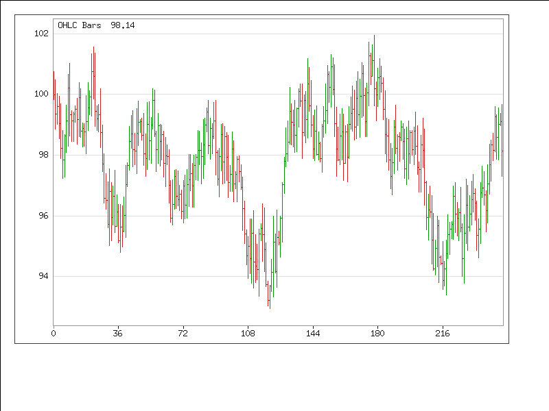

Classic OHLC bar per bar: vertical high–low line, left tick at the open,
right tick at the close, half-slot-wide ticks (35% of the item slot).
Colour is green when `close >= open`, red otherwise. Y range from visible
lows/highs.

Unclear from the header: tick length is a fixed fraction of the slot width,
so ticks shrink as more bars are shown; there is no minimum tick length
beyond 1 pixel.


- **Example:**
  ```cpp
  StockOHLCBarChart w(display, screen, window, gc, &styles, 20, 20, 720, 480, xframe::make_seeded_series(250));
  w.draw();
  ```
## StockLineChart

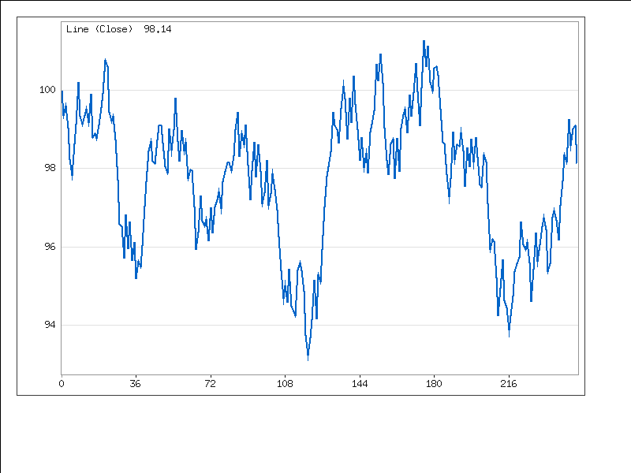

Closes joined by a single 2-pixel polyline (blue). Y range from visible
closes only, so wicks do not affect the scale. Crosshair readout shows the
close at the hovered index.

Unclear from the header: with a single bar there is no line (needs 2+
points); the widget then shows only axes, grid and title.


- **Example:**
  ```cpp
  StockLineChart w(display, screen, window, gc, &styles, 20, 20, 720, 480, xframe::make_seeded_series(250));
  w.draw();
  ```
## StockAreaChart

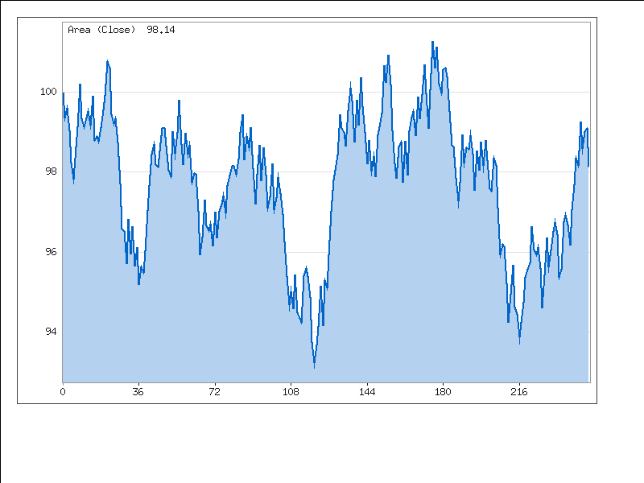

Closes as a line (as in StockLineChart) with the area between the line and
the bottom of the plot filled light blue. Y range from visible closes only.

Unclear from the header: the fill goes to the plot bottom, not to zero or to
the Y minimum — on a zoomed view the filled region is bounded by the visible
plot rectangle.


- **Example:**
  ```cpp
  StockAreaChart w(display, screen, window, gc, &styles, 20, 20, 720, 480, xframe::make_seeded_series(250));
  w.draw();
  ```
## StockHeikinAshi

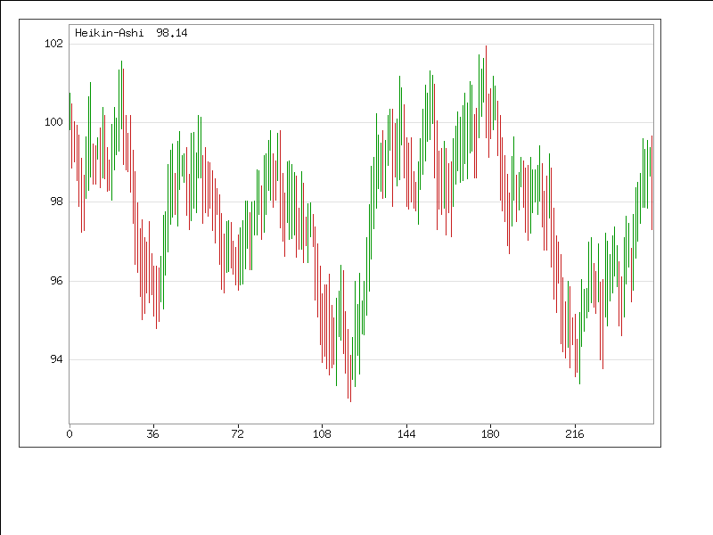

Computes Heikin-Ashi candles from the series and draws them as candles
(same rendering as StockCandlestickChart):

- `ha_close = (open + high + low + close) / 4`
- `ha_open = (prev ha_open + prev ha_close) / 2`; for the first bar,
  `ha_open = (open + close) / 2`
- `ha_high = max(high, ha_open, ha_close)`,
  `ha_low = min(low, ha_open, ha_close)`

Extra API: `const xframe::OHLCVSeries& heikin_ashi_series() const`,
`int heikin_ashi_count()`. The derived candles are rebuilt by the
constructor and by `set_series()`. Y range, item count and crosshair readout
all use the Heikin-Ashi candles, not the raw bars.

Unclear from the header: the first-bar `ha_open` seed `(open + close) / 2`
is a convention choice, not something the header derives — other
implementations seed it with the raw open. The volume and timestamp of each
derived candle are copied from the raw bar.


- **Example:**
  ```cpp
  StockHeikinAshi w(display, screen, window, gc, &styles, 20, 20, 720, 480, xframe::make_seeded_series(250));
  w.draw();
  ```
## StockRenko

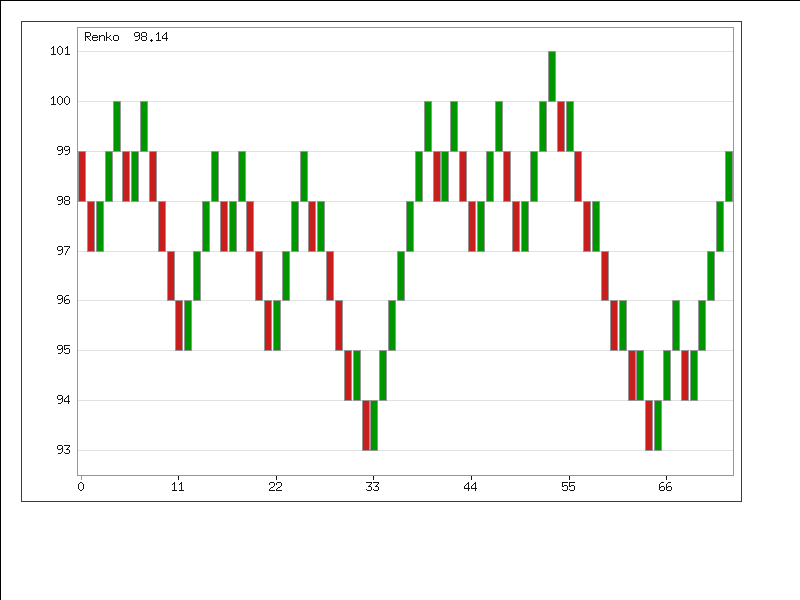

Builds Renko bricks from closes. Extra API:

- `void set_brick_size(double s)` — brick height in price units (ignored
  when `s <= 0`); rebuilds the bricks and resets the view. Default `1.0`.
- `double brick_size() const`, `int brick_count()`.

Bricks: the anchor is `floor(first close / brick_size) * brick_size`; each
time the close crosses the running brick boundary a brick is added (green
for up, red for down), and the anchor advances one brick. Bricks are drawn
as filled rectangles 80% of the item slot, with a thin outline. Y range,
item count and the x axis all use bricks, so the x axis is brick index, not
time — consecutive bricks need not be consecutive days.

Unclear from the header: the first bar never produces a brick (it only sets
the anchor), and a large single-bar jump produces several bricks at once;
there is no cap on bricks per bar. With the default brick size 1.0 and the
seeded 250-bar series the brick count is in the tens.


- **Example:**
  ```cpp
  StockRenko w(display, screen, window, gc, &styles, 20, 20, 720, 480, xframe::make_seeded_series(250));
  w.draw();
  ```
## StockHollowCandles

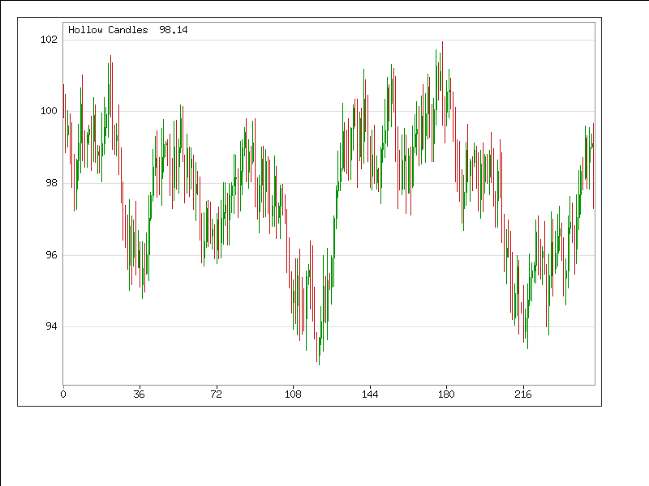

Candles as in StockCandlestickChart, except the body is hollow
(outline only) when `close > open` and filled when `close <= open`.
The wick is always drawn. Colour is green for hollow (up) bodies, red for
filled (down) bodies.

Unclear from the header: a doji (`open == close`) counts as down/filled
(the `close > open` test is strict); the header does not discuss dojis.


- **Example:**
  ```cpp
  StockHollowCandles w(display, screen, window, gc, &styles, 20, 20, 720, 480, xframe::make_seeded_series(250));
  w.draw();
  ```
## StockBaselineChart

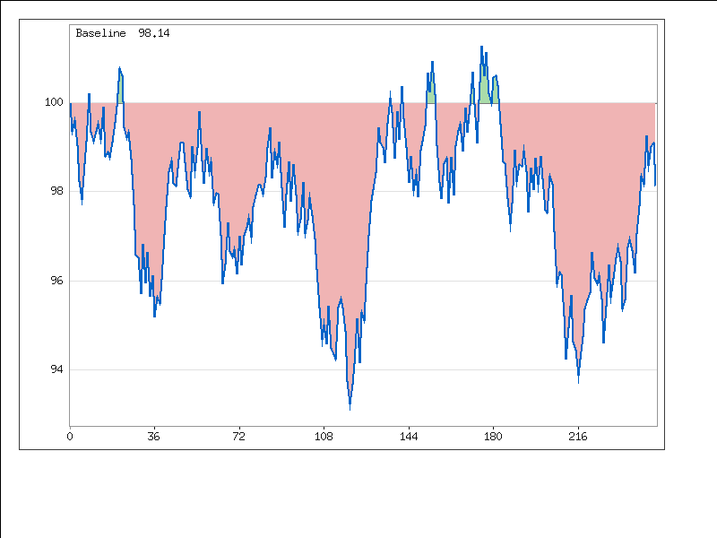

Closes as a line with the area between the line and a baseline value filled
green where the line is above the baseline and red where it is below; the
baseline itself is drawn as a grey horizontal line. Extra API:
`void set_baseline(double b)`, `double baseline() const`. Default baseline
is the first bar's close (or 100.0 for an empty series); `set_series()`
resets it to the new series' first close. Y range includes the baseline, so
the baseline line is always visible.

Unclear from the header: the fill is computed per segment and split at
baseline crossings, so a segment that crosses the baseline is filled with
two triangles; the exact split point is linear interpolation between the
two closes. No smoothing is applied.


- **Example:**
  ```cpp
  StockBaselineChart w(display, screen, window, gc, &styles, 20, 20, 720, 480, xframe::make_seeded_series(250));
  w.draw();
  ```
## Group: Comparative plotting & volume (15)

## Stock Market — Comparative Plotting & Volume Widgets

Part of the XFrame Stock Market section (10th palette section). All widgets
are header-only X11 classes in `widgets/components/<Name>/`, following the
`XGraph` pattern (Display\*/screen/window/GC, `draw()`, `on_button_press`,
`on_button_release`, `on_motion`, `on_key`). All demos run on deterministic
seeded synthetic data from `widgets/components/StockData.h`
(`xframe::make_seeded_series(n, seed)`); there is no network, no live market
data, and no API key. Comparative demos use different seeds as different
symbols. Attribution: XFrame.

Common behaviour (all 15): left-drag pans the visible window, mouse wheel
zooms around the cursor, `+`/`-` zoom, arrow keys pan, `r`/`Home` resets the
view, moving the mouse shows a crosshair. `on_view_change(first, count)` fires
on pan/zoom/reset. Build: `cmake -S widgets/components/<Name> -B build`
then `cmake --build build` (C++17, X11 only, `-Wall -Wextra`, 0 warnings).

Test driver: `widgets/tests/test_stock_compare_volume.py` — rebuilds every
demo, runs it under Xvfb, screenshots the default draw, exercises
hover/click/key, and exits cleanly via `WM_DELETE_WINDOW`. Result:
**15/15 widgets, 75/75 cells PASS** (build/draw/click/key/exit each).

---

## Comparative plotting (2+ series each)

### StockOverlayChart

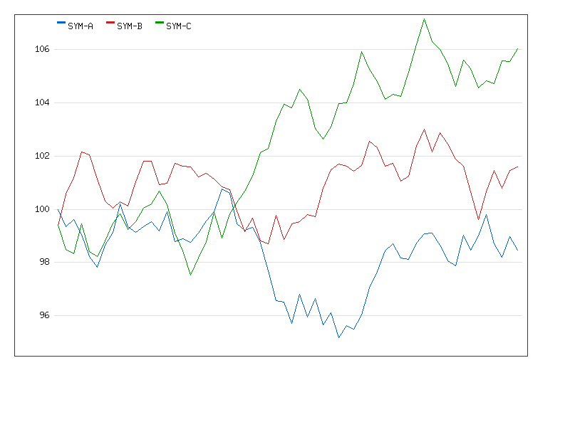
- **Draws/computes:** close-price lines for several symbols overlaid on one
  shared price axis, with a colour legend and a 1/2/5 nice-step grid.
- **API:** `StockOverlayChart(Display*, int screen, Window, GC, SStyle_Manager*, int x, int y, int w, int h)`;
  `add_series(name, series)` (auto colour) or `add_series(name, series, Srgb)`;
  `clear_series()`, `series_count()`, `item_count()`, `close_at(series, i)`.
- **Example:**
  ```cpp
  StockOverlayChart w(display, screen, window, gc, &styles, 20, 20, 720, 480);
  w.add_series("SYM-A", xframe::make_seeded_series(60, 42));
  w.add_series("SYM-B", xframe::make_seeded_series(60, 7));
  w.draw();
  ```
- **Unclear from the header:** symbols with very different price levels share
  one axis, so a low-priced symbol can look flat next to a high-priced one;
  use `StockRelativePerformance` or `StockIndexedComparison` for that case.

### StockMultiSymbolChart

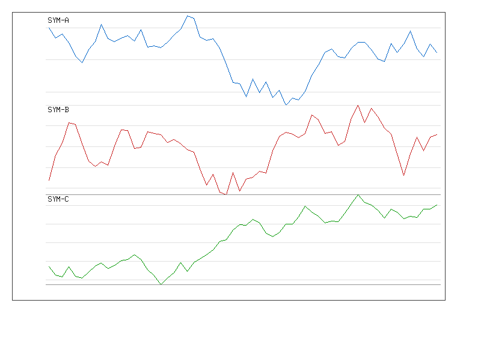
- **Draws/computes:** small-multiple panels — one close-price panel per
  symbol, stacked vertically, each with its own auto y-range.
- **API:** same constructor; `add_series(name, series[, colour])`,
  `clear_series()`, `series_count()`, `item_count()`,
  `panel_close_at(series, i)`.
- **Example:**
  ```cpp
  StockMultiSymbolChart w(display, screen, window, gc, &styles, 20, 20, 720, 480);
  w.add_series("SYM-A", xframe::make_seeded_series(60, 42));
  w.add_series("SYM-B", xframe::make_seeded_series(60, 7));
  w.draw();
  ```
- **Unclear from the header:** panels split the plot height evenly (the last
  panel takes any remainder); there is no per-panel y-axis label, only grid
  lines, so exact values are read from the crosshair position, not the panel.

### StockRelativePerformance


- **Draws/computes:** each symbol rebased to 100 at its first close
  (`close / first_close * 100`); lines show percentage performance vs the
  start, with a horizontal line at 100.
- **API:** same constructor; `add_series(...)`, `rebased(series)` (vector),
  `performance_at(series, i)` (rebased value minus 100).
- **Example:**
  ```cpp
  StockRelativePerformance w(display, screen, window, gc, &styles, 20, 20, 720, 480);
  w.add_series("SYM-A", xframe::make_seeded_series(60, 42));
  double pct = w.performance_at(0, 59);  // % move of SYM-A over the window
  ```
- **Unclear from the header:** the base is always the first bar in the
  series as supplied, not the first *visible* bar after panning/zooming.

### StockSpreadChart

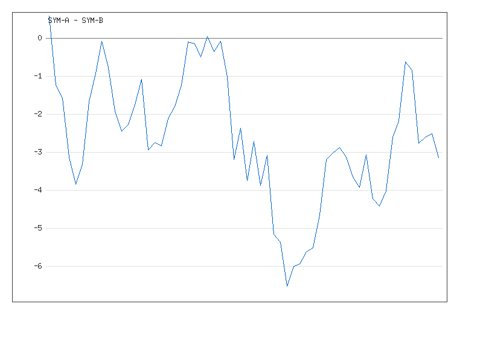
- **Draws/computes:** the price difference `A.close - B.close` (first two
  series, truncated to the shorter length) as a line around a zero line.
- **API:** same constructor; `add_series(...)`, `spread()` (vector),
  `spread_at(i)`, `spread_label()` (`"A - B"`).
- **Example:**
  ```cpp
  StockSpreadChart w(display, screen, window, gc, &styles, 20, 20, 720, 480);
  w.add_series("SYM-A", xframe::make_seeded_series(60, 42));
  w.add_series("SYM-B", xframe::make_seeded_series(60, 7));
  double s = w.spread_at(10);
  w.draw();
  ```
- **Unclear from the header:** only the first two series are used; a third
  series is drawn nowhere and ignored by `spread()`. No z-score or
  normalisation is applied — the spread is in raw price units.

### StockRatioChart

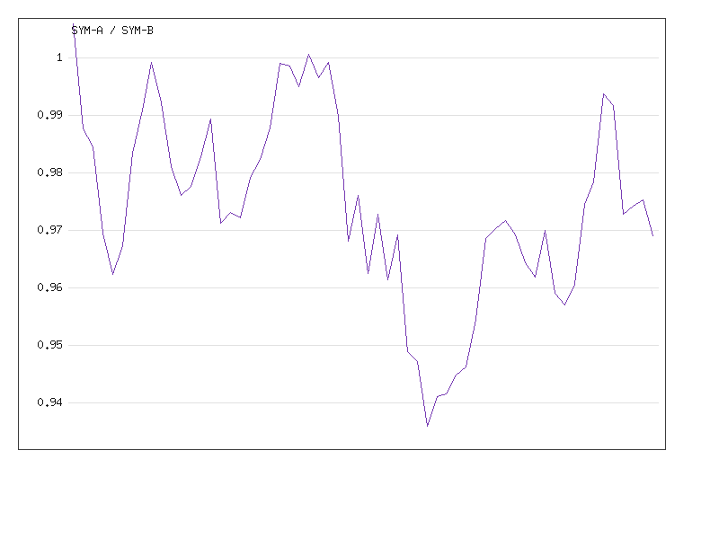
- **Draws/computes:** the price ratio `A.close / B.close` (first two series,
  truncated to the shorter length) as a line.
- **API:** same constructor; `add_series(...)`, `ratio()` (vector),
  `ratio_at(i)`, `ratio_label()` (`"A / B"`).
- **Example:**
  ```cpp
  StockRatioChart w(display, screen, window, gc, &styles, 20, 20, 720, 480);
  w.add_series("SYM-A", xframe::make_seeded_series(60, 42));
  w.add_series("SYM-B", xframe::make_seeded_series(60, 7));
  double r = w.ratio_at(10);
  w.draw();
  ```
- **Unclear from the header:** a zero close in B yields a ratio of 0.0
  rather than an error or a skipped bar; only the first two series are used.

### StockCorrelationView

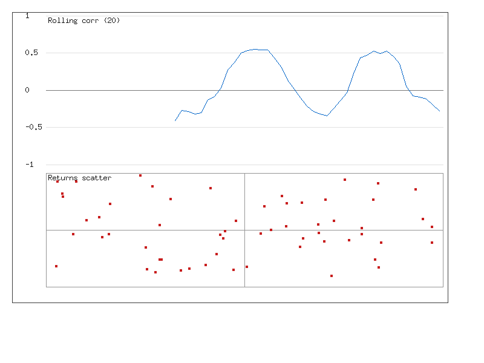
- **Draws/computes:** top panel — rolling Pearson correlation (default
  window 20 bars) between the closes of two symbols, on a fixed −1..+1
  scale with a zero line; bottom panel — scatter of daily returns
  (`(close-prev)/prev`) of A vs B, with cross axes at zero.
- **API:** same constructor; `add_series(...)`, `set_window(w)` /
  `get_window()`, `correlation()` (full-period, on closes),
  `rolling_correlation()` (vector, 0.0 before the window fills),
  `return_scatter()` (vector of `(retA, retB)` pairs).
- **Example:**
  ```cpp
  StockCorrelationView w(display, screen, window, gc, &styles, 20, 20, 720, 480);
  w.add_series("SYM-A", xframe::make_seeded_series(60, 42));
  w.add_series("SYM-B", xframe::make_seeded_series(60, 7));
  double c = w.correlation();
  ```
- **Unclear from the header:** the rolling correlation is computed on raw
  closes, while the scatter uses returns — the two panels deliberately use
  different inputs. The scatter axes are scaled to the largest absolute
  return in either symbol, so the aspect is data-dependent.

### StockIndexedComparison

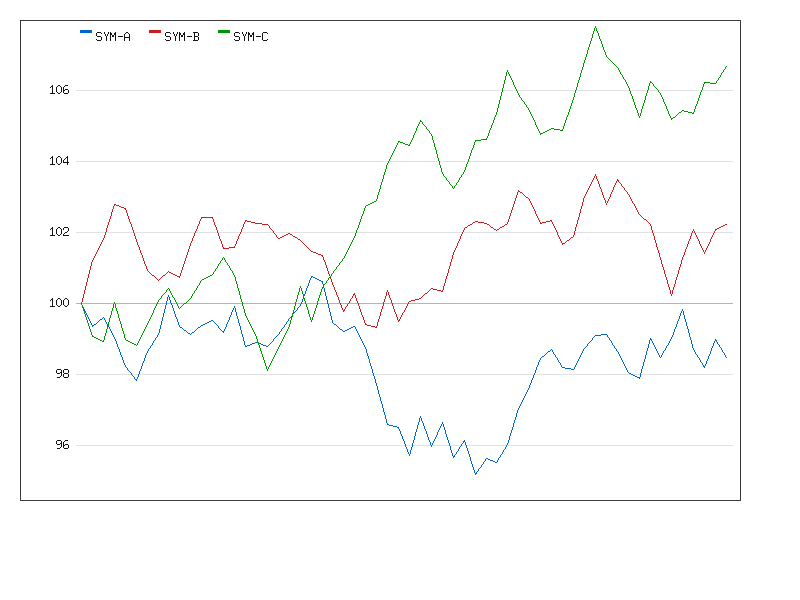
- **Draws/computes:** all symbols indexed to a common base value (default
  100) at their first close, as lines, with a horizontal line at the base.
- **API:** same constructor; `add_series(...)`, `set_base_value(v)` /
  `base_value()`, `indexed(series)` (vector), `indexed_at(series, i)`.
- **Example:**
  ```cpp
  StockIndexedComparison w(display, screen, window, gc, &styles, 20, 20, 720, 480);
  w.add_series("SYM-A", xframe::make_seeded_series(60, 42));
  w.add_series("SYM-B", xframe::make_seeded_series(60, 7));
  w.set_base_value(1000.0);
  w.draw();
  ```
- **Unclear from the header:** this differs from `StockRelativePerformance`
  only in the configurable base value and the absence of the
  `performance_at` helper; the plotted lines are identical when the base
  is 100. Changing the base after construction re-indexes on the next draw.

### StockSectorComparison

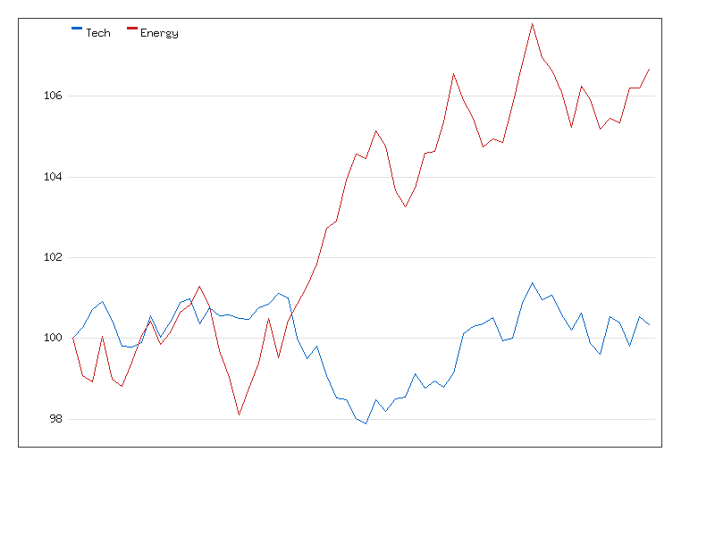
- **Draws/computes:** series grouped by sector label; one line per sector,
  the average of that sector's members each indexed to 100 at its first
  close. Legend shows the sector names.
- **API:** same constructor; `add_series(...)`,
  `set_labels(vector<string>)` (one label per series, in order),
  `labels()`, `sector_names()`, `sector_count()`,
  `sector_indexed(sector)` (average indexed vector).
- **Example:**
  ```cpp
  StockSectorComparison w(display, screen, window, gc, &styles, 20, 20, 720, 480);
  w.add_series("SYM-A", xframe::make_seeded_series(60, 42));
  w.add_series("SYM-B", xframe::make_seeded_series(60, 7));
  w.add_series("SYM-C", xframe::make_seeded_series(60, 99));
  w.set_labels({"Tech", "Tech", "Energy"});
  ```
- **Unclear from the header:** a series with no label (shorter label list)
  is grouped under `"Other"`. The sector line is a simple mean of the
  members' indexed values, not volume- or capitalisation-weighted. The
  "grouped bars" mentioned in the brief are not drawn — the current widget
  draws grouped (per-sector) lines only.

---

## Volume (one OHLCVSeries each)

### StockVolumeBars

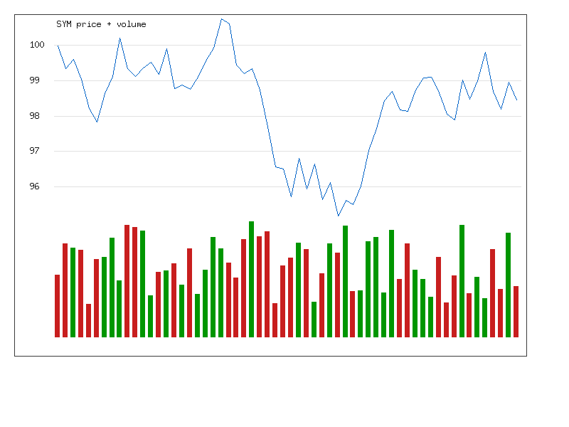
- **Draws/computes:** close-price line in the top ~62% of the plot and
  volume bars in the bottom strip, coloured green when `close >= open`,
  red otherwise.
- **API:** same constructor; `set_series(series)`, `set_symbol(name)` /
  `symbol()`, `volume_at(i)`, `max_volume()`.
- **Example:**
  ```cpp
  StockVolumeBars w(display, screen, window, gc, &styles, 20, 20, 720, 480);
  auto series = xframe::make_seeded_series(60, 42);
  w.set_series(series);
  ```
- **Unclear from the header:** bar height is scaled to the maximum volume
  in the *whole* series, not the visible window, so zooming does not
  rescale the bars.

### StockVWAP

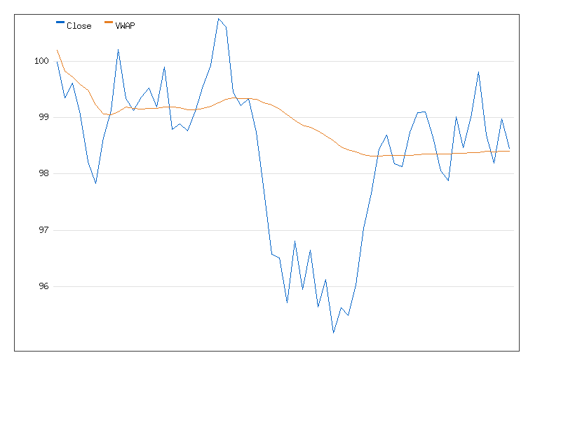
- **Draws/computes:** close price plus the VWAP line, where VWAP is the
  cumulative `sum(typical * volume) / sum(volume)` with typical price
  `(high + low + close) / 3`, anchored at the first bar of the series.
- **API:** same constructor; `set_series(series)`, `vwap()` (vector),
  `vwap_at(i)`.
- **Example:**
  ```cpp
  StockVWAP w(display, screen, window, gc, &styles, 20, 20, 720, 480);
  w.set_series(xframe::make_seeded_series(60, 42));
  double v = w.vwap_at(59);
  w.draw();
  ```
- **Unclear from the header:** VWAP is session-anchored at bar 0 of the
  supplied series — there is no per-day reset and no way to re-anchor it
  other than supplying a shorter series.

### StockVolumeProfile

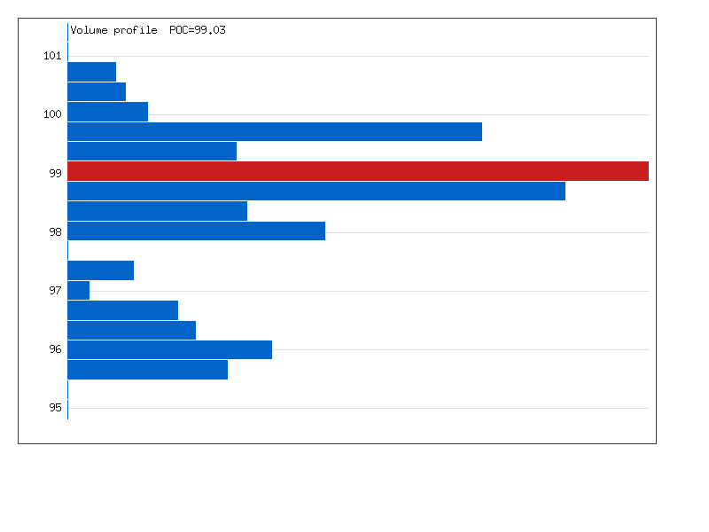
- **Draws/computes:** horizontal volume-by-price histogram: volume
  accumulated into 20 price bins (by typical price) between the series low
  and high; the point of control (highest-volume bin) is drawn in red and
  labelled with its price.
- **API:** same constructor; `set_series(series)`, `set_bins(n)` /
  `get_bins()` (clamped 2..100), `profile()` (vector of bin volumes),
  `poc_bin()`, `poc_price()`.
- **Example:**
  ```cpp
  StockVolumeProfile w(display, screen, window, gc, &styles, 20, 20, 720, 480);
  auto series = xframe::make_seeded_series(60, 42);
  w.set_series(series);
  double poc = w.poc_price();
  ```
- **Unclear from the header:** a bar's whole volume goes into the single
  bin containing its typical price (no splitting across bins); on a tie,
  the lowest bin wins as POC.

### StockOBVChart

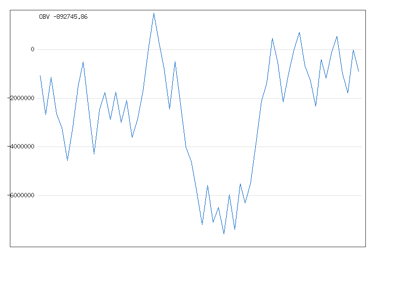
- **Draws/computes:** on-balance volume — cumulative volume, adding the
  bar's volume when `close > open`, subtracting it when `close < open`,
  unchanged on a doji (`close == open`).
- **API:** same constructor; `set_series(series)`, `obv()` (vector),
  `obv_at(i)`.
- **Example:**
  ```cpp
  StockOBVChart w(display, screen, window, gc, &styles, 20, 20, 720, 480);
  w.set_series(xframe::make_seeded_series(60, 42));
  double o = w.obv_at(59);
  w.draw();
  ```
- **Unclear from the header:** OBV starts at 0 at bar 0 (bar 0's own volume
  is included with its sign); it is not normalised or rebased.

### StockVolumeCandles

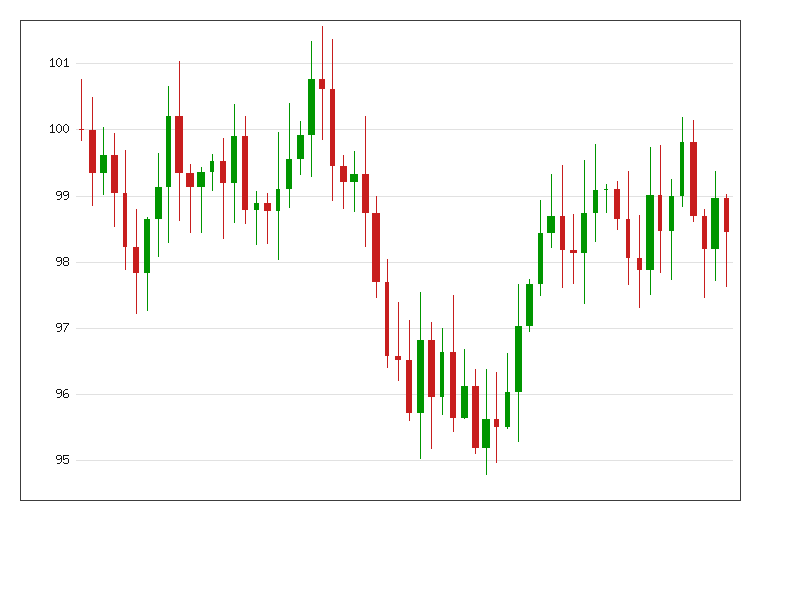
- **Draws/computes:** candlesticks (wick = high–low, body = open–close,
  green up / red down) whose body width encodes volume:
  `width fraction = 0.3 + 0.7 * volume / max_volume`, so the heaviest bar
  is full slot width and the lightest is 30%.
- **API:** same constructor; `set_series(series)`,
  `body_width_at(i)` (the 0.3..1.0 fraction), `max_volume()`.
- **Example:**
  ```cpp
  StockVolumeCandles w(display, screen, window, gc, &styles, 20, 20, 720, 480);
  w.set_series(xframe::make_seeded_series(60, 42));
  double f = w.body_width_at(3);
  w.draw();
  ```
- **Unclear from the header:** the width encodes *relative* volume within
  the supplied series; absolute volume is not shown anywhere.

### StockAccumulationDistribution

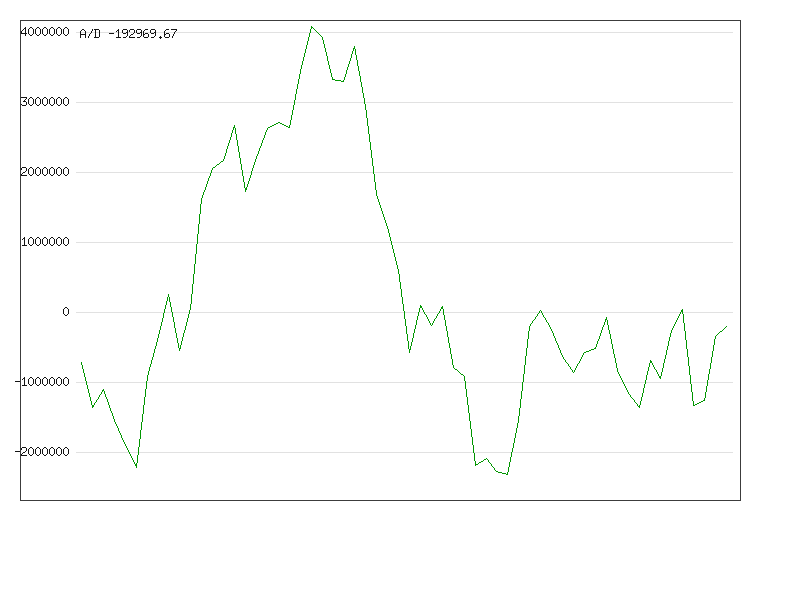
- **Draws/computes:** the accumulation/distribution line — cumulative
  money-flow volume, where each bar contributes
  `CLV * volume` and `CLV = ((close-low) - (high-close)) / (high-low)`.
- **API:** same constructor; `set_series(series)`,
  `accumulation_distribution()` (vector), `ad_at(i)`,
  `clv(bar)` (static helper).
- **Example:**
  ```cpp
  StockAccumulationDistribution w(display, screen, window, gc, &styles, 20, 20, 720, 480);
  w.set_series(xframe::make_seeded_series(60, 42));
  double a = w.ad_at(59);
  w.draw();
  ```
- **Unclear from the header:** a zero-range bar (`high == low`) contributes
  0; the line starts at 0 plus bar 0's contribution, not at bar 0's close.

### StockMoneyFlowChart

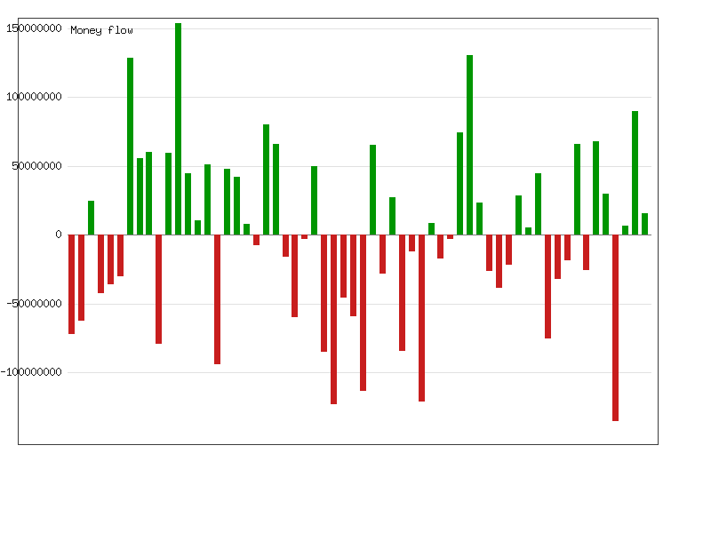
- **Draws/computes:** money-flow volume bars — `CLV * typical * volume`
  per bar (same CLV as A/D), drawn as signed bars from a zero line, green
  for positive flow, red for negative.
- **API:** same constructor; `set_series(series)`,
  `money_flow()` (vector, per-bar values, *not* cumulative),
  `money_flow_at(i)`, `total_money_flow()` (sum over bars),
  `clv(bar)` (static helper).
- **Example:**
  ```cpp
  StockMoneyFlowChart w(display, screen, window, gc, &styles, 20, 20, 720, 480);
  w.set_series(xframe::make_seeded_series(60, 42));
  double m = w.total_money_flow();
  w.draw();
  ```
- **Unclear from the header:** unlike `StockAccumulationDistribution`,
  this widget does *not* cumulate — each bar stands alone. The vertical
  scale is money-flow units (price × volume), not volume, so bar heights
  are not comparable with `StockVolumeBars`.

## Group: Drawing / annotation (14)

## Stock Market — Drawing / Annotation Widgets

XFrame Stock Market section, drawing group (14 widgets). Every widget in
this group takes an `xframe::OHLCVSeries` (see
`widgets/components/StockData.h`, seeded synthetic data only — no network,
no live market data), draws a light candlestick background from it, then
draws its annotation in a strong colour. All are header-only classes in
`widgets/components/<Name>/<Name>.h`, following the `XGraph` pattern
(`Display*` / `screen_` / `window_` / `GC`, geometry, `draw()`,
`on_button_press` / `on_button_release` / `on_motion` / `on_key`).
Demos: `widgets/components/<Name>/main_<Name>.cpp` (800×600 window,
widget at 20,20,720,480, 60 seeded bars, seed 42), `CMakeLists.txt`
(CMake ≥ 3.20, C++17, X11 only).

Common API (all 14): constructor
`(Display*, int screen, Window, GC, SStyle_Manager*, x, y, width, height)`;
`set_series(const xframe::OHLCVSeries&)` (also resets anchors to seeded
defaults); `set_anchors(int bar1, double price1, int bar2, double price2)`;
`set_anchors3(...)` (3 anchors); `set_anchor(int i, int bar, double price)`;
`anchor(int i)` / `anchor_count()`; `set_color(Srgb)` / `get_color()`;
`add_point(int bar, double price)` / `clear_points()` / `point_count()`
(meaningful only for StockBrush); `set_text(std::string)` /
`get_text()`; `reset_anchors()`; `bar_count()`; `draw()`.
Interaction (all 14): left-click moves the nearest anchor to the clicked
bar/price (StockBrush: click adds a point instead); drag moves the
dragged anchor / extends the brush path; arrow keys shift all anchors
(Left/Right ±1 bar, Up/Down ±2% of the price range); `r` / `Home` resets
anchors. Tests: `widgets/tests/test_stock_drawing.py`
(build/draw/hover/click/key/clean-exit per widget, 14/14 PASS, 0 warnings).

## StockTrendline

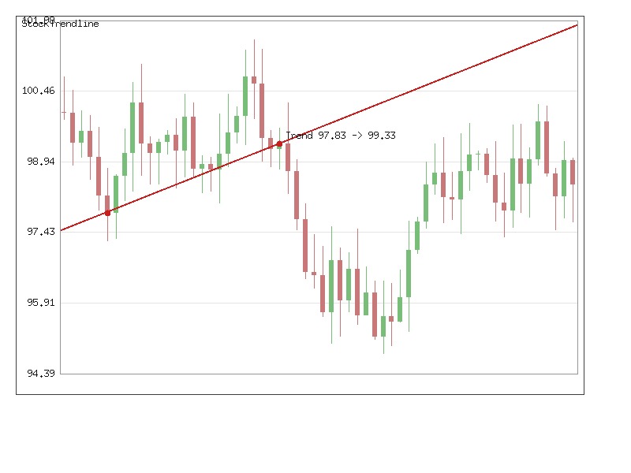

Draws a trend line through two anchors, extended across the full plot
width using the slope between them, with filled circles at both anchors
and a `Trend <p0> -> <p1>` label at the second anchor.

API: `set_anchors(b1, p1, b2, p2)` — the two points the line passes through.

Example:
```cpp
StockTrendline w(display, screen, window, gc, &styles, 20, 20, 720, 480);
auto series = xframe::make_seeded_series(60, 42);
w.set_series(series);
w.set_anchors(5, series[5].close, 25, series[25].close);
w.draw();
```

Unclear from the header: the line is extrapolated to the plot edges, not
clipped to the segment between the anchors; if both anchors share a bar
the slope is treated as 0 (flat line at the first anchor's price).

## StockHorizontalLine

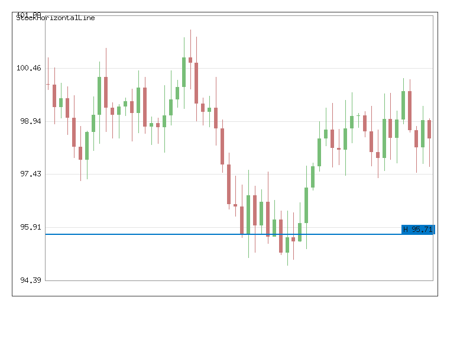

Draws a full-width horizontal line at one price level, with a filled tag
at the right edge showing `H <price>`.

API: `set_anchors(bar, price, bar, price)` — only the first anchor's
price is drawn; the bar indices are stored but ignored.

Example:
```cpp
StockHorizontalLine w(display, screen, window, gc, &styles, 20, 20, 720, 480);
auto series = xframe::make_seeded_series(60, 42);
w.set_series(series);
w.set_anchors(0, series[30].close, 0, series[30].close);
w.draw();
```

Unclear from the header: clicking/dragging moves the line to the clicked
price (the bar component of the move has no visible effect); arrow-key
Left/Right therefore also has no visible effect on this widget.

## StockVerticalLine

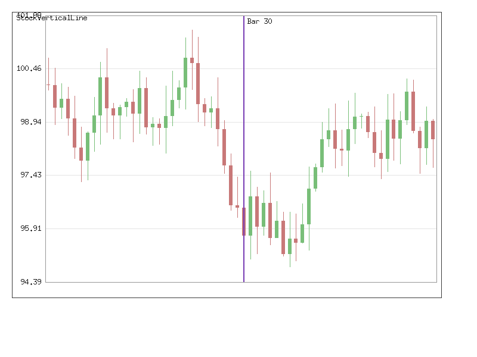

Draws a full-height vertical line at one bar index, labelled
`Bar <n>` at the top.

API: `set_anchors(bar, price, bar, price)` — only the first anchor's bar
is drawn; the prices are stored but ignored.

Example:
```cpp
StockVerticalLine w(display, screen, window, gc, &styles, 20, 20, 720, 480);
auto series = xframe::make_seeded_series(60, 42);
w.set_series(series);
w.set_anchors(30, series[30].close, 30, series[30].close);
w.draw();
```

Unclear from the header: the line is drawn at the centre of the bar's
slot; Up/Down arrow keys (price shift) have no visible effect here.

## StockRectangle

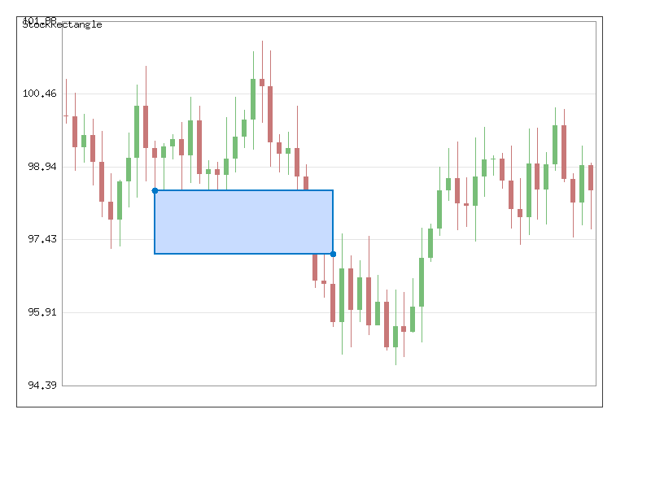

Draws a rectangle between two anchors (bar/price corners), pale-blue
fill with a strong-colour outline, plus filled circles at both corners.

API: `set_anchors(b1, p1, b2, p2)` — opposite corners; order does not
matter, the min/max of each axis is used.

Example:
```cpp
StockRectangle w(display, screen, window, gc, &styles, 20, 20, 720, 480);
auto series = xframe::make_seeded_series(60, 42);
w.set_series(series);
w.set_anchors(10, series[10].low, 30, series[30].high);
w.draw();
```

Unclear from the header: the fill is a fixed pale blue, not the
annotation colour set by `set_color()` (only the outline follows it);
a zero-width or zero-height rectangle still draws a 1 px line.

## StockEllipse

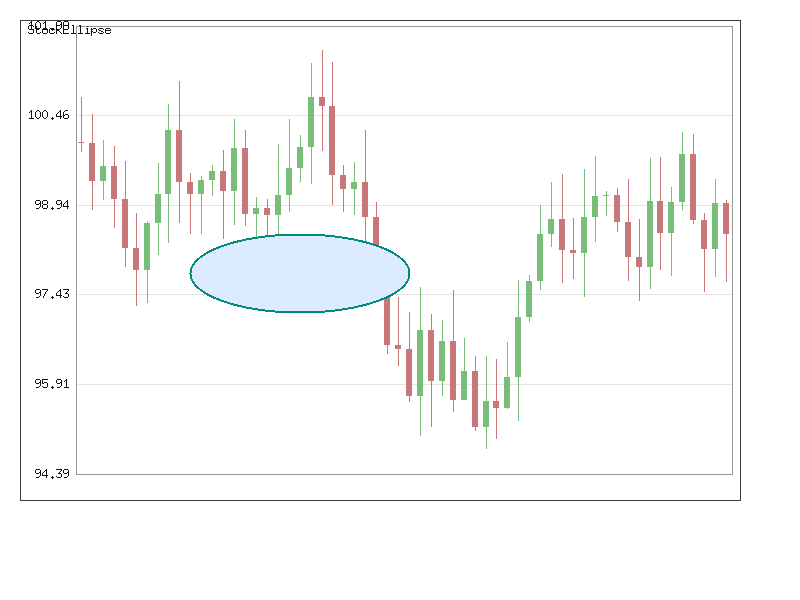

Draws an ellipse inscribed in the rectangle between two anchors,
pale-blue fill with a strong-colour outline.

API: `set_anchors(b1, p1, b2, p2)` — opposite corners of the bounding
box; order does not matter.

Example:
```cpp
StockEllipse w(display, screen, window, gc, &styles, 20, 20, 720, 480);
auto series = xframe::make_seeded_series(60, 42);
w.set_series(series);
w.set_anchors(10, series[10].low, 30, series[30].high);
w.draw();
```

Unclear from the header: same fixed pale-blue fill as StockRectangle;
the ellipse is axis-aligned only (no rotation parameter).

## StockFibRetracement

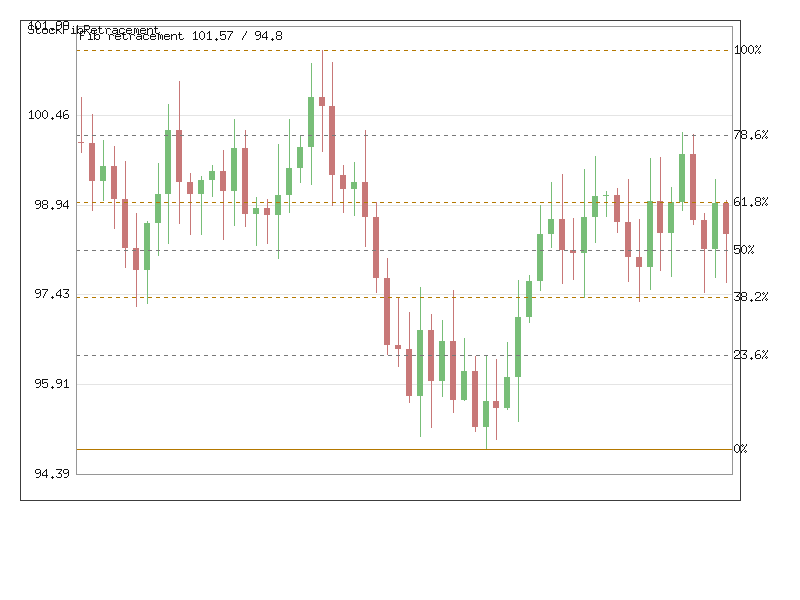

Draws horizontal Fibonacci retracement levels between a high and a low
anchor: 0%, 23.6%, 38.2%, 50%, 61.8%, 78.6%, 100%, each labelled at the
right edge. Alternating levels are dashed.

API: `set_anchors(b_high, high, b_low, low)`; `set_high_low(hi, lo)`;
`level_count()` (= 7); `level_ratio(int i)`; `level_price(int i)`.

Example:
```cpp
StockFibRetracement w(display, screen, window, gc, &styles, 20, 20, 720, 480);
auto series = xframe::make_seeded_series(60, 42);
w.set_series(series);
double hi = series[0].high, lo = series[0].low; for (auto& b : series) { hi = std::max(hi, b.high); lo = std::min(lo, b.low); }
w.set_high_low(hi, lo);  // hi/lo from the series range
w.draw();
```

Unclear from the header: high/low are normalised (swapped if inverted),
so the anchor order does not matter; the anchors' bar indices do not
affect where the levels are drawn (levels span the full plot width);
labels can run past the right plot edge on narrow windows.

## StockFibExtension


Draws horizontal Fibonacci extension levels beyond the anchor range:
0%, 38.2%, 61.8%, 100%, 127.2%, 161.8%, each labelled at the right edge.

API: `set_anchors(b_high, high, b_low, low)`; `set_high_low(hi, lo)`;
`level_count()` (= 6); `level_ratio(int i)`; `level_price(int i)`.
`level_price(i)` returns `low + (high - low) * ratio`, so 127.2% and
161.8% lie beyond the high.

Example:
```cpp
StockFibExtension w(display, screen, window, gc, &styles, 20, 20, 720, 480);
auto series = xframe::make_seeded_series(60, 42);
w.set_series(series);
double hi = series[0].high, lo = series[0].low; for (auto& b : series) { hi = std::max(hi, b.high); lo = std::min(lo, b.low); }
w.set_high_low(hi, lo);
w.draw();
```

Unclear from the header: same normalisation and full-width behaviour as
StockFibRetracement; the 0%/38.2%/61.8%/100% levels duplicate the
retracement levels by design (they are the shared part of the scale).

## StockTextAnnotation

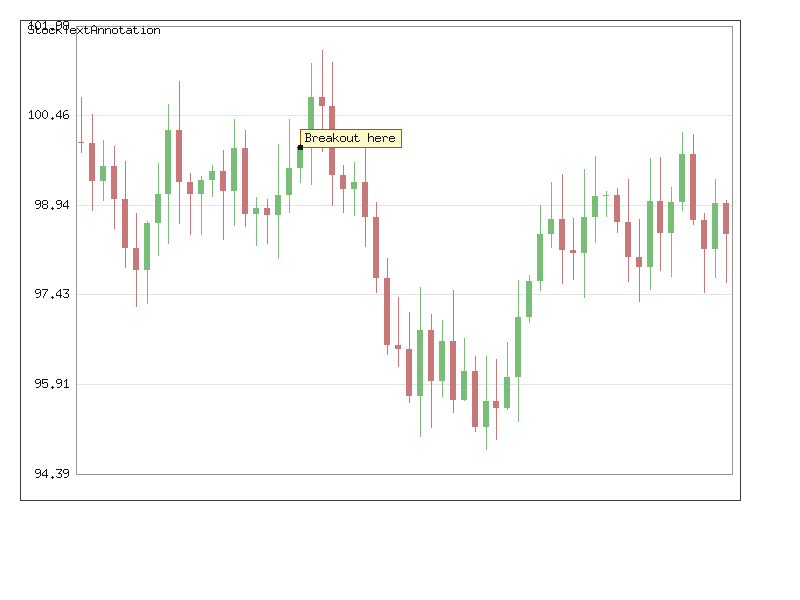

Draws a text note in a pale-yellow box with a strong-colour border,
anchored at one bar/price, with a small dot at the anchor point.

API: `set_anchors(bar, price, bar, price)`; `set_text(std::string)` /
`set_annotation_text(std::string)` / `annotation_text()`.

Example:
```cpp
StockTextAnnotation w(display, screen, window, gc, &styles, 20, 20, 720, 480);
auto series = xframe::make_seeded_series(60, 42);
w.set_series(series);
w.set_anchors(20, series[20].close, 20, series[20].close);
w.set_text("Breakout here");
w.draw();
```

Unclear from the header: `set_text()` and `set_annotation_text()` are
aliases (both set the same text); long text is not wrapped and the box
is not clipped to the plot, so it can overflow the right edge; the box
is drawn to the right and slightly above the anchor.

## StockArrow

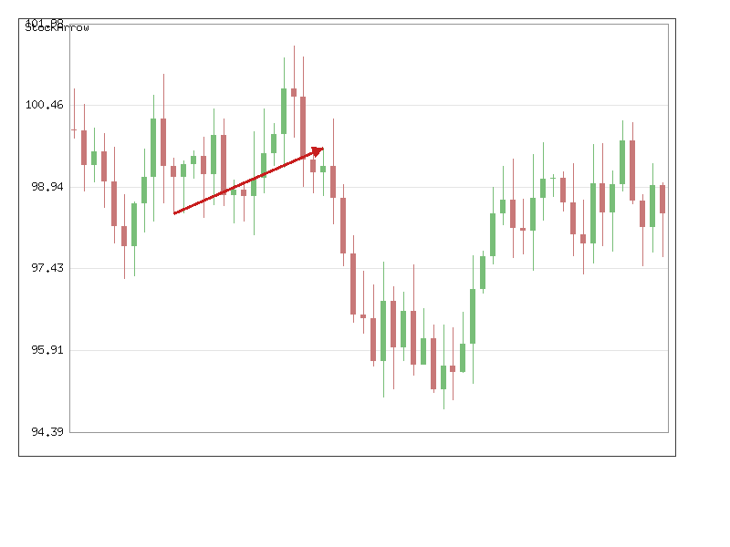

Draws a thick arrow from the first anchor to the second, with a filled
triangular arrowhead at the tip.

API: `set_anchors(b1, p1, b2, p2)` — tail and tip.

Example:
```cpp
StockArrow w(display, screen, window, gc, &styles, 20, 20, 720, 480);
auto series = xframe::make_seeded_series(60, 42);
w.set_series(series);
w.set_anchors(10, series[10].low, 25, series[25].high);
w.draw();
```

Unclear from the header: the arrowhead size is fixed (14 px) regardless
of arrow length or zoom; a zero-length arrow (same anchor twice) draws
only the head.

## StockParallelChannel

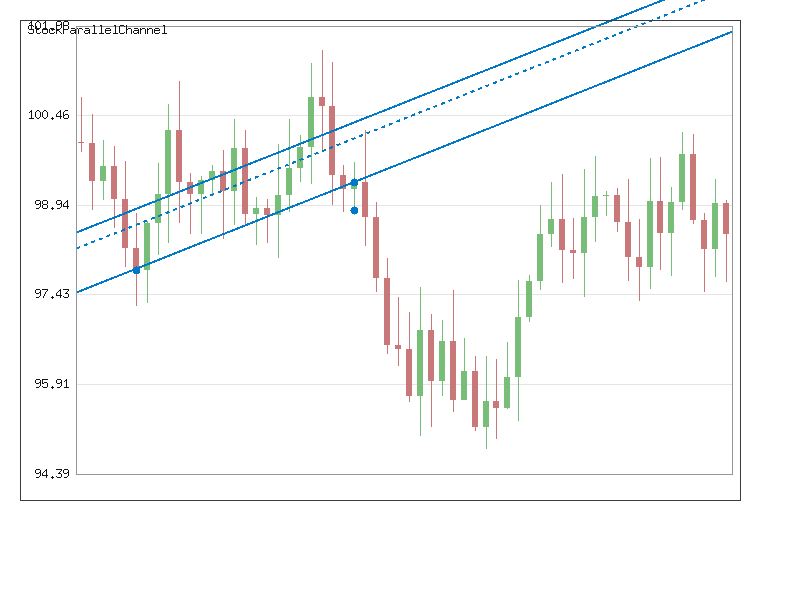

Draws three parallel lines: a solid line through the first two anchors,
a dashed mid-line halfway between them, and a second solid line offset
from the first by the third anchor's price.

API: `set_anchors(b1, p1, b2, p2)` plus `set_anchor(2, bar, offset_price)`.

Example:
```cpp
StockParallelChannel w(display, screen, window, gc, &styles, 20, 20, 720, 480);
auto series = xframe::make_seeded_series(60, 42);
w.set_series(series);
w.set_anchors(5, series[5].close, 25, series[25].close);
w.set_anchor(2, 25, series[5].close + 5.0);
w.draw();
```

Unclear from the header: the offset is interpreted as the parallel
line's price at the *first* anchor's bar (the line shares the slope of
the first two anchors); the third anchor's bar index is stored but does
not move the line. All three lines extend across the full plot width.

## StockPitchfork

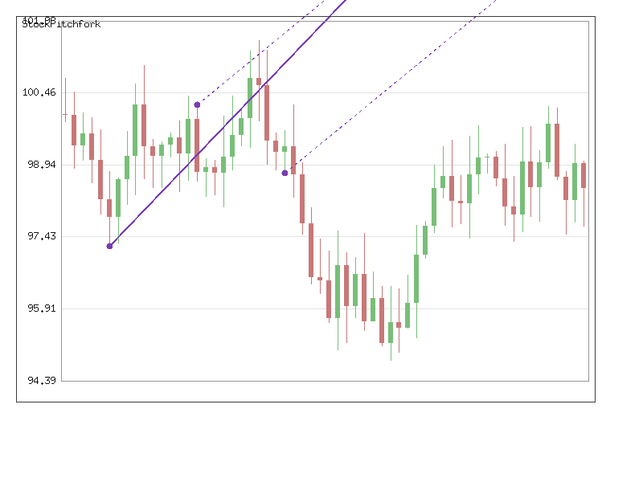

Draws an Andrews pitchfork from three pivots: a solid median line from
the first pivot through the midpoint of pivots 2 and 3, extended to the
right edge, plus dashed parallel lines through pivots 2 and 3 with the
same slope.

API: `set_anchors3(b1, p1, b2, p2, b3, p3)` or
`set_pivots(b1, p1, b2, p2, b3, p3)` (aliases).

Example:
```cpp
StockPitchfork w(display, screen, window, gc, &styles, 20, 20, 720, 480);
auto series = xframe::make_seeded_series(60, 42);
w.set_series(series);
w.set_pivots(5, series[5].low, 15, series[15].high, 25, series[25].low);
w.draw();
```

Unclear from the header: the lines are only drawn from each pivot to
the right edge (no extension to the left); if the midpoint of pivots 2
and 3 shares the first pivot's bar, the slope division is guarded and
the median line is drawn flat.

## StockBrush

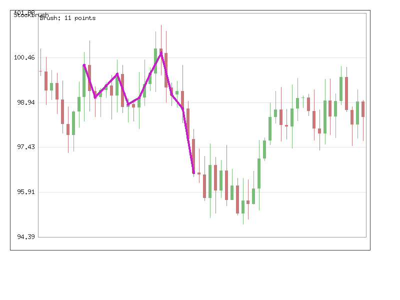

Draws a freehand highlight path through stored (bar, price) points: a
thick polyline with a dot at each point, plus a `Brush: <n> points`
label. Clicking adds a point; dragging extends the path.

API: `add_point(int bar, double price)`; `clear_points()`;
`point_count()`.

Example:
```cpp
StockBrush w(display, screen, window, gc, &styles, 20, 20, 720, 480);
auto series = xframe::make_seeded_series(60, 42);
w.set_series(series);
w.clear_points();
for (int i = 8; i <= 28; i += 2) w.add_point(i, series[i].close);
w.draw();
```

Unclear from the header: there is no erase/undo — points can only be
removed all at once with `clear_points()`; `set_series()` reseeds a
default path (bars 8–20 step 2); the two anchors are unused by the
drawing (arrow keys move them with no visible effect); a single point
draws only its dot, no line.

## StockPriceLabel

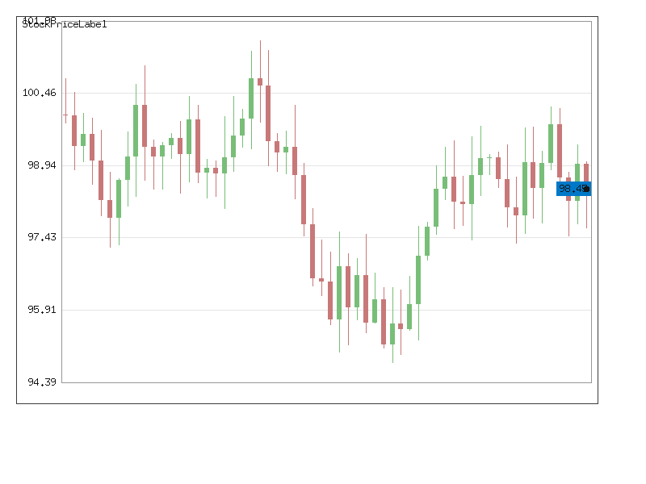

Draws a dashed connector from an anchor bar/price to the right edge,
ending in a filled tag showing the price.

API: `set_anchors(bar, price, bar, price)` — only the first anchor is used.

Example:
```cpp
StockPriceLabel w(display, screen, window, gc, &styles, 20, 20, 720, 480);
auto series = xframe::make_seeded_series(60, 42);
w.set_series(series);
w.set_anchors(59, series[59].close, 59, series[59].close);
w.draw();
```

Unclear from the header: the tag is drawn over the plot's right margin
and can overlap the axis area on narrow windows; the tag text is the
price only (no symbol or bar label).

## StockMeasureTool

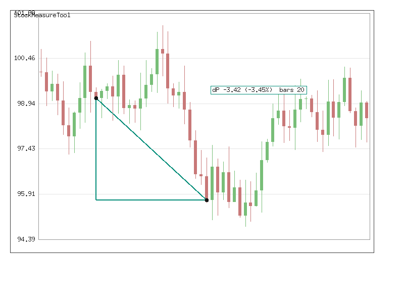

Draws a line between two anchors with a right-angle projection, and a
box showing the measurement: `dP <diff> (<pct>%)  bars <n>`.

API: `set_anchors(b1, p1, b2, p2)`; `price_diff()`; `bar_diff()`;
`pct_diff()` (percent of the first anchor's price).

Example:
```cpp
StockMeasureTool w(display, screen, window, gc, &styles, 20, 20, 720, 480);
auto series = xframe::make_seeded_series(60, 42);
w.set_series(series);
w.set_anchors(10, series[10].close, 30, series[30].close);
w.draw();
// w.price_diff(), w.bar_diff(), w.pct_diff()
```

Unclear from the header: differences are signed (reversed anchors give
negative values); `pct_diff()` returns 0 if the first anchor's price is
0; the info box is placed above the higher anchor and clamped into the
plot, so it can overlap the line on short measurements.

## Group: Indicators — trend (85)

## Stock Market indicators — trend (85)
Trend indicators for the XFrame Stock Market section. Every compute function returns a vector the same length as its input; leading warm-up bars are NaN until enough bars exist. Demos and tests run on deterministic seeded synthetic data (`xframe::make_seeded_series`), never live market data. Attribution: XFrame.
## SMA (`IndSMA`)

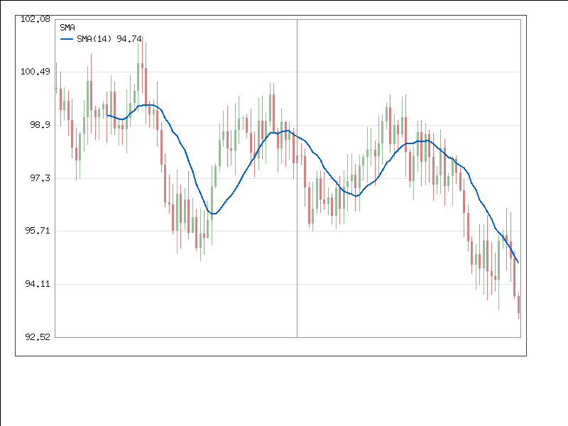

**Formula:** arithmetic mean of the last period closes.

**API:** `std::vector<double> ind_sma(const std::vector<double>& closes, int period)`; widget `IndSMA(Display*, int screen, Window, GC, SStyle_Manager*, int x, int y, int width, int height, const OHLCVSeries& series, int period = 14)`; draw style: overlay (overlay draws over a light candle background, pane draws its own subplot with an axis). Key methods: `draw()`, `on_click(x, y)`, `on_button_press(x, y, button)`, `on_button_release(x, y, button)`, `on_motion(x, y)`, `on_key(key, str)`, `line(i)`, `line_count()`, `is_pane()`.

**Example:**

```cpp
#include "IndSMA.h"
auto series = xframe::make_seeded_series(250, 42);
auto values = xframe::ind_sma(xframe::series_closes(series), 14);
```

## EMA (`IndEMA`)


**Formula:** exponentially weighted mean, k=2/(period+1), seeded with the first SMA.

**API:** `std::vector<double> ind_ema(const std::vector<double>& closes, int period)`; widget `IndEMA(Display*, int screen, Window, GC, SStyle_Manager*, int x, int y, int width, int height, const OHLCVSeries& series, int period = 14)`; draw style: overlay (overlay draws over a light candle background, pane draws its own subplot with an axis). Key methods: `draw()`, `on_click(x, y)`, `on_button_press(x, y, button)`, `on_button_release(x, y, button)`, `on_motion(x, y)`, `on_key(key, str)`, `line(i)`, `line_count()`, `is_pane()`.

**Example:**

```cpp
#include "IndEMA.h"
auto series = xframe::make_seeded_series(250, 42);
auto values = xframe::ind_ema(xframe::series_closes(series), 14);
```

## WMA (`IndWMA`)

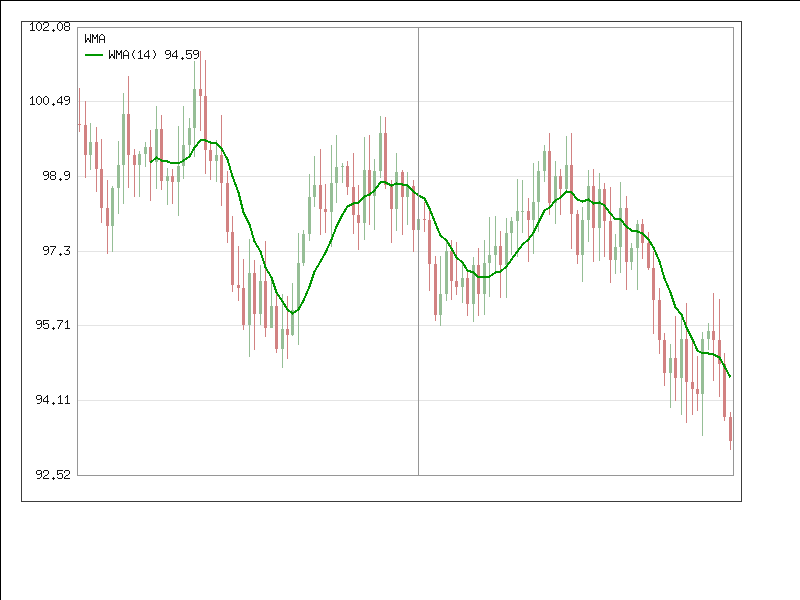

**Formula:** linearly weighted mean, weights 1..period with the newest bar heaviest.

**API:** `std::vector<double> ind_wma(const std::vector<double>& closes, int period)`; widget `IndWMA(Display*, int screen, Window, GC, SStyle_Manager*, int x, int y, int width, int height, const OHLCVSeries& series, int period = 14)`; draw style: overlay (overlay draws over a light candle background, pane draws its own subplot with an axis). Key methods: `draw()`, `on_click(x, y)`, `on_button_press(x, y, button)`, `on_button_release(x, y, button)`, `on_motion(x, y)`, `on_key(key, str)`, `line(i)`, `line_count()`, `is_pane()`.

**Example:**

```cpp
#include "IndWMA.h"
auto series = xframe::make_seeded_series(250, 42);
auto values = xframe::ind_wma(xframe::series_closes(series), 14);
```

## DEMA (`IndDEMA`)

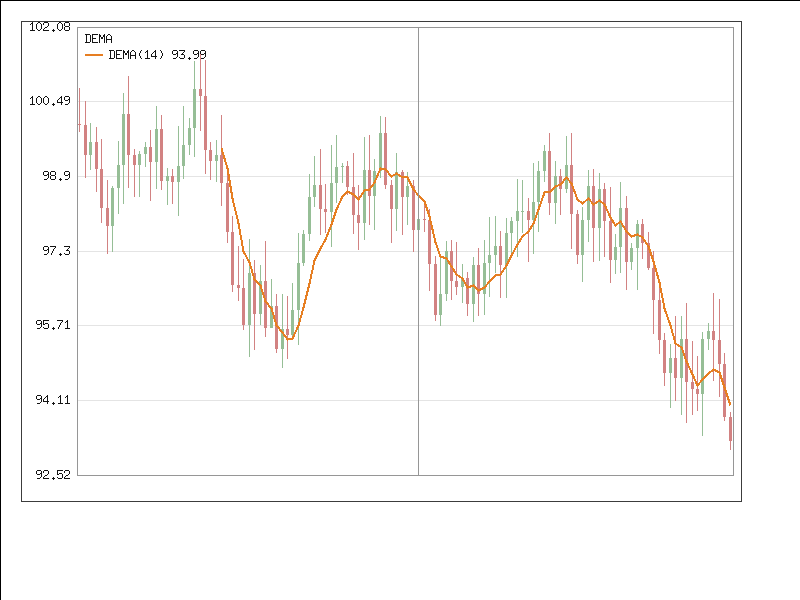

**Formula:** double exponential moving average, 2*EMA - EMA(EMA).

**API:** `std::vector<double> ind_dema(const std::vector<double>& closes, int period)`; widget `IndDEMA(Display*, int screen, Window, GC, SStyle_Manager*, int x, int y, int width, int height, const OHLCVSeries& series, int period = 14)`; draw style: overlay (overlay draws over a light candle background, pane draws its own subplot with an axis). Key methods: `draw()`, `on_click(x, y)`, `on_button_press(x, y, button)`, `on_button_release(x, y, button)`, `on_motion(x, y)`, `on_key(key, str)`, `line(i)`, `line_count()`, `is_pane()`.

**Example:**

```cpp
#include "IndDEMA.h"
auto series = xframe::make_seeded_series(250, 42);
auto values = xframe::ind_dema(xframe::series_closes(series), 14);
```

## TEMA (`IndTEMA`)

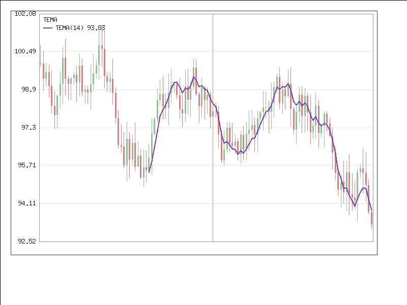

**Formula:** triple exponential moving average, 3*EMA - 3*EMA(EMA) + EMA(EMA(EMA)).

**API:** `std::vector<double> ind_tema(const std::vector<double>& closes, int period)`; widget `IndTEMA(Display*, int screen, Window, GC, SStyle_Manager*, int x, int y, int width, int height, const OHLCVSeries& series, int period = 14)`; draw style: overlay (overlay draws over a light candle background, pane draws its own subplot with an axis). Key methods: `draw()`, `on_click(x, y)`, `on_button_press(x, y, button)`, `on_button_release(x, y, button)`, `on_motion(x, y)`, `on_key(key, str)`, `line(i)`, `line_count()`, `is_pane()`.

**Example:**

```cpp
#include "IndTEMA.h"
auto series = xframe::make_seeded_series(250, 42);
auto values = xframe::ind_tema(xframe::series_closes(series), 14);
```

## TRIMA (`IndTRIMA`)

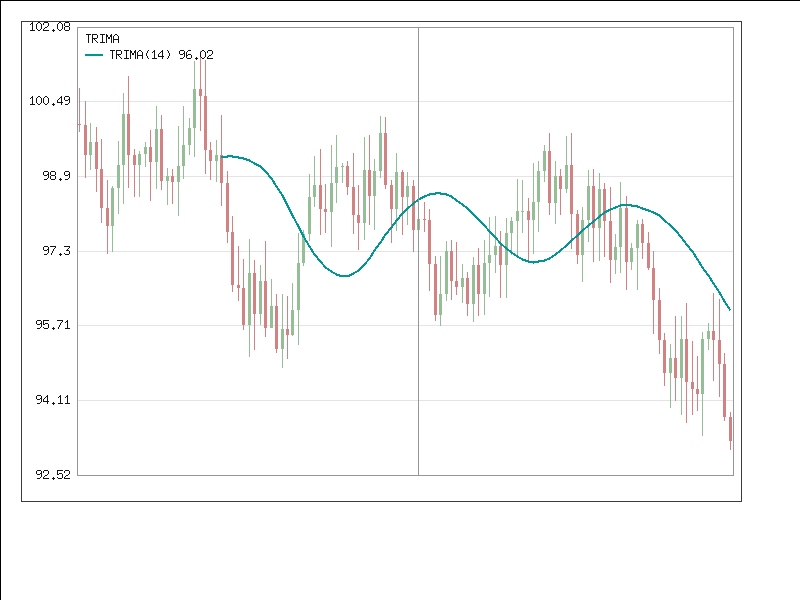

**Formula:** triangular moving average, SMA of the SMA over the same period.

**API:** `std::vector<double> ind_trima(const std::vector<double>& closes, int period)`; widget `IndTRIMA(Display*, int screen, Window, GC, SStyle_Manager*, int x, int y, int width, int height, const OHLCVSeries& series, int period = 14)`; draw style: overlay (overlay draws over a light candle background, pane draws its own subplot with an axis). Key methods: `draw()`, `on_click(x, y)`, `on_button_press(x, y, button)`, `on_button_release(x, y, button)`, `on_motion(x, y)`, `on_key(key, str)`, `line(i)`, `line_count()`, `is_pane()`.

**Example:**

```cpp
#include "IndTRIMA.h"
auto series = xframe::make_seeded_series(250, 42);
auto values = xframe::ind_trima(xframe::series_closes(series), 14);
```

## KAMA (`IndKAMA`)


**Formula:** Kaufman adaptive moving average, smoothing constant from the efficiency ratio.

**API:** `std::vector<double> ind_kama(const std::vector<double>& closes, int period, int fast, int slow)`; widget `IndKAMA(Display*, int screen, Window, GC, SStyle_Manager*, int x, int y, int width, int height, const OHLCVSeries& series, int period = 10, int fast = 2, int slow = 30)`; draw style: overlay (overlay draws over a light candle background, pane draws its own subplot with an axis). Key methods: `draw()`, `on_click(x, y)`, `on_button_press(x, y, button)`, `on_button_release(x, y, button)`, `on_motion(x, y)`, `on_key(key, str)`, `line(i)`, `line_count()`, `is_pane()`.

**Example:**

```cpp
#include "IndKAMA.h"
auto series = xframe::make_seeded_series(250, 42);
auto values = xframe::ind_kama(xframe::series_closes(series), 10, 2, 30);
```

## HMA (`IndHMA`)

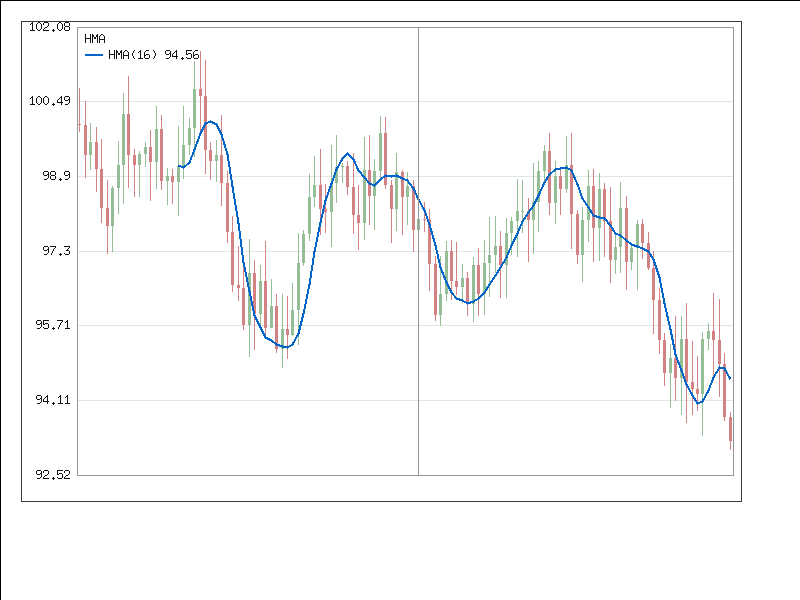

**Formula:** Hull moving average, WMA of 2*WMA(period/2) - WMA(period) with window sqrt(period).

**API:** `std::vector<double> ind_hma(const std::vector<double>& closes, int period)`; widget `IndHMA(Display*, int screen, Window, GC, SStyle_Manager*, int x, int y, int width, int height, const OHLCVSeries& series, int period = 16)`; draw style: overlay (overlay draws over a light candle background, pane draws its own subplot with an axis). Key methods: `draw()`, `on_click(x, y)`, `on_button_press(x, y, button)`, `on_button_release(x, y, button)`, `on_motion(x, y)`, `on_key(key, str)`, `line(i)`, `line_count()`, `is_pane()`.

**Example:**

```cpp
#include "IndHMA.h"
auto series = xframe::make_seeded_series(250, 42);
auto values = xframe::ind_hma(xframe::series_closes(series), 16);
```

## VWMA (`IndVWMA`)

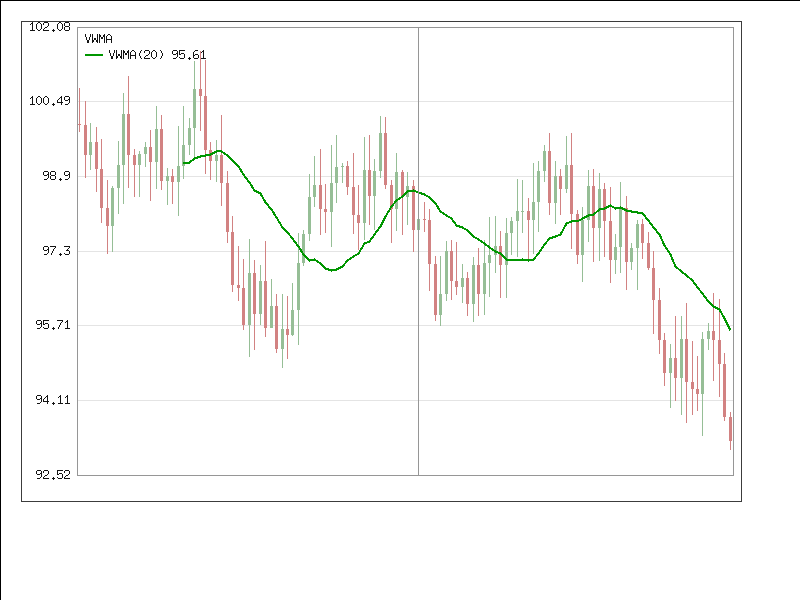

**Formula:** volume-weighted moving average, sum(close*volume)/sum(volume).

**API:** `std::vector<double> ind_vwma(const OHLCVSeries& series, int period)`; widget `IndVWMA(Display*, int screen, Window, GC, SStyle_Manager*, int x, int y, int width, int height, const OHLCVSeries& series, int period = 20)`; draw style: overlay (overlay draws over a light candle background, pane draws its own subplot with an axis). Key methods: `draw()`, `on_click(x, y)`, `on_button_press(x, y, button)`, `on_button_release(x, y, button)`, `on_motion(x, y)`, `on_key(key, str)`, `line(i)`, `line_count()`, `is_pane()`.

**Example:**

```cpp
#include "IndVWMA.h"
auto series = xframe::make_seeded_series(250, 42);
auto values = xframe::ind_vwma(series, 20);
```

## ALMA (`IndALMA`)


**Formula:** Arnaud Legoux moving average, Gaussian-weighted mean with offset 0.85 and sigma 6.

**API:** `std::vector<double> ind_alma(const std::vector<double>& closes, int period, double offset, double sigma)`; widget `IndALMA(Display*, int screen, Window, GC, SStyle_Manager*, int x, int y, int width, int height, const OHLCVSeries& series, int period = 9, double offset = 0.85, double sigma = 6.0)`; draw style: overlay (overlay draws over a light candle background, pane draws its own subplot with an axis). Key methods: `draw()`, `on_click(x, y)`, `on_button_press(x, y, button)`, `on_button_release(x, y, button)`, `on_motion(x, y)`, `on_key(key, str)`, `line(i)`, `line_count()`, `is_pane()`.

**Example:**

```cpp
#include "IndALMA.h"
auto series = xframe::make_seeded_series(250, 42);
auto values = xframe::ind_alma(xframe::series_closes(series), 9, 0.85, 6.0);
```

## ZLEMA (`IndZLEMA`)

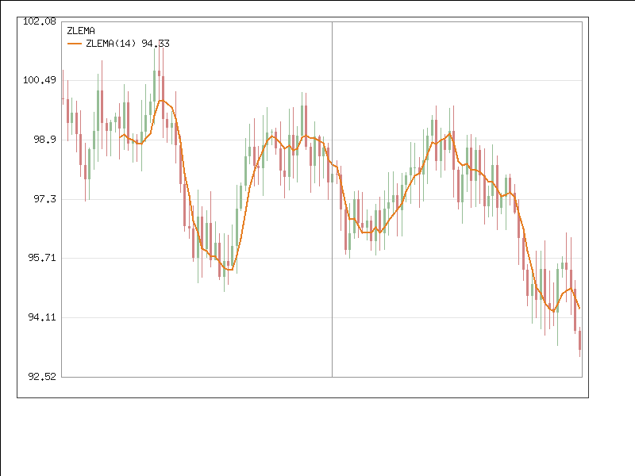

**Formula:** zero-lag exponential moving average, EMA of price plus price minus price lag bars ago.

**API:** `std::vector<double> ind_zlema(const std::vector<double>& closes, int period)`; widget `IndZLEMA(Display*, int screen, Window, GC, SStyle_Manager*, int x, int y, int width, int height, const OHLCVSeries& series, int period = 14)`; draw style: overlay (overlay draws over a light candle background, pane draws its own subplot with an axis). Key methods: `draw()`, `on_click(x, y)`, `on_button_press(x, y, button)`, `on_button_release(x, y, button)`, `on_motion(x, y)`, `on_key(key, str)`, `line(i)`, `line_count()`, `is_pane()`.

**Example:**

```cpp
#include "IndZLEMA.h"
auto series = xframe::make_seeded_series(250, 42);
auto values = xframe::ind_zlema(xframe::series_closes(series), 14);
```

## LSMA (`IndLSMA`)

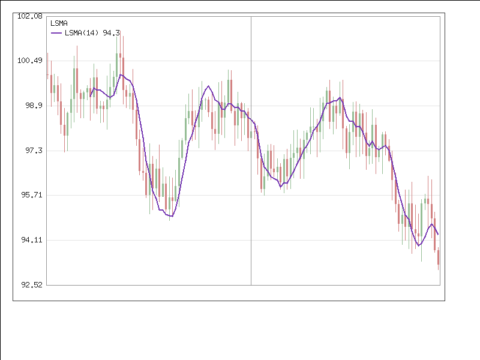

**Formula:** least-squares moving average, endpoint value of the linear-regression line over the window.

**API:** `std::vector<double> ind_lsma(const std::vector<double>& closes, int period)`; widget `IndLSMA(Display*, int screen, Window, GC, SStyle_Manager*, int x, int y, int width, int height, const OHLCVSeries& series, int period = 14)`; draw style: overlay (overlay draws over a light candle background, pane draws its own subplot with an axis). Key methods: `draw()`, `on_click(x, y)`, `on_button_press(x, y, button)`, `on_button_release(x, y, button)`, `on_motion(x, y)`, `on_key(key, str)`, `line(i)`, `line_count()`, `is_pane()`.

**Example:**

```cpp
#include "IndLSMA.h"
auto series = xframe::make_seeded_series(250, 42);
auto values = xframe::ind_lsma(xframe::series_closes(series), 14);
```

## SMMA (`IndSMMA`)

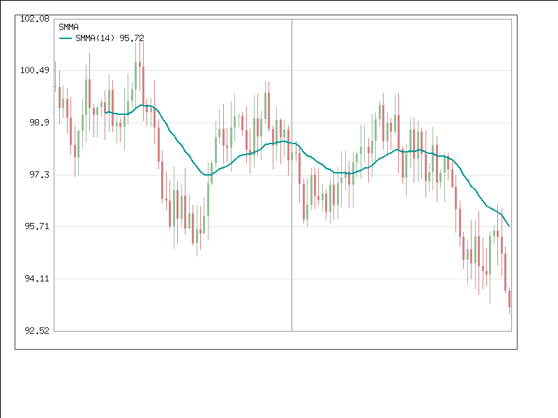

**Formula:** smoothed moving average, Wilder smoothing seeded with the first SMA.

**API:** `std::vector<double> ind_smma(const std::vector<double>& closes, int period)`; widget `IndSMMA(Display*, int screen, Window, GC, SStyle_Manager*, int x, int y, int width, int height, const OHLCVSeries& series, int period = 14)`; draw style: overlay (overlay draws over a light candle background, pane draws its own subplot with an axis). Key methods: `draw()`, `on_click(x, y)`, `on_button_press(x, y, button)`, `on_button_release(x, y, button)`, `on_motion(x, y)`, `on_key(key, str)`, `line(i)`, `line_count()`, `is_pane()`.

**Example:**

```cpp
#include "IndSMMA.h"
auto series = xframe::make_seeded_series(250, 42);
auto values = xframe::ind_smma(xframe::series_closes(series), 14);
```

## RMA (`IndRMA`)

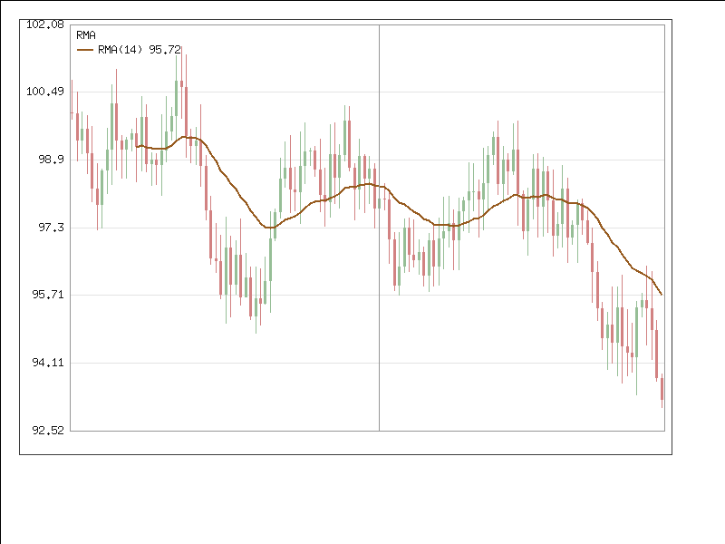

**Formula:** Wilder relative moving average, EMA with alpha 1/period seeded with the first SMA.

**API:** `std::vector<double> ind_rma(const std::vector<double>& closes, int period)`; widget `IndRMA(Display*, int screen, Window, GC, SStyle_Manager*, int x, int y, int width, int height, const OHLCVSeries& series, int period = 14)`; draw style: overlay (overlay draws over a light candle background, pane draws its own subplot with an axis). Key methods: `draw()`, `on_click(x, y)`, `on_button_press(x, y, button)`, `on_button_release(x, y, button)`, `on_motion(x, y)`, `on_key(key, str)`, `line(i)`, `line_count()`, `is_pane()`.

**Example:**

```cpp
#include "IndRMA.h"
auto series = xframe::make_seeded_series(250, 42);
auto values = xframe::ind_rma(xframe::series_closes(series), 14);
```

## MAMA (`IndMAMA`)

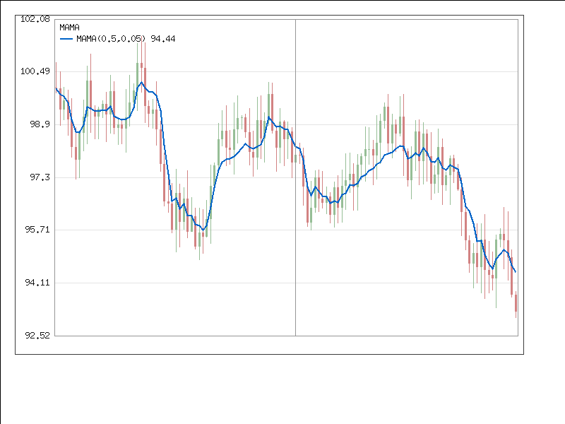

**Formula:** Ehlers MESA adaptive moving average, alpha from the detrended phase, clamped to slow/fast limits.

**API:** `std::vector<double> ind_mama(const std::vector<double>& closes, double fastlimit, double slowlimit)`; widget `IndMAMA(Display*, int screen, Window, GC, SStyle_Manager*, int x, int y, int width, int height, const OHLCVSeries& series, double fastlimit = 0.5, double slowlimit = 0.05)`; draw style: overlay (overlay draws over a light candle background, pane draws its own subplot with an axis). Key methods: `draw()`, `on_click(x, y)`, `on_button_press(x, y, button)`, `on_button_release(x, y, button)`, `on_motion(x, y)`, `on_key(key, str)`, `line(i)`, `line_count()`, `is_pane()`.

**Example:**

```cpp
#include "IndMAMA.h"
auto series = xframe::make_seeded_series(250, 42);
auto values = xframe::ind_mama(xframe::series_closes(series), 0.5, 0.05);
```

**Unclear from the header:** Simplified Ehlers MAMA: the detrender/phase stage uses a fixed-period approximation rather than the full adaptive-period measurement, so values track the published MAMA but are not bit-identical to TA-Lib.

## FAMA (`IndFAMA`)

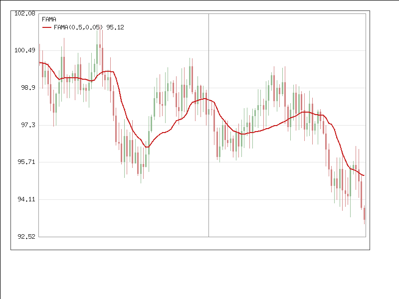

**Formula:** Ehlers following adaptive moving average, slow EMA-style smoothing of MAMA.

**API:** `std::vector<double> ind_fama(const std::vector<double>& closes, double fastlimit, double slowlimit)`; widget `IndFAMA(Display*, int screen, Window, GC, SStyle_Manager*, int x, int y, int width, int height, const OHLCVSeries& series, double fastlimit = 0.5, double slowlimit = 0.05)`; draw style: overlay (overlay draws over a light candle background, pane draws its own subplot with an axis). Key methods: `draw()`, `on_click(x, y)`, `on_button_press(x, y, button)`, `on_button_release(x, y, button)`, `on_motion(x, y)`, `on_key(key, str)`, `line(i)`, `line_count()`, `is_pane()`.

**Example:**

```cpp
#include "IndFAMA.h"
auto series = xframe::make_seeded_series(250, 42);
auto values = xframe::ind_fama(xframe::series_closes(series), 0.5, 0.05);
```

**Unclear from the header:** FAMA smooths MAMA with half the MAMA alpha at each bar, as published.

## FRAMA (`IndFRAMA`)

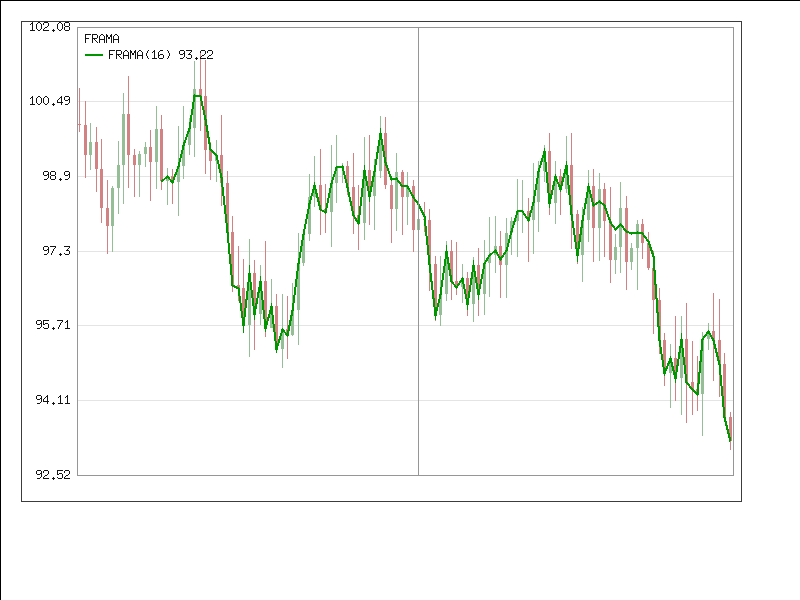

**Formula:** fractal adaptive moving average, alpha from the fractal dimension of the window.

**API:** `std::vector<double> ind_frama(const std::vector<double>& closes, int period)`; widget `IndFRAMA(Display*, int screen, Window, GC, SStyle_Manager*, int x, int y, int width, int height, const OHLCVSeries& series, int period = 16)`; draw style: overlay (overlay draws over a light candle background, pane draws its own subplot with an axis). Key methods: `draw()`, `on_click(x, y)`, `on_button_press(x, y, button)`, `on_button_release(x, y, button)`, `on_motion(x, y)`, `on_key(key, str)`, `line(i)`, `line_count()`, `is_pane()`.

**Example:**

```cpp
#include "IndFRAMA.h"
auto series = xframe::make_seeded_series(250, 42);
auto values = xframe::ind_frama(xframe::series_closes(series), 16);
```

## VIDYA (`IndVIDYA`)

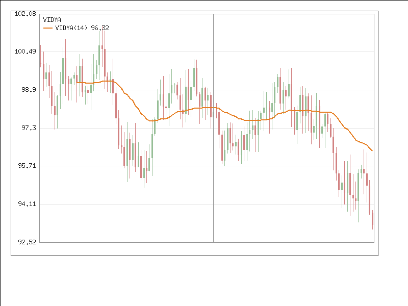

**Formula:** variable index dynamic average, Chande momentum oscillator scaled EMA alpha.

**API:** `std::vector<double> ind_vidya(const std::vector<double>& closes, int period)`; widget `IndVIDYA(Display*, int screen, Window, GC, SStyle_Manager*, int x, int y, int width, int height, const OHLCVSeries& series, int period = 14)`; draw style: overlay (overlay draws over a light candle background, pane draws its own subplot with an axis). Key methods: `draw()`, `on_click(x, y)`, `on_button_press(x, y, button)`, `on_button_release(x, y, button)`, `on_motion(x, y)`, `on_key(key, str)`, `line(i)`, `line_count()`, `is_pane()`.

**Example:**

```cpp
#include "IndVIDYA.h"
auto series = xframe::make_seeded_series(250, 42);
auto values = xframe::ind_vidya(xframe::series_closes(series), 14);
```

## T3 (`IndT3`)

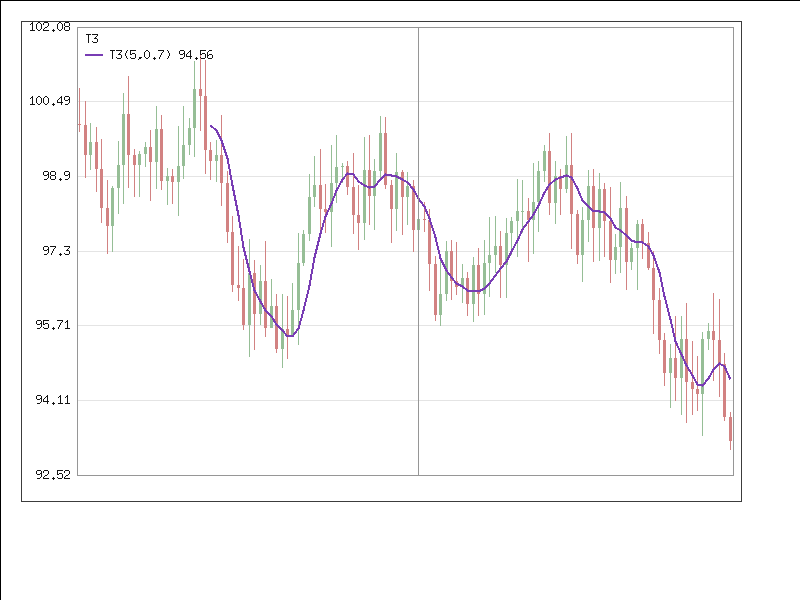

**Formula:** Tillson T3, triple-smoothed EMA with volume-factor correction, vf 0.7.

**API:** `std::vector<double> ind_t3(const std::vector<double>& closes, int period, double vf)`; widget `IndT3(Display*, int screen, Window, GC, SStyle_Manager*, int x, int y, int width, int height, const OHLCVSeries& series, int period = 5, double vf = 0.7)`; draw style: overlay (overlay draws over a light candle background, pane draws its own subplot with an axis). Key methods: `draw()`, `on_click(x, y)`, `on_button_press(x, y, button)`, `on_button_release(x, y, button)`, `on_motion(x, y)`, `on_key(key, str)`, `line(i)`, `line_count()`, `is_pane()`.

**Example:**

```cpp
#include "IndT3.h"
auto series = xframe::make_seeded_series(250, 42);
auto values = xframe::ind_t3(xframe::series_closes(series), 5, 0.7);
```

## McGinley (`IndMcGinley`)


**Formula:** McGinley dynamic average, speed adapts with the price ratio to the fourth power.

**API:** `std::vector<double> ind_mcginley(const std::vector<double>& closes, int period)`; widget `IndMcGinley(Display*, int screen, Window, GC, SStyle_Manager*, int x, int y, int width, int height, const OHLCVSeries& series, int period = 14)`; draw style: overlay (overlay draws over a light candle background, pane draws its own subplot with an axis). Key methods: `draw()`, `on_click(x, y)`, `on_button_press(x, y, button)`, `on_button_release(x, y, button)`, `on_motion(x, y)`, `on_key(key, str)`, `line(i)`, `line_count()`, `is_pane()`.

**Example:**

```cpp
#include "IndMcGinley.h"
auto series = xframe::make_seeded_series(250, 42);
auto values = xframe::ind_mcginley(xframe::series_closes(series), 14);
```

## GaussianMA (`IndGaussianMA`)


**Formula:** Gaussian-weighted moving average, sigma period/6 centred on the window.

**API:** `std::vector<double> ind_gaussian_ma(const std::vector<double>& closes, int period)`; widget `IndGaussianMA(Display*, int screen, Window, GC, SStyle_Manager*, int x, int y, int width, int height, const OHLCVSeries& series, int period = 14)`; draw style: overlay (overlay draws over a light candle background, pane draws its own subplot with an axis). Key methods: `draw()`, `on_click(x, y)`, `on_button_press(x, y, button)`, `on_button_release(x, y, button)`, `on_motion(x, y)`, `on_key(key, str)`, `line(i)`, `line_count()`, `is_pane()`.

**Example:**

```cpp
#include "IndGaussianMA.h"
auto series = xframe::make_seeded_series(250, 42);
auto values = xframe::ind_gaussian_ma(xframe::series_closes(series), 14);
```

## SineWMA (`IndSineWMA`)


**Formula:** sine-weighted moving average, weights follow a half-sine over the window.

**API:** `std::vector<double> ind_sine_wma(const std::vector<double>& closes, int period)`; widget `IndSineWMA(Display*, int screen, Window, GC, SStyle_Manager*, int x, int y, int width, int height, const OHLCVSeries& series, int period = 14)`; draw style: overlay (overlay draws over a light candle background, pane draws its own subplot with an axis). Key methods: `draw()`, `on_click(x, y)`, `on_button_press(x, y, button)`, `on_button_release(x, y, button)`, `on_motion(x, y)`, `on_key(key, str)`, `line(i)`, `line_count()`, `is_pane()`.

**Example:**

```cpp
#include "IndSineWMA.h"
auto series = xframe::make_seeded_series(250, 42);
auto values = xframe::ind_sine_wma(xframe::series_closes(series), 14);
```

## WildersMA (`IndWildersMA`)


**Formula:** Wilder moving average, Wilder smoothing seeded with the first SMA.

**API:** `std::vector<double> ind_wilders_ma(const std::vector<double>& closes, int period)`; widget `IndWildersMA(Display*, int screen, Window, GC, SStyle_Manager*, int x, int y, int width, int height, const OHLCVSeries& series, int period = 14)`; draw style: overlay (overlay draws over a light candle background, pane draws its own subplot with an axis). Key methods: `draw()`, `on_click(x, y)`, `on_button_press(x, y, button)`, `on_button_release(x, y, button)`, `on_motion(x, y)`, `on_key(key, str)`, `line(i)`, `line_count()`, `is_pane()`.

**Example:**

```cpp
#include "IndWildersMA.h"
auto series = xframe::make_seeded_series(250, 42);
auto values = xframe::ind_wilders_ma(xframe::series_closes(series), 14);
```

**Unclear from the header:** Wilder's smoothing recursion is identical to SMMA; the two widgets differ only in name and attribution.

## MedianMA (`IndMedianMA`)


**Formula:** median moving average, median of the last period closes.

**API:** `std::vector<double> ind_median_ma(const std::vector<double>& closes, int period)`; widget `IndMedianMA(Display*, int screen, Window, GC, SStyle_Manager*, int x, int y, int width, int height, const OHLCVSeries& series, int period = 14)`; draw style: overlay (overlay draws over a light candle background, pane draws its own subplot with an axis). Key methods: `draw()`, `on_click(x, y)`, `on_button_press(x, y, button)`, `on_button_release(x, y, button)`, `on_motion(x, y)`, `on_key(key, str)`, `line(i)`, `line_count()`, `is_pane()`.

**Example:**

```cpp
#include "IndMedianMA.h"
auto series = xframe::make_seeded_series(250, 42);
auto values = xframe::ind_median_ma(xframe::series_closes(series), 14);
```

## TSMA (`IndTSMA`)


**Formula:** triple-smoothed exponential moving average, EMA applied three times.

**API:** `std::vector<double> ind_tsma(const std::vector<double>& closes, int period)`; widget `IndTSMA(Display*, int screen, Window, GC, SStyle_Manager*, int x, int y, int width, int height, const OHLCVSeries& series, int period = 14)`; draw style: overlay (overlay draws over a light candle background, pane draws its own subplot with an axis). Key methods: `draw()`, `on_click(x, y)`, `on_button_press(x, y, button)`, `on_button_release(x, y, button)`, `on_motion(x, y)`, `on_key(key, str)`, `line(i)`, `line_count()`, `is_pane()`.

**Example:**

```cpp
#include "IndTSMA.h"
auto series = xframe::make_seeded_series(250, 42);
auto values = xframe::ind_tsma(xframe::series_closes(series), 14);
```

## TenkanSen (`IndTenkanSen`)


**Formula:** Ichimoku conversion line, midpoint of the highest high and lowest low over 9 bars.

**API:** `std::vector<double> ind_tenkan_sen(const OHLCVSeries& series, int period)`; widget `IndTenkanSen(Display*, int screen, Window, GC, SStyle_Manager*, int x, int y, int width, int height, const OHLCVSeries& series, int period = 9)`; draw style: overlay (overlay draws over a light candle background, pane draws its own subplot with an axis). Key methods: `draw()`, `on_click(x, y)`, `on_button_press(x, y, button)`, `on_button_release(x, y, button)`, `on_motion(x, y)`, `on_key(key, str)`, `line(i)`, `line_count()`, `is_pane()`.

**Example:**

```cpp
#include "IndTenkanSen.h"
auto series = xframe::make_seeded_series(250, 42);
auto values = xframe::ind_tenkan_sen(series, 9);
```

## KijunSen (`IndKijunSen`)


**Formula:** Ichimoku base line, midpoint of the highest high and lowest low over 26 bars.

**API:** `std::vector<double> ind_kijun_sen(const OHLCVSeries& series, int period)`; widget `IndKijunSen(Display*, int screen, Window, GC, SStyle_Manager*, int x, int y, int width, int height, const OHLCVSeries& series, int period = 26)`; draw style: overlay (overlay draws over a light candle background, pane draws its own subplot with an axis). Key methods: `draw()`, `on_click(x, y)`, `on_button_press(x, y, button)`, `on_button_release(x, y, button)`, `on_motion(x, y)`, `on_key(key, str)`, `line(i)`, `line_count()`, `is_pane()`.

**Example:**

```cpp
#include "IndKijunSen.h"
auto series = xframe::make_seeded_series(250, 42);
auto values = xframe::ind_kijun_sen(series, 26);
```

## SenkouSpanA (`IndSenkouSpanA`)


**Formula:** Ichimoku leading span A, average of Tenkan-sen and Kijun-sen.

**API:** `std::vector<double> ind_senkou_span_a(const OHLCVSeries& series, int tenkan, int kijun)`; widget `IndSenkouSpanA(Display*, int screen, Window, GC, SStyle_Manager*, int x, int y, int width, int height, const OHLCVSeries& series, int tenkan = 9, int kijun = 26)`; draw style: overlay (overlay draws over a light candle background, pane draws its own subplot with an axis). Key methods: `draw()`, `on_click(x, y)`, `on_button_press(x, y, button)`, `on_button_release(x, y, button)`, `on_motion(x, y)`, `on_key(key, str)`, `line(i)`, `line_count()`, `is_pane()`.

**Example:**

```cpp
#include "IndSenkouSpanA.h"
auto series = xframe::make_seeded_series(250, 42);
auto values = xframe::ind_senkou_span_a(series, 9, 26);
```

**Unclear from the header:** In live Ichimoku charts Span A is plotted 26 bars ahead; this widget returns the unshifted value at each bar and documents the shift.

## SenkouSpanB (`IndSenkouSpanB`)


**Formula:** Ichimoku leading span B, midpoint of the highest high and lowest low over 52 bars.

**API:** `std::vector<double> ind_senkou_span_b(const OHLCVSeries& series, int period)`; widget `IndSenkouSpanB(Display*, int screen, Window, GC, SStyle_Manager*, int x, int y, int width, int height, const OHLCVSeries& series, int period = 52)`; draw style: overlay (overlay draws over a light candle background, pane draws its own subplot with an axis). Key methods: `draw()`, `on_click(x, y)`, `on_button_press(x, y, button)`, `on_button_release(x, y, button)`, `on_motion(x, y)`, `on_key(key, str)`, `line(i)`, `line_count()`, `is_pane()`.

**Example:**

```cpp
#include "IndSenkouSpanB.h"
auto series = xframe::make_seeded_series(250, 42);
auto values = xframe::ind_senkou_span_b(series, 52);
```

**Unclear from the header:** In live Ichimoku charts Span B is plotted 26 bars ahead; this widget returns the unshifted value at each bar and documents the shift.

## ChikouSpan (`IndChikouSpan`)


**Formula:** Ichimoku lagging span, close shifted back 26 bars.

**API:** `std::vector<double> ind_chikou_span(const std::vector<double>& closes, int period)`; widget `IndChikouSpan(Display*, int screen, Window, GC, SStyle_Manager*, int x, int y, int width, int height, const OHLCVSeries& series, int period = 26)`; draw style: overlay (overlay draws over a light candle background, pane draws its own subplot with an axis). Key methods: `draw()`, `on_click(x, y)`, `on_button_press(x, y, button)`, `on_button_release(x, y, button)`, `on_motion(x, y)`, `on_key(key, str)`, `line(i)`, `line_count()`, `is_pane()`.

**Example:**

```cpp
#include "IndChikouSpan.h"
auto series = xframe::make_seeded_series(250, 42);
auto values = xframe::ind_chikou_span(xframe::series_closes(series), 26);
```

**Unclear from the header:** Trailing bars are NaN by construction (the shift runs past the end of the series).

## PSAR (`IndPSAR`)


**Formula:** Wilder parabolic SAR, accelerating stop-and-reverse dots.

**API:** `std::vector<double> ind_psar(const OHLCVSeries& series, double step, double maxaf)`; widget `IndPSAR(Display*, int screen, Window, GC, SStyle_Manager*, int x, int y, int width, int height, const OHLCVSeries& series, double step = 0.02, double maxaf = 0.2)`; draw style: overlay (overlay draws over a light candle background, pane draws its own subplot with an axis). Key methods: `draw()`, `on_click(x, y)`, `on_button_press(x, y, button)`, `on_button_release(x, y, button)`, `on_motion(x, y)`, `on_key(key, str)`, `line(i)`, `line_count()`, `is_pane()`.

**Example:**

```cpp
#include "IndPSAR.h"
auto series = xframe::make_seeded_series(250, 42);
auto values = xframe::ind_psar(series, 0.02, 0.2);
```

## Supertrend (`IndSupertrend`)


**Formula:** Supertrend line, ATR trailing band that flips with the trend.

**API:** `std::vector<double> ind_supertrend(const OHLCVSeries& series, int period, double mult)`; widget `IndSupertrend(Display*, int screen, Window, GC, SStyle_Manager*, int x, int y, int width, int height, const OHLCVSeries& series, int period = 10, double mult = 3.0)`; draw style: overlay (overlay draws over a light candle background, pane draws its own subplot with an axis). Key methods: `draw()`, `on_click(x, y)`, `on_button_press(x, y, button)`, `on_button_release(x, y, button)`, `on_motion(x, y)`, `on_key(key, str)`, `line(i)`, `line_count()`, `is_pane()`.

**Example:**

```cpp
#include "IndSupertrend.h"
auto series = xframe::make_seeded_series(250, 42);
auto values = xframe::ind_supertrend(series, 10, 3.0);
```

## ADX (`IndADX`)


**Formula:** Wilder average directional index, smoothed DX over the period.

**API:** `std::vector<double> ind_adx(const OHLCVSeries& series, int period)`; widget `IndADX(Display*, int screen, Window, GC, SStyle_Manager*, int x, int y, int width, int height, const OHLCVSeries& series, int period = 14)`; draw style: pane (overlay draws over a light candle background, pane draws its own subplot with an axis). Key methods: `draw()`, `on_click(x, y)`, `on_button_press(x, y, button)`, `on_button_release(x, y, button)`, `on_motion(x, y)`, `on_key(key, str)`, `line(i)`, `line_count()`, `is_pane()`.

**Example:**

```cpp
#include "IndADX.h"
auto series = xframe::make_seeded_series(250, 42);
auto values = xframe::ind_adx(series, 14);
```

## PlusDI (`IndPlusDI`)


**Formula:** Wilder positive directional indicator, smoothed +DM over smoothed true range.

**API:** `std::vector<double> ind_plus_di(const OHLCVSeries& series, int period)`; widget `IndPlusDI(Display*, int screen, Window, GC, SStyle_Manager*, int x, int y, int width, int height, const OHLCVSeries& series, int period = 14)`; draw style: pane (overlay draws over a light candle background, pane draws its own subplot with an axis). Key methods: `draw()`, `on_click(x, y)`, `on_button_press(x, y, button)`, `on_button_release(x, y, button)`, `on_motion(x, y)`, `on_key(key, str)`, `line(i)`, `line_count()`, `is_pane()`.

**Example:**

```cpp
#include "IndPlusDI.h"
auto series = xframe::make_seeded_series(250, 42);
auto values = xframe::ind_plus_di(series, 14);
```

## MinusDI (`IndMinusDI`)


**Formula:** Wilder negative directional indicator, smoothed -DM over smoothed true range.

**API:** `std::vector<double> ind_minus_di(const OHLCVSeries& series, int period)`; widget `IndMinusDI(Display*, int screen, Window, GC, SStyle_Manager*, int x, int y, int width, int height, const OHLCVSeries& series, int period = 14)`; draw style: pane (overlay draws over a light candle background, pane draws its own subplot with an axis). Key methods: `draw()`, `on_click(x, y)`, `on_button_press(x, y, button)`, `on_button_release(x, y, button)`, `on_motion(x, y)`, `on_key(key, str)`, `line(i)`, `line_count()`, `is_pane()`.

**Example:**

```cpp
#include "IndMinusDI.h"
auto series = xframe::make_seeded_series(250, 42);
auto values = xframe::ind_minus_di(series, 14);
```

## DX (`IndDX`)


**Formula:** directional movement index, 100*|+DI - -DI| / (+DI + -DI).

**API:** `std::vector<double> ind_dx(const OHLCVSeries& series, int period)`; widget `IndDX(Display*, int screen, Window, GC, SStyle_Manager*, int x, int y, int width, int height, const OHLCVSeries& series, int period = 14)`; draw style: pane (overlay draws over a light candle background, pane draws its own subplot with an axis). Key methods: `draw()`, `on_click(x, y)`, `on_button_press(x, y, button)`, `on_button_release(x, y, button)`, `on_motion(x, y)`, `on_key(key, str)`, `line(i)`, `line_count()`, `is_pane()`.

**Example:**

```cpp
#include "IndDX.h"
auto series = xframe::make_seeded_series(250, 42);
auto values = xframe::ind_dx(series, 14);
```

## ADXR (`IndADXR`)


**Formula:** average directional movement index rating, average of ADX now and ADX period bars ago.

**API:** `std::vector<double> ind_adxr(const OHLCVSeries& series, int period)`; widget `IndADXR(Display*, int screen, Window, GC, SStyle_Manager*, int x, int y, int width, int height, const OHLCVSeries& series, int period = 14)`; draw style: pane (overlay draws over a light candle background, pane draws its own subplot with an axis). Key methods: `draw()`, `on_click(x, y)`, `on_button_press(x, y, button)`, `on_button_release(x, y, button)`, `on_motion(x, y)`, `on_key(key, str)`, `line(i)`, `line_count()`, `is_pane()`.

**Example:**

```cpp
#include "IndADXR.h"
auto series = xframe::make_seeded_series(250, 42);
auto values = xframe::ind_adxr(series, 14);
```

## AroonUp (`IndAroonUp`)


**Formula:** Aroon up, 100*(period - bars since the highest high)/period.

**API:** `std::vector<double> ind_aroon_up(const OHLCVSeries& series, int period)`; widget `IndAroonUp(Display*, int screen, Window, GC, SStyle_Manager*, int x, int y, int width, int height, const OHLCVSeries& series, int period = 14)`; draw style: pane (overlay draws over a light candle background, pane draws its own subplot with an axis). Key methods: `draw()`, `on_click(x, y)`, `on_button_press(x, y, button)`, `on_button_release(x, y, button)`, `on_motion(x, y)`, `on_key(key, str)`, `line(i)`, `line_count()`, `is_pane()`.

**Example:**

```cpp
#include "IndAroonUp.h"
auto series = xframe::make_seeded_series(250, 42);
auto values = xframe::ind_aroon_up(series, 14);
```

## AroonDown (`IndAroonDown`)


**Formula:** Aroon down, 100*(period - bars since the lowest low)/period.

**API:** `std::vector<double> ind_aroon_down(const OHLCVSeries& series, int period)`; widget `IndAroonDown(Display*, int screen, Window, GC, SStyle_Manager*, int x, int y, int width, int height, const OHLCVSeries& series, int period = 14)`; draw style: pane (overlay draws over a light candle background, pane draws its own subplot with an axis). Key methods: `draw()`, `on_click(x, y)`, `on_button_press(x, y, button)`, `on_button_release(x, y, button)`, `on_motion(x, y)`, `on_key(key, str)`, `line(i)`, `line_count()`, `is_pane()`.

**Example:**

```cpp
#include "IndAroonDown.h"
auto series = xframe::make_seeded_series(250, 42);
auto values = xframe::ind_aroon_down(series, 14);
```

## AroonOscillator (`IndAroonOscillator`)


**Formula:** Aroon oscillator, Aroon up minus Aroon down.

**API:** `std::vector<double> ind_aroon_osc(const OHLCVSeries& series, int period)`; widget `IndAroonOscillator(Display*, int screen, Window, GC, SStyle_Manager*, int x, int y, int width, int height, const OHLCVSeries& series, int period = 14)`; draw style: pane (overlay draws over a light candle background, pane draws its own subplot with an axis). Key methods: `draw()`, `on_click(x, y)`, `on_button_press(x, y, button)`, `on_button_release(x, y, button)`, `on_motion(x, y)`, `on_key(key, str)`, `line(i)`, `line_count()`, `is_pane()`.

**Example:**

```cpp
#include "IndAroonOscillator.h"
auto series = xframe::make_seeded_series(250, 42);
auto values = xframe::ind_aroon_osc(series, 14);
```

## Vortex (`IndVortex`)


**Formula:** Vortex indicator, summed positive/negative vortex movement over summed true range.

**API:** `VortexResult ind_vortex(const OHLCVSeries& series, int period)`; widget `IndVortex(Display*, int screen, Window, GC, SStyle_Manager*, int x, int y, int width, int height, const OHLCVSeries& series, int period = 14)`; draw style: pane (overlay draws over a light candle background, pane draws its own subplot with an axis). Key methods: `draw()`, `on_click(x, y)`, `on_button_press(x, y, button)`, `on_button_release(x, y, button)`, `on_motion(x, y)`, `on_key(key, str)`, `line(i)`, `line_count()`, `is_pane()`.

**Example:**

```cpp
#include "IndVortex.h"
auto series = xframe::make_seeded_series(250, 42);
auto values = xframe::ind_vortex(series, 14).plus;
```

## AlligatorJaw (`IndAlligatorJaw`)


**Formula:** Alligator jaw, 13-bar SMMA of the median price shifted 8 bars ahead.

**API:** `std::vector<double> ind_alligator_jaw(const std::vector<double>& closes, int period, int shift)`; widget `IndAlligatorJaw(Display*, int screen, Window, GC, SStyle_Manager*, int x, int y, int width, int height, const OHLCVSeries& series, int period = 13, int shift = 8)`; draw style: overlay (overlay draws over a light candle background, pane draws its own subplot with an axis). Key methods: `draw()`, `on_click(x, y)`, `on_button_press(x, y, button)`, `on_button_release(x, y, button)`, `on_motion(x, y)`, `on_key(key, str)`, `line(i)`, `line_count()`, `is_pane()`.

**Example:**

```cpp
#include "IndAlligatorJaw.h"
auto series = xframe::make_seeded_series(250, 42);
auto values = xframe::ind_alligator_jaw(xframe::series_closes(series), 13, 8);
```

**Unclear from the header:** The published Alligator smooths the median price (high+low)/2; this widget smooths closes and documents the difference.

## AlligatorTeeth (`IndAlligatorTeeth`)


**Formula:** Alligator teeth, 8-bar SMMA shifted 5 bars ahead.

**API:** `std::vector<double> ind_alligator_teeth(const std::vector<double>& closes, int period, int shift)`; widget `IndAlligatorTeeth(Display*, int screen, Window, GC, SStyle_Manager*, int x, int y, int width, int height, const OHLCVSeries& series, int period = 8, int shift = 5)`; draw style: overlay (overlay draws over a light candle background, pane draws its own subplot with an axis). Key methods: `draw()`, `on_click(x, y)`, `on_button_press(x, y, button)`, `on_button_release(x, y, button)`, `on_motion(x, y)`, `on_key(key, str)`, `line(i)`, `line_count()`, `is_pane()`.

**Example:**

```cpp
#include "IndAlligatorTeeth.h"
auto series = xframe::make_seeded_series(250, 42);
auto values = xframe::ind_alligator_teeth(xframe::series_closes(series), 8, 5);
```

**Unclear from the header:** The published Alligator smooths the median price (high+low)/2; this widget smooths closes and documents the difference.

## AlligatorLips (`IndAlligatorLips`)


**Formula:** Alligator lips, 5-bar SMMA shifted 3 bars ahead.

**API:** `std::vector<double> ind_alligator_lips(const std::vector<double>& closes, int period, int shift)`; widget `IndAlligatorLips(Display*, int screen, Window, GC, SStyle_Manager*, int x, int y, int width, int height, const OHLCVSeries& series, int period = 5, int shift = 3)`; draw style: overlay (overlay draws over a light candle background, pane draws its own subplot with an axis). Key methods: `draw()`, `on_click(x, y)`, `on_button_press(x, y, button)`, `on_button_release(x, y, button)`, `on_motion(x, y)`, `on_key(key, str)`, `line(i)`, `line_count()`, `is_pane()`.

**Example:**

```cpp
#include "IndAlligatorLips.h"
auto series = xframe::make_seeded_series(250, 42);
auto values = xframe::ind_alligator_lips(xframe::series_closes(series), 5, 3);
```

**Unclear from the header:** The published Alligator smooths the median price (high+low)/2; this widget smooths closes and documents the difference.

## GatorOscillator (`IndGatorOscillator`)


**Formula:** Gator oscillator, absolute jaw-teeth gap above zero and teeth-lips gap below zero.

**API:** `GatorResult ind_gator(const std::vector<double>& closes)`; widget `IndGatorOscillator(Display*, int screen, Window, GC, SStyle_Manager*, int x, int y, int width, int height, const OHLCVSeries& series)`; draw style: pane (overlay draws over a light candle background, pane draws its own subplot with an axis). Key methods: `draw()`, `on_click(x, y)`, `on_button_press(x, y, button)`, `on_button_release(x, y, button)`, `on_motion(x, y)`, `on_key(key, str)`, `line(i)`, `line_count()`, `is_pane()`.

**Example:**

```cpp
#include "IndGatorOscillator.h"
auto series = xframe::make_seeded_series(250, 42);
auto values = xframe::ind_gator(xframe::series_closes(series)).upper;
```

## TRIX (`IndTRIX`)


**Formula:** TRIX, 1-bar rate of change of the triple-smoothed EMA, in percent.

**API:** `std::vector<double> ind_trix(const std::vector<double>& closes, int period)`; widget `IndTRIX(Display*, int screen, Window, GC, SStyle_Manager*, int x, int y, int width, int height, const OHLCVSeries& series, int period = 14)`; draw style: pane (overlay draws over a light candle background, pane draws its own subplot with an axis). Key methods: `draw()`, `on_click(x, y)`, `on_button_press(x, y, button)`, `on_button_release(x, y, button)`, `on_motion(x, y)`, `on_key(key, str)`, `line(i)`, `line_count()`, `is_pane()`.

**Example:**

```cpp
#include "IndTRIX.h"
auto series = xframe::make_seeded_series(250, 42);
auto values = xframe::ind_trix(xframe::series_closes(series), 14);
```

## DPO (`IndDPO`)


**Formula:** detrended price oscillator, close minus the SMA shifted back period/2+1 bars.

**API:** `std::vector<double> ind_dpo(const std::vector<double>& closes, int period)`; widget `IndDPO(Display*, int screen, Window, GC, SStyle_Manager*, int x, int y, int width, int height, const OHLCVSeries& series, int period = 20)`; draw style: pane (overlay draws over a light candle background, pane draws its own subplot with an axis). Key methods: `draw()`, `on_click(x, y)`, `on_button_press(x, y, button)`, `on_button_release(x, y, button)`, `on_motion(x, y)`, `on_key(key, str)`, `line(i)`, `line_count()`, `is_pane()`.

**Example:**

```cpp
#include "IndDPO.h"
auto series = xframe::make_seeded_series(250, 42);
auto values = xframe::ind_dpo(xframe::series_closes(series), 20);
```

## QStick (`IndQStick`)


**Formula:** QStick, SMA of close minus open over the period.

**API:** `std::vector<double> ind_qstick(const OHLCVSeries& series, int period)`; widget `IndQStick(Display*, int screen, Window, GC, SStyle_Manager*, int x, int y, int width, int height, const OHLCVSeries& series, int period = 14)`; draw style: pane (overlay draws over a light candle background, pane draws its own subplot with an axis). Key methods: `draw()`, `on_click(x, y)`, `on_button_press(x, y, button)`, `on_button_release(x, y, button)`, `on_motion(x, y)`, `on_key(key, str)`, `line(i)`, `line_count()`, `is_pane()`.

**Example:**

```cpp
#include "IndQStick.h"
auto series = xframe::make_seeded_series(250, 42);
auto values = xframe::ind_qstick(series, 14);
```

## ElderRayBull (`IndElderRayBull`)


**Formula:** Elder Ray bull power, high minus the EMA of closes.

**API:** `std::vector<double> ind_elder_ray_bull(const OHLCVSeries& series, int period)`; widget `IndElderRayBull(Display*, int screen, Window, GC, SStyle_Manager*, int x, int y, int width, int height, const OHLCVSeries& series, int period = 13)`; draw style: pane (overlay draws over a light candle background, pane draws its own subplot with an axis). Key methods: `draw()`, `on_click(x, y)`, `on_button_press(x, y, button)`, `on_button_release(x, y, button)`, `on_motion(x, y)`, `on_key(key, str)`, `line(i)`, `line_count()`, `is_pane()`.

**Example:**

```cpp
#include "IndElderRayBull.h"
auto series = xframe::make_seeded_series(250, 42);
auto values = xframe::ind_elder_ray_bull(series, 13);
```

## ElderRayBear (`IndElderRayBear`)


**Formula:** Elder Ray bear power, low minus the EMA of closes.

**API:** `std::vector<double> ind_elder_ray_bear(const OHLCVSeries& series, int period)`; widget `IndElderRayBear(Display*, int screen, Window, GC, SStyle_Manager*, int x, int y, int width, int height, const OHLCVSeries& series, int period = 13)`; draw style: pane (overlay draws over a light candle background, pane draws its own subplot with an axis). Key methods: `draw()`, `on_click(x, y)`, `on_button_press(x, y, button)`, `on_button_release(x, y, button)`, `on_motion(x, y)`, `on_key(key, str)`, `line(i)`, `line_count()`, `is_pane()`.

**Example:**

```cpp
#include "IndElderRayBear.h"
auto series = xframe::make_seeded_series(250, 42);
auto values = xframe::ind_elder_ray_bear(series, 13);
```

## LinReg (`IndLinReg`)


**Formula:** linear regression line, endpoint value of the least-squares fit over the window.

**API:** `std::vector<double> ind_linreg(const std::vector<double>& closes, int period)`; widget `IndLinReg(Display*, int screen, Window, GC, SStyle_Manager*, int x, int y, int width, int height, const OHLCVSeries& series, int period = 14)`; draw style: overlay (overlay draws over a light candle background, pane draws its own subplot with an axis). Key methods: `draw()`, `on_click(x, y)`, `on_button_press(x, y, button)`, `on_button_release(x, y, button)`, `on_motion(x, y)`, `on_key(key, str)`, `line(i)`, `line_count()`, `is_pane()`.

**Example:**

```cpp
#include "IndLinReg.h"
auto series = xframe::make_seeded_series(250, 42);
auto values = xframe::ind_linreg(xframe::series_closes(series), 14);
```

## LinRegSlope (`IndLinRegSlope`)


**Formula:** linear regression slope, price change per bar of the least-squares fit.

**API:** `std::vector<double> ind_linreg_slope(const std::vector<double>& closes, int period)`; widget `IndLinRegSlope(Display*, int screen, Window, GC, SStyle_Manager*, int x, int y, int width, int height, const OHLCVSeries& series, int period = 14)`; draw style: pane (overlay draws over a light candle background, pane draws its own subplot with an axis). Key methods: `draw()`, `on_click(x, y)`, `on_button_press(x, y, button)`, `on_button_release(x, y, button)`, `on_motion(x, y)`, `on_key(key, str)`, `line(i)`, `line_count()`, `is_pane()`.

**Example:**

```cpp
#include "IndLinRegSlope.h"
auto series = xframe::make_seeded_series(250, 42);
auto values = xframe::ind_linreg_slope(xframe::series_closes(series), 14);
```

## LinRegAngle (`IndLinRegAngle`)


**Formula:** linear regression angle, arctangent of the slope in degrees.

**API:** `std::vector<double> ind_linreg_angle(const std::vector<double>& closes, int period)`; widget `IndLinRegAngle(Display*, int screen, Window, GC, SStyle_Manager*, int x, int y, int width, int height, const OHLCVSeries& series, int period = 14)`; draw style: pane (overlay draws over a light candle background, pane draws its own subplot with an axis). Key methods: `draw()`, `on_click(x, y)`, `on_button_press(x, y, button)`, `on_button_release(x, y, button)`, `on_motion(x, y)`, `on_key(key, str)`, `line(i)`, `line_count()`, `is_pane()`.

**Example:**

```cpp
#include "IndLinRegAngle.h"
auto series = xframe::make_seeded_series(250, 42);
auto values = xframe::ind_linreg_angle(xframe::series_closes(series), 14);
```

## LinRegIntercept (`IndLinRegIntercept`)


**Formula:** linear regression intercept, fitted value at the start of the window.

**API:** `std::vector<double> ind_linreg_intercept(const std::vector<double>& closes, int period)`; widget `IndLinRegIntercept(Display*, int screen, Window, GC, SStyle_Manager*, int x, int y, int width, int height, const OHLCVSeries& series, int period = 14)`; draw style: pane (overlay draws over a light candle background, pane draws its own subplot with an axis). Key methods: `draw()`, `on_click(x, y)`, `on_button_press(x, y, button)`, `on_button_release(x, y, button)`, `on_motion(x, y)`, `on_key(key, str)`, `line(i)`, `line_count()`, `is_pane()`.

**Example:**

```cpp
#include "IndLinRegIntercept.h"
auto series = xframe::make_seeded_series(250, 42);
auto values = xframe::ind_linreg_intercept(xframe::series_closes(series), 14);
```

## TSF (`IndTSF`)


**Formula:** time series forecast, linear-regression line extrapolated one bar ahead.

**API:** `std::vector<double> ind_tsf(const std::vector<double>& closes, int period)`; widget `IndTSF(Display*, int screen, Window, GC, SStyle_Manager*, int x, int y, int width, int height, const OHLCVSeries& series, int period = 14)`; draw style: overlay (overlay draws over a light candle background, pane draws its own subplot with an axis). Key methods: `draw()`, `on_click(x, y)`, `on_button_press(x, y, button)`, `on_button_release(x, y, button)`, `on_motion(x, y)`, `on_key(key, str)`, `line(i)`, `line_count()`, `is_pane()`.

**Example:**

```cpp
#include "IndTSF.h"
auto series = xframe::make_seeded_series(250, 42);
auto values = xframe::ind_tsf(xframe::series_closes(series), 14);
```

## DonchianUpper (`IndDonchianUpper`)


**Formula:** Donchian channel upper band, highest high over the period.

**API:** `std::vector<double> ind_donchian_upper(const OHLCVSeries& series, int period)`; widget `IndDonchianUpper(Display*, int screen, Window, GC, SStyle_Manager*, int x, int y, int width, int height, const OHLCVSeries& series, int period = 20)`; draw style: overlay (overlay draws over a light candle background, pane draws its own subplot with an axis). Key methods: `draw()`, `on_click(x, y)`, `on_button_press(x, y, button)`, `on_button_release(x, y, button)`, `on_motion(x, y)`, `on_key(key, str)`, `line(i)`, `line_count()`, `is_pane()`.

**Example:**

```cpp
#include "IndDonchianUpper.h"
auto series = xframe::make_seeded_series(250, 42);
auto values = xframe::ind_donchian_upper(series, 20);
```

## DonchianMiddle (`IndDonchianMiddle`)


**Formula:** Donchian channel middle line, average of the upper and lower bands.

**API:** `std::vector<double> ind_donchian_middle(const OHLCVSeries& series, int period)`; widget `IndDonchianMiddle(Display*, int screen, Window, GC, SStyle_Manager*, int x, int y, int width, int height, const OHLCVSeries& series, int period = 20)`; draw style: overlay (overlay draws over a light candle background, pane draws its own subplot with an axis). Key methods: `draw()`, `on_click(x, y)`, `on_button_press(x, y, button)`, `on_button_release(x, y, button)`, `on_motion(x, y)`, `on_key(key, str)`, `line(i)`, `line_count()`, `is_pane()`.

**Example:**

```cpp
#include "IndDonchianMiddle.h"
auto series = xframe::make_seeded_series(250, 42);
auto values = xframe::ind_donchian_middle(series, 20);
```

## DonchianLower (`IndDonchianLower`)


**Formula:** Donchian channel lower band, lowest low over the period.

**API:** `std::vector<double> ind_donchian_lower(const OHLCVSeries& series, int period)`; widget `IndDonchianLower(Display*, int screen, Window, GC, SStyle_Manager*, int x, int y, int width, int height, const OHLCVSeries& series, int period = 20)`; draw style: overlay (overlay draws over a light candle background, pane draws its own subplot with an axis). Key methods: `draw()`, `on_click(x, y)`, `on_button_press(x, y, button)`, `on_button_release(x, y, button)`, `on_motion(x, y)`, `on_key(key, str)`, `line(i)`, `line_count()`, `is_pane()`.

**Example:**

```cpp
#include "IndDonchianLower.h"
auto series = xframe::make_seeded_series(250, 42);
auto values = xframe::ind_donchian_lower(series, 20);
```

## ChandelierExitLong (`IndChandelierExitLong`)


**Formula:** Chandelier exit for longs, highest high over the period minus mult times ATR.

**API:** `std::vector<double> ind_chandelier_long(const OHLCVSeries& series, int period, double mult)`; widget `IndChandelierExitLong(Display*, int screen, Window, GC, SStyle_Manager*, int x, int y, int width, int height, const OHLCVSeries& series, int period = 22, double mult = 3.0)`; draw style: overlay (overlay draws over a light candle background, pane draws its own subplot with an axis). Key methods: `draw()`, `on_click(x, y)`, `on_button_press(x, y, button)`, `on_button_release(x, y, button)`, `on_motion(x, y)`, `on_key(key, str)`, `line(i)`, `line_count()`, `is_pane()`.

**Example:**

```cpp
#include "IndChandelierExitLong.h"
auto series = xframe::make_seeded_series(250, 42);
auto values = xframe::ind_chandelier_long(series, 22, 3.0);
```

## ChandelierExitShort (`IndChandelierExitShort`)


**Formula:** Chandelier exit for shorts, lowest low over the period plus mult times ATR.

**API:** `std::vector<double> ind_chandelier_short(const OHLCVSeries& series, int period, double mult)`; widget `IndChandelierExitShort(Display*, int screen, Window, GC, SStyle_Manager*, int x, int y, int width, int height, const OHLCVSeries& series, int period = 22, double mult = 3.0)`; draw style: overlay (overlay draws over a light candle background, pane draws its own subplot with an axis). Key methods: `draw()`, `on_click(x, y)`, `on_button_press(x, y, button)`, `on_button_release(x, y, button)`, `on_motion(x, y)`, `on_key(key, str)`, `line(i)`, `line_count()`, `is_pane()`.

**Example:**

```cpp
#include "IndChandelierExitShort.h"
auto series = xframe::make_seeded_series(250, 42);
auto values = xframe::ind_chandelier_short(series, 22, 3.0);
```

## ChandeKrollStop (`IndChandeKrollStop`)


**Formula:** Chande-Kroll stop for longs, highest high over the period minus mult times ATR.

**API:** `std::vector<double> ind_chande_kroll_stop(const OHLCVSeries& series, int period, double mult)`; widget `IndChandeKrollStop(Display*, int screen, Window, GC, SStyle_Manager*, int x, int y, int width, int height, const OHLCVSeries& series, int period = 10, double mult = 1.0)`; draw style: overlay (overlay draws over a light candle background, pane draws its own subplot with an axis). Key methods: `draw()`, `on_click(x, y)`, `on_button_press(x, y, button)`, `on_button_release(x, y, button)`, `on_motion(x, y)`, `on_key(key, str)`, `line(i)`, `line_count()`, `is_pane()`.

**Example:**

```cpp
#include "IndChandeKrollStop.h"
auto series = xframe::make_seeded_series(250, 42);
auto values = xframe::ind_chande_kroll_stop(series, 10, 1.0);
```

**Unclear from the header:** The published Chande-Kroll stop carries a second, wider stop; this widget implements the primary (first) stop only.

## HalfTrend (`IndHalfTrend`)


**Formula:** HalfTrend line, ATR channel-deviation bands that flip with the trend.

**API:** `std::vector<double> ind_half_trend(const OHLCVSeries& series, int amplitude, double channelDeviation)`; widget `IndHalfTrend(Display*, int screen, Window, GC, SStyle_Manager*, int x, int y, int width, int height, const OHLCVSeries& series, int amplitude = 2, double channelDeviation = 2.0)`; draw style: overlay (overlay draws over a light candle background, pane draws its own subplot with an axis). Key methods: `draw()`, `on_click(x, y)`, `on_button_press(x, y, button)`, `on_button_release(x, y, button)`, `on_motion(x, y)`, `on_key(key, str)`, `line(i)`, `line_count()`, `is_pane()`.

**Example:**

```cpp
#include "IndHalfTrend.h"
auto series = xframe::make_seeded_series(250, 42);
auto values = xframe::ind_half_trend(series, 2, 2.0);
```

**Unclear from the header:** Simplified port of the published HalfTrend logic (amplitude extrema plus ATR channel-deviation bands); the exact ATR period and band update rules vary by implementation.

## SSLChannel (`IndSSLChannel`)


**Formula:** SSL channel line, SMA of lows when close is above the SMA of highs, else SMA of highs.

**API:** `std::vector<double> ind_ssl_channel(const OHLCVSeries& series, int period)`; widget `IndSSLChannel(Display*, int screen, Window, GC, SStyle_Manager*, int x, int y, int width, int height, const OHLCVSeries& series, int period = 10)`; draw style: overlay (overlay draws over a light candle background, pane draws its own subplot with an axis). Key methods: `draw()`, `on_click(x, y)`, `on_button_press(x, y, button)`, `on_button_release(x, y, button)`, `on_motion(x, y)`, `on_key(key, str)`, `line(i)`, `line_count()`, `is_pane()`.

**Example:**

```cpp
#include "IndSSLChannel.h"
auto series = xframe::make_seeded_series(250, 42);
auto values = xframe::ind_ssl_channel(series, 10);
```

## UTBot (`IndUTBot`)


**Formula:** UT Bot trailing stop, ATR trailing stop that flips sides with the trend.

**API:** `std::vector<double> ind_ut_bot(const OHLCVSeries& series, int period, double mult)`; widget `IndUTBot(Display*, int screen, Window, GC, SStyle_Manager*, int x, int y, int width, int height, const OHLCVSeries& series, int period = 10, double mult = 1.0)`; draw style: overlay (overlay draws over a light candle background, pane draws its own subplot with an axis). Key methods: `draw()`, `on_click(x, y)`, `on_button_press(x, y, button)`, `on_button_release(x, y, button)`, `on_motion(x, y)`, `on_key(key, str)`, `line(i)`, `line_count()`, `is_pane()`.

**Example:**

```cpp
#include "IndUTBot.h"
auto series = xframe::make_seeded_series(250, 42);
auto values = xframe::ind_ut_bot(series, 10, 1.0);
```

## PivotPoint (`IndPivotPoint`)


**Formula:** classic floor-trader pivot point, (prior high + prior low + prior close)/3.

**API:** `std::vector<double> ind_pivot_point(const OHLCVSeries& series)`; widget `IndPivotPoint(Display*, int screen, Window, GC, SStyle_Manager*, int x, int y, int width, int height, const OHLCVSeries& series)`; draw style: overlay (overlay draws over a light candle background, pane draws its own subplot with an axis). Key methods: `draw()`, `on_click(x, y)`, `on_button_press(x, y, button)`, `on_button_release(x, y, button)`, `on_motion(x, y)`, `on_key(key, str)`, `line(i)`, `line_count()`, `is_pane()`.

**Example:**

```cpp
#include "IndPivotPoint.h"
auto series = xframe::make_seeded_series(250, 42);
auto values = xframe::ind_pivot_point(series);
```

## MAEnvelopeUpper (`IndMAEnvelopeUpper`)


**Formula:** moving average envelope upper band, SMA shifted up by pct percent.

**API:** `std::vector<double> ind_ma_envelope_upper(const std::vector<double>& closes, int period, double pct)`; widget `IndMAEnvelopeUpper(Display*, int screen, Window, GC, SStyle_Manager*, int x, int y, int width, int height, const OHLCVSeries& series, int period = 20, double pct = 2.5)`; draw style: overlay (overlay draws over a light candle background, pane draws its own subplot with an axis). Key methods: `draw()`, `on_click(x, y)`, `on_button_press(x, y, button)`, `on_button_release(x, y, button)`, `on_motion(x, y)`, `on_key(key, str)`, `line(i)`, `line_count()`, `is_pane()`.

**Example:**

```cpp
#include "IndMAEnvelopeUpper.h"
auto series = xframe::make_seeded_series(250, 42);
auto values = xframe::ind_ma_envelope_upper(xframe::series_closes(series), 20, 2.5);
```

## MAEnvelopeLower (`IndMAEnvelopeLower`)


**Formula:** moving average envelope lower band, SMA shifted down by pct percent.

**API:** `std::vector<double> ind_ma_envelope_lower(const std::vector<double>& closes, int period, double pct)`; widget `IndMAEnvelopeLower(Display*, int screen, Window, GC, SStyle_Manager*, int x, int y, int width, int height, const OHLCVSeries& series, int period = 20, double pct = 2.5)`; draw style: overlay (overlay draws over a light candle background, pane draws its own subplot with an axis). Key methods: `draw()`, `on_click(x, y)`, `on_button_press(x, y, button)`, `on_button_release(x, y, button)`, `on_motion(x, y)`, `on_key(key, str)`, `line(i)`, `line_count()`, `is_pane()`.

**Example:**

```cpp
#include "IndMAEnvelopeLower.h"
auto series = xframe::make_seeded_series(250, 42);
auto values = xframe::ind_ma_envelope_lower(xframe::series_closes(series), 20, 2.5);
```

## TrendIntensityIndex (`IndTrendIntensityIndex`)


**Formula:** trend intensity index, share of SMA deviation that lies above the SMA, 0-100.

**API:** `std::vector<double> ind_trend_intensity(const std::vector<double>& closes, int period)`; widget `IndTrendIntensityIndex(Display*, int screen, Window, GC, SStyle_Manager*, int x, int y, int width, int height, const OHLCVSeries& series, int period = 30)`; draw style: pane (overlay draws over a light candle background, pane draws its own subplot with an axis). Key methods: `draw()`, `on_click(x, y)`, `on_button_press(x, y, button)`, `on_button_release(x, y, button)`, `on_motion(x, y)`, `on_key(key, str)`, `line(i)`, `line_count()`, `is_pane()`.

**Example:**

```cpp
#include "IndTrendIntensityIndex.h"
auto series = xframe::make_seeded_series(250, 42);
auto values = xframe::ind_trend_intensity(xframe::series_closes(series), 30);
```

## VHF (`IndVHF`)


**Formula:** vertical horizontal filter, price range over the period divided by the sum of absolute daily changes.

**API:** `std::vector<double> ind_vhf(const OHLCVSeries& series, int period)`; widget `IndVHF(Display*, int screen, Window, GC, SStyle_Manager*, int x, int y, int width, int height, const OHLCVSeries& series, int period = 28)`; draw style: pane (overlay draws over a light candle background, pane draws its own subplot with an axis). Key methods: `draw()`, `on_click(x, y)`, `on_button_press(x, y, button)`, `on_button_release(x, y, button)`, `on_motion(x, y)`, `on_key(key, str)`, `line(i)`, `line_count()`, `is_pane()`.

**Example:**

```cpp
#include "IndVHF.h"
auto series = xframe::make_seeded_series(250, 42);
auto values = xframe::ind_vhf(series, 28);
```

## RWIHigh (`IndRWIHigh`)


**Formula:** random walk index high, (high - low period bars ago) / (ATR * sqrt(period)).

**API:** `std::vector<double> ind_rwi_high(const OHLCVSeries& series, int period)`; widget `IndRWIHigh(Display*, int screen, Window, GC, SStyle_Manager*, int x, int y, int width, int height, const OHLCVSeries& series, int period = 14)`; draw style: pane (overlay draws over a light candle background, pane draws its own subplot with an axis). Key methods: `draw()`, `on_click(x, y)`, `on_button_press(x, y, button)`, `on_button_release(x, y, button)`, `on_motion(x, y)`, `on_key(key, str)`, `line(i)`, `line_count()`, `is_pane()`.

**Example:**

```cpp
#include "IndRWIHigh.h"
auto series = xframe::make_seeded_series(250, 42);
auto values = xframe::ind_rwi_high(series, 14);
```

## RWILow (`IndRWILow`)


**Formula:** random walk index low, (high period bars ago - low) / (ATR * sqrt(period)).

**API:** `std::vector<double> ind_rwi_low(const OHLCVSeries& series, int period)`; widget `IndRWILow(Display*, int screen, Window, GC, SStyle_Manager*, int x, int y, int width, int height, const OHLCVSeries& series, int period = 14)`; draw style: pane (overlay draws over a light candle background, pane draws its own subplot with an axis). Key methods: `draw()`, `on_click(x, y)`, `on_button_press(x, y, button)`, `on_button_release(x, y, button)`, `on_motion(x, y)`, `on_key(key, str)`, `line(i)`, `line_count()`, `is_pane()`.

**Example:**

```cpp
#include "IndRWILow.h"
auto series = xframe::make_seeded_series(250, 42);
auto values = xframe::ind_rwi_low(series, 14);
```

## EhlersTrendline (`IndEhlersTrendline`)


**Formula:** Ehlers instantaneous trendline, alpha-weighted two-pole low-pass filter.

**API:** `std::vector<double> ind_ehlers_trendline(const std::vector<double>& closes, double alpha)`; widget `IndEhlersTrendline(Display*, int screen, Window, GC, SStyle_Manager*, int x, int y, int width, int height, const OHLCVSeries& series, double alpha = 0.07)`; draw style: overlay (overlay draws over a light candle background, pane draws its own subplot with an axis). Key methods: `draw()`, `on_click(x, y)`, `on_button_press(x, y, button)`, `on_button_release(x, y, button)`, `on_motion(x, y)`, `on_key(key, str)`, `line(i)`, `line_count()`, `is_pane()`.

**Example:**

```cpp
#include "IndEhlersTrendline.h"
auto series = xframe::make_seeded_series(250, 42);
auto values = xframe::ind_ehlers_trendline(xframe::series_closes(series), 0.07);
```

## EhlersDecycler (`IndEhlersDecycler`)


**Formula:** Ehlers decycler, high-pass cycle removal plus first-order smoothing.

**API:** `std::vector<double> ind_ehlers_decycler(const std::vector<double>& closes, int period)`; widget `IndEhlersDecycler(Display*, int screen, Window, GC, SStyle_Manager*, int x, int y, int width, int height, const OHLCVSeries& series, int period = 10)`; draw style: overlay (overlay draws over a light candle background, pane draws its own subplot with an axis). Key methods: `draw()`, `on_click(x, y)`, `on_button_press(x, y, button)`, `on_button_release(x, y, button)`, `on_motion(x, y)`, `on_key(key, str)`, `line(i)`, `line_count()`, `is_pane()`.

**Example:**

```cpp
#include "IndEhlersDecycler.h"
auto series = xframe::make_seeded_series(250, 42);
auto values = xframe::ind_ehlers_decycler(xframe::series_closes(series), 10);
```

**Unclear from the header:** Simplified Ehlers Decycler: the high-pass stage keeps only the current two-pole term and the published second-order recursion is reduced; values track the published decycler but are not bit-identical.

## GuppyMMA (`IndGuppyMMA`)


**Formula:** Guppy multiple moving average, 12 EMAs in a fast group (3-15) and a slow group (30-60).

**API:** `GuppyResult ind_guppy_mma(const std::vector<double>& closes)`; widget `IndGuppyMMA(Display*, int screen, Window, GC, SStyle_Manager*, int x, int y, int width, int height, const OHLCVSeries& series)`; draw style: overlay (overlay draws over a light candle background, pane draws its own subplot with an axis). Key methods: `draw()`, `on_click(x, y)`, `on_button_press(x, y, button)`, `on_button_release(x, y, button)`, `on_motion(x, y)`, `on_key(key, str)`, `line(i)`, `line_count()`, `is_pane()`.

**Example:**

```cpp
#include "IndGuppyMMA.h"
auto series = xframe::make_seeded_series(250, 42);
auto values = xframe::ind_guppy_mma(xframe::series_closes(series)).lines[0];
```

## ZigZag (`IndZigZag`)


**Formula:** ZigZag, pivot points where price reverses by at least deviation percent.

**API:** `std::vector<double> ind_zigzag(const OHLCVSeries& series, double deviation)`; widget `IndZigZag(Display*, int screen, Window, GC, SStyle_Manager*, int x, int y, int width, int height, const OHLCVSeries& series, double deviation = 5.0)`; draw style: overlay (overlay draws over a light candle background, pane draws its own subplot with an axis). Key methods: `draw()`, `on_click(x, y)`, `on_button_press(x, y, button)`, `on_button_release(x, y, button)`, `on_motion(x, y)`, `on_key(key, str)`, `line(i)`, `line_count()`, `is_pane()`.

**Example:**

```cpp
#include "IndZigZag.h"
auto series = xframe::make_seeded_series(250, 42);
auto values = xframe::ind_zigzag(series, 5.0);
```

**Unclear from the header:** Only pivot bars carry values; every other bar is NaN by design. The last leg repaints as new bars arrive.

## FractalUp (`IndFractalUp`)


**Formula:** Bill Williams fractal up, high greater than the highs of the two bars either side.

**API:** `std::vector<double> ind_fractal_up(const OHLCVSeries& series)`; widget `IndFractalUp(Display*, int screen, Window, GC, SStyle_Manager*, int x, int y, int width, int height, const OHLCVSeries& series)`; draw style: overlay (overlay draws over a light candle background, pane draws its own subplot with an axis). Key methods: `draw()`, `on_click(x, y)`, `on_button_press(x, y, button)`, `on_button_release(x, y, button)`, `on_motion(x, y)`, `on_key(key, str)`, `line(i)`, `line_count()`, `is_pane()`.

**Example:**

```cpp
#include "IndFractalUp.h"
auto series = xframe::make_seeded_series(250, 42);
auto values = xframe::ind_fractal_up(series);
```

**Unclear from the header:** Only fractal bars carry values; uses two bars of lookahead, so the signal confirms two bars late.

## FractalDown (`IndFractalDown`)


**Formula:** Bill Williams fractal down, low lower than the lows of the two bars either side.

**API:** `std::vector<double> ind_fractal_down(const OHLCVSeries& series)`; widget `IndFractalDown(Display*, int screen, Window, GC, SStyle_Manager*, int x, int y, int width, int height, const OHLCVSeries& series)`; draw style: overlay (overlay draws over a light candle background, pane draws its own subplot with an axis). Key methods: `draw()`, `on_click(x, y)`, `on_button_press(x, y, button)`, `on_button_release(x, y, button)`, `on_motion(x, y)`, `on_key(key, str)`, `line(i)`, `line_count()`, `is_pane()`.

**Example:**

```cpp
#include "IndFractalDown.h"
auto series = xframe::make_seeded_series(250, 42);
auto values = xframe::ind_fractal_down(series);
```

**Unclear from the header:** Only fractal bars carry values; uses two bars of lookahead, so the signal confirms two bars late.

## SwingIndex (`IndSwingIndex`)


**Formula:** Wilder swing index, real price move scaled by the limit move.

**API:** `std::vector<double> ind_swing_index(const OHLCVSeries& series, double limitMove)`; widget `IndSwingIndex(Display*, int screen, Window, GC, SStyle_Manager*, int x, int y, int width, int height, const OHLCVSeries& series, double limitMove = 1.0)`; draw style: pane (overlay draws over a light candle background, pane draws its own subplot with an axis). Key methods: `draw()`, `on_click(x, y)`, `on_button_press(x, y, button)`, `on_button_release(x, y, button)`, `on_motion(x, y)`, `on_key(key, str)`, `line(i)`, `line_count()`, `is_pane()`.

**Example:**

```cpp
#include "IndSwingIndex.h"
auto series = xframe::make_seeded_series(250, 42);
auto values = xframe::ind_swing_index(series, 1.0);
```

## AccumulativeSwingIndex (`IndAccumulativeSwingIndex`)


**Formula:** Wilder accumulative swing index, running sum of the swing index.

**API:** `std::vector<double> ind_accumulative_swing_index(const OHLCVSeries& series, double limitMove)`; widget `IndAccumulativeSwingIndex(Display*, int screen, Window, GC, SStyle_Manager*, int x, int y, int width, int height, const OHLCVSeries& series, double limitMove = 1.0)`; draw style: pane (overlay draws over a light candle background, pane draws its own subplot with an axis). Key methods: `draw()`, `on_click(x, y)`, `on_button_press(x, y, button)`, `on_button_release(x, y, button)`, `on_motion(x, y)`, `on_key(key, str)`, `line(i)`, `line_count()`, `is_pane()`.

**Example:**

```cpp
#include "IndAccumulativeSwingIndex.h"
auto series = xframe::make_seeded_series(250, 42);
auto values = xframe::ind_accumulative_swing_index(series, 1.0);
```

## FractalDimensionIndex (`IndFractalDimensionIndex`)


**Formula:** fractal dimension index, 1 + (ln(sum of absolute changes) - ln 2) / ln(period).

**API:** `std::vector<double> ind_fractal_dimension_index(const std::vector<double>& closes, int period)`; widget `IndFractalDimensionIndex(Display*, int screen, Window, GC, SStyle_Manager*, int x, int y, int width, int height, const OHLCVSeries& series, int period = 30)`; draw style: pane (overlay draws over a light candle background, pane draws its own subplot with an axis). Key methods: `draw()`, `on_click(x, y)`, `on_button_press(x, y, button)`, `on_button_release(x, y, button)`, `on_motion(x, y)`, `on_key(key, str)`, `line(i)`, `line_count()`, `is_pane()`.

**Example:**

```cpp
#include "IndFractalDimensionIndex.h"
auto series = xframe::make_seeded_series(250, 42);
auto values = xframe::ind_fractal_dimension_index(xframe::series_closes(series), 30);
```

**Unclear from the header:** The FDI formula has several published variants; this widget uses the common ln form and documents it.

## RegressionChannel (`IndRegressionChannel`)


**Formula:** linear regression channel, regression line plus/minus mult times the residual standard deviation.

**API:** `RegChannelResult ind_regression_channel(const std::vector<double>& closes, int period, double mult)`; widget `IndRegressionChannel(Display*, int screen, Window, GC, SStyle_Manager*, int x, int y, int width, int height, const OHLCVSeries& series, int period = 20, double mult = 2.0)`; draw style: overlay (overlay draws over a light candle background, pane draws its own subplot with an axis). Key methods: `draw()`, `on_click(x, y)`, `on_button_press(x, y, button)`, `on_button_release(x, y, button)`, `on_motion(x, y)`, `on_key(key, str)`, `line(i)`, `line_count()`, `is_pane()`.

**Example:**

```cpp
#include "IndRegressionChannel.h"
auto series = xframe::make_seeded_series(250, 42);
auto values = xframe::ind_regression_channel(xframe::series_closes(series), 20, 2.0).upper;
```

## MovingAverageRibbon (`IndMovingAverageRibbon`)


**Formula:** moving average ribbon, six SMAs (5, 10, 20, 30, 50, 100) plotted together.

**API:** `RibbonResult ind_ma_ribbon(const std::vector<double>& closes)`; widget `IndMovingAverageRibbon(Display*, int screen, Window, GC, SStyle_Manager*, int x, int y, int width, int height, const OHLCVSeries& series)`; draw style: overlay (overlay draws over a light candle background, pane draws its own subplot with an axis). Key methods: `draw()`, `on_click(x, y)`, `on_button_press(x, y, button)`, `on_button_release(x, y, button)`, `on_motion(x, y)`, `on_key(key, str)`, `line(i)`, `line_count()`, `is_pane()`.

**Example:**

```cpp
#include "IndMovingAverageRibbon.h"
auto series = xframe::make_seeded_series(250, 42);
auto values = xframe::ind_ma_ribbon(xframe::series_closes(series)).lines[0];
```

## EhlersSuperSmoother (`IndEhlersSuperSmoother`)


**Formula:** Ehlers SuperSmoother, two-pole low-pass filter with minimal lag.

**API:** `std::vector<double> ind_ehlers_super_smoother(const std::vector<double>& closes, int period)`; widget `IndEhlersSuperSmoother(Display*, int screen, Window, GC, SStyle_Manager*, int x, int y, int width, int height, const OHLCVSeries& series, int period = 10)`; draw style: overlay (overlay draws over a light candle background, pane draws its own subplot with an axis). Key methods: `draw()`, `on_click(x, y)`, `on_button_press(x, y, button)`, `on_button_release(x, y, button)`, `on_motion(x, y)`, `on_key(key, str)`, `line(i)`, `line_count()`, `is_pane()`.

**Example:**

```cpp
#include "IndEhlersSuperSmoother.h"
auto series = xframe::make_seeded_series(250, 42);
auto values = xframe::ind_ehlers_super_smoother(xframe::series_closes(series), 10);
```

## VWEMA (`IndVWEMA`)


**Formula:** volume-weighted exponential moving average, EMA of close times volume over EMA of volume.

**API:** `std::vector<double> ind_vwema(const OHLCVSeries& series, int period)`; widget `IndVWEMA(Display*, int screen, Window, GC, SStyle_Manager*, int x, int y, int width, int height, const OHLCVSeries& series, int period = 14)`; draw style: overlay (overlay draws over a light candle background, pane draws its own subplot with an axis). Key methods: `draw()`, `on_click(x, y)`, `on_button_press(x, y, button)`, `on_button_release(x, y, button)`, `on_motion(x, y)`, `on_key(key, str)`, `line(i)`, `line_count()`, `is_pane()`.

**Example:**

```cpp
#include "IndVWEMA.h"
auto series = xframe::make_seeded_series(250, 42);
auto values = xframe::ind_vwema(series, 14);
```

## ElderSafeZone (`IndElderSafeZone`)


**Formula:** Elder SafeZone long stop, lowest low over the period minus mult times ATR.

**API:** `std::vector<double> ind_elder_safe_zone(const OHLCVSeries& series, int period, double mult)`; widget `IndElderSafeZone(Display*, int screen, Window, GC, SStyle_Manager*, int x, int y, int width, int height, const OHLCVSeries& series, int period = 10, double mult = 2.0)`; draw style: overlay (overlay draws over a light candle background, pane draws its own subplot with an axis). Key methods: `draw()`, `on_click(x, y)`, `on_button_press(x, y, button)`, `on_button_release(x, y, button)`, `on_motion(x, y)`, `on_key(key, str)`, `line(i)`, `line_count()`, `is_pane()`.

**Example:**

```cpp
#include "IndElderSafeZone.h"
auto series = xframe::make_seeded_series(250, 42);
auto values = xframe::ind_elder_safe_zone(series, 10, 2.0);
```

**Unclear from the header:** Simplified Elder SafeZone: the published SafeZone subtracts the average downside penetration rather than a fixed ATR multiple.


## Group: Indicators — momentum (85)

## Stock Market indicators: momentum (85)

Momentum indicators of the XFrame Stock Market section. Each entry: name, formula, API, a short working example, and honest notes where the header does not settle a behaviour.

Shared conventions: output length == input length; leading warm-up bars are NaN until enough bars exist. All demos and tests use `xframe::make_seeded_series(250)` (deterministic synthetic data, no network, no live market data).

## RSI


- Formula: Wilder RSI: 100 * avg gain / (avg gain + avg loss), gains/losses Wilder-smoothed over period.
- Compute: `std::vector<double> ind_rsi(const std::vector<double>& closes, int period = 14)`
- Widget: `IndRSI(Display*, int screen, Window, GC, SStyle_Manager*, int x, int y, int width, int height, const xframe::OHLCVSeries& series, int period = 14)`; methods: `draw()`, `on_button_press(x, y, button)`, `on_button_release(x, y, button)`, `on_motion(x, y)`, `on_key(key, str)`, `line_values(i)`, `values()`, `item_count()`, `line_count()`, `reset_view()`.
- Draw style: pane.
- Example:

```cpp
#include "IndRSI.h"
auto series = xframe::make_seeded_series(250);
auto out = xframe::ind_rsi(xframe::series_closes(series));
IndRSI w(display, screen, window, gc, &styles, 20, 20, 760, 520, series);
w.draw();
```

## ConnorsRSI


- Formula: Connors RSI: average of RSI(3) of closes, RSI(2) of the up/down streak, and the 100-bar percent rank of the 1-day return.
- Compute: `std::vector<double> ind_connors_rsi(const xframe::OHLCVSeries& s, int period = 3)`
- Widget: `IndConnorsRSI(Display*, int screen, Window, GC, SStyle_Manager*, int x, int y, int width, int height, const xframe::OHLCVSeries& series, int period = 3)`; methods: `draw()`, `on_button_press(x, y, button)`, `on_button_release(x, y, button)`, `on_motion(x, y)`, `on_key(key, str)`, `line_values(i)`, `values()`, `item_count()`, `line_count()`, `reset_view()`.
- Draw style: pane.
- Example:

```cpp
#include "IndConnorsRSI.h"
auto series = xframe::make_seeded_series(250);
auto out = xframe::ind_connors_rsi(series);
IndConnorsRSI w(display, screen, window, gc, &styles, 20, 20, 760, 520, series);
w.draw();
```

## StochRSI


- Formula: Stochastic RSI: 100 * (RSI - lowest RSI over period) / (highest RSI - lowest RSI over period).
- Compute: `std::vector<double> ind_stoch_rsi(const std::vector<double>& closes, int period = 14)`
- Widget: `IndStochRSI(Display*, int screen, Window, GC, SStyle_Manager*, int x, int y, int width, int height, const xframe::OHLCVSeries& series, int period = 14)`; methods: `draw()`, `on_button_press(x, y, button)`, `on_button_release(x, y, button)`, `on_motion(x, y)`, `on_key(key, str)`, `line_values(i)`, `values()`, `item_count()`, `line_count()`, `reset_view()`.
- Draw style: pane.
- Example:

```cpp
#include "IndStochRSI.h"
auto series = xframe::make_seeded_series(250);
auto out = xframe::ind_stoch_rsi(xframe::series_closes(series));
IndStochRSI w(display, screen, window, gc, &styles, 20, 20, 760, 520, series);
w.draw();
```

## CutlerRSI


- Formula: Cutler RSI: same as RSI but gains/losses averaged with a simple moving average instead of Wilder smoothing.
- Compute: `std::vector<double> ind_cutler_rsi(const std::vector<double>& closes, int period = 14)`
- Widget: `IndCutlerRSI(Display*, int screen, Window, GC, SStyle_Manager*, int x, int y, int width, int height, const xframe::OHLCVSeries& series, int period = 14)`; methods: `draw()`, `on_button_press(x, y, button)`, `on_button_release(x, y, button)`, `on_motion(x, y)`, `on_key(key, str)`, `line_values(i)`, `values()`, `item_count()`, `line_count()`, `reset_view()`.
- Draw style: pane.
- Example:

```cpp
#include "IndCutlerRSI.h"
auto series = xframe::make_seeded_series(250);
auto out = xframe::ind_cutler_rsi(xframe::series_closes(series));
IndCutlerRSI w(display, screen, window, gc, &styles, 20, 20, 760, 520, series);
w.draw();
```

## LaguerreRSI


- Formula: Laguerre RSI (Ehlers): price passed through a 4-pole Laguerre filter; RSI-style ratio of up-moves (CU) to up+down moves (CD) of the filter outputs.
- Compute: `std::vector<double> ind_laguerre_rsi(const std::vector<double>& closes, double gamma = 0.8)`
- Widget: `IndLaguerreRSI(Display*, int screen, Window, GC, SStyle_Manager*, int x, int y, int width, int height, const xframe::OHLCVSeries& series, double gamma = 0.8)`; methods: `draw()`, `on_button_press(x, y, button)`, `on_button_release(x, y, button)`, `on_motion(x, y)`, `on_key(key, str)`, `line_values(i)`, `values()`, `item_count()`, `line_count()`, `reset_view()`.
- Draw style: pane.
- Example:

```cpp
#include "IndLaguerreRSI.h"
auto series = xframe::make_seeded_series(250);
auto out = xframe::ind_laguerre_rsi(xframe::series_closes(series));
IndLaguerreRSI w(display, screen, window, gc, &styles, 20, 20, 760, 520, series);
w.draw();
```

## AdaptiveRSI


- Formula: Adaptive RSI: Wilder RSI whose smoothing period adapts per bar to the Kaufman efficiency ratio over 10 bars (efficient market -> short period, choppy -> long period, 5..30).
- Compute: `std::vector<double> ind_adaptive_rsi(const std::vector<double>& closes, int period = 14)`
- Widget: `IndAdaptiveRSI(Display*, int screen, Window, GC, SStyle_Manager*, int x, int y, int width, int height, const xframe::OHLCVSeries& series, int period = 14)`; methods: `draw()`, `on_button_press(x, y, button)`, `on_button_release(x, y, button)`, `on_motion(x, y)`, `on_key(key, str)`, `line_values(i)`, `values()`, `item_count()`, `line_count()`, `reset_view()`.
- Draw style: pane.
- Example:

```cpp
#include "IndAdaptiveRSI.h"
auto series = xframe::make_seeded_series(250);
auto out = xframe::ind_adaptive_rsi(xframe::series_closes(series));
IndAdaptiveRSI w(display, screen, window, gc, &styles, 20, 20, 760, 520, series);
w.draw();
```

## MACD


- Formula: MACD (Appel): MACD line = EMA(fast) - EMA(slow); signal = EMA(signal) of the MACD line; histogram = MACD - signal.
- Compute: `IndMACDResult ind_macd(const std::vector<double>& closes, int fast = 12, int slow = 26, int signal = 9)`
- Widget: `IndMACD(Display*, int screen, Window, GC, SStyle_Manager*, int x, int y, int width, int height, const xframe::OHLCVSeries& series, int fast = 12, int slow = 26, int signal = 9)`; methods: `draw()`, `on_button_press(x, y, button)`, `on_button_release(x, y, button)`, `on_motion(x, y)`, `on_key(key, str)`, `line_values(i)`, `values()`, `item_count()`, `line_count()`, `reset_view()`.
- Draw style: pane.
- Example:

```cpp
#include "IndMACD.h"
auto series = xframe::make_seeded_series(250);
auto out = xframe::ind_macd(xframe::series_closes(series));
IndMACD w(display, screen, window, gc, &styles, 20, 20, 760, 520, series);
w.draw();
```

## MACDHistogram


- Formula: MACD histogram: EMA(fast) - EMA(slow) minus its EMA(signal) signal line; the histogram alone.
- Compute: `std::vector<double> ind_macd_histogram(const std::vector<double>& closes, int fast = 12, int slow = 26, int signal = 9)`
- Widget: `IndMACDHistogram(Display*, int screen, Window, GC, SStyle_Manager*, int x, int y, int width, int height, const xframe::OHLCVSeries& series, int fast = 12, int slow = 26, int signal = 9)`; methods: `draw()`, `on_button_press(x, y, button)`, `on_button_release(x, y, button)`, `on_motion(x, y)`, `on_key(key, str)`, `line_values(i)`, `values()`, `item_count()`, `line_count()`, `reset_view()`.
- Draw style: pane.
- Example:

```cpp
#include "IndMACDHistogram.h"
auto series = xframe::make_seeded_series(250);
auto out = xframe::ind_macd_histogram(xframe::series_closes(series));
IndMACDHistogram w(display, screen, window, gc, &styles, 20, 20, 760, 520, series);
w.draw();
```

## ZeroLagMACD


- Formula: Zero-lag MACD: MACD line built from zero-lag EMAs (EMA of price + (price - price lagged by (period-1)/2)); this widget plots the zero-lag MACD line.
- Compute: `std::vector<double> ind_zero_lag_macd(const std::vector<double>& closes, int fast = 12, int slow = 26, int signal = 9)`
- Widget: `IndZeroLagMACD(Display*, int screen, Window, GC, SStyle_Manager*, int x, int y, int width, int height, const xframe::OHLCVSeries& series, int fast = 12, int slow = 26, int signal = 9)`; methods: `draw()`, `on_button_press(x, y, button)`, `on_button_release(x, y, button)`, `on_motion(x, y)`, `on_key(key, str)`, `line_values(i)`, `values()`, `item_count()`, `line_count()`, `reset_view()`.
- Draw style: pane.
- Example:

```cpp
#include "IndZeroLagMACD.h"
auto series = xframe::make_seeded_series(250);
auto out = xframe::ind_zero_lag_macd(xframe::series_closes(series));
IndZeroLagMACD w(display, screen, window, gc, &styles, 20, 20, 760, 520, series);
w.draw();
```

## MACDofRSI


- Formula: MACD of RSI: the RSI series is computed first, then a MACD line (EMA(fast) - EMA(slow)) is taken of the RSI values.
- Compute: `std::vector<double> ind_macd_of_rsi(const std::vector<double>& closes, int rsi_period = 14, int fast = 12, int slow = 26)`
- Widget: `IndMACDofRSI(Display*, int screen, Window, GC, SStyle_Manager*, int x, int y, int width, int height, const xframe::OHLCVSeries& series, int rsi_period = 14, int fast = 12, int slow = 26)`; methods: `draw()`, `on_button_press(x, y, button)`, `on_button_release(x, y, button)`, `on_motion(x, y)`, `on_key(key, str)`, `line_values(i)`, `values()`, `item_count()`, `line_count()`, `reset_view()`.
- Draw style: pane.
- Example:

```cpp
#include "IndMACDofRSI.h"
auto series = xframe::make_seeded_series(250);
auto out = xframe::ind_macd_of_rsi(xframe::series_closes(series));
IndMACDofRSI w(display, screen, window, gc, &styles, 20, 20, 760, 520, series);
w.draw();
```

## StochasticFast


- Formula: Fast stochastic (Lane): %K = 100 * (close - lowest low over period) / (highest high - lowest low); %D = SMA(smooth) of %K.
- Compute: `IndStochasticFastResult ind_stochastic_fast(const xframe::OHLCVSeries& s, int period = 14, int smooth = 3)`
- Widget: `IndStochasticFast(Display*, int screen, Window, GC, SStyle_Manager*, int x, int y, int width, int height, const xframe::OHLCVSeries& series, int period = 14, int smooth = 3)`; methods: `draw()`, `on_button_press(x, y, button)`, `on_button_release(x, y, button)`, `on_motion(x, y)`, `on_key(key, str)`, `line_values(i)`, `values()`, `item_count()`, `line_count()`, `reset_view()`.
- Draw style: pane.
- Example:

```cpp
#include "IndStochasticFast.h"
auto series = xframe::make_seeded_series(250);
auto out = xframe::ind_stochastic_fast(series);
IndStochasticFast w(display, screen, window, gc, &styles, 20, 20, 760, 520, series);
w.draw();
```

## StochasticSlow


- Formula: Slow stochastic (Lane): slow %K = SMA(smooth) of fast %K; slow %D = SMA(smooth) of slow %K.
- Compute: `IndStochasticSlowResult ind_stochastic_slow(const xframe::OHLCVSeries& s, int period = 14, int smooth = 3)`
- Widget: `IndStochasticSlow(Display*, int screen, Window, GC, SStyle_Manager*, int x, int y, int width, int height, const xframe::OHLCVSeries& series, int period = 14, int smooth = 3)`; methods: `draw()`, `on_button_press(x, y, button)`, `on_button_release(x, y, button)`, `on_motion(x, y)`, `on_key(key, str)`, `line_values(i)`, `values()`, `item_count()`, `line_count()`, `reset_view()`.
- Draw style: pane.
- Example:

```cpp
#include "IndStochasticSlow.h"
auto series = xframe::make_seeded_series(250);
auto out = xframe::ind_stochastic_slow(series);
IndStochasticSlow w(display, screen, window, gc, &styles, 20, 20, 760, 520, series);
w.draw();
```

## StochasticFull


- Formula: Full stochastic (Lane): %K = SMA(smooth_k) of raw %K over period; %D = SMA(smooth_d) of %K; all three periods are parameters.
- Compute: `IndStochasticFullResult ind_stochastic_full(const xframe::OHLCVSeries& s, int period = 14, int smooth_k = 3, int smooth_d = 3)`
- Widget: `IndStochasticFull(Display*, int screen, Window, GC, SStyle_Manager*, int x, int y, int width, int height, const xframe::OHLCVSeries& series, int period = 14, int smooth_k = 3, int smooth_d = 3)`; methods: `draw()`, `on_button_press(x, y, button)`, `on_button_release(x, y, button)`, `on_motion(x, y)`, `on_key(key, str)`, `line_values(i)`, `values()`, `item_count()`, `line_count()`, `reset_view()`.
- Draw style: pane.
- Example:

```cpp
#include "IndStochasticFull.h"
auto series = xframe::make_seeded_series(250);
auto out = xframe::ind_stochastic_full(series);
IndStochasticFull w(display, screen, window, gc, &styles, 20, 20, 760, 520, series);
w.draw();
```

## KDJ


- Formula: KDJ stochastic: RSV = 100 * (close - lowest low) / (highest high - lowest low); K = 2/3 K(prev) + 1/3 RSV (seeded 50); D = 2/3 D(prev) + 1/3 K; J = 3K - 2D.
- Compute: `IndKDJResult ind_kdj(const xframe::OHLCVSeries& s, int period = 9, int smooth = 3)`
- Widget: `IndKDJ(Display*, int screen, Window, GC, SStyle_Manager*, int x, int y, int width, int height, const xframe::OHLCVSeries& series, int period = 9, int smooth = 3)`; methods: `draw()`, `on_button_press(x, y, button)`, `on_button_release(x, y, button)`, `on_motion(x, y)`, `on_key(key, str)`, `line_values(i)`, `values()`, `item_count()`, `line_count()`, `reset_view()`.
- Draw style: pane.
- Example:

```cpp
#include "IndKDJ.h"
auto series = xframe::make_seeded_series(250);
auto out = xframe::ind_kdj(series);
IndKDJ w(display, screen, window, gc, &styles, 20, 20, 760, 520, series);
w.draw();
```

## WilliamsR


- Formula: Williams %R (Williams): -100 * (highest high over period - close) / (highest high - lowest low over period); 0 to -100.
- Compute: `std::vector<double> ind_williams_r(const xframe::OHLCVSeries& s, int period = 14)`
- Widget: `IndWilliamsR(Display*, int screen, Window, GC, SStyle_Manager*, int x, int y, int width, int height, const xframe::OHLCVSeries& series, int period = 14)`; methods: `draw()`, `on_button_press(x, y, button)`, `on_button_release(x, y, button)`, `on_motion(x, y)`, `on_key(key, str)`, `line_values(i)`, `values()`, `item_count()`, `line_count()`, `reset_view()`.
- Draw style: pane.
- Example:

```cpp
#include "IndWilliamsR.h"
auto series = xframe::make_seeded_series(250);
auto out = xframe::ind_williams_r(series);
IndWilliamsR w(display, screen, window, gc, &styles, 20, 20, 760, 520, series);
w.draw();
```

## SMI


- Formula: Stochastic Momentum Index (Blau): 100 * double-EMA-smoothed (close - (high+low)/2) / double-EMA-smoothed (high - low).
- Compute: `std::vector<double> ind_smi(const xframe::OHLCVSeries& s, int period = 13)`
- Widget: `IndSMI(Display*, int screen, Window, GC, SStyle_Manager*, int x, int y, int width, int height, const xframe::OHLCVSeries& series, int period = 13)`; methods: `draw()`, `on_button_press(x, y, button)`, `on_button_release(x, y, button)`, `on_motion(x, y)`, `on_key(key, str)`, `line_values(i)`, `values()`, `item_count()`, `line_count()`, `reset_view()`.
- Draw style: pane.
- Example:

```cpp
#include "IndSMI.h"
auto series = xframe::make_seeded_series(250);
auto out = xframe::ind_smi(series);
IndSMI w(display, screen, window, gc, &styles, 20, 20, 760, 520, series);
w.draw();
```

## DSS


- Formula: Double Smoothed Stochastic (Bressert): raw %K over period, EMA-smoothed twice with period smooth; the twice-smoothed %K is the output.
- Compute: `std::vector<double> ind_dss(const xframe::OHLCVSeries& s, int period = 10, int smooth = 3)`
- Widget: `IndDSS(Display*, int screen, Window, GC, SStyle_Manager*, int x, int y, int width, int height, const xframe::OHLCVSeries& series, int period = 10, int smooth = 3)`; methods: `draw()`, `on_button_press(x, y, button)`, `on_button_release(x, y, button)`, `on_motion(x, y)`, `on_key(key, str)`, `line_values(i)`, `values()`, `item_count()`, `line_count()`, `reset_view()`.
- Draw style: pane.
- Example:

```cpp
#include "IndDSS.h"
auto series = xframe::make_seeded_series(250);
auto out = xframe::ind_dss(series);
IndDSS w(display, screen, window, gc, &styles, 20, 20, 760, 520, series);
w.draw();
```

## CCI


- Formula: Commodity Channel Index (Lambert): (typical price - SMA(period) of typical price) / (0.015 * mean deviation of typical price).
- Compute: `std::vector<double> ind_cci(const xframe::OHLCVSeries& s, int period = 20)`
- Widget: `IndCCI(Display*, int screen, Window, GC, SStyle_Manager*, int x, int y, int width, int height, const xframe::OHLCVSeries& series, int period = 20)`; methods: `draw()`, `on_button_press(x, y, button)`, `on_button_release(x, y, button)`, `on_motion(x, y)`, `on_key(key, str)`, `line_values(i)`, `values()`, `item_count()`, `line_count()`, `reset_view()`.
- Draw style: pane.
- Example:

```cpp
#include "IndCCI.h"
auto series = xframe::make_seeded_series(250);
auto out = xframe::ind_cci(series);
IndCCI w(display, screen, window, gc, &styles, 20, 20, 760, 520, series);
w.draw();
```

## ROC


- Formula: Rate of Change: 100 * (close - close[period]) / close[period].
- Compute: `std::vector<double> ind_roc(const std::vector<double>& closes, int period = 12)`
- Widget: `IndROC(Display*, int screen, Window, GC, SStyle_Manager*, int x, int y, int width, int height, const xframe::OHLCVSeries& series, int period = 12)`; methods: `draw()`, `on_button_press(x, y, button)`, `on_button_release(x, y, button)`, `on_motion(x, y)`, `on_key(key, str)`, `line_values(i)`, `values()`, `item_count()`, `line_count()`, `reset_view()`.
- Draw style: pane.
- Example:

```cpp
#include "IndROC.h"
auto series = xframe::make_seeded_series(250);
auto out = xframe::ind_roc(xframe::series_closes(series));
IndROC w(display, screen, window, gc, &styles, 20, 20, 760, 520, series);
w.draw();
```

## ROCR


- Formula: Rate of Change Ratio (TA-Lib ROCR): close / close[period].
- Compute: `std::vector<double> ind_rocr(const std::vector<double>& closes, int period = 12)`
- Widget: `IndROCR(Display*, int screen, Window, GC, SStyle_Manager*, int x, int y, int width, int height, const xframe::OHLCVSeries& series, int period = 12)`; methods: `draw()`, `on_button_press(x, y, button)`, `on_button_release(x, y, button)`, `on_motion(x, y)`, `on_key(key, str)`, `line_values(i)`, `values()`, `item_count()`, `line_count()`, `reset_view()`.
- Draw style: pane.
- Example:

```cpp
#include "IndROCR.h"
auto series = xframe::make_seeded_series(250);
auto out = xframe::ind_rocr(xframe::series_closes(series));
IndROCR w(display, screen, window, gc, &styles, 20, 20, 760, 520, series);
w.draw();
```

## Momentum


- Formula: Momentum: close - close[period].
- Compute: `std::vector<double> ind_momentum(const std::vector<double>& closes, int period = 10)`
- Widget: `IndMomentum(Display*, int screen, Window, GC, SStyle_Manager*, int x, int y, int width, int height, const xframe::OHLCVSeries& series, int period = 10)`; methods: `draw()`, `on_button_press(x, y, button)`, `on_button_release(x, y, button)`, `on_motion(x, y)`, `on_key(key, str)`, `line_values(i)`, `values()`, `item_count()`, `line_count()`, `reset_view()`.
- Draw style: pane.
- Example:

```cpp
#include "IndMomentum.h"
auto series = xframe::make_seeded_series(250);
auto out = xframe::ind_momentum(xframe::series_closes(series));
IndMomentum w(display, screen, window, gc, &styles, 20, 20, 760, 520, series);
w.draw();
```

## PPO


- Formula: Percentage Price Oscillator: 100 * (EMA(fast) - EMA(slow)) / EMA(slow).
- Compute: `std::vector<double> ind_ppo(const std::vector<double>& closes, int fast = 12, int slow = 26)`
- Widget: `IndPPO(Display*, int screen, Window, GC, SStyle_Manager*, int x, int y, int width, int height, const xframe::OHLCVSeries& series, int fast = 12, int slow = 26)`; methods: `draw()`, `on_button_press(x, y, button)`, `on_button_release(x, y, button)`, `on_motion(x, y)`, `on_key(key, str)`, `line_values(i)`, `values()`, `item_count()`, `line_count()`, `reset_view()`.
- Draw style: pane.
- Example:

```cpp
#include "IndPPO.h"
auto series = xframe::make_seeded_series(250);
auto out = xframe::ind_ppo(xframe::series_closes(series));
IndPPO w(display, screen, window, gc, &styles, 20, 20, 760, 520, series);
w.draw();
```

## APO


- Formula: Absolute Price Oscillator: EMA(fast) - EMA(slow) in price units.
- Compute: `std::vector<double> ind_apo(const std::vector<double>& closes, int fast = 12, int slow = 26)`
- Widget: `IndAPO(Display*, int screen, Window, GC, SStyle_Manager*, int x, int y, int width, int height, const xframe::OHLCVSeries& series, int fast = 12, int slow = 26)`; methods: `draw()`, `on_button_press(x, y, button)`, `on_button_release(x, y, button)`, `on_motion(x, y)`, `on_key(key, str)`, `line_values(i)`, `values()`, `item_count()`, `line_count()`, `reset_view()`.
- Draw style: pane.
- Example:

```cpp
#include "IndAPO.h"
auto series = xframe::make_seeded_series(250);
auto out = xframe::ind_apo(xframe::series_closes(series));
IndAPO w(display, screen, window, gc, &styles, 20, 20, 760, 520, series);
w.draw();
```

## AwesomeOscillator


- Formula: Awesome Oscillator (Bill Williams): SMA(fast) of median price - SMA(slow) of median price; median price = (high + low) / 2.
- Compute: `std::vector<double> ind_awesome_oscillator(const xframe::OHLCVSeries& s, int fast = 5, int slow = 34)`
- Widget: `IndAwesomeOscillator(Display*, int screen, Window, GC, SStyle_Manager*, int x, int y, int width, int height, const xframe::OHLCVSeries& series, int fast = 5, int slow = 34)`; methods: `draw()`, `on_button_press(x, y, button)`, `on_button_release(x, y, button)`, `on_motion(x, y)`, `on_key(key, str)`, `line_values(i)`, `values()`, `item_count()`, `line_count()`, `reset_view()`.
- Draw style: pane.
- Example:

```cpp
#include "IndAwesomeOscillator.h"
auto series = xframe::make_seeded_series(250);
auto out = xframe::ind_awesome_oscillator(series);
IndAwesomeOscillator w(display, screen, window, gc, &styles, 20, 20, 760, 520, series);
w.draw();
```

## AcceleratorOscillator


- Formula: Accelerator Oscillator (Bill Williams): Awesome Oscillator - SMA(smooth) of the Awesome Oscillator.
- Compute: `std::vector<double> ind_accelerator_oscillator(const xframe::OHLCVSeries& s, int fast = 5, int slow = 34, int smooth = 5)`
- Widget: `IndAcceleratorOscillator(Display*, int screen, Window, GC, SStyle_Manager*, int x, int y, int width, int height, const xframe::OHLCVSeries& series, int fast = 5, int slow = 34, int smooth = 5)`; methods: `draw()`, `on_button_press(x, y, button)`, `on_button_release(x, y, button)`, `on_motion(x, y)`, `on_key(key, str)`, `line_values(i)`, `values()`, `item_count()`, `line_count()`, `reset_view()`.
- Draw style: pane.
- Example:

```cpp
#include "IndAcceleratorOscillator.h"
auto series = xframe::make_seeded_series(250);
auto out = xframe::ind_accelerator_oscillator(series);
IndAcceleratorOscillator w(display, screen, window, gc, &styles, 20, 20, 760, 520, series);
w.draw();
```

## ChandeMomentumOscillator


- Formula: Chande Momentum Oscillator: 100 * (sum of up closes - sum of down closes) / (sum of up closes + sum of down closes) over period.
- Compute: `std::vector<double> ind_chande_momentum_oscillator(const std::vector<double>& closes, int period = 20)`
- Widget: `IndChandeMomentumOscillator(Display*, int screen, Window, GC, SStyle_Manager*, int x, int y, int width, int height, const xframe::OHLCVSeries& series, int period = 20)`; methods: `draw()`, `on_button_press(x, y, button)`, `on_button_release(x, y, button)`, `on_motion(x, y)`, `on_key(key, str)`, `line_values(i)`, `values()`, `item_count()`, `line_count()`, `reset_view()`.
- Draw style: pane.
- Example:

```cpp
#include "IndChandeMomentumOscillator.h"
auto series = xframe::make_seeded_series(250);
auto out = xframe::ind_chande_momentum_oscillator(xframe::series_closes(series));
IndChandeMomentumOscillator w(display, screen, window, gc, &styles, 20, 20, 760, 520, series);
w.draw();
```

## TSI


- Formula: True Strength Index (Blau): 100 * double-EMA-smoothed momentum / double-EMA-smoothed absolute momentum; momentum = close - close[1].
- Compute: `std::vector<double> ind_tsi(const std::vector<double>& closes, int long_period = 25, int short_period = 13)`
- Widget: `IndTSI(Display*, int screen, Window, GC, SStyle_Manager*, int x, int y, int width, int height, const xframe::OHLCVSeries& series, int long_period = 25, int short_period = 13)`; methods: `draw()`, `on_button_press(x, y, button)`, `on_button_release(x, y, button)`, `on_motion(x, y)`, `on_key(key, str)`, `line_values(i)`, `values()`, `item_count()`, `line_count()`, `reset_view()`.
- Draw style: pane.
- Example:

```cpp
#include "IndTSI.h"
auto series = xframe::make_seeded_series(250);
auto out = xframe::ind_tsi(xframe::series_closes(series));
IndTSI w(display, screen, window, gc, &styles, 20, 20, 760, 520, series);
w.draw();
```

## UltimateOscillator


- Formula: Ultimate Oscillator (Larry Williams): buying pressure = close - min(low, prev close); true range = max(high, prev close) - min(low, prev close); 100 * (4*avg7 + 2*avg14 + avg28) / 7.
- Compute: `std::vector<double> ind_ultimate_oscillator(const xframe::OHLCVSeries& s, int p1 = 7, int p2 = 14, int p3 = 28)`
- Widget: `IndUltimateOscillator(Display*, int screen, Window, GC, SStyle_Manager*, int x, int y, int width, int height, const xframe::OHLCVSeries& series, int p1 = 7, int p2 = 14, int p3 = 28)`; methods: `draw()`, `on_button_press(x, y, button)`, `on_button_release(x, y, button)`, `on_motion(x, y)`, `on_key(key, str)`, `line_values(i)`, `values()`, `item_count()`, `line_count()`, `reset_view()`.
- Draw style: pane.
- Example:

```cpp
#include "IndUltimateOscillator.h"
auto series = xframe::make_seeded_series(250);
auto out = xframe::ind_ultimate_oscillator(series);
IndUltimateOscillator w(display, screen, window, gc, &styles, 20, 20, 760, 520, series);
w.draw();
```

## KST


- Formula: Know Sure Thing (Pring): weighted sum of four smoothed rates of change: 1*SMA10(ROC10) + 2*SMA10(ROC15) + 3*SMA10(ROC20) + 4*SMA9(ROC30).
- Compute: `std::vector<double> ind_kst(const std::vector<double>& closes, int dummy = 0)`
- Widget: `IndKST(Display*, int screen, Window, GC, SStyle_Manager*, int x, int y, int width, int height, const xframe::OHLCVSeries& series, int dummy = 0)`; methods: `draw()`, `on_button_press(x, y, button)`, `on_button_release(x, y, button)`, `on_motion(x, y)`, `on_key(key, str)`, `line_values(i)`, `values()`, `item_count()`, `line_count()`, `reset_view()`.
- Draw style: pane.
- Example:

```cpp
#include "IndKST.h"
auto series = xframe::make_seeded_series(250);
auto out = xframe::ind_kst(xframe::series_closes(series));
IndKST w(display, screen, window, gc, &styles, 20, 20, 760, 520, series);
w.draw();
```

## FisherTransform


- Formula: Fisher Transform (Ehlers): price normalized to [-1, 1] over period, then Fisher transform 0.5 * ln((1+x)/(1-x)), half-weighted with the previous value.
- Compute: `std::vector<double> ind_fisher_transform(const std::vector<double>& closes, int period = 10)`
- Widget: `IndFisherTransform(Display*, int screen, Window, GC, SStyle_Manager*, int x, int y, int width, int height, const xframe::OHLCVSeries& series, int period = 10)`; methods: `draw()`, `on_button_press(x, y, button)`, `on_button_release(x, y, button)`, `on_motion(x, y)`, `on_key(key, str)`, `line_values(i)`, `values()`, `item_count()`, `line_count()`, `reset_view()`.
- Draw style: pane.
- Example:

```cpp
#include "IndFisherTransform.h"
auto series = xframe::make_seeded_series(250);
auto out = xframe::ind_fisher_transform(xframe::series_closes(series));
IndFisherTransform w(display, screen, window, gc, &styles, 20, 20, 760, 520, series);
w.draw();
```

## InverseFisherTransform


- Formula: Inverse Fisher Transform (Ehlers): RSI(period) normalized to [-1, 1], then the inverse Fisher (exp(2x)-1)/(exp(2x)+1), rescaled to 0..100.
- Compute: `std::vector<double> ind_inverse_fisher_transform(const std::vector<double>& closes, int period = 14)`
- Widget: `IndInverseFisherTransform(Display*, int screen, Window, GC, SStyle_Manager*, int x, int y, int width, int height, const xframe::OHLCVSeries& series, int period = 14)`; methods: `draw()`, `on_button_press(x, y, button)`, `on_button_release(x, y, button)`, `on_motion(x, y)`, `on_key(key, str)`, `line_values(i)`, `values()`, `item_count()`, `line_count()`, `reset_view()`.
- Draw style: pane.
- Example:

```cpp
#include "IndInverseFisherTransform.h"
auto series = xframe::make_seeded_series(250);
auto out = xframe::ind_inverse_fisher_transform(xframe::series_closes(series));
IndInverseFisherTransform w(display, screen, window, gc, &styles, 20, 20, 760, 520, series);
w.draw();
```

## ErgodicOscillator


- Formula: Ergodic Oscillator (Blau): the True Strength Index with short smoothing periods (5, 3); 100 * double-EMA-smoothed momentum / double-EMA-smoothed absolute momentum.
- Compute: `std::vector<double> ind_ergodic_oscillator(const std::vector<double>& closes, int long_period = 5, int short_period = 3)`
- Widget: `IndErgodicOscillator(Display*, int screen, Window, GC, SStyle_Manager*, int x, int y, int width, int height, const xframe::OHLCVSeries& series, int long_period = 5, int short_period = 3)`; methods: `draw()`, `on_button_press(x, y, button)`, `on_button_release(x, y, button)`, `on_motion(x, y)`, `on_key(key, str)`, `line_values(i)`, `values()`, `item_count()`, `line_count()`, `reset_view()`.
- Draw style: pane.
- Example:

```cpp
#include "IndErgodicOscillator.h"
auto series = xframe::make_seeded_series(250);
auto out = xframe::ind_ergodic_oscillator(xframe::series_closes(series));
IndErgodicOscillator w(display, screen, window, gc, &styles, 20, 20, 760, 520, series);
w.draw();
```

## SchaffTrendCycle


- Formula: Schaff Trend Cycle (Schaff): stochastic of the MACD line (EMA(fast) - EMA(slow)) over cycle bars, EMA-smoothed over cycle bars, scaled 0..100.
- Compute: `std::vector<double> ind_schaff_trend_cycle(const std::vector<double>& closes, int fast = 23, int slow = 50, int cycle = 10)`
- Widget: `IndSchaffTrendCycle(Display*, int screen, Window, GC, SStyle_Manager*, int x, int y, int width, int height, const xframe::OHLCVSeries& series, int fast = 23, int slow = 50, int cycle = 10)`; methods: `draw()`, `on_button_press(x, y, button)`, `on_button_release(x, y, button)`, `on_motion(x, y)`, `on_key(key, str)`, `line_values(i)`, `values()`, `item_count()`, `line_count()`, `reset_view()`.
- Draw style: pane.
- Example:

```cpp
#include "IndSchaffTrendCycle.h"
auto series = xframe::make_seeded_series(250);
auto out = xframe::ind_schaff_trend_cycle(xframe::series_closes(series));
IndSchaffTrendCycle w(display, screen, window, gc, &styles, 20, 20, 760, 520, series);
w.draw();
```

## RelativeVigorIndex


- Formula: Relative Vigor Index (Ehlers): SMA(period) of (close - open) / SMA(period) of (high - low); -1 to 1.
- Compute: `std::vector<double> ind_relative_vigor_index(const xframe::OHLCVSeries& s, int period = 10)`
- Widget: `IndRelativeVigorIndex(Display*, int screen, Window, GC, SStyle_Manager*, int x, int y, int width, int height, const xframe::OHLCVSeries& series, int period = 10)`; methods: `draw()`, `on_button_press(x, y, button)`, `on_button_release(x, y, button)`, `on_motion(x, y)`, `on_key(key, str)`, `line_values(i)`, `values()`, `item_count()`, `line_count()`, `reset_view()`.
- Draw style: pane.
- Example:

```cpp
#include "IndRelativeVigorIndex.h"
auto series = xframe::make_seeded_series(250);
auto out = xframe::ind_relative_vigor_index(series);
IndRelativeVigorIndex w(display, screen, window, gc, &styles, 20, 20, 760, 520, series);
w.draw();
```

## ElderForceIndex


- Formula: Elder Force Index: EMA(period) of (close - prev close) * volume.
- Compute: `std::vector<double> ind_elder_force_index(const xframe::OHLCVSeries& s, int period = 13)`
- Widget: `IndElderForceIndex(Display*, int screen, Window, GC, SStyle_Manager*, int x, int y, int width, int height, const xframe::OHLCVSeries& series, int period = 13)`; methods: `draw()`, `on_button_press(x, y, button)`, `on_button_release(x, y, button)`, `on_motion(x, y)`, `on_key(key, str)`, `line_values(i)`, `values()`, `item_count()`, `line_count()`, `reset_view()`.
- Draw style: pane.
- Example:

```cpp
#include "IndElderForceIndex.h"
auto series = xframe::make_seeded_series(250);
auto out = xframe::ind_elder_force_index(series);
IndElderForceIndex w(display, screen, window, gc, &styles, 20, 20, 760, 520, series);
w.draw();
```

## ElderImpulse


- Formula: Elder Impulse System: +1 when EMA(13) is rising and the MACD histogram is rising; -1 when both are falling; 0 otherwise.
- Compute: `std::vector<double> ind_elder_impulse(const xframe::OHLCVSeries& s, int ema_period = 13, int fast = 12, int slow = 26)`
- Widget: `IndElderImpulse(Display*, int screen, Window, GC, SStyle_Manager*, int x, int y, int width, int height, const xframe::OHLCVSeries& series, int ema_period = 13, int fast = 12, int slow = 26)`; methods: `draw()`, `on_button_press(x, y, button)`, `on_button_release(x, y, button)`, `on_motion(x, y)`, `on_key(key, str)`, `line_values(i)`, `values()`, `item_count()`, `line_count()`, `reset_view()`.
- Draw style: overlay.
- Example:

```cpp
#include "IndElderImpulse.h"
auto series = xframe::make_seeded_series(250);
auto out = xframe::ind_elder_impulse(series);
IndElderImpulse w(display, screen, window, gc, &styles, 20, 20, 760, 520, series);
w.draw();
```

## BullPower


- Formula: Elder Bull Power: high - EMA(period) of closes.
- Compute: `std::vector<double> ind_bull_power(const xframe::OHLCVSeries& s, int period = 13)`
- Widget: `IndBullPower(Display*, int screen, Window, GC, SStyle_Manager*, int x, int y, int width, int height, const xframe::OHLCVSeries& series, int period = 13)`; methods: `draw()`, `on_button_press(x, y, button)`, `on_button_release(x, y, button)`, `on_motion(x, y)`, `on_key(key, str)`, `line_values(i)`, `values()`, `item_count()`, `line_count()`, `reset_view()`.
- Draw style: pane.
- Example:

```cpp
#include "IndBullPower.h"
auto series = xframe::make_seeded_series(250);
auto out = xframe::ind_bull_power(series);
IndBullPower w(display, screen, window, gc, &styles, 20, 20, 760, 520, series);
w.draw();
```

## BearPower


- Formula: Elder Bear Power: low - EMA(period) of closes.
- Compute: `std::vector<double> ind_bear_power(const xframe::OHLCVSeries& s, int period = 13)`
- Widget: `IndBearPower(Display*, int screen, Window, GC, SStyle_Manager*, int x, int y, int width, int height, const xframe::OHLCVSeries& series, int period = 13)`; methods: `draw()`, `on_button_press(x, y, button)`, `on_button_release(x, y, button)`, `on_motion(x, y)`, `on_key(key, str)`, `line_values(i)`, `values()`, `item_count()`, `line_count()`, `reset_view()`.
- Draw style: pane.
- Example:

```cpp
#include "IndBearPower.h"
auto series = xframe::make_seeded_series(250);
auto out = xframe::ind_bear_power(series);
IndBearPower w(display, screen, window, gc, &styles, 20, 20, 760, 520, series);
w.draw();
```

## CyberCycle


- Formula: Ehlers Cyber Cycle: price smoothed over 4 bars, then the cycle recursion with alpha 0.07: cycle = (1-a/2)^2 * (smooth - 2*smooth[1] + smooth[2]) + 2*(1-a)*cycle[1] - (1-a)^2 * cycle[2].
- Compute: `std::vector<double> ind_cyber_cycle(const std::vector<double>& closes, int dummy = 0)`
- Widget: `IndCyberCycle(Display*, int screen, Window, GC, SStyle_Manager*, int x, int y, int width, int height, const xframe::OHLCVSeries& series, int dummy = 0)`; methods: `draw()`, `on_button_press(x, y, button)`, `on_button_release(x, y, button)`, `on_motion(x, y)`, `on_key(key, str)`, `line_values(i)`, `values()`, `item_count()`, `line_count()`, `reset_view()`.
- Draw style: pane.
- Example:

```cpp
#include "IndCyberCycle.h"
auto series = xframe::make_seeded_series(250);
auto out = xframe::ind_cyber_cycle(xframe::series_closes(series));
IndCyberCycle w(display, screen, window, gc, &styles, 20, 20, 760, 520, series);
w.draw();
```

## CenterOfGravity


- Formula: Ehlers Center of Gravity: negative weighted average of price over period (weights 1..period, most recent heaviest), divided by the sum of prices; oscillates around zero with almost no lag.
- Compute: `std::vector<double> ind_center_of_gravity(const std::vector<double>& closes, int period = 10)`
- Widget: `IndCenterOfGravity(Display*, int screen, Window, GC, SStyle_Manager*, int x, int y, int width, int height, const xframe::OHLCVSeries& series, int period = 10)`; methods: `draw()`, `on_button_press(x, y, button)`, `on_button_release(x, y, button)`, `on_motion(x, y)`, `on_key(key, str)`, `line_values(i)`, `values()`, `item_count()`, `line_count()`, `reset_view()`.
- Draw style: pane.
- Example:

```cpp
#include "IndCenterOfGravity.h"
auto series = xframe::make_seeded_series(250);
auto out = xframe::ind_center_of_gravity(xframe::series_closes(series));
IndCenterOfGravity w(display, screen, window, gc, &styles, 20, 20, 760, 520, series);
w.draw();
```

## SineWave


- Formula: Ehlers Sine Wave: sine and lead-sine lines derived from the Cyber Cycle quadrature (cycle and its one-bar change normalized by their combined magnitude). Unclear from the header: this is a simplified quadrature from the Cyber Cycle, not a full Hilbert transform.
- Compute: `IndSineWaveResult ind_sine_wave(const std::vector<double>& closes, int dummy = 0)`
- Widget: `IndSineWave(Display*, int screen, Window, GC, SStyle_Manager*, int x, int y, int width, int height, const xframe::OHLCVSeries& series, int dummy = 0)`; methods: `draw()`, `on_button_press(x, y, button)`, `on_button_release(x, y, button)`, `on_motion(x, y)`, `on_key(key, str)`, `line_values(i)`, `values()`, `item_count()`, `line_count()`, `reset_view()`.
- Draw style: pane.
- Example:

```cpp
#include "IndSineWave.h"
auto series = xframe::make_seeded_series(250);
auto out = xframe::ind_sine_wave(xframe::series_closes(series));
IndSineWave w(display, screen, window, gc, &styles, 20, 20, 760, 520, series);
w.draw();
```
- Unclear from the header: see the formula note above; the implementation choice is documented there.

## DominantCycle


- Formula: Ehlers Dominant Cycle period: estimated from zero crossings of the Cyber Cycle over the last 50 bars (period = 100 / crossings, clamped 10..40). Unclear from the header: this is a zero-crossing estimate, not the MESA phasor measurement.
- Compute: `std::vector<double> ind_dominant_cycle(const std::vector<double>& closes, int dummy = 0)`
- Widget: `IndDominantCycle(Display*, int screen, Window, GC, SStyle_Manager*, int x, int y, int width, int height, const xframe::OHLCVSeries& series, int dummy = 0)`; methods: `draw()`, `on_button_press(x, y, button)`, `on_button_release(x, y, button)`, `on_motion(x, y)`, `on_key(key, str)`, `line_values(i)`, `values()`, `item_count()`, `line_count()`, `reset_view()`.
- Draw style: pane.
- Example:

```cpp
#include "IndDominantCycle.h"
auto series = xframe::make_seeded_series(250);
auto out = xframe::ind_dominant_cycle(xframe::series_closes(series));
IndDominantCycle w(display, screen, window, gc, &styles, 20, 20, 760, 520, series);
w.draw();
```
- Unclear from the header: see the formula note above; the implementation choice is documented there.

## ChandeForecastOscillator


- Formula: Chande Forecast Oscillator: 100 * (close - linear-regression fitted value over period) / close.
- Compute: `std::vector<double> ind_chande_forecast_oscillator(const std::vector<double>& closes, int period = 5)`
- Widget: `IndChandeForecastOscillator(Display*, int screen, Window, GC, SStyle_Manager*, int x, int y, int width, int height, const xframe::OHLCVSeries& series, int period = 5)`; methods: `draw()`, `on_button_press(x, y, button)`, `on_button_release(x, y, button)`, `on_motion(x, y)`, `on_key(key, str)`, `line_values(i)`, `values()`, `item_count()`, `line_count()`, `reset_view()`.
- Draw style: pane.
- Example:

```cpp
#include "IndChandeForecastOscillator.h"
auto series = xframe::make_seeded_series(250);
auto out = xframe::ind_chande_forecast_oscillator(xframe::series_closes(series));
IndChandeForecastOscillator w(display, screen, window, gc, &styles, 20, 20, 760, 520, series);
w.draw();
```

## CoppockCurve


- Formula: Coppock Curve: WMA(wma) of (ROC(roc1) + ROC(roc2)).
- Compute: `std::vector<double> ind_coppock_curve(const std::vector<double>& closes, int roc1 = 14, int roc2 = 11, int wma = 10)`
- Widget: `IndCoppockCurve(Display*, int screen, Window, GC, SStyle_Manager*, int x, int y, int width, int height, const xframe::OHLCVSeries& series, int roc1 = 14, int roc2 = 11, int wma = 10)`; methods: `draw()`, `on_button_press(x, y, button)`, `on_button_release(x, y, button)`, `on_motion(x, y)`, `on_key(key, str)`, `line_values(i)`, `values()`, `item_count()`, `line_count()`, `reset_view()`.
- Draw style: pane.
- Example:

```cpp
#include "IndCoppockCurve.h"
auto series = xframe::make_seeded_series(250);
auto out = xframe::ind_coppock_curve(xframe::series_closes(series));
IndCoppockCurve w(display, screen, window, gc, &styles, 20, 20, 760, 520, series);
w.draw();
```

## Kairi


- Formula: Kairi Relative Index: 100 * (close - SMA(period)) / SMA(period).
- Compute: `std::vector<double> ind_kairi(const std::vector<double>& closes, int period = 25)`
- Widget: `IndKairi(Display*, int screen, Window, GC, SStyle_Manager*, int x, int y, int width, int height, const xframe::OHLCVSeries& series, int period = 25)`; methods: `draw()`, `on_button_press(x, y, button)`, `on_button_release(x, y, button)`, `on_motion(x, y)`, `on_key(key, str)`, `line_values(i)`, `values()`, `item_count()`, `line_count()`, `reset_view()`.
- Draw style: pane.
- Example:

```cpp
#include "IndKairi.h"
auto series = xframe::make_seeded_series(250);
auto out = xframe::ind_kairi(xframe::series_closes(series));
IndKairi w(display, screen, window, gc, &styles, 20, 20, 760, 520, series);
w.draw();
```

## DetrendedPriceOscillator


- Formula: Detrended Price Oscillator: close - SMA(period) displaced back by period/2 + 1 bars.
- Compute: `std::vector<double> ind_detrended_price_oscillator(const std::vector<double>& closes, int period = 20)`
- Widget: `IndDetrendedPriceOscillator(Display*, int screen, Window, GC, SStyle_Manager*, int x, int y, int width, int height, const xframe::OHLCVSeries& series, int period = 20)`; methods: `draw()`, `on_button_press(x, y, button)`, `on_button_release(x, y, button)`, `on_motion(x, y)`, `on_key(key, str)`, `line_values(i)`, `values()`, `item_count()`, `line_count()`, `reset_view()`.
- Draw style: pane.
- Example:

```cpp
#include "IndDetrendedPriceOscillator.h"
auto series = xframe::make_seeded_series(250);
auto out = xframe::ind_detrended_price_oscillator(xframe::series_closes(series));
IndDetrendedPriceOscillator w(display, screen, window, gc, &styles, 20, 20, 760, 520, series);
w.draw();
```

## DeMarker


- Formula: DeMarker (DeMark): DeMax = high - prev high when it exceeds prev low - low, else 0; DeMin likewise for lows; DeM = 100 * SMA(DeMax) / (SMA(DeMax) + SMA(DeMin)).
- Compute: `std::vector<double> ind_demarker(const xframe::OHLCVSeries& s, int period = 14)`
- Widget: `IndDeMarker(Display*, int screen, Window, GC, SStyle_Manager*, int x, int y, int width, int height, const xframe::OHLCVSeries& series, int period = 14)`; methods: `draw()`, `on_button_press(x, y, button)`, `on_button_release(x, y, button)`, `on_motion(x, y)`, `on_key(key, str)`, `line_values(i)`, `values()`, `item_count()`, `line_count()`, `reset_view()`.
- Draw style: pane.
- Example:

```cpp
#include "IndDeMarker.h"
auto series = xframe::make_seeded_series(250);
auto out = xframe::ind_demarker(series);
IndDeMarker w(display, screen, window, gc, &styles, 20, 20, 760, 520, series);
w.draw();
```

## BalanceOfPower


- Formula: Balance of Power: SMA(period) of (close - open) / (high - low).
- Compute: `std::vector<double> ind_balance_of_power(const xframe::OHLCVSeries& s, int period = 14)`
- Widget: `IndBalanceOfPower(Display*, int screen, Window, GC, SStyle_Manager*, int x, int y, int width, int height, const xframe::OHLCVSeries& series, int period = 14)`; methods: `draw()`, `on_button_press(x, y, button)`, `on_button_release(x, y, button)`, `on_motion(x, y)`, `on_key(key, str)`, `line_values(i)`, `values()`, `item_count()`, `line_count()`, `reset_view()`.
- Draw style: pane.
- Example:

```cpp
#include "IndBalanceOfPower.h"
auto series = xframe::make_seeded_series(250);
auto out = xframe::ind_balance_of_power(series);
IndBalanceOfPower w(display, screen, window, gc, &styles, 20, 20, 760, 520, series);
w.draw();
```

## RelativeMomentumIndex


- Formula: Relative Momentum Index (RMI): RSI computed on momentum-period changes (close vs close[momentum]) instead of one-bar changes, Wilder-smoothed over period.
- Compute: `std::vector<double> ind_relative_momentum_index(const std::vector<double>& closes, int period = 20, int momentum = 5)`
- Widget: `IndRelativeMomentumIndex(Display*, int screen, Window, GC, SStyle_Manager*, int x, int y, int width, int height, const xframe::OHLCVSeries& series, int period = 20, int momentum = 5)`; methods: `draw()`, `on_button_press(x, y, button)`, `on_button_release(x, y, button)`, `on_motion(x, y)`, `on_key(key, str)`, `line_values(i)`, `values()`, `item_count()`, `line_count()`, `reset_view()`.
- Draw style: pane.
- Example:

```cpp
#include "IndRelativeMomentumIndex.h"
auto series = xframe::make_seeded_series(250);
auto out = xframe::ind_relative_momentum_index(xframe::series_closes(series));
IndRelativeMomentumIndex w(display, screen, window, gc, &styles, 20, 20, 760, 520, series);
w.draw();
```

## IntradayMomentumIndex


- Formula: Intraday Momentum Index (Chande): 100 * sum of up-day (close - open) gains / (sum of gains + sum of down-day (open - close) losses) over period.
- Compute: `std::vector<double> ind_intraday_momentum_index(const xframe::OHLCVSeries& s, int period = 14)`
- Widget: `IndIntradayMomentumIndex(Display*, int screen, Window, GC, SStyle_Manager*, int x, int y, int width, int height, const xframe::OHLCVSeries& series, int period = 14)`; methods: `draw()`, `on_button_press(x, y, button)`, `on_button_release(x, y, button)`, `on_motion(x, y)`, `on_key(key, str)`, `line_values(i)`, `values()`, `item_count()`, `line_count()`, `reset_view()`.
- Draw style: pane.
- Example:

```cpp
#include "IndIntradayMomentumIndex.h"
auto series = xframe::make_seeded_series(250);
auto out = xframe::ind_intraday_momentum_index(series);
IndIntradayMomentumIndex w(display, screen, window, gc, &styles, 20, 20, 760, 520, series);
w.draw();
```

## DynamicMomentumIndex


- Formula: Dynamic Momentum Index (Chande): RSI whose period adapts to relative volatility (stddev over 5 bars / stddev over 14 bars), clamped to 5..30 bars.
- Compute: `std::vector<double> ind_dynamic_momentum_index(const std::vector<double>& closes, int period = 14)`
- Widget: `IndDynamicMomentumIndex(Display*, int screen, Window, GC, SStyle_Manager*, int x, int y, int width, int height, const xframe::OHLCVSeries& series, int period = 14)`; methods: `draw()`, `on_button_press(x, y, button)`, `on_button_release(x, y, button)`, `on_motion(x, y)`, `on_key(key, str)`, `line_values(i)`, `values()`, `item_count()`, `line_count()`, `reset_view()`.
- Draw style: pane.
- Example:

```cpp
#include "IndDynamicMomentumIndex.h"
auto series = xframe::make_seeded_series(250);
auto out = xframe::ind_dynamic_momentum_index(xframe::series_closes(series));
IndDynamicMomentumIndex w(display, screen, window, gc, &styles, 20, 20, 760, 520, series);
w.draw();
```

## WaveTrend


- Formula: WaveTrend Oscillator: ESA = EMA(esa) of typical price; D = EMA(esa) of |typical - ESA|; CI = (typical - ESA) / (0.015 * D); WT1 = EMA(d) of CI. This widget plots WT1.
- Compute: `std::vector<double> ind_wave_trend(const xframe::OHLCVSeries& s, int esa = 10, int d = 21)`
- Widget: `IndWaveTrend(Display*, int screen, Window, GC, SStyle_Manager*, int x, int y, int width, int height, const xframe::OHLCVSeries& series, int esa = 10, int d = 21)`; methods: `draw()`, `on_button_press(x, y, button)`, `on_button_release(x, y, button)`, `on_motion(x, y)`, `on_key(key, str)`, `line_values(i)`, `values()`, `item_count()`, `line_count()`, `reset_view()`.
- Draw style: pane.
- Example:

```cpp
#include "IndWaveTrend.h"
auto series = xframe::make_seeded_series(250);
auto out = xframe::ind_wave_trend(series);
IndWaveTrend w(display, screen, window, gc, &styles, 20, 20, 760, 520, series);
w.draw();
```

## PrettyGoodOscillator


- Formula: Pretty Good Oscillator (Mark Johnson): (close - SMA(period)) / EMA(period) of true range, where true range = max(high-low, |high-prev close|, |low-prev close|).
- Compute: `std::vector<double> ind_pretty_good_oscillator(const xframe::OHLCVSeries& s, int period = 14)`
- Widget: `IndPrettyGoodOscillator(Display*, int screen, Window, GC, SStyle_Manager*, int x, int y, int width, int height, const xframe::OHLCVSeries& series, int period = 14)`; methods: `draw()`, `on_button_press(x, y, button)`, `on_button_release(x, y, button)`, `on_motion(x, y)`, `on_key(key, str)`, `line_values(i)`, `values()`, `item_count()`, `line_count()`, `reset_view()`.
- Draw style: pane.
- Example:

```cpp
#include "IndPrettyGoodOscillator.h"
auto series = xframe::make_seeded_series(250);
auto out = xframe::ind_pretty_good_oscillator(series);
IndPrettyGoodOscillator w(display, screen, window, gc, &styles, 20, 20, 760, 520, series);
w.draw();
```

## Inertia


- Formula: Inertia (Chande): SMA(period) of RSI(period); a smoothed RSI.
- Compute: `std::vector<double> ind_inertia(const std::vector<double>& closes, int period = 20)`
- Widget: `IndInertia(Display*, int screen, Window, GC, SStyle_Manager*, int x, int y, int width, int height, const xframe::OHLCVSeries& series, int period = 20)`; methods: `draw()`, `on_button_press(x, y, button)`, `on_button_release(x, y, button)`, `on_motion(x, y)`, `on_key(key, str)`, `line_values(i)`, `values()`, `item_count()`, `line_count()`, `reset_view()`.
- Draw style: pane.
- Example:

```cpp
#include "IndInertia.h"
auto series = xframe::make_seeded_series(250);
auto out = xframe::ind_inertia(xframe::series_closes(series));
IndInertia w(display, screen, window, gc, &styles, 20, 20, 760, 520, series);
w.draw();
```

## RangeExpansionIndex


- Formula: Range Expansion Index (DeMark): over period bars, sum of (close - close[2]) for bars whose high breaks above high[2] or low breaks below low[2], divided by the sum of |(close - close[2])| for the same bars, times 100.
- Compute: `std::vector<double> ind_range_expansion_index(const xframe::OHLCVSeries& s, int period = 8)`
- Widget: `IndRangeExpansionIndex(Display*, int screen, Window, GC, SStyle_Manager*, int x, int y, int width, int height, const xframe::OHLCVSeries& series, int period = 8)`; methods: `draw()`, `on_button_press(x, y, button)`, `on_button_release(x, y, button)`, `on_motion(x, y)`, `on_key(key, str)`, `line_values(i)`, `values()`, `item_count()`, `line_count()`, `reset_view()`.
- Draw style: pane.
- Example:

```cpp
#include "IndRangeExpansionIndex.h"
auto series = xframe::make_seeded_series(250);
auto out = xframe::ind_range_expansion_index(series);
IndRangeExpansionIndex w(display, screen, window, gc, &styles, 20, 20, 760, 520, series);
w.draw();
```

## TDSequential


- Formula: TD Sequential setup (DeMark): counts consecutive closes below close[4] as a buy setup (+1..+9) or above close[4] as a sell setup (-1..-9); the count resets when the condition flips.
- Compute: `std::vector<double> ind_td_sequential(const std::vector<double>& closes, int dummy = 0)`
- Widget: `IndTDSequential(Display*, int screen, Window, GC, SStyle_Manager*, int x, int y, int width, int height, const xframe::OHLCVSeries& series, int dummy = 0)`; methods: `draw()`, `on_button_press(x, y, button)`, `on_button_release(x, y, button)`, `on_motion(x, y)`, `on_key(key, str)`, `line_values(i)`, `values()`, `item_count()`, `line_count()`, `reset_view()`.
- Draw style: pane.
- Example:

```cpp
#include "IndTDSequential.h"
auto series = xframe::make_seeded_series(250);
auto out = xframe::ind_td_sequential(xframe::series_closes(series));
IndTDSequential w(display, screen, window, gc, &styles, 20, 20, 760, 520, series);
w.draw();
```

## DoubleStochastic


- Formula: Double Stochastic: average of the %K over period and the %K over short_period, SMA-smoothed over smooth bars.
- Compute: `std::vector<double> ind_double_stochastic(const xframe::OHLCVSeries& s, int period = 14, int short_period = 5, int smooth = 3)`
- Widget: `IndDoubleStochastic(Display*, int screen, Window, GC, SStyle_Manager*, int x, int y, int width, int height, const xframe::OHLCVSeries& series, int period = 14, int short_period = 5, int smooth = 3)`; methods: `draw()`, `on_button_press(x, y, button)`, `on_button_release(x, y, button)`, `on_motion(x, y)`, `on_key(key, str)`, `line_values(i)`, `values()`, `item_count()`, `line_count()`, `reset_view()`.
- Draw style: pane.
- Example:

```cpp
#include "IndDoubleStochastic.h"
auto series = xframe::make_seeded_series(250);
auto out = xframe::ind_double_stochastic(series);
IndDoubleStochastic w(display, screen, window, gc, &styles, 20, 20, 760, 520, series);
w.draw();
```

## PriceMomentumOscillator


- Formula: Price Momentum Oscillator (Swenlin): one-bar ROC in percent, EMA-smoothed over slow bars then over fast bars, times 10.
- Compute: `std::vector<double> ind_price_momentum_oscillator(const std::vector<double>& closes, int slow = 35, int fast = 20)`
- Widget: `IndPriceMomentumOscillator(Display*, int screen, Window, GC, SStyle_Manager*, int x, int y, int width, int height, const xframe::OHLCVSeries& series, int slow = 35, int fast = 20)`; methods: `draw()`, `on_button_press(x, y, button)`, `on_button_release(x, y, button)`, `on_motion(x, y)`, `on_key(key, str)`, `line_values(i)`, `values()`, `item_count()`, `line_count()`, `reset_view()`.
- Draw style: pane.
- Example:

```cpp
#include "IndPriceMomentumOscillator.h"
auto series = xframe::make_seeded_series(250);
auto out = xframe::ind_price_momentum_oscillator(xframe::series_closes(series));
IndPriceMomentumOscillator w(display, screen, window, gc, &styles, 20, 20, 760, 520, series);
w.draw();
```

## SwenlinTradingOscillator


- Formula: Swenlin Trading Oscillator: the Price Momentum Oscillator minus its EMA(signal) signal line.
- Compute: `std::vector<double> ind_swenlin_trading_oscillator(const std::vector<double>& closes, int slow = 35, int fast = 20, int signal = 10)`
- Widget: `IndSwenlinTradingOscillator(Display*, int screen, Window, GC, SStyle_Manager*, int x, int y, int width, int height, const xframe::OHLCVSeries& series, int slow = 35, int fast = 20, int signal = 10)`; methods: `draw()`, `on_button_press(x, y, button)`, `on_button_release(x, y, button)`, `on_motion(x, y)`, `on_key(key, str)`, `line_values(i)`, `values()`, `item_count()`, `line_count()`, `reset_view()`.
- Draw style: pane.
- Example:

```cpp
#include "IndSwenlinTradingOscillator.h"
auto series = xframe::make_seeded_series(250);
auto out = xframe::ind_swenlin_trading_oscillator(xframe::series_closes(series));
IndSwenlinTradingOscillator w(display, screen, window, gc, &styles, 20, 20, 760, 520, series);
w.draw();
```

## RSX


- Formula: RSX (Jurik): RSI whose average gains and losses are triple-EMA-smoothed instead of Wilder-smoothed. Unclear from the header: the Jurik smoothing is proprietary; this uses triple EMA as the published approximation.
- Compute: `std::vector<double> ind_rsx(const std::vector<double>& closes, int period = 14)`
- Widget: `IndRSX(Display*, int screen, Window, GC, SStyle_Manager*, int x, int y, int width, int height, const xframe::OHLCVSeries& series, int period = 14)`; methods: `draw()`, `on_button_press(x, y, button)`, `on_button_release(x, y, button)`, `on_motion(x, y)`, `on_key(key, str)`, `line_values(i)`, `values()`, `item_count()`, `line_count()`, `reset_view()`.
- Draw style: pane.
- Example:

```cpp
#include "IndRSX.h"
auto series = xframe::make_seeded_series(250);
auto out = xframe::ind_rsx(xframe::series_closes(series));
IndRSX w(display, screen, window, gc, &styles, 20, 20, 760, 520, series);
w.draw();
```
- Unclear from the header: see the formula note above; the implementation choice is documented there.

## JurikVelocity


- Formula: Jurik Velocity: one-bar ROC in percent, triple-EMA-smoothed over period. Unclear from the header: Jurik Velocity is proprietary; this uses triple EMA as the published approximation.
- Compute: `std::vector<double> ind_jurik_velocity(const std::vector<double>& closes, int period = 14)`
- Widget: `IndJurikVelocity(Display*, int screen, Window, GC, SStyle_Manager*, int x, int y, int width, int height, const xframe::OHLCVSeries& series, int period = 14)`; methods: `draw()`, `on_button_press(x, y, button)`, `on_button_release(x, y, button)`, `on_motion(x, y)`, `on_key(key, str)`, `line_values(i)`, `values()`, `item_count()`, `line_count()`, `reset_view()`.
- Draw style: pane.
- Example:

```cpp
#include "IndJurikVelocity.h"
auto series = xframe::make_seeded_series(250);
auto out = xframe::ind_jurik_velocity(xframe::series_closes(series));
IndJurikVelocity w(display, screen, window, gc, &styles, 20, 20, 760, 520, series);
w.draw();
```
- Unclear from the header: see the formula note above; the implementation choice is documented there.

## NormalizedROC


- Formula: Normalized ROC: ROC(period) divided by the rolling standard deviation of ROC(period) over norm bars.
- Compute: `std::vector<double> ind_normalized_roc(const std::vector<double>& closes, int period = 12, int norm = 20)`
- Widget: `IndNormalizedROC(Display*, int screen, Window, GC, SStyle_Manager*, int x, int y, int width, int height, const xframe::OHLCVSeries& series, int period = 12, int norm = 20)`; methods: `draw()`, `on_button_press(x, y, button)`, `on_button_release(x, y, button)`, `on_motion(x, y)`, `on_key(key, str)`, `line_values(i)`, `values()`, `item_count()`, `line_count()`, `reset_view()`.
- Draw style: pane.
- Example:

```cpp
#include "IndNormalizedROC.h"
auto series = xframe::make_seeded_series(250);
auto out = xframe::ind_normalized_roc(xframe::series_closes(series));
IndNormalizedROC w(display, screen, window, gc, &styles, 20, 20, 760, 520, series);
w.draw();
```

## LaguerreFilter


- Formula: Laguerre Filter (Ehlers): the first output (L0) of a 4-pole Laguerre filter on price; a low-lag smoothed price line drawn over the candles.
- Compute: `std::vector<double> ind_laguerre_filter(const std::vector<double>& closes, double gamma = 0.8)`
- Widget: `IndLaguerreFilter(Display*, int screen, Window, GC, SStyle_Manager*, int x, int y, int width, int height, const xframe::OHLCVSeries& series, double gamma = 0.8)`; methods: `draw()`, `on_button_press(x, y, button)`, `on_button_release(x, y, button)`, `on_motion(x, y)`, `on_key(key, str)`, `line_values(i)`, `values()`, `item_count()`, `line_count()`, `reset_view()`.
- Draw style: overlay.
- Example:

```cpp
#include "IndLaguerreFilter.h"
auto series = xframe::make_seeded_series(250);
auto out = xframe::ind_laguerre_filter(xframe::series_closes(series));
IndLaguerreFilter w(display, screen, window, gc, &styles, 20, 20, 760, 520, series);
w.draw();
```

## SuperSmoother


- Formula: Ehlers SuperSmoother: a 2-pole low-pass filter with coefficients from the period (a1 = exp(-1.414*pi/period)); a smoothed price line drawn over the candles.
- Compute: `std::vector<double> ind_super_smoother(const std::vector<double>& closes, int period = 10)`
- Widget: `IndSuperSmoother(Display*, int screen, Window, GC, SStyle_Manager*, int x, int y, int width, int height, const xframe::OHLCVSeries& series, int period = 10)`; methods: `draw()`, `on_button_press(x, y, button)`, `on_button_release(x, y, button)`, `on_motion(x, y)`, `on_key(key, str)`, `line_values(i)`, `values()`, `item_count()`, `line_count()`, `reset_view()`.
- Draw style: overlay.
- Example:

```cpp
#include "IndSuperSmoother.h"
auto series = xframe::make_seeded_series(250);
auto out = xframe::ind_super_smoother(xframe::series_closes(series));
IndSuperSmoother w(display, screen, window, gc, &styles, 20, 20, 760, 520, series);
w.draw();
```

## RainbowOscillator


- Formula: Rainbow Oscillator: 100 * (close - rainbow average) / rainbow average, where the rainbow average is the mean of SMA(2)..SMA(max_period).
- Compute: `std::vector<double> ind_rainbow_oscillator(const std::vector<double>& closes, int max_period = 10)`
- Widget: `IndRainbowOscillator(Display*, int screen, Window, GC, SStyle_Manager*, int x, int y, int width, int height, const xframe::OHLCVSeries& series, int max_period = 10)`; methods: `draw()`, `on_button_press(x, y, button)`, `on_button_release(x, y, button)`, `on_motion(x, y)`, `on_key(key, str)`, `line_values(i)`, `values()`, `item_count()`, `line_count()`, `reset_view()`.
- Draw style: pane.
- Example:

```cpp
#include "IndRainbowOscillator.h"
auto series = xframe::make_seeded_series(250);
auto out = xframe::ind_rainbow_oscillator(xframe::series_closes(series));
IndRainbowOscillator w(display, screen, window, gc, &styles, 20, 20, 760, 520, series);
w.draw();
```

## LinearRegressionOscillator


- Formula: Linear Regression Oscillator: close minus the linear-regression fitted value over period bars.
- Compute: `std::vector<double> ind_linear_regression_oscillator(const std::vector<double>& closes, int period = 14)`
- Widget: `IndLinearRegressionOscillator(Display*, int screen, Window, GC, SStyle_Manager*, int x, int y, int width, int height, const xframe::OHLCVSeries& series, int period = 14)`; methods: `draw()`, `on_button_press(x, y, button)`, `on_button_release(x, y, button)`, `on_motion(x, y)`, `on_key(key, str)`, `line_values(i)`, `values()`, `item_count()`, `line_count()`, `reset_view()`.
- Draw style: pane.
- Example:

```cpp
#include "IndLinearRegressionOscillator.h"
auto series = xframe::make_seeded_series(250);
auto out = xframe::ind_linear_regression_oscillator(xframe::series_closes(series));
IndLinearRegressionOscillator w(display, screen, window, gc, &styles, 20, 20, 760, 520, series);
w.draw();
```

## PercentRank


- Formula: Percent Rank: 100 * (number of prior period-1 closes below the current close) / (period - 1).
- Compute: `std::vector<double> ind_percent_rank(const std::vector<double>& closes, int period = 14)`
- Widget: `IndPercentRank(Display*, int screen, Window, GC, SStyle_Manager*, int x, int y, int width, int height, const xframe::OHLCVSeries& series, int period = 14)`; methods: `draw()`, `on_button_press(x, y, button)`, `on_button_release(x, y, button)`, `on_motion(x, y)`, `on_key(key, str)`, `line_values(i)`, `values()`, `item_count()`, `line_count()`, `reset_view()`.
- Draw style: pane.
- Example:

```cpp
#include "IndPercentRank.h"
auto series = xframe::make_seeded_series(250);
auto out = xframe::ind_percent_rank(xframe::series_closes(series));
IndPercentRank w(display, screen, window, gc, &styles, 20, 20, 760, 520, series);
w.draw();
```

## SpearmanRank


- Formula: Spearman Rank Correlation: rank correlation between closes and bar order over period bars; -1 to 1.
- Compute: `std::vector<double> ind_spearman_rank(const std::vector<double>& closes, int period = 14)`
- Widget: `IndSpearmanRank(Display*, int screen, Window, GC, SStyle_Manager*, int x, int y, int width, int height, const xframe::OHLCVSeries& series, int period = 14)`; methods: `draw()`, `on_button_press(x, y, button)`, `on_button_release(x, y, button)`, `on_motion(x, y)`, `on_key(key, str)`, `line_values(i)`, `values()`, `item_count()`, `line_count()`, `reset_view()`.
- Draw style: pane.
- Example:

```cpp
#include "IndSpearmanRank.h"
auto series = xframe::make_seeded_series(250);
auto out = xframe::ind_spearman_rank(xframe::series_closes(series));
IndSpearmanRank w(display, screen, window, gc, &styles, 20, 20, 760, 520, series);
w.draw();
```

## CorrelationCoefficient


- Formula: Correlation Coefficient: Pearson correlation between closes and bar order over period bars; -1 to 1.
- Compute: `std::vector<double> ind_correlation_coefficient(const std::vector<double>& closes, int period = 14)`
- Widget: `IndCorrelationCoefficient(Display*, int screen, Window, GC, SStyle_Manager*, int x, int y, int width, int height, const xframe::OHLCVSeries& series, int period = 14)`; methods: `draw()`, `on_button_press(x, y, button)`, `on_button_release(x, y, button)`, `on_motion(x, y)`, `on_key(key, str)`, `line_values(i)`, `values()`, `item_count()`, `line_count()`, `reset_view()`.
- Draw style: pane.
- Example:

```cpp
#include "IndCorrelationCoefficient.h"
auto series = xframe::make_seeded_series(250);
auto out = xframe::ind_correlation_coefficient(xframe::series_closes(series));
IndCorrelationCoefficient w(display, screen, window, gc, &styles, 20, 20, 760, 520, series);
w.draw();
```

## Decycler


- Formula: Ehlers Decycler: price high-pass filtered (price minus its SMA over 48 bars) and then SuperSmoothed over period; a low-lag smoothed price line drawn over the candles. Unclear from the header: the high-pass here uses an SMA subtraction rather than the textbook 2-pole high-pass.
- Compute: `std::vector<double> ind_decycler(const std::vector<double>& closes, int period = 10)`
- Widget: `IndDecycler(Display*, int screen, Window, GC, SStyle_Manager*, int x, int y, int width, int height, const xframe::OHLCVSeries& series, int period = 10)`; methods: `draw()`, `on_button_press(x, y, button)`, `on_button_release(x, y, button)`, `on_motion(x, y)`, `on_key(key, str)`, `line_values(i)`, `values()`, `item_count()`, `line_count()`, `reset_view()`.
- Draw style: overlay.
- Example:

```cpp
#include "IndDecycler.h"
auto series = xframe::make_seeded_series(250);
auto out = xframe::ind_decycler(xframe::series_closes(series));
IndDecycler w(display, screen, window, gc, &styles, 20, 20, 760, 520, series);
w.draw();
```
- Unclear from the header: see the formula note above; the implementation choice is documented there.

## TrendFlex


- Formula: Ehlers TrendFlex: the 10-bar price change (close - close[10]), SuperSmoothed over period. Unclear from the header: this is the simplified TrendFlex form (smoothed momentum), not the full roofing-filter version.
- Compute: `std::vector<double> ind_trend_flex(const std::vector<double>& closes, int period = 10)`
- Widget: `IndTrendFlex(Display*, int screen, Window, GC, SStyle_Manager*, int x, int y, int width, int height, const xframe::OHLCVSeries& series, int period = 10)`; methods: `draw()`, `on_button_press(x, y, button)`, `on_button_release(x, y, button)`, `on_motion(x, y)`, `on_key(key, str)`, `line_values(i)`, `values()`, `item_count()`, `line_count()`, `reset_view()`.
- Draw style: pane.
- Example:

```cpp
#include "IndTrendFlex.h"
auto series = xframe::make_seeded_series(250);
auto out = xframe::ind_trend_flex(xframe::series_closes(series));
IndTrendFlex w(display, screen, window, gc, &styles, 20, 20, 760, 520, series);
w.draw();
```
- Unclear from the header: see the formula note above; the implementation choice is documented there.

## RoofingFilter


- Formula: Ehlers Roofing Filter: price high-pass filtered (price minus its SMA over hp_period bars), then SuperSmoothed over period.
- Compute: `std::vector<double> ind_roofing_filter(const std::vector<double>& closes, int period = 10, int hp_period = 48)`
- Widget: `IndRoofingFilter(Display*, int screen, Window, GC, SStyle_Manager*, int x, int y, int width, int height, const xframe::OHLCVSeries& series, int period = 10, int hp_period = 48)`; methods: `draw()`, `on_button_press(x, y, button)`, `on_button_release(x, y, button)`, `on_motion(x, y)`, `on_key(key, str)`, `line_values(i)`, `values()`, `item_count()`, `line_count()`, `reset_view()`.
- Draw style: pane.
- Example:

```cpp
#include "IndRoofingFilter.h"
auto series = xframe::make_seeded_series(250);
auto out = xframe::ind_roofing_filter(xframe::series_closes(series));
IndRoofingFilter w(display, screen, window, gc, &styles, 20, 20, 760, 520, series);
w.draw();
```

## Reflex


- Formula: Ehlers Reflex: the 10-bar price change (close - close[10]), SuperSmoothed over period and normalized by the SMA(10) of the high-low range.
- Compute: `std::vector<double> ind_reflex(const xframe::OHLCVSeries& s, int period = 10)`
- Widget: `IndReflex(Display*, int screen, Window, GC, SStyle_Manager*, int x, int y, int width, int height, const xframe::OHLCVSeries& series, int period = 10)`; methods: `draw()`, `on_button_press(x, y, button)`, `on_button_release(x, y, button)`, `on_motion(x, y)`, `on_key(key, str)`, `line_values(i)`, `values()`, `item_count()`, `line_count()`, `reset_view()`.
- Draw style: pane.
- Example:

```cpp
#include "IndReflex.h"
auto series = xframe::make_seeded_series(250);
auto out = xframe::ind_reflex(series);
IndReflex w(display, screen, window, gc, &styles, 20, 20, 760, 520, series);
w.draw();
```

## EvenBetterSineWave


- Formula: Ehlers Even Better SineWave: sine and lead-sine lines from the Roofing Filter output and its one-bar change, normalized by their combined magnitude. Unclear from the header: quadrature is taken from the roofing filter, not a Hilbert transform.
- Compute: `IndEvenBetterSineWaveResult ind_even_better_sinewave(const std::vector<double>& closes, int period = 10, int hp_period = 48)`
- Widget: `IndEvenBetterSineWave(Display*, int screen, Window, GC, SStyle_Manager*, int x, int y, int width, int height, const xframe::OHLCVSeries& series, int period = 10, int hp_period = 48)`; methods: `draw()`, `on_button_press(x, y, button)`, `on_button_release(x, y, button)`, `on_motion(x, y)`, `on_key(key, str)`, `line_values(i)`, `values()`, `item_count()`, `line_count()`, `reset_view()`.
- Draw style: pane.
- Example:

```cpp
#include "IndEvenBetterSineWave.h"
auto series = xframe::make_seeded_series(250);
auto out = xframe::ind_even_better_sinewave(xframe::series_closes(series));
IndEvenBetterSineWave w(display, screen, window, gc, &styles, 20, 20, 760, 520, series);
w.draw();
```
- Unclear from the header: see the formula note above; the implementation choice is documented there.

## StochasticPop


- Formula: Stochastic Pop (Bernstein): +1 on the bar the fast stochastic %K crosses above 80, -1 on the bar it crosses below 20, 0 otherwise; a pop signal series.
- Compute: `std::vector<double> ind_stochastic_pop(const xframe::OHLCVSeries& s, int period = 14)`
- Widget: `IndStochasticPop(Display*, int screen, Window, GC, SStyle_Manager*, int x, int y, int width, int height, const xframe::OHLCVSeries& series, int period = 14)`; methods: `draw()`, `on_button_press(x, y, button)`, `on_button_release(x, y, button)`, `on_motion(x, y)`, `on_key(key, str)`, `line_values(i)`, `values()`, `item_count()`, `line_count()`, `reset_view()`.
- Draw style: pane.
- Example:

```cpp
#include "IndStochasticPop.h"
auto series = xframe::make_seeded_series(250);
auto out = xframe::ind_stochastic_pop(series);
IndStochasticPop w(display, screen, window, gc, &styles, 20, 20, 760, 520, series);
w.draw();
```

## GannSwingOscillator


- Formula: Gann Swing Oscillator: swing state, +1 on an up-swing bar (higher high and higher low than the previous bar), -1 on a down-swing bar (lower high and lower low), otherwise the previous state is carried; 0 before the first swing.
- Compute: `std::vector<double> ind_gann_swing_oscillator(const xframe::OHLCVSeries& s, int dummy = 0)`
- Widget: `IndGannSwingOscillator(Display*, int screen, Window, GC, SStyle_Manager*, int x, int y, int width, int height, const xframe::OHLCVSeries& series, int dummy = 0)`; methods: `draw()`, `on_button_press(x, y, button)`, `on_button_release(x, y, button)`, `on_motion(x, y)`, `on_key(key, str)`, `line_values(i)`, `values()`, `item_count()`, `line_count()`, `reset_view()`.
- Draw style: pane.
- Example:

```cpp
#include "IndGannSwingOscillator.h"
auto series = xframe::make_seeded_series(250);
auto out = xframe::ind_gann_swing_oscillator(series);
IndGannSwingOscillator w(display, screen, window, gc, &styles, 20, 20, 760, 520, series);
w.draw();
```

## SpecialK


- Formula: Special K (Pring): 1*SMA10(ROC10) + 2*SMA10(ROC15) + 3*SMA10(ROC20) + 4*SMA15(ROC30). Differs from KST only in the smoothing of the 30-bar ROC (SMA15 here, SMA9 in KST).
- Compute: `std::vector<double> ind_special_k(const std::vector<double>& closes, int dummy = 0)`
- Widget: `IndSpecialK(Display*, int screen, Window, GC, SStyle_Manager*, int x, int y, int width, int height, const xframe::OHLCVSeries& series, int dummy = 0)`; methods: `draw()`, `on_button_press(x, y, button)`, `on_button_release(x, y, button)`, `on_motion(x, y)`, `on_key(key, str)`, `line_values(i)`, `values()`, `item_count()`, `line_count()`, `reset_view()`.
- Draw style: pane.
- Example:

```cpp
#include "IndSpecialK.h"
auto series = xframe::make_seeded_series(250);
auto out = xframe::ind_special_k(xframe::series_closes(series));
IndSpecialK w(display, screen, window, gc, &styles, 20, 20, 760, 520, series);
w.draw();
```

## AdaptiveCyberCycle


- Formula: Ehlers Adaptive Cyber Cycle: the Cyber Cycle recursion with alpha adapted per bar from the dominant-cycle period estimate (zero-crossing estimate over 50 bars): alpha = clamp(0.07 * 20 / period, 0.02, 0.20). Unclear from the header: the period estimate is a zero-crossing estimate, not the MESA phasor measurement.
- Compute: `std::vector<double> ind_adaptive_cyber_cycle(const std::vector<double>& closes, int dummy = 0)`
- Widget: `IndAdaptiveCyberCycle(Display*, int screen, Window, GC, SStyle_Manager*, int x, int y, int width, int height, const xframe::OHLCVSeries& series, int dummy = 0)`; methods: `draw()`, `on_button_press(x, y, button)`, `on_button_release(x, y, button)`, `on_motion(x, y)`, `on_key(key, str)`, `line_values(i)`, `values()`, `item_count()`, `line_count()`, `reset_view()`.
- Draw style: pane.
- Example:

```cpp
#include "IndAdaptiveCyberCycle.h"
auto series = xframe::make_seeded_series(250);
auto out = xframe::ind_adaptive_cyber_cycle(xframe::series_closes(series));
IndAdaptiveCyberCycle w(display, screen, window, gc, &styles, 20, 20, 760, 520, series);
w.draw();
```
- Unclear from the header: see the formula note above; the implementation choice is documented there.

## DisparityIndex


- Formula: Disparity Index: 100 * (close - SMA(period)) / SMA(period); 0 when price sits on its moving average, positive above it, negative below it.
- Compute: `std::vector<double> ind_disparity_index(const std::vector<double>& closes, int period = 20)`
- Widget: `IndDisparityIndex(Display*, int screen, Window, GC, SStyle_Manager*, int x, int y, int width, int height, const xframe::OHLCVSeries& series, int period = 20)`; methods: `draw()`, `on_button_press(x, y, button)`, `on_button_release(x, y, button)`, `on_motion(x, y)`, `on_key(key, str)`, `line_values(i)`, `values()`, `item_count()`, `line_count()`, `reset_view()`.
- Draw style: pane.
- Example:

```cpp
#include "IndDisparityIndex.h"
auto series = xframe::make_seeded_series(250);
auto out = xframe::ind_disparity_index(xframe::series_closes(series));
IndDisparityIndex w(display, screen, window, gc, &styles, 20, 20, 760, 520, series);
w.draw();
```

## SmoothedROC


- Formula: Smoothed Rate of Change (Schutzman): EMA(smooth) of ROC(period), where ROC(period) = 100 * (close - close[period]) / close[period].
- Compute: `std::vector<double> ind_smoothed_roc(const std::vector<double>& closes, int period = 12, int smooth = 25)`
- Widget: `IndSmoothedROC(Display*, int screen, Window, GC, SStyle_Manager*, int x, int y, int width, int height, const xframe::OHLCVSeries& series, int period = 12, int smooth = 25)`; methods: `draw()`, `on_button_press(x, y, button)`, `on_button_release(x, y, button)`, `on_motion(x, y)`, `on_key(key, str)`, `line_values(i)`, `values()`, `item_count()`, `line_count()`, `reset_view()`.
- Draw style: pane.
- Example:

```cpp
#include "IndSmoothedROC.h"
auto series = xframe::make_seeded_series(250);
auto out = xframe::ind_smoothed_roc(xframe::series_closes(series));
IndSmoothedROC w(display, screen, window, gc, &styles, 20, 20, 760, 520, series);
w.draw();
```

## WilliamsAccumulationDistribution


- Formula: Williams Accumulation/Distribution (Larry Williams): cumulative; when close rises, add close - min(low, prev close); when close falls, subtract max(high, prev close) - close; unchanged on an unchanged close.
- Compute: `std::vector<double> ind_williams_ad(const xframe::OHLCVSeries& s, int dummy = 0)`
- Widget: `IndWilliamsAccumulationDistribution(Display*, int screen, Window, GC, SStyle_Manager*, int x, int y, int width, int height, const xframe::OHLCVSeries& series, int dummy = 0)`; methods: `draw()`, `on_button_press(x, y, button)`, `on_button_release(x, y, button)`, `on_motion(x, y)`, `on_key(key, str)`, `line_values(i)`, `values()`, `item_count()`, `line_count()`, `reset_view()`.
- Draw style: pane.
- Example:

```cpp
#include "IndWilliamsAccumulationDistribution.h"
auto series = xframe::make_seeded_series(250);
auto out = xframe::ind_williams_ad(series);
IndWilliamsAccumulationDistribution w(display, screen, window, gc, &styles, 20, 20, 760, 520, series);
w.draw();
```

## ChoppinessIndex


- Formula: Choppiness Index (Ehlers): 100 * log10(sum of true range over period / (highest high - lowest low over period)) / log10(period); above about 61.8 the market is choppy, below about 38.2 it is trending.
- Compute: `std::vector<double> ind_choppiness_index(const xframe::OHLCVSeries& s, int period = 14)`
- Widget: `IndChoppinessIndex(Display*, int screen, Window, GC, SStyle_Manager*, int x, int y, int width, int height, const xframe::OHLCVSeries& series, int period = 14)`; methods: `draw()`, `on_button_press(x, y, button)`, `on_button_release(x, y, button)`, `on_motion(x, y)`, `on_key(key, str)`, `line_values(i)`, `values()`, `item_count()`, `line_count()`, `reset_view()`.
- Draw style: pane.
- Example:

```cpp
#include "IndChoppinessIndex.h"
auto series = xframe::make_seeded_series(250);
auto out = xframe::ind_choppiness_index(series);
IndChoppinessIndex w(display, screen, window, gc, &styles, 20, 20, 760, 520, series);
w.draw();
```

## GannHiLoActivator


- Formula: Gann Hi-Lo Activator (Gann): in an uptrend the line is the lowest low of the previous 3 bars, in a downtrend the highest high of the previous 3 bars; the trend flips when the close crosses the line.
- Compute: `std::vector<double> ind_gann_hilo_activator(const xframe::OHLCVSeries& s, int period = 3)`
- Widget: `IndGannHiLoActivator(Display*, int screen, Window, GC, SStyle_Manager*, int x, int y, int width, int height, const xframe::OHLCVSeries& series, int period = 3)`; methods: `draw()`, `on_button_press(x, y, button)`, `on_button_release(x, y, button)`, `on_motion(x, y)`, `on_key(key, str)`, `line_values(i)`, `values()`, `item_count()`, `line_count()`, `reset_view()`.
- Draw style: overlay.
- Example:

```cpp
#include "IndGannHiLoActivator.h"
auto series = xframe::make_seeded_series(250);
auto out = xframe::ind_gann_hilo_activator(series);
IndGannHiLoActivator w(display, screen, window, gc, &styles, 20, 20, 760, 520, series);
w.draw();
```

## JurikMovingAverage


- Formula: Jurik Moving Average: an adaptive smoothed price line. Unclear from the header: the Jurik Moving Average is proprietary; this uses triple EMA as the published approximation.
- Compute: `std::vector<double> ind_jurik_moving_average(const std::vector<double>& closes, int period = 20)`
- Widget: `IndJurikMovingAverage(Display*, int screen, Window, GC, SStyle_Manager*, int x, int y, int width, int height, const xframe::OHLCVSeries& series, int period = 20)`; methods: `draw()`, `on_button_press(x, y, button)`, `on_button_release(x, y, button)`, `on_motion(x, y)`, `on_key(key, str)`, `line_values(i)`, `values()`, `item_count()`, `line_count()`, `reset_view()`.
- Draw style: overlay.
- Example:

```cpp
#include "IndJurikMovingAverage.h"
auto series = xframe::make_seeded_series(250);
auto out = xframe::ind_jurik_moving_average(xframe::series_closes(series));
IndJurikMovingAverage w(display, screen, window, gc, &styles, 20, 20, 760, 520, series);
w.draw();
```
- Unclear from the header: see the formula note above; the implementation choice is documented there.

## EhlersSmoothedRSI


- Formula: Ehlers Smoothed RSI: Wilder RSI(period) of closes, then SuperSmoothed over period. Unclear from the header: Ehlers smoothed RSI applies his SuperSmoother to the RSI series; this widget SuperSmooths the RSI output.
- Compute: `std::vector<double> ind_ehlers_smoothed_rsi(const std::vector<double>& closes, int period = 14)`
- Widget: `IndEhlersSmoothedRSI(Display*, int screen, Window, GC, SStyle_Manager*, int x, int y, int width, int height, const xframe::OHLCVSeries& series, int period = 14)`; methods: `draw()`, `on_button_press(x, y, button)`, `on_button_release(x, y, button)`, `on_motion(x, y)`, `on_key(key, str)`, `line_values(i)`, `values()`, `item_count()`, `line_count()`, `reset_view()`.
- Draw style: pane.
- Example:

```cpp
#include "IndEhlersSmoothedRSI.h"
auto series = xframe::make_seeded_series(250);
auto out = xframe::ind_ehlers_smoothed_rsi(xframe::series_closes(series));
IndEhlersSmoothedRSI w(display, screen, window, gc, &styles, 20, 20, 760, 520, series);
w.draw();
```
- Unclear from the header: see the formula note above; the implementation choice is documented there.

## Group: Indicators — volatility, volume and other (80)

## Stock Market indicators — volatility, volume and other (80 widgets)

XFrame Stock Market section, volatility + volume + other group. Every indicator
is a real named indicator with a standard formula (TA-Lib / StockCharts /
Investopedia or equivalent). All compute functions take an `xframe::OHLCVSeries`
and return one value per input bar; leading warm-up bars are NaN until enough
bars exist. All demos and tests run on deterministic seeded synthetic data
(`xframe::make_seeded_series`); no network, no live market data, no API keys.
Attribution: XFrame.

Regenerable: `widgets/tools/gen_indicators_volatility.py` emits all 80 widget
directories from its spec table; the audited list is
`widgets/tools/stock_indicators_volatility.txt` (80 lines).
Tests: `widgets/tests/test_stock_indicators_volatility.py` (build / draw /
click / key / exit / smoke per indicator, cmake build per indicator, hand-computed
spot checks for Bollinger Bands and ATR).

## Output convention (applies to every entry below)

Output length == input length. Leading warm-up bars are NaN. After the warm-up,
every value is finite on the seeded series. Multi-output indicators return a small
struct with one `std::vector<double>` per output line (field names listed below).

## IndBollingerBands


- Category: volatility; draw style: overlay
- Formula: Middle = SMA(close, 20); Upper = Middle + 2 * StdDev(close, 20); Lower = Middle - 2 * StdDev(close, 20).
- Compute: `BollingerBandsResult ind_bollinger_bands(const OHLCVSeries& series, int period = 20, double mult = 2.0)`
- Multi-output struct `BollingerBandsResult` with fields: `upper`, `middle`, `lower`
- Constructor: `IndBollingerBands(Display* display, int screen, Window window, GC gc, SStyle_Manager* styles, int x, int y, int width, int height, const OHLCVSeries& series, int period = <default>, double mult = <default>)`
- Key methods: `draw()`, `on_button_press(x, y, button)` (wheel zooms, drag pans), `on_button_release(x, y, button)`, `on_motion(x, y)` (crosshair + drag), `on_key(key, str)` (Left/Right pan, +/- zoom, r/Home reset), `line_count()`, `line_values(i)`, `set_bounds()`, `contains()`.
- Warm-up: first 19 bar(s) are NaN.
- Example:
  ```cpp
  xframe::OHLCVSeries series = xframe::make_seeded_series(250);
  auto values = xframe::ind_bollinger_bands(series);  // one value per bar, NaN warm-up
  xframe::IndBollingerBands widget(display, screen, window, gc, &styles, 20, 20, 720, 480, series);
  widget.draw();
  ```

## IndBollingerPercentB


- Category: volatility; draw style: pane
- Formula: %B = (close - Lower Band) / (Upper Band - Lower Band); 1.0 at the upper band, 0.0 at the lower band.
- Compute: `std::vector<double> ind_bollinger_percent_b(const OHLCVSeries& series, int period = 20, double mult = 2.0)`
- Constructor: `IndBollingerPercentB(Display* display, int screen, Window window, GC gc, SStyle_Manager* styles, int x, int y, int width, int height, const OHLCVSeries& series, int period = <default>, double mult = <default>)`
- Key methods: `draw()`, `on_button_press(x, y, button)` (wheel zooms, drag pans), `on_button_release(x, y, button)`, `on_motion(x, y)` (crosshair + drag), `on_key(key, str)` (Left/Right pan, +/- zoom, r/Home reset), `line_count()`, `line_values(i)`, `set_bounds()`, `contains()`.
- Warm-up: first 19 bar(s) are NaN.
- Example:
  ```cpp
  xframe::OHLCVSeries series = xframe::make_seeded_series(250);
  auto values = xframe::ind_bollinger_percent_b(series);  // one value per bar, NaN warm-up
  xframe::IndBollingerPercentB widget(display, screen, window, gc, &styles, 20, 20, 720, 480, series);
  widget.draw();
  ```

## IndBollingerBandwidth


- Category: volatility; draw style: pane
- Formula: Bandwidth = (Upper Band - Lower Band) / Middle Band.
- Compute: `std::vector<double> ind_bollinger_bandwidth(const OHLCVSeries& series, int period = 20, double mult = 2.0)`
- Constructor: `IndBollingerBandwidth(Display* display, int screen, Window window, GC gc, SStyle_Manager* styles, int x, int y, int width, int height, const OHLCVSeries& series, int period = <default>, double mult = <default>)`
- Key methods: `draw()`, `on_button_press(x, y, button)` (wheel zooms, drag pans), `on_button_release(x, y, button)`, `on_motion(x, y)` (crosshair + drag), `on_key(key, str)` (Left/Right pan, +/- zoom, r/Home reset), `line_count()`, `line_values(i)`, `set_bounds()`, `contains()`.
- Warm-up: first 19 bar(s) are NaN.
- Example:
  ```cpp
  xframe::OHLCVSeries series = xframe::make_seeded_series(250);
  auto values = xframe::ind_bollinger_bandwidth(series);  // one value per bar, NaN warm-up
  xframe::IndBollingerBandwidth widget(display, screen, window, gc, &styles, 20, 20, 720, 480, series);
  widget.draw();
  ```

## IndATR


- Category: volatility; draw style: pane
- Formula: True Range = max(high-low, |high-prev close|, |low-prev close|); ATR = Wilder-smoothed (1/14) moving average of True Range.
- Compute: `std::vector<double> ind_atr(const OHLCVSeries& series, int period = 14)`
- Constructor: `IndATR(Display* display, int screen, Window window, GC gc, SStyle_Manager* styles, int x, int y, int width, int height, const OHLCVSeries& series, int period = <default>, double mult = <default>)`
- Key methods: `draw()`, `on_button_press(x, y, button)` (wheel zooms, drag pans), `on_button_release(x, y, button)`, `on_motion(x, y)` (crosshair + drag), `on_key(key, str)` (Left/Right pan, +/- zoom, r/Home reset), `line_count()`, `line_values(i)`, `set_bounds()`, `contains()`.
- Warm-up: first 13 bar(s) are NaN.
- Example:
  ```cpp
  xframe::OHLCVSeries series = xframe::make_seeded_series(250);
  auto values = xframe::ind_atr(series);  // one value per bar, NaN warm-up
  xframe::IndATR widget(display, screen, window, gc, &styles, 20, 20, 720, 480, series);
  widget.draw();
  ```

## IndNATR


- Category: volatility; draw style: pane
- Formula: NATR = 100 * ATR(14) / close.
- Compute: `std::vector<double> ind_natr(const OHLCVSeries& series, int period = 14)`
- Constructor: `IndNATR(Display* display, int screen, Window window, GC gc, SStyle_Manager* styles, int x, int y, int width, int height, const OHLCVSeries& series, int period = <default>, double mult = <default>)`
- Key methods: `draw()`, `on_button_press(x, y, button)` (wheel zooms, drag pans), `on_button_release(x, y, button)`, `on_motion(x, y)` (crosshair + drag), `on_key(key, str)` (Left/Right pan, +/- zoom, r/Home reset), `line_count()`, `line_values(i)`, `set_bounds()`, `contains()`.
- Warm-up: first 13 bar(s) are NaN.
- Example:
  ```cpp
  xframe::OHLCVSeries series = xframe::make_seeded_series(250);
  auto values = xframe::ind_natr(series);  // one value per bar, NaN warm-up
  xframe::IndNATR widget(display, screen, window, gc, &styles, 20, 20, 720, 480, series);
  widget.draw();
  ```

## IndTrueRange


- Category: volatility; draw style: pane
- Formula: True Range = max(high - low, |high - previous close|, |low - previous close|); first bar is high - low.
- Compute: `std::vector<double> ind_true_range(const OHLCVSeries& series, int period = 1)`
- Constructor: `IndTrueRange(Display* display, int screen, Window window, GC gc, SStyle_Manager* styles, int x, int y, int width, int height, const OHLCVSeries& series, int period = <default>, double mult = <default>)`
- Key methods: `draw()`, `on_button_press(x, y, button)` (wheel zooms, drag pans), `on_button_release(x, y, button)`, `on_motion(x, y)` (crosshair + drag), `on_key(key, str)` (Left/Right pan, +/- zoom, r/Home reset), `line_count()`, `line_values(i)`, `set_bounds()`, `contains()`.
- Warm-up: first 0 bar(s) are NaN.
- Example:
  ```cpp
  xframe::OHLCVSeries series = xframe::make_seeded_series(250);
  auto values = xframe::ind_true_range(series);  // one value per bar, NaN warm-up
  xframe::IndTrueRange widget(display, screen, window, gc, &styles, 20, 20, 720, 480, series);
  widget.draw();
  ```

## IndKeltnerChannels


- Category: volatility; draw style: overlay
- Formula: Middle = EMA(typical price, 20); Upper = Middle + 2 * ATR(20); Lower = Middle - 2 * ATR(20). Typical price = (high + low + close) / 3.
- Compute: `KeltnerChannelsResult ind_keltner_channels(const OHLCVSeries& series, int period = 20, double mult = 2.0)`
- Multi-output struct `KeltnerChannelsResult` with fields: `upper`, `middle`, `lower`
- Constructor: `IndKeltnerChannels(Display* display, int screen, Window window, GC gc, SStyle_Manager* styles, int x, int y, int width, int height, const OHLCVSeries& series, int period = <default>, double mult = <default>)`
- Key methods: `draw()`, `on_button_press(x, y, button)` (wheel zooms, drag pans), `on_button_release(x, y, button)`, `on_motion(x, y)` (crosshair + drag), `on_key(key, str)` (Left/Right pan, +/- zoom, r/Home reset), `line_count()`, `line_values(i)`, `set_bounds()`, `contains()`.
- Warm-up: first 19 bar(s) are NaN.
- Example:
  ```cpp
  xframe::OHLCVSeries series = xframe::make_seeded_series(250);
  auto values = xframe::ind_keltner_channels(series);  // one value per bar, NaN warm-up
  xframe::IndKeltnerChannels widget(display, screen, window, gc, &styles, 20, 20, 720, 480, series);
  widget.draw();
  ```

## IndDonchianChannels


- Category: volatility; draw style: overlay
- Formula: Upper = highest high of the last 20 bars; Lower = lowest low of the last 20 bars; Middle = (Upper + Lower) / 2.
- Compute: `DonchianChannelsResult ind_donchian_channels(const OHLCVSeries& series, int period = 20)`
- Multi-output struct `DonchianChannelsResult` with fields: `upper`, `middle`, `lower`
- Constructor: `IndDonchianChannels(Display* display, int screen, Window window, GC gc, SStyle_Manager* styles, int x, int y, int width, int height, const OHLCVSeries& series, int period = <default>, double mult = <default>)`
- Key methods: `draw()`, `on_button_press(x, y, button)` (wheel zooms, drag pans), `on_button_release(x, y, button)`, `on_motion(x, y)` (crosshair + drag), `on_key(key, str)` (Left/Right pan, +/- zoom, r/Home reset), `line_count()`, `line_values(i)`, `set_bounds()`, `contains()`.
- Warm-up: first 19 bar(s) are NaN.
- Example:
  ```cpp
  xframe::OHLCVSeries series = xframe::make_seeded_series(250);
  auto values = xframe::ind_donchian_channels(series);  // one value per bar, NaN warm-up
  xframe::IndDonchianChannels widget(display, screen, window, gc, &styles, 20, 20, 720, 480, series);
  widget.draw();
  ```

## IndChaikinVolatility


- Category: volatility; draw style: pane
- Formula: Chaikin Volatility = 100 * (EMA(high-low, 10) - EMA(high-low, 10) 10 bars ago) / EMA(high-low, 10) 10 bars ago.
- Compute: `std::vector<double> ind_chaikin_volatility(const OHLCVSeries& series, int period = 10)`
- Constructor: `IndChaikinVolatility(Display* display, int screen, Window window, GC gc, SStyle_Manager* styles, int x, int y, int width, int height, const OHLCVSeries& series, int period = <default>, double mult = <default>)`
- Key methods: `draw()`, `on_button_press(x, y, button)` (wheel zooms, drag pans), `on_button_release(x, y, button)`, `on_motion(x, y)` (crosshair + drag), `on_key(key, str)` (Left/Right pan, +/- zoom, r/Home reset), `line_count()`, `line_values(i)`, `set_bounds()`, `contains()`.
- Warm-up: first 19 bar(s) are NaN.
- Example:
  ```cpp
  xframe::OHLCVSeries series = xframe::make_seeded_series(250);
  auto values = xframe::ind_chaikin_volatility(series);  // one value per bar, NaN warm-up
  xframe::IndChaikinVolatility widget(display, screen, window, gc, &styles, 20, 20, 720, 480, series);
  widget.draw();
  ```
- Unclear from the header: the percent change is measured against the EMA value exactly `period` bars ago, not against a second EMA.

## IndHistoricalVolatility


- Category: volatility; draw style: pane
- Formula: Historical Volatility = 100 * StdDev(log(close / previous close), 20) * sqrt(252) (annualised, percent).
- Compute: `std::vector<double> ind_historical_volatility(const OHLCVSeries& series, int period = 20)`
- Constructor: `IndHistoricalVolatility(Display* display, int screen, Window window, GC gc, SStyle_Manager* styles, int x, int y, int width, int height, const OHLCVSeries& series, int period = <default>, double mult = <default>)`
- Key methods: `draw()`, `on_button_press(x, y, button)` (wheel zooms, drag pans), `on_button_release(x, y, button)`, `on_motion(x, y)` (crosshair + drag), `on_key(key, str)` (Left/Right pan, +/- zoom, r/Home reset), `line_count()`, `line_values(i)`, `set_bounds()`, `contains()`.
- Warm-up: first 20 bar(s) are NaN.
- Example:
  ```cpp
  xframe::OHLCVSeries series = xframe::make_seeded_series(250);
  auto values = xframe::ind_historical_volatility(series);  // one value per bar, NaN warm-up
  xframe::IndHistoricalVolatility widget(display, screen, window, gc, &styles, 20, 20, 720, 480, series);
  widget.draw();
  ```

## IndParkinsonVolatility


- Category: volatility; draw style: pane
- Formula: Parkinson volatility = 100 * sqrt( (1 / (4 ln 2 * n)) * sum(ln(high/low)^2) ) * sqrt(252), over 20 bars.
- Compute: `std::vector<double> ind_parkinson_volatility(const OHLCVSeries& series, int period = 20)`
- Constructor: `IndParkinsonVolatility(Display* display, int screen, Window window, GC gc, SStyle_Manager* styles, int x, int y, int width, int height, const OHLCVSeries& series, int period = <default>, double mult = <default>)`
- Key methods: `draw()`, `on_button_press(x, y, button)` (wheel zooms, drag pans), `on_button_release(x, y, button)`, `on_motion(x, y)` (crosshair + drag), `on_key(key, str)` (Left/Right pan, +/- zoom, r/Home reset), `line_count()`, `line_values(i)`, `set_bounds()`, `contains()`.
- Warm-up: first 19 bar(s) are NaN.
- Example:
  ```cpp
  xframe::OHLCVSeries series = xframe::make_seeded_series(250);
  auto values = xframe::ind_parkinson_volatility(series);  // one value per bar, NaN warm-up
  xframe::IndParkinsonVolatility widget(display, screen, window, gc, &styles, 20, 20, 720, 480, series);
  widget.draw();
  ```

## IndGarmanKlassVolatility


- Category: volatility; draw style: pane
- Formula: Garman-Klass: per bar 0.5*ln(H/L)^2 - (2 ln 2 - 1)*ln(C/O)^2, averaged over 20 bars, square-rooted, annualised by sqrt(252), in percent.
- Compute: `std::vector<double> ind_garman_klass_volatility(const OHLCVSeries& series, int period = 20)`
- Constructor: `IndGarmanKlassVolatility(Display* display, int screen, Window window, GC gc, SStyle_Manager* styles, int x, int y, int width, int height, const OHLCVSeries& series, int period = <default>, double mult = <default>)`
- Key methods: `draw()`, `on_button_press(x, y, button)` (wheel zooms, drag pans), `on_button_release(x, y, button)`, `on_motion(x, y)` (crosshair + drag), `on_key(key, str)` (Left/Right pan, +/- zoom, r/Home reset), `line_count()`, `line_values(i)`, `set_bounds()`, `contains()`.
- Warm-up: first 19 bar(s) are NaN.
- Example:
  ```cpp
  xframe::OHLCVSeries series = xframe::make_seeded_series(250);
  auto values = xframe::ind_garman_klass_volatility(series);  // one value per bar, NaN warm-up
  xframe::IndGarmanKlassVolatility widget(display, screen, window, gc, &styles, 20, 20, 720, 480, series);
  widget.draw();
  ```

## IndRogersSatchellVolatility


- Category: volatility; draw style: pane
- Formula: Rogers-Satchell: per bar ln(H/C)*ln(H/O) + ln(L/C)*ln(L/O), averaged over 20 bars, square-rooted, annualised by sqrt(252), in percent.
- Compute: `std::vector<double> ind_rogers_satchell_volatility(const OHLCVSeries& series, int period = 20)`
- Constructor: `IndRogersSatchellVolatility(Display* display, int screen, Window window, GC gc, SStyle_Manager* styles, int x, int y, int width, int height, const OHLCVSeries& series, int period = <default>, double mult = <default>)`
- Key methods: `draw()`, `on_button_press(x, y, button)` (wheel zooms, drag pans), `on_button_release(x, y, button)`, `on_motion(x, y)` (crosshair + drag), `on_key(key, str)` (Left/Right pan, +/- zoom, r/Home reset), `line_count()`, `line_values(i)`, `set_bounds()`, `contains()`.
- Warm-up: first 19 bar(s) are NaN.
- Example:
  ```cpp
  xframe::OHLCVSeries series = xframe::make_seeded_series(250);
  auto values = xframe::ind_rogers_satchell_volatility(series);  // one value per bar, NaN warm-up
  xframe::IndRogersSatchellVolatility widget(display, screen, window, gc, &styles, 20, 20, 720, 480, series);
  widget.draw();
  ```

## IndYangZhangVolatility


- Category: volatility; draw style: pane
- Formula: Yang-Zhang: overnight variance + k * open-to-close variance + (1-k) * Rogers-Satchell variance, k = 0.34 / (1.34 + (n+1)/(n-1)), square-rooted, annualised by sqrt(252), in percent.
- Compute: `std::vector<double> ind_yang_zhang_volatility(const OHLCVSeries& series, int period = 20)`
- Constructor: `IndYangZhangVolatility(Display* display, int screen, Window window, GC gc, SStyle_Manager* styles, int x, int y, int width, int height, const OHLCVSeries& series, int period = <default>, double mult = <default>)`
- Key methods: `draw()`, `on_button_press(x, y, button)` (wheel zooms, drag pans), `on_button_release(x, y, button)`, `on_motion(x, y)` (crosshair + drag), `on_key(key, str)` (Left/Right pan, +/- zoom, r/Home reset), `line_count()`, `line_values(i)`, `set_bounds()`, `contains()`.
- Warm-up: first 20 bar(s) are NaN.
- Example:
  ```cpp
  xframe::OHLCVSeries series = xframe::make_seeded_series(250);
  auto values = xframe::ind_yang_zhang_volatility(series);  // one value per bar, NaN warm-up
  xframe::IndYangZhangVolatility widget(display, screen, window, gc, &styles, 20, 20, 720, 480, series);
  widget.draw();
  ```
- Unclear from the header: the overnight variance uses log(open / previous close); the first bar of the series contributes no overnight term.

## IndStdDev


- Category: volatility; draw style: pane
- Formula: StdDev = population standard deviation of close over the last 20 bars.
- Compute: `std::vector<double> ind_stddev(const OHLCVSeries& series, int period = 20)`
- Constructor: `IndStdDev(Display* display, int screen, Window window, GC gc, SStyle_Manager* styles, int x, int y, int width, int height, const OHLCVSeries& series, int period = <default>, double mult = <default>)`
- Key methods: `draw()`, `on_button_press(x, y, button)` (wheel zooms, drag pans), `on_button_release(x, y, button)`, `on_motion(x, y)` (crosshair + drag), `on_key(key, str)` (Left/Right pan, +/- zoom, r/Home reset), `line_count()`, `line_values(i)`, `set_bounds()`, `contains()`.
- Warm-up: first 19 bar(s) are NaN.
- Example:
  ```cpp
  xframe::OHLCVSeries series = xframe::make_seeded_series(250);
  auto values = xframe::ind_stddev(series);  // one value per bar, NaN warm-up
  xframe::IndStdDev widget(display, screen, window, gc, &styles, 20, 20, 720, 480, series);
  widget.draw();
  ```

## IndVariance


- Category: volatility; draw style: pane
- Formula: Variance = population variance (StdDev squared) of close over the last 20 bars.
- Compute: `std::vector<double> ind_variance(const OHLCVSeries& series, int period = 20)`
- Constructor: `IndVariance(Display* display, int screen, Window window, GC gc, SStyle_Manager* styles, int x, int y, int width, int height, const OHLCVSeries& series, int period = <default>, double mult = <default>)`
- Key methods: `draw()`, `on_button_press(x, y, button)` (wheel zooms, drag pans), `on_button_release(x, y, button)`, `on_motion(x, y)` (crosshair + drag), `on_key(key, str)` (Left/Right pan, +/- zoom, r/Home reset), `line_count()`, `line_values(i)`, `set_bounds()`, `contains()`.
- Warm-up: first 19 bar(s) are NaN.
- Example:
  ```cpp
  xframe::OHLCVSeries series = xframe::make_seeded_series(250);
  auto values = xframe::ind_variance(series);  // one value per bar, NaN warm-up
  xframe::IndVariance widget(display, screen, window, gc, &styles, 20, 20, 720, 480, series);
  widget.draw();
  ```

## IndChandelierExit


- Category: volatility; draw style: overlay
- Formula: Long Exit = highest high of the last 22 bars - 3 * ATR(22); Short Exit = lowest low of the last 22 bars + 3 * ATR(22).
- Compute: `ChandelierExitResult ind_chandelier_exit(const OHLCVSeries& series, int period = 22, double mult = 3.0)`
- Multi-output struct `ChandelierExitResult` with fields: `long_exit`, `short_exit`
- Constructor: `IndChandelierExit(Display* display, int screen, Window window, GC gc, SStyle_Manager* styles, int x, int y, int width, int height, const OHLCVSeries& series, int period = <default>, double mult = <default>)`
- Key methods: `draw()`, `on_button_press(x, y, button)` (wheel zooms, drag pans), `on_button_release(x, y, button)`, `on_motion(x, y)` (crosshair + drag), `on_key(key, str)` (Left/Right pan, +/- zoom, r/Home reset), `line_count()`, `line_values(i)`, `set_bounds()`, `contains()`.
- Warm-up: first 21 bar(s) are NaN.
- Example:
  ```cpp
  xframe::OHLCVSeries series = xframe::make_seeded_series(250);
  auto values = xframe::ind_chandelier_exit(series);  // one value per bar, NaN warm-up
  xframe::IndChandelierExit widget(display, screen, window, gc, &styles, 20, 20, 720, 480, series);
  widget.draw();
  ```

## IndVolatilityStop


- Category: volatility; draw style: overlay
- Formula: Wilder Volatility Stop: a trailing stop that ratchets up (long) at close - 3*ATR and flips to a short stop at close + 3*ATR when price closes through it.
- Compute: `std::vector<double> ind_volatility_stop(const OHLCVSeries& series, int period = 14, double mult = 3.0)`
- Constructor: `IndVolatilityStop(Display* display, int screen, Window window, GC gc, SStyle_Manager* styles, int x, int y, int width, int height, const OHLCVSeries& series, int period = <default>, double mult = <default>)`
- Key methods: `draw()`, `on_button_press(x, y, button)` (wheel zooms, drag pans), `on_button_release(x, y, button)`, `on_motion(x, y)` (crosshair + drag), `on_key(key, str)` (Left/Right pan, +/- zoom, r/Home reset), `line_count()`, `line_values(i)`, `set_bounds()`, `contains()`.
- Warm-up: first 13 bar(s) are NaN.
- Example:
  ```cpp
  xframe::OHLCVSeries series = xframe::make_seeded_series(250);
  auto values = xframe::ind_volatility_stop(series);  // one value per bar, NaN warm-up
  xframe::IndVolatilityStop widget(display, screen, window, gc, &styles, 20, 20, 720, 480, series);
  widget.draw();
  ```
- Unclear from the header: the first stop is seeded at close - mult*ATR on the first finite ATR bar; the long/short state starts long.

## IndMassIndex


- Category: volatility; draw style: pane
- Formula: Mass Index = 25-bar sum of (high - low) / EMA(high - low, 9).
- Compute: `std::vector<double> ind_mass_index(const OHLCVSeries& series, int period = 25)`
- Constructor: `IndMassIndex(Display* display, int screen, Window window, GC gc, SStyle_Manager* styles, int x, int y, int width, int height, const OHLCVSeries& series, int period = <default>, double mult = <default>)`
- Key methods: `draw()`, `on_button_press(x, y, button)` (wheel zooms, drag pans), `on_button_release(x, y, button)`, `on_motion(x, y)` (crosshair + drag), `on_key(key, str)` (Left/Right pan, +/- zoom, r/Home reset), `line_count()`, `line_values(i)`, `set_bounds()`, `contains()`.
- Warm-up: first 32 bar(s) are NaN.
- Example:
  ```cpp
  xframe::OHLCVSeries series = xframe::make_seeded_series(250);
  auto values = xframe::ind_mass_index(series);  // one value per bar, NaN warm-up
  xframe::IndMassIndex widget(display, screen, window, gc, &styles, 20, 20, 720, 480, series);
  widget.draw();
  ```

## IndUlcerIndex


- Category: volatility; draw style: pane
- Formula: Ulcer Index = sqrt(mean of squared percentage drawdowns from the rolling 14-bar highest close).
- Compute: `std::vector<double> ind_ulcer_index(const OHLCVSeries& series, int period = 14)`
- Constructor: `IndUlcerIndex(Display* display, int screen, Window window, GC gc, SStyle_Manager* styles, int x, int y, int width, int height, const OHLCVSeries& series, int period = <default>, double mult = <default>)`
- Key methods: `draw()`, `on_button_press(x, y, button)` (wheel zooms, drag pans), `on_button_release(x, y, button)`, `on_motion(x, y)` (crosshair + drag), `on_key(key, str)` (Left/Right pan, +/- zoom, r/Home reset), `line_count()`, `line_values(i)`, `set_bounds()`, `contains()`.
- Warm-up: first 13 bar(s) are NaN.
- Example:
  ```cpp
  xframe::OHLCVSeries series = xframe::make_seeded_series(250);
  auto values = xframe::ind_ulcer_index(series);  // one value per bar, NaN warm-up
  xframe::IndUlcerIndex widget(display, screen, window, gc, &styles, 20, 20, 720, 480, series);
  widget.draw();
  ```

## IndRelativeVolatilityIndex


- Category: volatility; draw style: pane
- Formula: Relative Volatility Index: Wilder-smoothed standard deviation of up closes vs down closes, combined RSI-style as 100 * up / (up + down) over 10 bars.
- Compute: `std::vector<double> ind_relative_volatility_index(const OHLCVSeries& series, int period = 10)`
- Constructor: `IndRelativeVolatilityIndex(Display* display, int screen, Window window, GC gc, SStyle_Manager* styles, int x, int y, int width, int height, const OHLCVSeries& series, int period = <default>, double mult = <default>)`
- Key methods: `draw()`, `on_button_press(x, y, button)` (wheel zooms, drag pans), `on_button_release(x, y, button)`, `on_motion(x, y)` (crosshair + drag), `on_key(key, str)` (Left/Right pan, +/- zoom, r/Home reset), `line_count()`, `line_values(i)`, `set_bounds()`, `contains()`.
- Warm-up: first 19 bar(s) are NaN.
- Example:
  ```cpp
  xframe::OHLCVSeries series = xframe::make_seeded_series(250);
  auto values = xframe::ind_relative_volatility_index(series);  // one value per bar, NaN warm-up
  xframe::IndRelativeVolatilityIndex widget(display, screen, window, gc, &styles, 20, 20, 720, 480, series);
  widget.draw();
  ```

## IndTTMSqueeze


- Category: volatility; draw style: pane
- Formula: TTM Squeeze: the squeeze is ON (1) when the Bollinger Bands (20, 2 StdDev) lie inside the Keltner Channels (20, 1.5 ATR); ratio = Bollinger width / Keltner width.
- Compute: `TTMSqueezeResult ind_ttm_squeeze(const OHLCVSeries& series, int period = 20, double mult = 2.0)`
- Multi-output struct `TTMSqueezeResult` with fields: `squeeze`, `ratio`
- Constructor: `IndTTMSqueeze(Display* display, int screen, Window window, GC gc, SStyle_Manager* styles, int x, int y, int width, int height, const OHLCVSeries& series, int period = <default>, double mult = <default>)`
- Key methods: `draw()`, `on_button_press(x, y, button)` (wheel zooms, drag pans), `on_button_release(x, y, button)`, `on_motion(x, y)` (crosshair + drag), `on_key(key, str)` (Left/Right pan, +/- zoom, r/Home reset), `line_count()`, `line_values(i)`, `set_bounds()`, `contains()`.
- Warm-up: first 19 bar(s) are NaN.
- Example:
  ```cpp
  xframe::OHLCVSeries series = xframe::make_seeded_series(250);
  auto values = xframe::ind_ttm_squeeze(series);  // one value per bar, NaN warm-up
  xframe::IndTTMSqueeze widget(display, screen, window, gc, &styles, 20, 20, 720, 480, series);
  widget.draw();
  ```
- Unclear from the header: the Keltner width in the squeeze test uses a 1.5 ATR multiplier while the Bollinger width uses the 2.0 StdDev multiplier parameter.

## IndGopalakrishnanRangeIndex


- Category: volatility; draw style: pane
- Formula: Gopalakrishnan Range Index (GAPO) = 100 * mean of ln(high / low) over the last 20 bars.
- Compute: `std::vector<double> ind_gopalakrishnan_range_index(const OHLCVSeries& series, int period = 20)`
- Constructor: `IndGopalakrishnanRangeIndex(Display* display, int screen, Window window, GC gc, SStyle_Manager* styles, int x, int y, int width, int height, const OHLCVSeries& series, int period = <default>, double mult = <default>)`
- Key methods: `draw()`, `on_button_press(x, y, button)` (wheel zooms, drag pans), `on_button_release(x, y, button)`, `on_motion(x, y)` (crosshair + drag), `on_key(key, str)` (Left/Right pan, +/- zoom, r/Home reset), `line_count()`, `line_values(i)`, `set_bounds()`, `contains()`.
- Warm-up: first 19 bar(s) are NaN.
- Example:
  ```cpp
  xframe::OHLCVSeries series = xframe::make_seeded_series(250);
  auto values = xframe::ind_gopalakrishnan_range_index(series);  // one value per bar, NaN warm-up
  xframe::IndGopalakrishnanRangeIndex widget(display, screen, window, gc, &styles, 20, 20, 720, 480, series);
  widget.draw();
  ```

## IndWilderVolatilitySystem


- Category: volatility; draw style: overlay
- Formula: Wilder Volatility System stop: long stop trails the highest high minus 3*ATR and flips to a short stop at the lowest low plus 3*ATR on a close through the stop.
- Compute: `std::vector<double> ind_wilder_volatility_system(const OHLCVSeries& series, int period = 14, double mult = 3.0)`
- Constructor: `IndWilderVolatilitySystem(Display* display, int screen, Window window, GC gc, SStyle_Manager* styles, int x, int y, int width, int height, const OHLCVSeries& series, int period = <default>, double mult = <default>)`
- Key methods: `draw()`, `on_button_press(x, y, button)` (wheel zooms, drag pans), `on_button_release(x, y, button)`, `on_motion(x, y)` (crosshair + drag), `on_key(key, str)` (Left/Right pan, +/- zoom, r/Home reset), `line_count()`, `line_values(i)`, `set_bounds()`, `contains()`.
- Warm-up: first 13 bar(s) are NaN.
- Example:
  ```cpp
  xframe::OHLCVSeries series = xframe::make_seeded_series(250);
  auto values = xframe::ind_wilder_volatility_system(series);  // one value per bar, NaN warm-up
  xframe::IndWilderVolatilitySystem widget(display, screen, window, gc, &styles, 20, 20, 720, 480, series);
  widget.draw();
  ```
- Unclear from the header: the long stop trails the highest high minus mult*ATR (not the close), and flips on a close through the stop.

## IndVolatilityRatio


- Category: volatility; draw style: pane
- Formula: Volatility Ratio = True Range / SMA(True Range, 14).
- Compute: `std::vector<double> ind_volatility_ratio(const OHLCVSeries& series, int period = 14)`
- Constructor: `IndVolatilityRatio(Display* display, int screen, Window window, GC gc, SStyle_Manager* styles, int x, int y, int width, int height, const OHLCVSeries& series, int period = <default>, double mult = <default>)`
- Key methods: `draw()`, `on_button_press(x, y, button)` (wheel zooms, drag pans), `on_button_release(x, y, button)`, `on_motion(x, y)` (crosshair + drag), `on_key(key, str)` (Left/Right pan, +/- zoom, r/Home reset), `line_count()`, `line_values(i)`, `set_bounds()`, `contains()`.
- Warm-up: first 13 bar(s) are NaN.
- Example:
  ```cpp
  xframe::OHLCVSeries series = xframe::make_seeded_series(250);
  auto values = xframe::ind_volatility_ratio(series);  // one value per bar, NaN warm-up
  xframe::IndVolatilityRatio widget(display, screen, window, gc, &styles, 20, 20, 720, 480, series);
  widget.draw();
  ```

## IndCloseVolatility


- Category: volatility; draw style: pane
- Formula: Close Volatility = 100 * StdDev(log(close / previous close), 20), unannualised, in percent.
- Compute: `std::vector<double> ind_close_volatility(const OHLCVSeries& series, int period = 20)`
- Constructor: `IndCloseVolatility(Display* display, int screen, Window window, GC gc, SStyle_Manager* styles, int x, int y, int width, int height, const OHLCVSeries& series, int period = <default>, double mult = <default>)`
- Key methods: `draw()`, `on_button_press(x, y, button)` (wheel zooms, drag pans), `on_button_release(x, y, button)`, `on_motion(x, y)` (crosshair + drag), `on_key(key, str)` (Left/Right pan, +/- zoom, r/Home reset), `line_count()`, `line_values(i)`, `set_bounds()`, `contains()`.
- Warm-up: first 20 bar(s) are NaN.
- Example:
  ```cpp
  xframe::OHLCVSeries series = xframe::make_seeded_series(250);
  auto values = xframe::ind_close_volatility(series);  // one value per bar, NaN warm-up
  xframe::IndCloseVolatility widget(display, screen, window, gc, &styles, 20, 20, 720, 480, series);
  widget.draw();
  ```

## IndHighLowRange


- Category: volatility; draw style: pane
- Formula: High-Low Range = 100 * (highest high - lowest low of the last 20 bars) / close.
- Compute: `std::vector<double> ind_high_low_range(const OHLCVSeries& series, int period = 20)`
- Constructor: `IndHighLowRange(Display* display, int screen, Window window, GC gc, SStyle_Manager* styles, int x, int y, int width, int height, const OHLCVSeries& series, int period = <default>, double mult = <default>)`
- Key methods: `draw()`, `on_button_press(x, y, button)` (wheel zooms, drag pans), `on_button_release(x, y, button)`, `on_motion(x, y)` (crosshair + drag), `on_key(key, str)` (Left/Right pan, +/- zoom, r/Home reset), `line_count()`, `line_values(i)`, `set_bounds()`, `contains()`.
- Warm-up: first 19 bar(s) are NaN.
- Example:
  ```cpp
  xframe::OHLCVSeries series = xframe::make_seeded_series(250);
  auto values = xframe::ind_high_low_range(series);  // one value per bar, NaN warm-up
  xframe::IndHighLowRange widget(display, screen, window, gc, &styles, 20, 20, 720, 480, series);
  widget.draw();
  ```

## IndKeltnerBandwidth


- Category: volatility; draw style: pane
- Formula: Keltner Bandwidth = (Upper Channel - Lower Channel) / Middle Channel, with channels at EMA(typical, 20) +/- 2 * ATR(20).
- Compute: `std::vector<double> ind_keltner_bandwidth(const OHLCVSeries& series, int period = 20, double mult = 2.0)`
- Constructor: `IndKeltnerBandwidth(Display* display, int screen, Window window, GC gc, SStyle_Manager* styles, int x, int y, int width, int height, const OHLCVSeries& series, int period = <default>, double mult = <default>)`
- Key methods: `draw()`, `on_button_press(x, y, button)` (wheel zooms, drag pans), `on_button_release(x, y, button)`, `on_motion(x, y)` (crosshair + drag), `on_key(key, str)` (Left/Right pan, +/- zoom, r/Home reset), `line_count()`, `line_values(i)`, `set_bounds()`, `contains()`.
- Warm-up: first 19 bar(s) are NaN.
- Example:
  ```cpp
  xframe::OHLCVSeries series = xframe::make_seeded_series(250);
  auto values = xframe::ind_keltner_bandwidth(series);  // one value per bar, NaN warm-up
  xframe::IndKeltnerBandwidth widget(display, screen, window, gc, &styles, 20, 20, 720, 480, series);
  widget.draw();
  ```

## IndOBV


- Category: volume; draw style: pane
- Formula: On-Balance Volume: cumulative volume, adding the bar volume when close rises, subtracting it when close falls, unchanged on an unchanged close.
- Compute: `std::vector<double> ind_obv(const OHLCVSeries& series, int period = 1)`
- Constructor: `IndOBV(Display* display, int screen, Window window, GC gc, SStyle_Manager* styles, int x, int y, int width, int height, const OHLCVSeries& series, int period = <default>, double mult = <default>)`
- Key methods: `draw()`, `on_button_press(x, y, button)` (wheel zooms, drag pans), `on_button_release(x, y, button)`, `on_motion(x, y)` (crosshair + drag), `on_key(key, str)` (Left/Right pan, +/- zoom, r/Home reset), `line_count()`, `line_values(i)`, `set_bounds()`, `contains()`.
- Warm-up: first 0 bar(s) are NaN.
- Example:
  ```cpp
  xframe::OHLCVSeries series = xframe::make_seeded_series(250);
  auto values = xframe::ind_obv(series);  // one value per bar, NaN warm-up
  xframe::IndOBV widget(display, screen, window, gc, &styles, 20, 20, 720, 480, series);
  widget.draw();
  ```

## IndAccumulationDistributionLine


- Category: volume; draw style: pane
- Formula: Accumulation/Distribution Line: cumulative Close Location Value * volume, where CLV = ((close - low) - (high - close)) / (high - low).
- Compute: `std::vector<double> ind_accumulation_distribution_line(const OHLCVSeries& series, int period = 1)`
- Constructor: `IndAccumulationDistributionLine(Display* display, int screen, Window window, GC gc, SStyle_Manager* styles, int x, int y, int width, int height, const OHLCVSeries& series, int period = <default>, double mult = <default>)`
- Key methods: `draw()`, `on_button_press(x, y, button)` (wheel zooms, drag pans), `on_button_release(x, y, button)`, `on_motion(x, y)` (crosshair + drag), `on_key(key, str)` (Left/Right pan, +/- zoom, r/Home reset), `line_count()`, `line_values(i)`, `set_bounds()`, `contains()`.
- Warm-up: first 0 bar(s) are NaN.
- Example:
  ```cpp
  xframe::OHLCVSeries series = xframe::make_seeded_series(250);
  auto values = xframe::ind_accumulation_distribution_line(series);  // one value per bar, NaN warm-up
  xframe::IndAccumulationDistributionLine widget(display, screen, window, gc, &styles, 20, 20, 720, 480, series);
  widget.draw();
  ```

## IndChaikinMoneyFlow


- Category: volume; draw style: pane
- Formula: Chaikin Money Flow = sum(CLV * volume, 20) / sum(volume, 20).
- Compute: `std::vector<double> ind_chaikin_money_flow(const OHLCVSeries& series, int period = 20)`
- Constructor: `IndChaikinMoneyFlow(Display* display, int screen, Window window, GC gc, SStyle_Manager* styles, int x, int y, int width, int height, const OHLCVSeries& series, int period = <default>, double mult = <default>)`
- Key methods: `draw()`, `on_button_press(x, y, button)` (wheel zooms, drag pans), `on_button_release(x, y, button)`, `on_motion(x, y)` (crosshair + drag), `on_key(key, str)` (Left/Right pan, +/- zoom, r/Home reset), `line_count()`, `line_values(i)`, `set_bounds()`, `contains()`.
- Warm-up: first 19 bar(s) are NaN.
- Example:
  ```cpp
  xframe::OHLCVSeries series = xframe::make_seeded_series(250);
  auto values = xframe::ind_chaikin_money_flow(series);  // one value per bar, NaN warm-up
  xframe::IndChaikinMoneyFlow widget(display, screen, window, gc, &styles, 20, 20, 720, 480, series);
  widget.draw();
  ```

## IndMoneyFlowIndex


- Category: volume; draw style: pane
- Formula: Money Flow Index: raw money flow = typical price * volume; positive flow when typical price rises, negative when it falls; MFI = 100 - 100 / (1 + positive flow / negative flow) over 14 bars.
- Compute: `std::vector<double> ind_money_flow_index(const OHLCVSeries& series, int period = 14)`
- Constructor: `IndMoneyFlowIndex(Display* display, int screen, Window window, GC gc, SStyle_Manager* styles, int x, int y, int width, int height, const OHLCVSeries& series, int period = <default>, double mult = <default>)`
- Key methods: `draw()`, `on_button_press(x, y, button)` (wheel zooms, drag pans), `on_button_release(x, y, button)`, `on_motion(x, y)` (crosshair + drag), `on_key(key, str)` (Left/Right pan, +/- zoom, r/Home reset), `line_count()`, `line_values(i)`, `set_bounds()`, `contains()`.
- Warm-up: first 14 bar(s) are NaN.
- Example:
  ```cpp
  xframe::OHLCVSeries series = xframe::make_seeded_series(250);
  auto values = xframe::ind_money_flow_index(series);  // one value per bar, NaN warm-up
  xframe::IndMoneyFlowIndex widget(display, screen, window, gc, &styles, 20, 20, 720, 480, series);
  widget.draw();
  ```
- Unclear from the header: a bar whose typical price is unchanged contributes its money flow to neither the positive nor the negative sum.

## IndVolumeOscillator


- Category: volume; draw style: pane
- Formula: Volume Oscillator = 100 * (EMA(volume, 5) - EMA(volume, 10)) / EMA(volume, 10).
- Compute: `std::vector<double> ind_volume_oscillator(const OHLCVSeries& series, int period = 14)`
- Constructor: `IndVolumeOscillator(Display* display, int screen, Window window, GC gc, SStyle_Manager* styles, int x, int y, int width, int height, const OHLCVSeries& series, int period = <default>, double mult = <default>)`
- Key methods: `draw()`, `on_button_press(x, y, button)` (wheel zooms, drag pans), `on_button_release(x, y, button)`, `on_motion(x, y)` (crosshair + drag), `on_key(key, str)` (Left/Right pan, +/- zoom, r/Home reset), `line_count()`, `line_values(i)`, `set_bounds()`, `contains()`.
- Warm-up: first 9 bar(s) are NaN.
- Example:
  ```cpp
  xframe::OHLCVSeries series = xframe::make_seeded_series(250);
  auto values = xframe::ind_volume_oscillator(series);  // one value per bar, NaN warm-up
  xframe::IndVolumeOscillator widget(display, screen, window, gc, &styles, 20, 20, 720, 480, series);
  widget.draw();
  ```

## IndPercentageVolumeOscillator


- Category: volume; draw style: pane
- Formula: Percentage Volume Oscillator = 100 * (EMA(volume, 12) - EMA(volume, 26)) / EMA(volume, 26).
- Compute: `std::vector<double> ind_percentage_volume_oscillator(const OHLCVSeries& series, int period = 14)`
- Constructor: `IndPercentageVolumeOscillator(Display* display, int screen, Window window, GC gc, SStyle_Manager* styles, int x, int y, int width, int height, const OHLCVSeries& series, int period = <default>, double mult = <default>)`
- Key methods: `draw()`, `on_button_press(x, y, button)` (wheel zooms, drag pans), `on_button_release(x, y, button)`, `on_motion(x, y)` (crosshair + drag), `on_key(key, str)` (Left/Right pan, +/- zoom, r/Home reset), `line_count()`, `line_values(i)`, `set_bounds()`, `contains()`.
- Warm-up: first 25 bar(s) are NaN.
- Example:
  ```cpp
  xframe::OHLCVSeries series = xframe::make_seeded_series(250);
  auto values = xframe::ind_percentage_volume_oscillator(series);  // one value per bar, NaN warm-up
  xframe::IndPercentageVolumeOscillator widget(display, screen, window, gc, &styles, 20, 20, 720, 480, series);
  widget.draw();
  ```

## IndVWAP


- Category: volume; draw style: overlay
- Formula: VWAP = cumulative sum(typical price * volume) / cumulative sum(volume) from the first bar; typical price = (high + low + close) / 3.
- Compute: `std::vector<double> ind_vwap(const OHLCVSeries& series, int period = 1)`
- Constructor: `IndVWAP(Display* display, int screen, Window window, GC gc, SStyle_Manager* styles, int x, int y, int width, int height, const OHLCVSeries& series, int period = <default>, double mult = <default>)`
- Key methods: `draw()`, `on_button_press(x, y, button)` (wheel zooms, drag pans), `on_button_release(x, y, button)`, `on_motion(x, y)` (crosshair + drag), `on_key(key, str)` (Left/Right pan, +/- zoom, r/Home reset), `line_count()`, `line_values(i)`, `set_bounds()`, `contains()`.
- Warm-up: first 0 bar(s) are NaN.
- Example:
  ```cpp
  xframe::OHLCVSeries series = xframe::make_seeded_series(250);
  auto values = xframe::ind_vwap(series);  // one value per bar, NaN warm-up
  xframe::IndVWAP widget(display, screen, window, gc, &styles, 20, 20, 720, 480, series);
  widget.draw();
  ```

## IndVWAPBands


- Category: volume; draw style: overlay
- Formula: VWAP Bands: VWAP plus/minus 1 volume-weighted standard deviation of typical price, computed cumulatively from the first bar.
- Compute: `VWAPBandsResult ind_vwap_bands(const OHLCVSeries& series, int period = 1, double mult = 1.0)`
- Multi-output struct `VWAPBandsResult` with fields: `upper`, `vwap`, `lower`
- Constructor: `IndVWAPBands(Display* display, int screen, Window window, GC gc, SStyle_Manager* styles, int x, int y, int width, int height, const OHLCVSeries& series, int period = <default>, double mult = <default>)`
- Key methods: `draw()`, `on_button_press(x, y, button)` (wheel zooms, drag pans), `on_button_release(x, y, button)`, `on_motion(x, y)` (crosshair + drag), `on_key(key, str)` (Left/Right pan, +/- zoom, r/Home reset), `line_count()`, `line_values(i)`, `set_bounds()`, `contains()`.
- Warm-up: first 0 bar(s) are NaN.
- Example:
  ```cpp
  xframe::OHLCVSeries series = xframe::make_seeded_series(250);
  auto values = xframe::ind_vwap_bands(series);  // one value per bar, NaN warm-up
  xframe::IndVWAPBands widget(display, screen, window, gc, &styles, 20, 20, 720, 480, series);
  widget.draw();
  ```

## IndAnchoredVWAP


- Category: volume; draw style: overlay
- Formula: Anchored VWAP = cumulative sum(typical price * volume) / cumulative sum(volume), anchored at bar 50 (the period parameter) instead of the first bar.
- Compute: `std::vector<double> ind_anchored_vwap(const OHLCVSeries& series, int period = 50)`
- Constructor: `IndAnchoredVWAP(Display* display, int screen, Window window, GC gc, SStyle_Manager* styles, int x, int y, int width, int height, const OHLCVSeries& series, int period = <default>, double mult = <default>)`
- Key methods: `draw()`, `on_button_press(x, y, button)` (wheel zooms, drag pans), `on_button_release(x, y, button)`, `on_motion(x, y)` (crosshair + drag), `on_key(key, str)` (Left/Right pan, +/- zoom, r/Home reset), `line_count()`, `line_values(i)`, `set_bounds()`, `contains()`.
- Warm-up: first 49 bar(s) are NaN.
- Example:
  ```cpp
  xframe::OHLCVSeries series = xframe::make_seeded_series(250);
  auto values = xframe::ind_anchored_vwap(series);  // one value per bar, NaN warm-up
  xframe::IndAnchoredVWAP widget(display, screen, window, gc, &styles, 20, 20, 720, 480, series);
  widget.draw();
  ```
- Unclear from the header: the anchor is bar (period - 1), i.e. bar 50 by default; there is no calendar-date anchor.

## IndChaikinOscillator


- Category: volume; draw style: pane
- Formula: Chaikin Oscillator = EMA(Accumulation/Distribution Line, 3) - EMA(Accumulation/Distribution Line, 10).
- Compute: `std::vector<double> ind_chaikin_oscillator(const OHLCVSeries& series, int period = 14)`
- Constructor: `IndChaikinOscillator(Display* display, int screen, Window window, GC gc, SStyle_Manager* styles, int x, int y, int width, int height, const OHLCVSeries& series, int period = <default>, double mult = <default>)`
- Key methods: `draw()`, `on_button_press(x, y, button)` (wheel zooms, drag pans), `on_button_release(x, y, button)`, `on_motion(x, y)` (crosshair + drag), `on_key(key, str)` (Left/Right pan, +/- zoom, r/Home reset), `line_count()`, `line_values(i)`, `set_bounds()`, `contains()`.
- Warm-up: first 9 bar(s) are NaN.
- Example:
  ```cpp
  xframe::OHLCVSeries series = xframe::make_seeded_series(250);
  auto values = xframe::ind_chaikin_oscillator(series);  // one value per bar, NaN warm-up
  xframe::IndChaikinOscillator widget(display, screen, window, gc, &styles, 20, 20, 720, 480, series);
  widget.draw();
  ```

## IndEaseOfMovement


- Category: volume; draw style: pane
- Formula: Ease of Movement: distance moved = midpoint change; box ratio = (volume / 1,000,000) / (high - low); EMV = SMA(distance moved / box ratio, 14).
- Compute: `std::vector<double> ind_ease_of_movement(const OHLCVSeries& series, int period = 14)`
- Constructor: `IndEaseOfMovement(Display* display, int screen, Window window, GC gc, SStyle_Manager* styles, int x, int y, int width, int height, const OHLCVSeries& series, int period = <default>, double mult = <default>)`
- Key methods: `draw()`, `on_button_press(x, y, button)` (wheel zooms, drag pans), `on_button_release(x, y, button)`, `on_motion(x, y)` (crosshair + drag), `on_key(key, str)` (Left/Right pan, +/- zoom, r/Home reset), `line_count()`, `line_values(i)`, `set_bounds()`, `contains()`.
- Warm-up: first 14 bar(s) are NaN.
- Example:
  ```cpp
  xframe::OHLCVSeries series = xframe::make_seeded_series(250);
  auto values = xframe::ind_ease_of_movement(series);  // one value per bar, NaN warm-up
  xframe::IndEaseOfMovement widget(display, screen, window, gc, &styles, 20, 20, 720, 480, series);
  widget.draw();
  ```
- Unclear from the header: the box ratio divides volume by 1,000,000 before dividing by the high-low range.

## IndVolumeRateOfChange


- Category: volume; draw style: pane
- Formula: Volume Rate of Change = 100 * (volume - volume 14 bars ago) / volume 14 bars ago.
- Compute: `std::vector<double> ind_volume_rate_of_change(const OHLCVSeries& series, int period = 14)`
- Constructor: `IndVolumeRateOfChange(Display* display, int screen, Window window, GC gc, SStyle_Manager* styles, int x, int y, int width, int height, const OHLCVSeries& series, int period = <default>, double mult = <default>)`
- Key methods: `draw()`, `on_button_press(x, y, button)` (wheel zooms, drag pans), `on_button_release(x, y, button)`, `on_motion(x, y)` (crosshair + drag), `on_key(key, str)` (Left/Right pan, +/- zoom, r/Home reset), `line_count()`, `line_values(i)`, `set_bounds()`, `contains()`.
- Warm-up: first 14 bar(s) are NaN.
- Example:
  ```cpp
  xframe::OHLCVSeries series = xframe::make_seeded_series(250);
  auto values = xframe::ind_volume_rate_of_change(series);  // one value per bar, NaN warm-up
  xframe::IndVolumeRateOfChange widget(display, screen, window, gc, &styles, 20, 20, 720, 480, series);
  widget.draw();
  ```

## IndVolumePriceTrend


- Category: volume; draw style: pane
- Formula: Volume Price Trend: cumulative sum of volume * (close - previous close) / previous close.
- Compute: `std::vector<double> ind_volume_price_trend(const OHLCVSeries& series, int period = 1)`
- Constructor: `IndVolumePriceTrend(Display* display, int screen, Window window, GC gc, SStyle_Manager* styles, int x, int y, int width, int height, const OHLCVSeries& series, int period = <default>, double mult = <default>)`
- Key methods: `draw()`, `on_button_press(x, y, button)` (wheel zooms, drag pans), `on_button_release(x, y, button)`, `on_motion(x, y)` (crosshair + drag), `on_key(key, str)` (Left/Right pan, +/- zoom, r/Home reset), `line_count()`, `line_values(i)`, `set_bounds()`, `contains()`.
- Warm-up: first 0 bar(s) are NaN.
- Example:
  ```cpp
  xframe::OHLCVSeries series = xframe::make_seeded_series(250);
  auto values = xframe::ind_volume_price_trend(series);  // one value per bar, NaN warm-up
  xframe::IndVolumePriceTrend widget(display, screen, window, gc, &styles, 20, 20, 720, 480, series);
  widget.draw();
  ```

## IndNegativeVolumeIndex


- Category: volume; draw style: pane
- Formula: Negative Volume Index: starts at 1000; only changes on bars whose volume fell versus the previous bar, by the close-to-close price ratio.
- Compute: `std::vector<double> ind_negative_volume_index(const OHLCVSeries& series, int period = 1)`
- Constructor: `IndNegativeVolumeIndex(Display* display, int screen, Window window, GC gc, SStyle_Manager* styles, int x, int y, int width, int height, const OHLCVSeries& series, int period = <default>, double mult = <default>)`
- Key methods: `draw()`, `on_button_press(x, y, button)` (wheel zooms, drag pans), `on_button_release(x, y, button)`, `on_motion(x, y)` (crosshair + drag), `on_key(key, str)` (Left/Right pan, +/- zoom, r/Home reset), `line_count()`, `line_values(i)`, `set_bounds()`, `contains()`.
- Warm-up: first 0 bar(s) are NaN.
- Example:
  ```cpp
  xframe::OHLCVSeries series = xframe::make_seeded_series(250);
  auto values = xframe::ind_negative_volume_index(series);  // one value per bar, NaN warm-up
  xframe::IndNegativeVolumeIndex widget(display, screen, window, gc, &styles, 20, 20, 720, 480, series);
  widget.draw();
  ```

## IndPositiveVolumeIndex


- Category: volume; draw style: pane
- Formula: Positive Volume Index: starts at 1000; only changes on bars whose volume rose versus the previous bar, by the close-to-close price ratio.
- Compute: `std::vector<double> ind_positive_volume_index(const OHLCVSeries& series, int period = 1)`
- Constructor: `IndPositiveVolumeIndex(Display* display, int screen, Window window, GC gc, SStyle_Manager* styles, int x, int y, int width, int height, const OHLCVSeries& series, int period = <default>, double mult = <default>)`
- Key methods: `draw()`, `on_button_press(x, y, button)` (wheel zooms, drag pans), `on_button_release(x, y, button)`, `on_motion(x, y)` (crosshair + drag), `on_key(key, str)` (Left/Right pan, +/- zoom, r/Home reset), `line_count()`, `line_values(i)`, `set_bounds()`, `contains()`.
- Warm-up: first 0 bar(s) are NaN.
- Example:
  ```cpp
  xframe::OHLCVSeries series = xframe::make_seeded_series(250);
  auto values = xframe::ind_positive_volume_index(series);  // one value per bar, NaN warm-up
  xframe::IndPositiveVolumeIndex widget(display, screen, window, gc, &styles, 20, 20, 720, 480, series);
  widget.draw();
  ```

## IndDemandIndex


- Category: volume; draw style: pane
- Formula: Demand Index: buying pressure = positive CLV*volume, selling pressure = negative CLV*volume; index = 100 * (SMA(buying,14) - SMA(selling,14)) / (SMA(buying,14) + SMA(selling,14)).
- Compute: `std::vector<double> ind_demand_index(const OHLCVSeries& series, int period = 14)`
- Constructor: `IndDemandIndex(Display* display, int screen, Window window, GC gc, SStyle_Manager* styles, int x, int y, int width, int height, const OHLCVSeries& series, int period = <default>, double mult = <default>)`
- Key methods: `draw()`, `on_button_press(x, y, button)` (wheel zooms, drag pans), `on_button_release(x, y, button)`, `on_motion(x, y)` (crosshair + drag), `on_key(key, str)` (Left/Right pan, +/- zoom, r/Home reset), `line_count()`, `line_values(i)`, `set_bounds()`, `contains()`.
- Warm-up: first 13 bar(s) are NaN.
- Example:
  ```cpp
  xframe::OHLCVSeries series = xframe::make_seeded_series(250);
  auto values = xframe::ind_demand_index(series);  // one value per bar, NaN warm-up
  xframe::IndDemandIndex widget(display, screen, window, gc, &styles, 20, 20, 720, 480, series);
  widget.draw();
  ```

## IndKlingerVolumeOscillator


- Category: volume; draw style: pane
- Formula: Klinger Volume Oscillator: volume force = trend * volume * |2*dm/cm - 1|, where dm is the high-low range change and cm the cumulative measurement; KVO = EMA(volume force, 34) - EMA(volume force, 55); signal = EMA(KVO, 13).
- Compute: `KlingerVolumeOscillatorResult ind_klinger_volume_oscillator(const OHLCVSeries& series, int period = 14)`
- Multi-output struct `KlingerVolumeOscillatorResult` with fields: `kvo`, `signal`
- Constructor: `IndKlingerVolumeOscillator(Display* display, int screen, Window window, GC gc, SStyle_Manager* styles, int x, int y, int width, int height, const OHLCVSeries& series, int period = <default>, double mult = <default>)`
- Key methods: `draw()`, `on_button_press(x, y, button)` (wheel zooms, drag pans), `on_button_release(x, y, button)`, `on_motion(x, y)` (crosshair + drag), `on_key(key, str)` (Left/Right pan, +/- zoom, r/Home reset), `line_count()`, `line_values(i)`, `set_bounds()`, `contains()`.
- Warm-up: first 54 bar(s) are NaN.
- Example:
  ```cpp
  xframe::OHLCVSeries series = xframe::make_seeded_series(250);
  auto values = xframe::ind_klinger_volume_oscillator(series);  // one value per bar, NaN warm-up
  xframe::IndKlingerVolumeOscillator widget(display, screen, window, gc, &styles, 20, 20, 720, 480, series);
  widget.draw();
  ```
- Unclear from the header: the signal line is EMA(KVO, 13) computed over a zero-filled KVO and re-masked to NaN where KVO itself is NaN.

## IndTwiggsMoneyFlow


- Category: volume; draw style: pane
- Formula: Twiggs Money Flow: like Chaikin Money Flow but the true high/low are extended by the previous close; EMA(AD volume, 21) / EMA(volume, 21).
- Compute: `std::vector<double> ind_twiggs_money_flow(const OHLCVSeries& series, int period = 21)`
- Constructor: `IndTwiggsMoneyFlow(Display* display, int screen, Window window, GC gc, SStyle_Manager* styles, int x, int y, int width, int height, const OHLCVSeries& series, int period = <default>, double mult = <default>)`
- Key methods: `draw()`, `on_button_press(x, y, button)` (wheel zooms, drag pans), `on_button_release(x, y, button)`, `on_motion(x, y)` (crosshair + drag), `on_key(key, str)` (Left/Right pan, +/- zoom, r/Home reset), `line_count()`, `line_values(i)`, `set_bounds()`, `contains()`.
- Warm-up: first 20 bar(s) are NaN.
- Example:
  ```cpp
  xframe::OHLCVSeries series = xframe::make_seeded_series(250);
  auto values = xframe::ind_twiggs_money_flow(series);  // one value per bar, NaN warm-up
  xframe::IndTwiggsMoneyFlow widget(display, screen, window, gc, &styles, 20, 20, 720, 480, series);
  widget.draw();
  ```

## IndVolumeWeightedMovingAverage


- Category: volume; draw style: overlay
- Formula: Volume Weighted Moving Average = sum(close * volume, 20) / sum(volume, 20).
- Compute: `std::vector<double> ind_volume_weighted_moving_average(const OHLCVSeries& series, int period = 20)`
- Constructor: `IndVolumeWeightedMovingAverage(Display* display, int screen, Window window, GC gc, SStyle_Manager* styles, int x, int y, int width, int height, const OHLCVSeries& series, int period = <default>, double mult = <default>)`
- Key methods: `draw()`, `on_button_press(x, y, button)` (wheel zooms, drag pans), `on_button_release(x, y, button)`, `on_motion(x, y)` (crosshair + drag), `on_key(key, str)` (Left/Right pan, +/- zoom, r/Home reset), `line_count()`, `line_values(i)`, `set_bounds()`, `contains()`.
- Warm-up: first 19 bar(s) are NaN.
- Example:
  ```cpp
  xframe::OHLCVSeries series = xframe::make_seeded_series(250);
  auto values = xframe::ind_volume_weighted_moving_average(series);  // one value per bar, NaN warm-up
  xframe::IndVolumeWeightedMovingAverage widget(display, screen, window, gc, &styles, 20, 20, 720, 480, series);
  widget.draw();
  ```

## IndVolumeZoneOscillator


- Category: volume; draw style: pane
- Formula: Volume Zone Oscillator: R = +1 on up closes, -1 on down closes; VZO = 100 * (EMA(up volume,14) - EMA(down volume,14)) / (EMA(up volume,14) + EMA(down volume,14)).
- Compute: `std::vector<double> ind_volume_zone_oscillator(const OHLCVSeries& series, int period = 14)`
- Constructor: `IndVolumeZoneOscillator(Display* display, int screen, Window window, GC gc, SStyle_Manager* styles, int x, int y, int width, int height, const OHLCVSeries& series, int period = <default>, double mult = <default>)`
- Key methods: `draw()`, `on_button_press(x, y, button)` (wheel zooms, drag pans), `on_button_release(x, y, button)`, `on_motion(x, y)` (crosshair + drag), `on_key(key, str)` (Left/Right pan, +/- zoom, r/Home reset), `line_count()`, `line_values(i)`, `set_bounds()`, `contains()`.
- Warm-up: first 13 bar(s) are NaN.
- Example:
  ```cpp
  xframe::OHLCVSeries series = xframe::make_seeded_series(250);
  auto values = xframe::ind_volume_zone_oscillator(series);  // one value per bar, NaN warm-up
  xframe::IndVolumeZoneOscillator widget(display, screen, window, gc, &styles, 20, 20, 720, 480, series);
  widget.draw();
  ```

## IndRelativeVolume


- Category: volume; draw style: pane
- Formula: Relative Volume = volume / SMA(volume, 20).
- Compute: `std::vector<double> ind_relative_volume(const OHLCVSeries& series, int period = 20)`
- Constructor: `IndRelativeVolume(Display* display, int screen, Window window, GC gc, SStyle_Manager* styles, int x, int y, int width, int height, const OHLCVSeries& series, int period = <default>, double mult = <default>)`
- Key methods: `draw()`, `on_button_press(x, y, button)` (wheel zooms, drag pans), `on_button_release(x, y, button)`, `on_motion(x, y)` (crosshair + drag), `on_key(key, str)` (Left/Right pan, +/- zoom, r/Home reset), `line_count()`, `line_values(i)`, `set_bounds()`, `contains()`.
- Warm-up: first 19 bar(s) are NaN.
- Example:
  ```cpp
  xframe::OHLCVSeries series = xframe::make_seeded_series(250);
  auto values = xframe::ind_relative_volume(series);  // one value per bar, NaN warm-up
  xframe::IndRelativeVolume widget(display, screen, window, gc, &styles, 20, 20, 720, 480, series);
  widget.draw();
  ```

## IndVolumeAverage


- Category: volume; draw style: pane
- Formula: Volume Average = SMA(volume, 20).
- Compute: `std::vector<double> ind_volume_average(const OHLCVSeries& series, int period = 20)`
- Constructor: `IndVolumeAverage(Display* display, int screen, Window window, GC gc, SStyle_Manager* styles, int x, int y, int width, int height, const OHLCVSeries& series, int period = <default>, double mult = <default>)`
- Key methods: `draw()`, `on_button_press(x, y, button)` (wheel zooms, drag pans), `on_button_release(x, y, button)`, `on_motion(x, y)` (crosshair + drag), `on_key(key, str)` (Left/Right pan, +/- zoom, r/Home reset), `line_count()`, `line_values(i)`, `set_bounds()`, `contains()`.
- Warm-up: first 19 bar(s) are NaN.
- Example:
  ```cpp
  xframe::OHLCVSeries series = xframe::make_seeded_series(250);
  auto values = xframe::ind_volume_average(series);  // one value per bar, NaN warm-up
  xframe::IndVolumeAverage widget(display, screen, window, gc, &styles, 20, 20, 720, 480, series);
  widget.draw();
  ```

## IndMoneyFlowVolume


- Category: volume; draw style: pane
- Formula: Money Flow Volume = typical price * volume per bar; typical price = (high + low + close) / 3.
- Compute: `std::vector<double> ind_money_flow_volume(const OHLCVSeries& series, int period = 1)`
- Constructor: `IndMoneyFlowVolume(Display* display, int screen, Window window, GC gc, SStyle_Manager* styles, int x, int y, int width, int height, const OHLCVSeries& series, int period = <default>, double mult = <default>)`
- Key methods: `draw()`, `on_button_press(x, y, button)` (wheel zooms, drag pans), `on_button_release(x, y, button)`, `on_motion(x, y)` (crosshair + drag), `on_key(key, str)` (Left/Right pan, +/- zoom, r/Home reset), `line_count()`, `line_values(i)`, `set_bounds()`, `contains()`.
- Warm-up: first 0 bar(s) are NaN.
- Example:
  ```cpp
  xframe::OHLCVSeries series = xframe::make_seeded_series(250);
  auto values = xframe::ind_money_flow_volume(series);  // one value per bar, NaN warm-up
  xframe::IndMoneyFlowVolume widget(display, screen, window, gc, &styles, 20, 20, 720, 480, series);
  widget.draw();
  ```

## IndVolumeDelta


- Category: volume; draw style: pane
- Formula: Volume Delta per bar = Close Location Value * volume; CLV = ((close - low) - (high - close)) / (high - low).
- Compute: `std::vector<double> ind_volume_delta(const OHLCVSeries& series, int period = 1)`
- Constructor: `IndVolumeDelta(Display* display, int screen, Window window, GC gc, SStyle_Manager* styles, int x, int y, int width, int height, const OHLCVSeries& series, int period = <default>, double mult = <default>)`
- Key methods: `draw()`, `on_button_press(x, y, button)` (wheel zooms, drag pans), `on_button_release(x, y, button)`, `on_motion(x, y)` (crosshair + drag), `on_key(key, str)` (Left/Right pan, +/- zoom, r/Home reset), `line_count()`, `line_values(i)`, `set_bounds()`, `contains()`.
- Warm-up: first 0 bar(s) are NaN.
- Example:
  ```cpp
  xframe::OHLCVSeries series = xframe::make_seeded_series(250);
  auto values = xframe::ind_volume_delta(series);  // one value per bar, NaN warm-up
  xframe::IndVolumeDelta widget(display, screen, window, gc, &styles, 20, 20, 720, 480, series);
  widget.draw();
  ```
- Unclear from the header: this is the signed-volume proxy CLV * volume per bar, not exchange-reported buy/sell volume.

## IndCumulativeVolumeDelta


- Category: volume; draw style: pane
- Formula: Cumulative Volume Delta = running sum of per-bar Volume Delta (CLV * volume).
- Compute: `std::vector<double> ind_cumulative_volume_delta(const OHLCVSeries& series, int period = 1)`
- Constructor: `IndCumulativeVolumeDelta(Display* display, int screen, Window window, GC gc, SStyle_Manager* styles, int x, int y, int width, int height, const OHLCVSeries& series, int period = <default>, double mult = <default>)`
- Key methods: `draw()`, `on_button_press(x, y, button)` (wheel zooms, drag pans), `on_button_release(x, y, button)`, `on_motion(x, y)` (crosshair + drag), `on_key(key, str)` (Left/Right pan, +/- zoom, r/Home reset), `line_count()`, `line_values(i)`, `set_bounds()`, `contains()`.
- Warm-up: first 0 bar(s) are NaN.
- Example:
  ```cpp
  xframe::OHLCVSeries series = xframe::make_seeded_series(250);
  auto values = xframe::ind_cumulative_volume_delta(series);  // one value per bar, NaN warm-up
  xframe::IndCumulativeVolumeDelta widget(display, screen, window, gc, &styles, 20, 20, 720, 480, series);
  widget.draw();
  ```

## IndUpDownVolumeRatio


- Category: volume; draw style: pane
- Formula: Up/Down Volume Ratio = SMA(up-close volume, 14) / SMA(down-close volume, 14).
- Compute: `std::vector<double> ind_up_down_volume_ratio(const OHLCVSeries& series, int period = 14)`
- Constructor: `IndUpDownVolumeRatio(Display* display, int screen, Window window, GC gc, SStyle_Manager* styles, int x, int y, int width, int height, const OHLCVSeries& series, int period = <default>, double mult = <default>)`
- Key methods: `draw()`, `on_button_press(x, y, button)` (wheel zooms, drag pans), `on_button_release(x, y, button)`, `on_motion(x, y)` (crosshair + drag), `on_key(key, str)` (Left/Right pan, +/- zoom, r/Home reset), `line_count()`, `line_values(i)`, `set_bounds()`, `contains()`.
- Warm-up: first 13 bar(s) are NaN.
- Example:
  ```cpp
  xframe::OHLCVSeries series = xframe::make_seeded_series(250);
  auto values = xframe::ind_up_down_volume_ratio(series);  // one value per bar, NaN warm-up
  xframe::IndUpDownVolumeRatio widget(display, screen, window, gc, &styles, 20, 20, 720, 480, series);
  widget.draw();
  ```

## IndIntradayIntensityIndex


- Category: volume; draw style: pane
- Formula: Intraday Intensity Index (Elder): per bar ((2*close - high - low) / (high - low)) * volume, summed over the last 21 bars.
- Compute: `std::vector<double> ind_intraday_intensity_index(const OHLCVSeries& series, int period = 21)`
- Constructor: `IndIntradayIntensityIndex(Display* display, int screen, Window window, GC gc, SStyle_Manager* styles, int x, int y, int width, int height, const OHLCVSeries& series, int period = <default>, double mult = <default>)`
- Key methods: `draw()`, `on_button_press(x, y, button)` (wheel zooms, drag pans), `on_button_release(x, y, button)`, `on_motion(x, y)` (crosshair + drag), `on_key(key, str)` (Left/Right pan, +/- zoom, r/Home reset), `line_count()`, `line_values(i)`, `set_bounds()`, `contains()`.
- Warm-up: first 20 bar(s) are NaN.
- Example:
  ```cpp
  xframe::OHLCVSeries series = xframe::make_seeded_series(250);
  auto values = xframe::ind_intraday_intensity_index(series);  // one value per bar, NaN warm-up
  xframe::IndIntradayIntensityIndex widget(display, screen, window, gc, &styles, 20, 20, 720, 480, series);
  widget.draw();
  ```

## IndHurstExponent


- Category: other; draw style: pane
- Formula: Hurst Exponent (rescaled range): H = log(R/S) / log(n/2), where R is the range of the cumulative deviations from the 50-bar mean close and S is the standard deviation of close.
- Compute: `std::vector<double> ind_hurst_exponent(const OHLCVSeries& series, int period = 50)`
- Constructor: `IndHurstExponent(Display* display, int screen, Window window, GC gc, SStyle_Manager* styles, int x, int y, int width, int height, const OHLCVSeries& series, int period = <default>, double mult = <default>)`
- Key methods: `draw()`, `on_button_press(x, y, button)` (wheel zooms, drag pans), `on_button_release(x, y, button)`, `on_motion(x, y)` (crosshair + drag), `on_key(key, str)` (Left/Right pan, +/- zoom, r/Home reset), `line_count()`, `line_values(i)`, `set_bounds()`, `contains()`.
- Warm-up: first 49 bar(s) are NaN.
- Example:
  ```cpp
  xframe::OHLCVSeries series = xframe::make_seeded_series(250);
  auto values = xframe::ind_hurst_exponent(series);  // one value per bar, NaN warm-up
  xframe::IndHurstExponent widget(display, screen, window, gc, &styles, 20, 20, 720, 480, series);
  widget.draw();
  ```
- Unclear from the header: single-window rescaled-range estimate H = log(R/S) / log(n/2); not a multi-window regression slope.

## IndFractalDimension


- Category: other; draw style: pane
- Formula: Fractal Dimension D = 2 - Hurst Exponent, with the Hurst Exponent computed by the rescaled-range method over 50 bars. NOTE: this widget recomputes the Hurst estimate internally; it is the standard D = 2 - H relation, not an independent box-count.
- Compute: `std::vector<double> ind_fractal_dimension(const OHLCVSeries& series, int period = 50)`
- Constructor: `IndFractalDimension(Display* display, int screen, Window window, GC gc, SStyle_Manager* styles, int x, int y, int width, int height, const OHLCVSeries& series, int period = <default>, double mult = <default>)`
- Key methods: `draw()`, `on_button_press(x, y, button)` (wheel zooms, drag pans), `on_button_release(x, y, button)`, `on_motion(x, y)` (crosshair + drag), `on_key(key, str)` (Left/Right pan, +/- zoom, r/Home reset), `line_count()`, `line_values(i)`, `set_bounds()`, `contains()`.
- Warm-up: first 49 bar(s) are NaN.
- Example:
  ```cpp
  xframe::OHLCVSeries series = xframe::make_seeded_series(250);
  auto values = xframe::ind_fractal_dimension(series);  // one value per bar, NaN warm-up
  xframe::IndFractalDimension widget(display, screen, window, gc, &styles, 20, 20, 720, 480, series);
  widget.draw();
  ```
- Unclear from the header: the fractal dimension here is the standard D = 2 - H relation applied to the rescaled-range Hurst estimate, not an independent box-counting dimension.

## IndEfficiencyRatio


- Category: other; draw style: pane
- Formula: Kaufman Efficiency Ratio = |close - close 10 bars ago| / sum of |daily close changes| over 10 bars.
- Compute: `std::vector<double> ind_efficiency_ratio(const OHLCVSeries& series, int period = 10)`
- Constructor: `IndEfficiencyRatio(Display* display, int screen, Window window, GC gc, SStyle_Manager* styles, int x, int y, int width, int height, const OHLCVSeries& series, int period = <default>, double mult = <default>)`
- Key methods: `draw()`, `on_button_press(x, y, button)` (wheel zooms, drag pans), `on_button_release(x, y, button)`, `on_motion(x, y)` (crosshair + drag), `on_key(key, str)` (Left/Right pan, +/- zoom, r/Home reset), `line_count()`, `line_values(i)`, `set_bounds()`, `contains()`.
- Warm-up: first 10 bar(s) are NaN.
- Example:
  ```cpp
  xframe::OHLCVSeries series = xframe::make_seeded_series(250);
  auto values = xframe::ind_efficiency_ratio(series);  // one value per bar, NaN warm-up
  xframe::IndEfficiencyRatio widget(display, screen, window, gc, &styles, 20, 20, 720, 480, series);
  widget.draw();
  ```
- Unclear from the header: the denominator sums absolute close-to-close changes over the window including the current bar's change.

## IndLinearRegressionSlope


- Category: other; draw style: pane
- Formula: Linear Regression Slope: least-squares slope of close against bar index over the last 14 bars.
- Compute: `std::vector<double> ind_linear_regression_slope(const OHLCVSeries& series, int period = 14)`
- Constructor: `IndLinearRegressionSlope(Display* display, int screen, Window window, GC gc, SStyle_Manager* styles, int x, int y, int width, int height, const OHLCVSeries& series, int period = <default>, double mult = <default>)`
- Key methods: `draw()`, `on_button_press(x, y, button)` (wheel zooms, drag pans), `on_button_release(x, y, button)`, `on_motion(x, y)` (crosshair + drag), `on_key(key, str)` (Left/Right pan, +/- zoom, r/Home reset), `line_count()`, `line_values(i)`, `set_bounds()`, `contains()`.
- Warm-up: first 13 bar(s) are NaN.
- Example:
  ```cpp
  xframe::OHLCVSeries series = xframe::make_seeded_series(250);
  auto values = xframe::ind_linear_regression_slope(series);  // one value per bar, NaN warm-up
  xframe::IndLinearRegressionSlope widget(display, screen, window, gc, &styles, 20, 20, 720, 480, series);
  widget.draw();
  ```

## IndLinearRegressionIntercept


- Category: other; draw style: pane
- Formula: Linear Regression Intercept: least-squares intercept of close against bar index over the last 14 bars (value of the fitted line at bar index 0 of the window).
- Compute: `std::vector<double> ind_linear_regression_intercept(const OHLCVSeries& series, int period = 14)`
- Constructor: `IndLinearRegressionIntercept(Display* display, int screen, Window window, GC gc, SStyle_Manager* styles, int x, int y, int width, int height, const OHLCVSeries& series, int period = <default>, double mult = <default>)`
- Key methods: `draw()`, `on_button_press(x, y, button)` (wheel zooms, drag pans), `on_button_release(x, y, button)`, `on_motion(x, y)` (crosshair + drag), `on_key(key, str)` (Left/Right pan, +/- zoom, r/Home reset), `line_count()`, `line_values(i)`, `set_bounds()`, `contains()`.
- Warm-up: first 13 bar(s) are NaN.
- Example:
  ```cpp
  xframe::OHLCVSeries series = xframe::make_seeded_series(250);
  auto values = xframe::ind_linear_regression_intercept(series);  // one value per bar, NaN warm-up
  xframe::IndLinearRegressionIntercept widget(display, screen, window, gc, &styles, 20, 20, 720, 480, series);
  widget.draw();
  ```

## IndRSquared


- Category: other; draw style: pane
- Formula: R-Squared: 1 - SSE/SST of the least-squares line of close against bar index over the last 14 bars.
- Compute: `std::vector<double> ind_r_squared(const OHLCVSeries& series, int period = 14)`
- Constructor: `IndRSquared(Display* display, int screen, Window window, GC gc, SStyle_Manager* styles, int x, int y, int width, int height, const OHLCVSeries& series, int period = <default>, double mult = <default>)`
- Key methods: `draw()`, `on_button_press(x, y, button)` (wheel zooms, drag pans), `on_button_release(x, y, button)`, `on_motion(x, y)` (crosshair + drag), `on_key(key, str)` (Left/Right pan, +/- zoom, r/Home reset), `line_count()`, `line_values(i)`, `set_bounds()`, `contains()`.
- Warm-up: first 13 bar(s) are NaN.
- Example:
  ```cpp
  xframe::OHLCVSeries series = xframe::make_seeded_series(250);
  auto values = xframe::ind_r_squared(series);  // one value per bar, NaN warm-up
  xframe::IndRSquared widget(display, screen, window, gc, &styles, 20, 20, 720, 480, series);
  widget.draw();
  ```

## IndStandardError


- Category: other; draw style: pane
- Formula: Standard Error of the linear regression of close against bar index over the last 14 bars: sqrt(SSE / (n - 2)).
- Compute: `std::vector<double> ind_standard_error(const OHLCVSeries& series, int period = 14)`
- Constructor: `IndStandardError(Display* display, int screen, Window window, GC gc, SStyle_Manager* styles, int x, int y, int width, int height, const OHLCVSeries& series, int period = <default>, double mult = <default>)`
- Key methods: `draw()`, `on_button_press(x, y, button)` (wheel zooms, drag pans), `on_button_release(x, y, button)`, `on_motion(x, y)` (crosshair + drag), `on_key(key, str)` (Left/Right pan, +/- zoom, r/Home reset), `line_count()`, `line_values(i)`, `set_bounds()`, `contains()`.
- Warm-up: first 13 bar(s) are NaN.
- Example:
  ```cpp
  xframe::OHLCVSeries series = xframe::make_seeded_series(250);
  auto values = xframe::ind_standard_error(series);  // one value per bar, NaN warm-up
  xframe::IndStandardError widget(display, screen, window, gc, &styles, 20, 20, 720, 480, series);
  widget.draw();
  ```

## IndLinearRegressionForecast


- Category: other; draw style: pane
- Formula: Linear Regression Forecast: the fitted line value at the last bar of each 14-bar window (intercept + slope * (n - 1)).
- Compute: `std::vector<double> ind_linear_regression_forecast(const OHLCVSeries& series, int period = 14)`
- Constructor: `IndLinearRegressionForecast(Display* display, int screen, Window window, GC gc, SStyle_Manager* styles, int x, int y, int width, int height, const OHLCVSeries& series, int period = <default>, double mult = <default>)`
- Key methods: `draw()`, `on_button_press(x, y, button)` (wheel zooms, drag pans), `on_button_release(x, y, button)`, `on_motion(x, y)` (crosshair + drag), `on_key(key, str)` (Left/Right pan, +/- zoom, r/Home reset), `line_count()`, `line_values(i)`, `set_bounds()`, `contains()`.
- Warm-up: first 13 bar(s) are NaN.
- Example:
  ```cpp
  xframe::OHLCVSeries series = xframe::make_seeded_series(250);
  auto values = xframe::ind_linear_regression_forecast(series);  // one value per bar, NaN warm-up
  xframe::IndLinearRegressionForecast widget(display, screen, window, gc, &styles, 20, 20, 720, 480, series);
  widget.draw();
  ```

## IndZScore


- Category: other; draw style: pane
- Formula: Z-Score = (close - SMA(close, 20)) / StdDev(close, 20).
- Compute: `std::vector<double> ind_z_score(const OHLCVSeries& series, int period = 20)`
- Constructor: `IndZScore(Display* display, int screen, Window window, GC gc, SStyle_Manager* styles, int x, int y, int width, int height, const OHLCVSeries& series, int period = <default>, double mult = <default>)`
- Key methods: `draw()`, `on_button_press(x, y, button)` (wheel zooms, drag pans), `on_button_release(x, y, button)`, `on_motion(x, y)` (crosshair + drag), `on_key(key, str)` (Left/Right pan, +/- zoom, r/Home reset), `line_count()`, `line_values(i)`, `set_bounds()`, `contains()`.
- Warm-up: first 19 bar(s) are NaN.
- Example:
  ```cpp
  xframe::OHLCVSeries series = xframe::make_seeded_series(250);
  auto values = xframe::ind_z_score(series);  // one value per bar, NaN warm-up
  xframe::IndZScore widget(display, screen, window, gc, &styles, 20, 20, 720, 480, series);
  widget.draw();
  ```

## IndPercentileRank


- Category: other; draw style: pane
- Formula: Percentile Rank = 100 * (number of closes in the last 20 bars below the current close) / 19.
- Compute: `std::vector<double> ind_percentile_rank(const OHLCVSeries& series, int period = 20)`
- Constructor: `IndPercentileRank(Display* display, int screen, Window window, GC gc, SStyle_Manager* styles, int x, int y, int width, int height, const OHLCVSeries& series, int period = <default>, double mult = <default>)`
- Key methods: `draw()`, `on_button_press(x, y, button)` (wheel zooms, drag pans), `on_button_release(x, y, button)`, `on_motion(x, y)` (crosshair + drag), `on_key(key, str)` (Left/Right pan, +/- zoom, r/Home reset), `line_count()`, `line_values(i)`, `set_bounds()`, `contains()`.
- Warm-up: first 19 bar(s) are NaN.
- Example:
  ```cpp
  xframe::OHLCVSeries series = xframe::make_seeded_series(250);
  auto values = xframe::ind_percentile_rank(series);  // one value per bar, NaN warm-up
  xframe::IndPercentileRank widget(display, screen, window, gc, &styles, 20, 20, 720, 480, series);
  widget.draw();
  ```
- Unclear from the header: the denominator is period - 1 (19), so a close above every prior bar in the window scores 100.

## IndMedianPrice


- Category: other; draw style: overlay
- Formula: Median Price = rolling median of close over the last 20 bars.
- Compute: `std::vector<double> ind_median_price(const OHLCVSeries& series, int period = 20)`
- Constructor: `IndMedianPrice(Display* display, int screen, Window window, GC gc, SStyle_Manager* styles, int x, int y, int width, int height, const OHLCVSeries& series, int period = <default>, double mult = <default>)`
- Key methods: `draw()`, `on_button_press(x, y, button)` (wheel zooms, drag pans), `on_button_release(x, y, button)`, `on_motion(x, y)` (crosshair + drag), `on_key(key, str)` (Left/Right pan, +/- zoom, r/Home reset), `line_count()`, `line_values(i)`, `set_bounds()`, `contains()`.
- Warm-up: first 19 bar(s) are NaN.
- Example:
  ```cpp
  xframe::OHLCVSeries series = xframe::make_seeded_series(250);
  auto values = xframe::ind_median_price(series);  // one value per bar, NaN warm-up
  xframe::IndMedianPrice widget(display, screen, window, gc, &styles, 20, 20, 720, 480, series);
  widget.draw();
  ```

## IndTypicalPrice


- Category: other; draw style: overlay
- Formula: Typical Price = (high + low + close) / 3 per bar.
- Compute: `std::vector<double> ind_typical_price(const OHLCVSeries& series, int period = 1)`
- Constructor: `IndTypicalPrice(Display* display, int screen, Window window, GC gc, SStyle_Manager* styles, int x, int y, int width, int height, const OHLCVSeries& series, int period = <default>, double mult = <default>)`
- Key methods: `draw()`, `on_button_press(x, y, button)` (wheel zooms, drag pans), `on_button_release(x, y, button)`, `on_motion(x, y)` (crosshair + drag), `on_key(key, str)` (Left/Right pan, +/- zoom, r/Home reset), `line_count()`, `line_values(i)`, `set_bounds()`, `contains()`.
- Warm-up: first 0 bar(s) are NaN.
- Example:
  ```cpp
  xframe::OHLCVSeries series = xframe::make_seeded_series(250);
  auto values = xframe::ind_typical_price(series);  // one value per bar, NaN warm-up
  xframe::IndTypicalPrice widget(display, screen, window, gc, &styles, 20, 20, 720, 480, series);
  widget.draw();
  ```

## IndWeightedClose


- Category: other; draw style: overlay
- Formula: Weighted Close = (high + low + 2 * close) / 4 per bar.
- Compute: `std::vector<double> ind_weighted_close(const OHLCVSeries& series, int period = 1)`
- Constructor: `IndWeightedClose(Display* display, int screen, Window window, GC gc, SStyle_Manager* styles, int x, int y, int width, int height, const OHLCVSeries& series, int period = <default>, double mult = <default>)`
- Key methods: `draw()`, `on_button_press(x, y, button)` (wheel zooms, drag pans), `on_button_release(x, y, button)`, `on_motion(x, y)` (crosshair + drag), `on_key(key, str)` (Left/Right pan, +/- zoom, r/Home reset), `line_count()`, `line_values(i)`, `set_bounds()`, `contains()`.
- Warm-up: first 0 bar(s) are NaN.
- Example:
  ```cpp
  xframe::OHLCVSeries series = xframe::make_seeded_series(250);
  auto values = xframe::ind_weighted_close(series);  // one value per bar, NaN warm-up
  xframe::IndWeightedClose widget(display, screen, window, gc, &styles, 20, 20, 720, 480, series);
  widget.draw();
  ```

## IndSkewness


- Category: other; draw style: pane
- Formula: Skewness = mean of ((close - SMA(close,20)) / StdDev(close,20))^3 over the last 20 bars (population moment).
- Compute: `std::vector<double> ind_skewness(const OHLCVSeries& series, int period = 20)`
- Constructor: `IndSkewness(Display* display, int screen, Window window, GC gc, SStyle_Manager* styles, int x, int y, int width, int height, const OHLCVSeries& series, int period = <default>, double mult = <default>)`
- Key methods: `draw()`, `on_button_press(x, y, button)` (wheel zooms, drag pans), `on_button_release(x, y, button)`, `on_motion(x, y)` (crosshair + drag), `on_key(key, str)` (Left/Right pan, +/- zoom, r/Home reset), `line_count()`, `line_values(i)`, `set_bounds()`, `contains()`.
- Warm-up: first 19 bar(s) are NaN.
- Example:
  ```cpp
  xframe::OHLCVSeries series = xframe::make_seeded_series(250);
  auto values = xframe::ind_skewness(series);  // one value per bar, NaN warm-up
  xframe::IndSkewness widget(display, screen, window, gc, &styles, 20, 20, 720, 480, series);
  widget.draw();
  ```
- Unclear from the header: population moment (divided by n); the Fisher adjusted (sample) skewness is not used.

## IndKurtosis


- Category: other; draw style: pane
- Formula: Excess Kurtosis = mean of ((close - SMA(close,20)) / StdDev(close,20))^4 over the last 20 bars, minus 3.
- Compute: `std::vector<double> ind_kurtosis(const OHLCVSeries& series, int period = 20)`
- Constructor: `IndKurtosis(Display* display, int screen, Window window, GC gc, SStyle_Manager* styles, int x, int y, int width, int height, const OHLCVSeries& series, int period = <default>, double mult = <default>)`
- Key methods: `draw()`, `on_button_press(x, y, button)` (wheel zooms, drag pans), `on_button_release(x, y, button)`, `on_motion(x, y)` (crosshair + drag), `on_key(key, str)` (Left/Right pan, +/- zoom, r/Home reset), `line_count()`, `line_values(i)`, `set_bounds()`, `contains()`.
- Warm-up: first 19 bar(s) are NaN.
- Example:
  ```cpp
  xframe::OHLCVSeries series = xframe::make_seeded_series(250);
  auto values = xframe::ind_kurtosis(series);  // one value per bar, NaN warm-up
  xframe::IndKurtosis widget(display, screen, window, gc, &styles, 20, 20, 720, 480, series);
  widget.draw();
  ```
- Unclear from the header: excess kurtosis, population moment minus 3.

## IndAutocorrelation


- Category: other; draw style: pane
- Formula: Lag-1 Autocorrelation of log returns over the last 20 bars: sum((r_t - mean)(r_{t-1} - mean)) / sum((r_t - mean)^2).
- Compute: `std::vector<double> ind_autocorrelation(const OHLCVSeries& series, int period = 20)`
- Constructor: `IndAutocorrelation(Display* display, int screen, Window window, GC gc, SStyle_Manager* styles, int x, int y, int width, int height, const OHLCVSeries& series, int period = <default>, double mult = <default>)`
- Key methods: `draw()`, `on_button_press(x, y, button)` (wheel zooms, drag pans), `on_button_release(x, y, button)`, `on_motion(x, y)` (crosshair + drag), `on_key(key, str)` (Left/Right pan, +/- zoom, r/Home reset), `line_count()`, `line_values(i)`, `set_bounds()`, `contains()`.
- Warm-up: first 20 bar(s) are NaN.
- Example:
  ```cpp
  xframe::OHLCVSeries series = xframe::make_seeded_series(250);
  auto values = xframe::ind_autocorrelation(series);  // one value per bar, NaN warm-up
  xframe::IndAutocorrelation widget(display, screen, window, gc, &styles, 20, 20, 720, 480, series);
  widget.draw();
  ```
- Unclear from the header: lag-1 autocorrelation of log returns; the numerator sum runs over window pairs only.

## IndShannonEntropy


- Category: other; draw style: pane
- Formula: Shannon Entropy (bits) of the up / down / flat daily-close sign distribution over the last 20 bars: -sum(p * log2(p)).
- Compute: `std::vector<double> ind_shannon_entropy(const OHLCVSeries& series, int period = 20)`
- Constructor: `IndShannonEntropy(Display* display, int screen, Window window, GC gc, SStyle_Manager* styles, int x, int y, int width, int height, const OHLCVSeries& series, int period = <default>, double mult = <default>)`
- Key methods: `draw()`, `on_button_press(x, y, button)` (wheel zooms, drag pans), `on_button_release(x, y, button)`, `on_motion(x, y)` (crosshair + drag), `on_key(key, str)` (Left/Right pan, +/- zoom, r/Home reset), `line_count()`, `line_values(i)`, `set_bounds()`, `contains()`.
- Warm-up: first 20 bar(s) are NaN.
- Example:
  ```cpp
  xframe::OHLCVSeries series = xframe::make_seeded_series(250);
  auto values = xframe::ind_shannon_entropy(series);  // one value per bar, NaN warm-up
  xframe::IndShannonEntropy widget(display, screen, window, gc, &styles, 20, 20, 720, 480, series);
  widget.draw();
  ```
- Unclear from the header: entropy is over the three-state (up / down / flat) daily-close sign distribution, not over return magnitudes.

## IndUpDownRatio


- Category: other; draw style: pane
- Formula: Up/Down Ratio = (number of up closes in the last 14 bars) / (number of down closes in the last 14 bars).
- Compute: `std::vector<double> ind_up_down_ratio(const OHLCVSeries& series, int period = 14)`
- Constructor: `IndUpDownRatio(Display* display, int screen, Window window, GC gc, SStyle_Manager* styles, int x, int y, int width, int height, const OHLCVSeries& series, int period = <default>, double mult = <default>)`
- Key methods: `draw()`, `on_button_press(x, y, button)` (wheel zooms, drag pans), `on_button_release(x, y, button)`, `on_motion(x, y)` (crosshair + drag), `on_key(key, str)` (Left/Right pan, +/- zoom, r/Home reset), `line_count()`, `line_values(i)`, `set_bounds()`, `contains()`.
- Warm-up: first 14 bar(s) are NaN.
- Example:
  ```cpp
  xframe::OHLCVSeries series = xframe::make_seeded_series(250);
  auto values = xframe::ind_up_down_ratio(series);  // one value per bar, NaN warm-up
  xframe::IndUpDownRatio widget(display, screen, window, gc, &styles, 20, 20, 720, 480, series);
  widget.draw();
  ```
- Unclear from the header: when there are no down closes in the window the value is the up count itself (not infinity).

## IndStandardPivotPoints


- Category: other; draw style: overlay
- Formula: Standard Pivot Points from the previous bar: Pivot = (H+L+C)/3; R1 = 2*Pivot - Low; S1 = 2*Pivot - High.
- Compute: `StandardPivotPointsResult ind_standard_pivot_points(const OHLCVSeries& series, int period = 1)`
- Multi-output struct `StandardPivotPointsResult` with fields: `pivot`, `r1`, `s1`
- Constructor: `IndStandardPivotPoints(Display* display, int screen, Window window, GC gc, SStyle_Manager* styles, int x, int y, int width, int height, const OHLCVSeries& series, int period = <default>, double mult = <default>)`
- Key methods: `draw()`, `on_button_press(x, y, button)` (wheel zooms, drag pans), `on_button_release(x, y, button)`, `on_motion(x, y)` (crosshair + drag), `on_key(key, str)` (Left/Right pan, +/- zoom, r/Home reset), `line_count()`, `line_values(i)`, `set_bounds()`, `contains()`.
- Warm-up: first 1 bar(s) are NaN.
- Example:
  ```cpp
  xframe::OHLCVSeries series = xframe::make_seeded_series(250);
  auto values = xframe::ind_standard_pivot_points(series);  // one value per bar, NaN warm-up
  xframe::IndStandardPivotPoints widget(display, screen, window, gc, &styles, 20, 20, 720, 480, series);
  widget.draw();
  ```
- Unclear from the header: levels for bar i are computed from bar i-1 only (previous-bar pivots); R2/R3/S2/S3 are not computed.

## IndFibonacciPivotPoints


- Category: other; draw style: overlay
- Formula: Fibonacci Pivot Points from the previous bar: Pivot = (H+L+C)/3; R1 = Pivot + 0.382*(H-L); S1 = Pivot - 0.382*(H-L).
- Compute: `FibonacciPivotPointsResult ind_fibonacci_pivot_points(const OHLCVSeries& series, int period = 1)`
- Multi-output struct `FibonacciPivotPointsResult` with fields: `pivot`, `r1`, `s1`
- Constructor: `IndFibonacciPivotPoints(Display* display, int screen, Window window, GC gc, SStyle_Manager* styles, int x, int y, int width, int height, const OHLCVSeries& series, int period = <default>, double mult = <default>)`
- Key methods: `draw()`, `on_button_press(x, y, button)` (wheel zooms, drag pans), `on_button_release(x, y, button)`, `on_motion(x, y)` (crosshair + drag), `on_key(key, str)` (Left/Right pan, +/- zoom, r/Home reset), `line_count()`, `line_values(i)`, `set_bounds()`, `contains()`.
- Warm-up: first 1 bar(s) are NaN.
- Example:
  ```cpp
  xframe::OHLCVSeries series = xframe::make_seeded_series(250);
  auto values = xframe::ind_fibonacci_pivot_points(series);  // one value per bar, NaN warm-up
  xframe::IndFibonacciPivotPoints widget(display, screen, window, gc, &styles, 20, 20, 720, 480, series);
  widget.draw();
  ```
- Unclear from the header: only the 0.382 extension is provided (R1/S1); 0.618 / 1.0 extensions are not computed.

## IndCamarillaPivotPoints


- Category: other; draw style: overlay
- Formula: Camarilla Pivot Points from the previous bar: Pivot = (H+L+C)/3; R1 = Close + (H-L)*1.1/12; S1 = Close - (H-L)*1.1/12.
- Compute: `CamarillaPivotPointsResult ind_camarilla_pivot_points(const OHLCVSeries& series, int period = 1)`
- Multi-output struct `CamarillaPivotPointsResult` with fields: `pivot`, `r1`, `s1`
- Constructor: `IndCamarillaPivotPoints(Display* display, int screen, Window window, GC gc, SStyle_Manager* styles, int x, int y, int width, int height, const OHLCVSeries& series, int period = <default>, double mult = <default>)`
- Key methods: `draw()`, `on_button_press(x, y, button)` (wheel zooms, drag pans), `on_button_release(x, y, button)`, `on_motion(x, y)` (crosshair + drag), `on_key(key, str)` (Left/Right pan, +/- zoom, r/Home reset), `line_count()`, `line_values(i)`, `set_bounds()`, `contains()`.
- Warm-up: first 1 bar(s) are NaN.
- Example:
  ```cpp
  xframe::OHLCVSeries series = xframe::make_seeded_series(250);
  auto values = xframe::ind_camarilla_pivot_points(series);  // one value per bar, NaN warm-up
  xframe::IndCamarillaPivotPoints widget(display, screen, window, gc, &styles, 20, 20, 720, 480, series);
  widget.draw();
  ```
- Unclear from the header: only R1/S1 (the 1.1/12 levels) are provided; R2-R4/S2-S4 are not computed.

## IndWoodiePivotPoints


- Category: other; draw style: overlay
- Formula: Woodie Pivot Points from the previous bar: Pivot = (H+L+2*C)/4; R1 = 2*Pivot - Low; S1 = 2*Pivot - High.
- Compute: `WoodiePivotPointsResult ind_woodie_pivot_points(const OHLCVSeries& series, int period = 1)`
- Multi-output struct `WoodiePivotPointsResult` with fields: `pivot`, `r1`, `s1`
- Constructor: `IndWoodiePivotPoints(Display* display, int screen, Window window, GC gc, SStyle_Manager* styles, int x, int y, int width, int height, const OHLCVSeries& series, int period = <default>, double mult = <default>)`
- Key methods: `draw()`, `on_button_press(x, y, button)` (wheel zooms, drag pans), `on_button_release(x, y, button)`, `on_motion(x, y)` (crosshair + drag), `on_key(key, str)` (Left/Right pan, +/- zoom, r/Home reset), `line_count()`, `line_values(i)`, `set_bounds()`, `contains()`.
- Warm-up: first 1 bar(s) are NaN.
- Example:
  ```cpp
  xframe::OHLCVSeries series = xframe::make_seeded_series(250);
  auto values = xframe::ind_woodie_pivot_points(series);  // one value per bar, NaN warm-up
  xframe::IndWoodiePivotPoints widget(display, screen, window, gc, &styles, 20, 20, 720, 480, series);
  widget.draw();
  ```
- Unclear from the header: the pivot weights the close twice, (H + L + 2*C) / 4, per the Woodie definition.

## IndDominantCyclePeriod


- Category: other; draw style: pane
- Formula: Dominant Cycle Period (zero-crossing estimate): count sign changes of (close - SMA(close,10)) over the last 50 bars; period = 2 * 50 / crossings.
- Compute: `std::vector<double> ind_dominant_cycle_period(const OHLCVSeries& series, int period = 50)`
- Constructor: `IndDominantCyclePeriod(Display* display, int screen, Window window, GC gc, SStyle_Manager* styles, int x, int y, int width, int height, const OHLCVSeries& series, int period = <default>, double mult = <default>)`
- Key methods: `draw()`, `on_button_press(x, y, button)` (wheel zooms, drag pans), `on_button_release(x, y, button)`, `on_motion(x, y)` (crosshair + drag), `on_key(key, str)` (Left/Right pan, +/- zoom, r/Home reset), `line_count()`, `line_values(i)`, `set_bounds()`, `contains()`.
- Warm-up: first 49 bar(s) are NaN.
- Example:
  ```cpp
  xframe::OHLCVSeries series = xframe::make_seeded_series(250);
  auto values = xframe::ind_dominant_cycle_period(series);  // one value per bar, NaN warm-up
  xframe::IndDominantCyclePeriod widget(display, screen, window, gc, &styles, 20, 20, 720, 480, series);
  widget.draw();
  ```
- Unclear from the header: this is a zero-crossing estimate of the dominant cycle, not a Hilbert-transform or FFT period measurement.

## IndCorrelation


- Category: other; draw style: pane
- Formula: Correlation: Pearson correlation between bar index and close over the last 20 bars.
- Compute: `std::vector<double> ind_correlation(const OHLCVSeries& series, int period = 20)`
- Constructor: `IndCorrelation(Display* display, int screen, Window window, GC gc, SStyle_Manager* styles, int x, int y, int width, int height, const OHLCVSeries& series, int period = <default>, double mult = <default>)`
- Key methods: `draw()`, `on_button_press(x, y, button)` (wheel zooms, drag pans), `on_button_release(x, y, button)`, `on_motion(x, y)` (crosshair + drag), `on_key(key, str)` (Left/Right pan, +/- zoom, r/Home reset), `line_count()`, `line_values(i)`, `set_bounds()`, `contains()`.
- Warm-up: first 19 bar(s) are NaN.
- Example:
  ```cpp
  xframe::OHLCVSeries series = xframe::make_seeded_series(250);
  auto values = xframe::ind_correlation(series);  // one value per bar, NaN warm-up
  xframe::IndCorrelation widget(display, screen, window, gc, &styles, 20, 20, 720, 480, series);
  widget.draw();
  ```
- Unclear from the header: Pearson correlation of close against bar index (a trend-linearity measure), not against another symbol.

## IndCovariance


- Category: other; draw style: pane
- Formula: Covariance: population covariance between close and volume over the last 20 bars.
- Compute: `std::vector<double> ind_covariance(const OHLCVSeries& series, int period = 20)`
- Constructor: `IndCovariance(Display* display, int screen, Window window, GC gc, SStyle_Manager* styles, int x, int y, int width, int height, const OHLCVSeries& series, int period = <default>, double mult = <default>)`
- Key methods: `draw()`, `on_button_press(x, y, button)` (wheel zooms, drag pans), `on_button_release(x, y, button)`, `on_motion(x, y)` (crosshair + drag), `on_key(key, str)` (Left/Right pan, +/- zoom, r/Home reset), `line_count()`, `line_values(i)`, `set_bounds()`, `contains()`.
- Warm-up: first 19 bar(s) are NaN.
- Example:
  ```cpp
  xframe::OHLCVSeries series = xframe::make_seeded_series(250);
  auto values = xframe::ind_covariance(series);  // one value per bar, NaN warm-up
  xframe::IndCovariance widget(display, screen, window, gc, &styles, 20, 20, 720, 480, series);
  widget.draw();
  ```
- Unclear from the header: population covariance (divided by n, not n-1) between close and volume.

